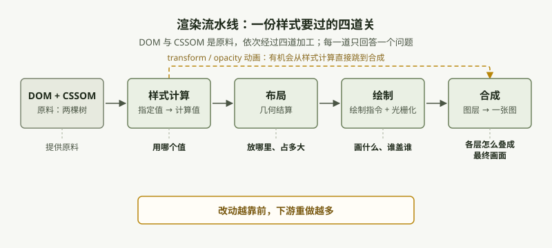

# 01 · 从规则到像素

> **前置**：无。
>
> 上一篇：无（起点） ｜ [本阶段目录](README.md)

## 1. 本章目标

- 给一条 `.card { width: 50%; transform: translateX(20px) }`，能说出 Styles、Computed、Layout、Rendering 四个面板分别看到哪一站的结果。
- 给定一次属性改动（`width` / `color` / `transform`），能判断流水线被砍到哪一站，并预测 `getBoundingClientRect()` 会不会变。
- 能解释 `transform` 动画为什么有机会只走合成，而 `width` 动画每帧都要重排加重绘。
- 能说出一个百分比在流水线哪一站变成具体像素，以及为什么 Computed 面板里看不到 `50%`。

**为什么现在学这个**：第 02–04 篇都在回答"一条声明怎么胜出"，第 05–08 篇回答"胜出的值变成盒子后落在哪、谁盖谁"。先看清整条流水线，才知道后面每一章装在哪一格。

## 2. 新增模型

先看一条最常见的规则：

```css
.card {
  width: 50%;
  transform: translateX(20px);
  color: #16794a;
}
```

你在四个面板里看到四张完全不同的脸：Styles 里是字面量 `width: 50%`，Computed 里是结算后的 `320px`，Layout 里是一个 320px 宽、带明确坐标的盒子，Rendering 里打开图层边界后 `.card` 若已提升为层会自己框出一层。同一条声明，四处不同貌。

更别扭的是三种改动：把 `width` 从 `200px` 改成 `240px`，`getBoundingClientRect().width` 跟着变；把 `color` 改成红色，几何一个数字不动，画面却变了；加 `transform: translateX(20px)`，`left` 变大、画面位移，但内容并没有重新画。浏览器为这三种改动走的路根本不是同一条。

**模型：从 CSS 到像素是一条四站流水线——样式计算定"用哪个值"，布局定"放哪、占多大"，绘制定"画什么、谁盖谁"，合成定"各层怎么叠"；每一站只回答一个问题，改动的属性决定从哪一站重做。**



*图 1-1 · 渲染流水线：一份样式要过的四道关*

DOM 与 CSSOM 是两种原料，依次经过样式计算、布局、绘制、合成四道加工，每道关下方标着它回答的问题：用哪个值、放哪里占多大、画什么谁盖谁、各层怎么叠成最终画面。顶部那条金色虚线从样式计算直接跨到合成，标注"transform / opacity 动画有机会跳过中间两站"；底部一句提醒：改动越靠前，下游重做越多。

**这张图的一句话结论：四站各答一个问题，只有 transform / opacity 动画能走虚线直达合成，其余改动都得按序重做。**

术语落地：

- **样式计算**：把 DOM 里的元素和 CSSOM 里的规则配对，跑完层叠（详见第 03 篇）后算出每个属性最终用的值。
- **布局**：把计算值换算成几何坐标和盒子尺寸，也叫重排。
- **绘制**：产出"在这个矩形填什么色、在这条基线画哪段字"的指令，并把它光栅化成像素。
- **合成**：把若干已经画好的图层按层叠顺序叠成一张图交给屏幕，通常由 GPU 完成。

四站之所以要分开，不是为了让流程显得复杂，而是因为一次改动只需重做从它那一站往后的部分。把"动值、动几何、动外观、动图层"分开，你手里就有了一把尺子：越靠前的改动，被推翻的下游越多；越靠后的改动，代价越小。

## 3. 可运行的 demo

[打开 demo：改一条声明，看四道关哪道被触发](../../examples/minimal/01-computed.html)

<iframe class="demo-frame" src="/css-concept-course/examples/minimal/01-computed.html" title="改一条声明，看四道关哪道被触发" loading="lazy"></iframe>

> **先预测**：demo 里的开关控制"是否启用后写的冲突声明 `width: 240px`"。把开关从关拨到开，盒子的宽从 `200px` 变成 `240px`，Styles、Computed、Layout 三栏的读数各会显示什么？写下三栏各自的数字再揭晓。
>
> **验证**：打开 demo 拨动开关，用页面显示的 Styles / Computed / Layout 三栏读数核对。盒子没有 padding 和 border，所以 Computed 与 Layout 两栏都是 `240px`，但它们属于不同阶段；Styles 那栏显示的是你写下的字面量。

把开头那三种改动也带进 demo 一起看：改 `width` 会让 Computed 与 Layout 两栏同时跳数；改 `color` 时 Computed 栏变了、Layout 栏的几何纹丝不动；加 `transform` 时 Computed 栏的 `width` 不变，但元素的视觉位置偏移。三栏的变化组合本身就是"改动落在哪一站"的指纹。

demo 的意图不是让你背"哪条声明触发哪站"，而是建立动作：看到一次改动，先问它动的是值、几何、外观还是图层位置，就知道流水线会被砍到哪一格。

## 4. 原理与规则

### 4.1 样式计算：百分比在这一站落地

输入是 DOM（元素组成的树）和 CSSOM（规则组成的树）。浏览器把它们匹配起来，对每个元素的每个属性选出胜出声明，得到**指定值**；再处理继承、单位换算和百分比解析，得到**计算值**。

为什么 `width: 50%` 在 Computed 里是 `320px`？因为父元素 content box 宽 `640px`，百分比本身不是长度，必须乘这个参照宽度才落地；参照盒由包含块规则决定（详见第 06 篇）。Computed 停在最末一格，所以那里永远是带单位的具体值，看不到 `50%`。

值的推进是一条短链：声明 `width: 50%` 经层叠胜出成为指定值 `width: 50%`，再经百分比解析成为计算值 `width: 320px`。`font-size: 1.5em`、`color: currentColor` 也都在这一站结算，不会拖到绘制才补。

为什么继承也要在这里解决？因为 `currentColor` 要等继承链确定后才知道自己是什么颜色；父元素写了 `1.2em`，子元素拿到的是换算后的像素。等走到布局时，每个属性的值都已经是一份没有歧义的数字或关键字，否则后面的几何结算无从下手。

**失效条件**：若百分比落在尺寸尚未确定的轴上——例如普通流中父元素高度为 `auto` 时的 `height: 50%`——它不会在样式计算里变成 px，而是按 `auto` 处理；"有参照盒"和"参照尺寸已确定"是两回事。

### 4.2 布局：几何是一次全局结算

样式计算知道了"多宽"，布局回答"放在哪"。浏览器按正常流、flex、grid 等规则把计算值换算成实际几何：位置坐标、宽高、margin 是否折叠、文字换行后的真实高度。

为什么这一步必须单独存在？因为一个元素的尺寸和位置常常取决于兄弟和父级。上下相邻两块，上面的 `margin-bottom: 30px`、下面的 `margin-top: 20px`，最终间距是 `30px` 而不是 `50px`——垂直 margin 折叠取较大者（详见第 05 篇）。这个结论只有把两个盒子摆在一起才得得出，单独结算谁都算不出来。

flex 容器分配剩余空间是同一类全局结算：`flex: 1` 这一项最终分到多少，取决于兄弟的基准宽度和容器剩余空间，必须等所有项目凑齐才能算。文字换行撑高容器同理——单行高度来自字体度量，总高度却取决于内容在哪断行。

`getBoundingClientRect()` 读的就是布局结果。改 `width`、`font-size`、增删 DOM 节点都会推翻重算，这就是**重排**。

**失效条件**：绝对定位元素脱离正常流后，它的尺寸不再由兄弟的折叠决定，而由包含块决定（详见第 06 篇）；此时把相邻 margin 相加或套用折叠直觉都会失效。

### 4.3 绘制：先有指令，再有像素

布局定下几何，但还没决定一个像素的颜色。绘制阶段把每个盒子拆成一串绘制指令：先背景、再边框、再文字、再阴影，并按层叠顺序排好队（谁在下、谁盖住谁，详见第 08 篇）。

为什么绘制要和布局分开？把 `color` 从黑改红，盒子位置尺寸分毫不动，没必要重算布局，只需重新发出绘制指令。`box-shadow`、`border-radius`、`background` 这类属性也都落在这一步。

绘制指令不是像素本身，而是配方；把配方变成真正的像素网格叫**光栅化**，通常也在这站完成。所以改颜色虽然不用重排，仍要把那一块重新光栅化一遍——跳过布局不等于免费。

为什么绘制顺序也要单独结算？因为两个定位元素谁盖住谁，取决于它们在层叠序列里的位置，而不是 HTML 里的先后。把阴影、边框、文字拆成有序指令，而不是"一个元素一张图"，浏览器才能正确处理交叉与遮挡。

**失效条件**：只有当改动落在已提升为独立图层的 `transform` / `opacity` 上，绘制才真正被跳过；改 `z-index` 不重排也不改几何，却会重画叠放顺序，仍要付出绘制代价。

### 4.4 合成：图层叠成一张图

浏览器把画面切成若干**图层**，分别光栅化成纹理，再由合成线程按层叠顺序拼成最终图像。合成由 GPU 承担，是四站里最便宜的一站。

为什么要有图层？分层之后，某些层可以独立平移、缩放、改透明度，而不碰其他层的内容——这正是顶部虚线的物理基础。让元素自己成层的常见手段是运行中的 `transform` / `opacity` 动画、`position: fixed` 或 `will-change`。合成线程独立于主线程：主线程忙着布局、绘制时，合成线程仍能把已做好的图层平滑位移。

图层不是越多越好：每层都占一份显存，层数过多反而拖慢合成；浏览器只在确有需要时提升图层，不会因为写了 `transform` 就给每个元素单开一层。

| 面板 | 你看到的东西 | 所处阶段 | 为什么停在这一格 |
| --- | --- | --- | --- |
| Styles | 命中的规则、字面量、被划掉的声明 | 样式计算的输入 | 展示候选声明，层叠还没跑完 |
| Computed | 每个属性的最终值（`320px`、`rgb(...)`） | 样式计算的输出 | 百分比、em 已换算，继承值已填入 |
| Layout | 盒子的位置、宽高、margin、padding | 布局 | 几何结算完成，还没决定颜色 |
| Rendering | 闪烁的绘制区域、图层边界 | 绘制 + 合成 | 这两站的产物不是属性值，只能用可视化标出 |

**失效条件**：图里那条虚线是"机会"不是"保证"——`transform: scale` 放大到超出原纹理分辨率、元素带 `filter` 或混合模式、或压根没被单独分层时，浏览器仍会重新绘制。

## 5. 常见坑

**坑 1：改了 `color` 就以为触发了重排**

- **原因**：把"画面变了"等同于"几何变了"。颜色属于绘制站的输入，布局结果没变。
- **确认**：改色前后各读一次 `getBoundingClientRect()`，返回同样的 `left / top / width / height`。
- **修法**：用 Rendering 面板的 Paint flashing 看哪块重画，而不是盯着 Layout 面板找不存在的尺寸变化。

**坑 2：`transform` 动画"永远不重绘"**

- **原因**：把虚线当成了承诺。只有已提升为独立图层、且只是平移/旋转/整体透明度变化、内容无需重新光栅化时才成立。
- **确认**：开 Layer borders 看元素是否自成一层，再开 Paint flashing 看动画期间是否闪绿。
- **修法**：需要稳定走合成时，给元素加 `will-change: transform` 提前分层；代价是每层常驻显存。

**坑 3：把 Computed 当成自己写的 CSS**

- **原因**：Computed 是样式计算后的结果，`red` 变 `rgb(255, 0, 0)`、`50%` 变像素、继承值也已填入。
- **确认**：在 Styles 面板看字面量 `50%`，切到 Computed 看 `320px`，两者对照。
- **修法**：调试时明确"我在看输入还是输出"；要核对声明是否命中，看 Styles；要核对浏览器实际用的值，看 Computed。

**坑 4：想在 Rendering 面板里读出某个属性值**

- **原因**：绘制和合成的产物是指令与图层，不是属性值，没法像 `width` 那样列表展示。
- **确认**：打开 Rendering 面板，你看到的是 Paint flashing 的绿块和 Layer borders 的框线，不是键值表。
- **修法**：查值回 Computed 面板，查"哪里重画了"回 Rendering 面板；把四个面板当成四扇观察窗，而不是四份样式副本。

## 6. 练习

1. **基础**：写 `.box { width: 200px; padding: 20px; }`，在 Styles 与 Computed 两面板各读一次 `width`。
   验收：两处都是 `200px`；`getBoundingClientRect().width` 为 `240px`，因为 padding 在布局站额外加价（详见第 05 篇）。

2. **基础**：父元素 content 宽 `640px`，子元素写 `width: 50%` 且无 padding/border。
   验收：`getComputedStyle(el).width` 为 `320px`，`getBoundingClientRect().width` 同为 `320px`，Computed 面板不出现 `50%`。

3. **进阶**：对同一个元素分别改 `width: 200px → 240px`、`color: black → red`、`transform: translateX(20px)`，记录每次的 rect 与画面。
   验收：第一次 `rect.width` 从 `200` 变 `240`；第二次 rect 六个数字全不变、computed color 变 `rgb(255, 0, 0)`；第三次 `rect.left` 增加 `20px`、computed width 不变。

4. **进阶**：给元素做 `transform: translateX(100px)` 和 `width: 240px` 两场 `0.3s` 动画，分别打开 Rendering 的 Paint flashing。
   验收：前者起止帧各闪一次、动画进行中不闪，后者整片区域每帧反复闪绿。

5. **挑战**：给元素加 `will-change: transform` 后再跑 transform 动画，打开 Layer borders，然后移除 `will-change` 重做一次。
   验收：加上时 Layer borders 显示该元素自成一层；移除后若边框消失且动画期间 Paint flashing 闪绿，说明合成只是机会；若仍成层且不闪绿，说明浏览器因运行中的 transform 动画自行提升了图层。两种结果都证明虚线不是保证。

6. **挑战**：父元素 content 宽 `640px`，子元素 `width: 50%`；先读 Computed 与 Layout，再给父元素加 `padding: 20px`（content-box 下），重新读一次。
   验收：加 padding 前后子元素计算值都是 `320px`（参照 content box 不变），但 `getBoundingClientRect().left` 从父内容左沿起算、被推开 `20px`——说明样式计算定的是值，布局才定原点。

> 下一篇：[精准找到元素](02-selectors.md)
