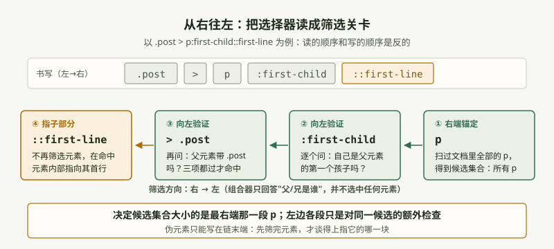

# 02 · 精准找到元素

> **前置**：知道 DOM 是元素组成的树，CSS 规则在样式计算这一站与元素匹配（详见第 01 篇）；不需要层叠结论，那是第 03 篇的事。
>
> 上一篇：[从规则到像素](01-pipeline.md) ｜ [本阶段目录](README.md)

## 1. 本章目标

- 给一条陌生选择器，能从最右端锚点开始逐段说出候选集合怎么缩小，并指出最终命中几个元素。
- 能说清组合器、伪类、伪元素各自负责"筛元素"还是"指子部分"，不把它们混用。
- 能预测 `:is()` / `:where()` / `:has()` 对命中集合和优先级位的影响，并解释 `:where()` 为什么适合写默认样式。
- 能解释 `p:first-child` 为什么是"身为首孩子的 p"，而不是"p 的第一个孩子"。

**为什么现在学这个**：第 01 篇把样式计算定位成流水线第一站；这一站的第一步就是"谁命中"。命中集合算错了，后面层叠算得再准也是在对错误的元素求值。

## 2. 新增模型

先看这段结构：

```html
<article class="post">
  <p class="lead">开场段</p>
  <p>正文段</p>
  <blockquote><p>引用里的段落</p></blockquote>
</article>
```

配一条规则：

```css
.post > p:first-child::first-line { font-weight: 700; }
```

你以为浏览器先找到 `.post`，从它的子元素里取出第一个 `p`，再把首行加粗。实际它先扫过文档里全部的 `p`，逐个问三件事："自己是 `p` 吗？是父元素的第一个孩子吗？父元素带 `.post` 吗？"三项都过，才轮到 `::first-line` 指向这个段落的首行。

把 `.post > p` 改成 `.post p`，嵌在 `<blockquote>` 里的那个 `p` 会突然被命中——因为组合器从"子"放宽成了"后代"，而决定候选集合的仍是最右端的 `p`。

**模型：选择器是一条从右往左执行的筛选程序——最右端圈出候选集合，往左每一段只对同一个候选追加一道检查；伪元素不参与筛选，只在命中元素内部指一块子区域。**



*图 2-1 · 从右往左：把选择器读成筛选关卡*

图把 `.post > p:first-child::first-line` 拆成四关，顺序从右往左：①右端 `p` 扫过文档里全部 `p`，得到候选集合；②`:first-child` 逐个问"自己是父元素的第一个孩子吗"；③`> .post` 再问"父元素带 `.post` 吗"；④`::first-line` 不再筛选元素，只在命中元素内部指向首行。书写顺序是从左到右，筛选方向却是从右到左。

**这张图的一句话结论：决定候选集合大小的是最右端那一段，组合器只回答"父/兄是谁"，并不选中任何元素。**

术语落地：

- **候选集合**：右端基础选择器先按元素自身特征圈出来的一批元素，后面所有检查都只在这批元素上做。
- **组合器**：空格（后代）、`>`（子）、`+`（相邻兄弟）、`~`（通用兄弟），表达 DOM 树上的关系。
- **伪类**：`:hover`、`:nth-child()` 这类附加检查，回答"这个元素处于什么状态、排在结构第几位"。
- **伪元素**：`::before`、`::first-line` 这类由 CSS 生成的子部分，不是 DOM 节点。

## 3. 可运行的 demo

[打开 demo：把选择器拆成筛选关卡](../../examples/minimal/02-selectors.html)

<iframe class="demo-frame" src="/css-concept-course/examples/minimal/02-selectors.html" title="把选择器拆成筛选关卡" loading="lazy"></iframe>

> **先预测**：把选择器输入成 `.list li:has(span)`，哪一项会被高亮？这条链里右端锚点是谁，左边两段各在问什么？把答案写成一句话再揭晓。
>
> **验证**：打开 demo，用页面显示的"右端锚点候选数 / 实际命中数量 / 命中项序号"三栏读数核对；再切到 `.list li:nth-child(2n)`，看"再筛"这一步怎样按所有兄弟从 1 计数。

demo 的重点不是记住哪条规则命中哪个段落，而是每次改完选择器，你都能指着页面说：**右端锚点是谁，哪几段在往左验证，哪一步淘汰了谁。**

## 4. 原理与规则

### 4.1 右端锚定元素，基础选择器只问"它是什么"

右端可以是标签 `p`、类 `.card`、ID `#app`、属性 `[aria-expanded="true"]` 或通用选择器 `*`。它们描述元素自身特征，不涉及位置。

```css
.button[aria-expanded="true"] { background: #dff2b7; }
button:focus-visible { outline: 3px solid #8262d7; }
```

把状态伪类写在右端，能先用最小的集合淘汰绝大多数元素——这是从右往左的实际收益。想缩小 `.nav .item .title` 的命中范围，改右端的 `.title` 比加长左端有效得多。

逗号分隔的列表是另一回事：`.a, .b` 表示"命中 `.a` 或命中 `.b`"，两条规则共用一组声明，而不是两个元素之间的关系。

**失效条件**：右端写成 `*` 时候选集合是整棵 DOM，往左每段都要对大量元素检查；若整条链只有 `*`，它命中所有元素，包括你并不打算改动的第三方组件。

### 4.2 组合器表达 DOM 关系，不是视觉邻近

| 写法 | 关系 | 命中条件 |
| --- | --- | --- |
| `.card p` | 后代 | `p` 是 `.card` 任意层级的后代 |
| `.card > p` | 子 | `p` 的父元素正好是 `.card` |
| `h2 + p` | 相邻兄弟 | `p` 紧跟在 `h2` 后，同一父元素 |
| `h2 ~ p` | 通用兄弟 | `p` 在 `h2` 之后，同一父元素，中间可隔兄弟 |

```html
<h2>标题</h2>
<p class="a">紧邻段</p>
<p class="b">隔了一个兄弟的段</p>
```

上例里 `h2 + p` 只命中 `.a`，`h2 ~ p` 命中 `.a` 和 `.b`。两个兄弟组合器都只向后看：写 `p + h2` 选的是"紧跟在 `p` 后面的 `h2`"，方向反了就选不中上例的标题。

为什么 `>` 能减少样式泄漏？它把匹配锁在一层以内，内层组件再嵌套 `p` 时不会被外层规则误伤。内容结构稳定时 `.card p` 更直接，不必走到"永远只用 `>`"的极端。

**失效条件**：`+` / `~` 要求同一父元素，DOM 里中间插一层包装就选不中；屏幕上上下紧邻不等于兄弟，布局视觉不能当成 DOM 结构来读。

### 4.3 伪类筛元素，伪元素指元素的子部分

伪类回答"这个元素处于什么状态、位于结构的第几位"：`:hover`、`:focus-visible`、`:checked`、`:nth-child(2n)`、`:not(.active)`。它们不更换候选元素，只给同一个候选增加一道检查。

```css
li:nth-child(2n) { background: #f0ede5; }   /* 按所有兄弟计数 */
li:nth-of-type(2n) { font-weight: 600; }    /* 只数同类兄弟 */
.notice::before { content: "提示"; }
```

`:nth-child()` 从 1 开始、按**所有**兄弟计数，`2n` 是偶数项；列表里混排了别的标签时，它与 `:nth-of-type(2n)` 的命中集合会分开。伪元素回答"元素内部的哪一块"：`::first-line`、`::first-letter`、`::before`、`::after`、`::selection`。它们由 CSS 生成，JS 取不到 `::before` 的内容，也不是事件目标。

为什么必须分清两类？伪类可以出现在选择器链的任何位置参与筛选；伪元素只能跟在链的末端，因为先筛完元素，才谈得上指它的哪一块。

**失效条件**：一条链里不能写两个伪元素，`p::first-line::before` 是无效写法；`::first-line` 指向当前行盒里的那一段，容器宽度一变范围跟着变，拿它做固定尺寸的"首字母高亮"视觉稿会错位。

### 4.4 `:is()` / `:where()` / `:has()` 改的是命中集合与优先级位

```css
:is(.card, .panel) h2 { margin-block-start: 0; }    /* 优先级取参数最高项 */
:where(.card, .panel) h2 { margin-block-start: 0; } /* 贡献 0 优先级 */
.field:has(input:invalid) label { color: #a53d2b; }
```

前两者命中集合完全相同，差别只在优先级：`:is()` 取参数中最高的一项，`:where()` 恒为 0。`:has()` 把匹配方向反过来——先拿右端内部的条件 `input:invalid` 定位，再回到外面的 `.field`；它的右端锚点是内部的 `input`，不是外面的 `.field`。

为什么 `:where()` 适合写默认样式？它不增加优先级位，后续任何简单类都能覆盖它，不必靠堆类名或 `!important` 摆脱"默认规则太黏"的困境。优先级在这里只与层叠搭一次桥：这三个函数改变的是命中集合和四元组里的那一位；命中之后谁胜出，按第 03 篇的来源、重要性、层、优先级依次闯关。

**失效条件**：`:where()` 贡献 0，后写的单标签选择器也能盖掉它，别拿它写需要守住的规则；`:has()` 的表达式越复杂越难一眼看出谁被选中，能用一个状态类直接表达时就不要硬塞。

## 5. 常见坑

**坑 1：以为选择器从祖先一步步走到目标**

- **原因**：把书写顺序当成了执行顺序。浏览器从右端锚点圈候选，再往左验证。
- **确认**：写 `.post > p:first-child`，若命中集合里出现引用块内的 `p`，说明你多算了层级。
- **修法**：遇到陌生选择器先从右端拆，逐段问"这一步淘汰谁"；`:has()` 能选父级，正是因为它把内部条件当成了新的右端锚点。

**坑 2：把 `:is()` 与 `:where()` 当纯简写互换**

- **原因**：两者命中集合相同，但优先级不同——前者取参数最高项，后者恒为 0。
- **确认**：写 `:where(.card, .panel) h2 { color: red }` 与 `.card h2 { color: blue }`，看蓝色是否生效。
- **修法**：写基础/默认样式用 `:where()`，需要压住后续覆盖时用 `:is()`；代价是后者抬高优先级位，后续覆盖更难。

**坑 3：给伪元素绑事件**

- **原因**：伪元素不是 DOM 节点，由 CSS 生成，不是事件目标，JS 也取不到它的内容。
- **确认**：给 `::before` 加 `click` 监听，点击该区域不会触发绑定到伪元素的处理器。
- **修法**：给真实元素绑事件，用 `::before` 只做视觉；需要交互就插入真实的 `span` 或 `button`。

## 6. 练习

1. **基础**：用第 2 节的 DOM，写两条选择器分别做到"只命中首段"和"三个 `p` 全命中"。
   验收：`.post > p:first-child` 命中 1 个（开场段），`.post p` 命中 3 个（含引用块里的 `p`）。

2. **基础**：一个列表里混排 `li` 与 `div`，分别用 `li:nth-child(2n)` 和 `li:nth-of-type(2n)` 上色。
   验收：前者按所有兄弟从 1 计数，后者只数 `li`；两者着色项集合不同，混排处至少有一项不一致。

3. **进阶**：写 `:where(.card, .panel) h2 { color: red }` 与 `.card h2 { color: blue }`。
   验收：蓝色生效；前者四元组为 `(0,0,0,1)`，后者为 `(0,0,1,1)`，逐位比较第二位即分胜负。

4. **进阶**：用 demo 的 `.list` 结构，输入 `.list li:has(span)`，记录页面三栏读数。
   验收：右端锚点候选数为 `3`，实际命中数量为 `1`，命中项序号只有第二项。

5. **挑战**：写一条选择器命中"父级是 `.card` 且自身不是 `.lead` 的 `p`"，分别用 `:where(.card)` 和 `.card` 做开头。
   验收：两条选择器命中集合相同（各 1 个），优先级分别为 `(0,0,1,1)` 与 `(0,0,2,1)`；后者多出的一位来自开头的 `.card`，`:where(.card)` 那一份被清零。

> 下一篇：[谁说了算](03-cascade.md)
