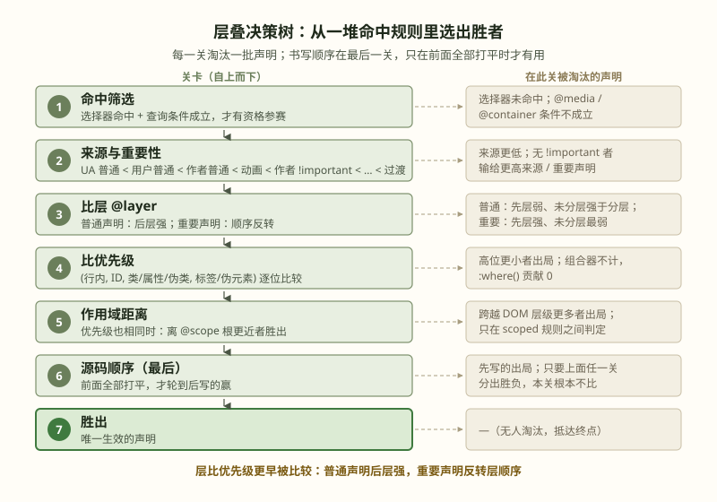

# 03 · 谁说了算

> 一句话模型：层叠不是"后写的覆盖先写的"，而是一串有先后的关卡——**先比来源与重要性，再比层，再比优先级和作用域距离，最后才轮到书写顺序**。

## 先看一个现象

下面两条规则都命中同一个按钮。按"后写覆盖前写"，按钮应该是蓝色：

```css
.button { color: red; }
.button { color: blue; }
```

但如果第一条写在一个 layer 里，第二条写在另一个 layer 里，结果可能反过来：

```css
@layer base, overrides;

@layer base {
  .button { color: red; }
}
@layer overrides {
  .button { color: blue; }
}
```

这时蓝色赢，是因为 `overrides` 层排在后面——即使 `base` 里的选择器写成 `.button.button.button`（优先级更高）也赢不了。**层比优先级更早被比较。**

再换个情况：如果红色那条加了 `!important`，蓝色就输了；而如果蓝色写在未分层的样式里且带 `!important`，又会重新赢回来。这些"反直觉"的结果，都是因为比较顺序在起作用。

## 先建立直觉



*图 3-1 · 层叠决策树：从一堆命中规则里选出胜者*

把"谁生效"想象成一道闯关：每一关淘汰一批声明，只有走到最后的那个胜出。注意"书写顺序"在最后一关，所以它只在前面全部打平时才有用。

图里最关键的一条：**重要性会反转层的顺序**。普通声明是"后层强"，重要声明变成"先层强"。

## 机制拆成五步

### 1. 先筛：哪些声明有资格参赛

选择器必须命中这个元素，媒体查询/容器查询的条件必须成立。没命中的规则根本不进入比较。

这一步常被忽略：你以为在跟某条规则竞争，其实那条规则的 `@media` 条件没成立。

### 2. 比来源与重要性

先分出"谁家的声明"，再分有没有 `!important`。从低到高的顺序是：

| 顺序 | 来源 | 说明 |
| --- | --- | --- |
| 低 | 用户代理普通声明 | 浏览器默认样式 |
| ↓ | 用户普通声明 | 读者自己的浏览器设置 |
| ↓ | 作者普通声明 | 你写的 CSS |
| ↓ | CSS 动画 | `@keyframes` 运行中的值 |
| ↓ | 作者 `!important` | 见下方警告 |
| ↓ | 用户 `!important` | 用户无障碍设置在此 |
| ↓ | 用户代理 `!important` | 极少数浏览器强制样式 |
| 高 | CSS 过渡 | 正在 transition 的属性值最高 |

**为什么这样排？** 动画要盖过普通样式才能动起来，所以高于普通作者声明；但用户用 `!important` 表达的辅助需求（比如强制高对比度文字色）要盖过动画，所以用户重要声明在动画之上；过渡是用户对"当前这帧"的即时期望，所以最高。

由此得到一个实用结论：**不要用 `!important` 去盖用户的无障碍设置**，你盖不住，而且会破坏别人的阅读体验。

### 3. 比层（`@layer`）

同一来源、同一重要性下，先比较层：

- **普通声明**：先声明的层弱，后声明的层强；**未分层样式强于所有分层样式**；行内 `style` 又强于未分层样式。
- **重要声明**：顺序反转——先声明的层强，后声明的层弱，未分层最弱。

```css
@layer reset, base, components;

/* 普通声明：components 最强，reset 最弱 */
/* 重要声明：reset 最强，components 最弱 */
```

**为什么要有层？** 它把"谁应该覆盖谁"从选择器优先级里抽出来，变成一句显式的顺序声明。写 `@layer reset, base, components` 的意思就是：重置规则无论选择器多宽泛都不该压过组件样式，不用靠 `!important` 或堆叠类名来实现。

### 4. 比优先级与作用域距离

前面都打平，才轮到选择器。优先级按四元组记：

```text
(行内, ID, 类/属性/伪类, 标签/伪元素)
```

`.button` 是 `(0,0,1,0)`，`#app .button` 是 `(0,1,1,0)`，`style="..."` 是 `(1,0,0,0)`。逐位比较，前一位大就赢，后面的位不再看。

`*`、`>`、`+` 这些组合器**不贡献优先级**；`:where()` 整个括号贡献 0，`:is()` 取参数中最高的一项。`!important` 不参与优先级计数，它属于第 2 步。

如果优先级也相同、且用了 `@scope`，则**离 scope 根更近的胜出**（跨越的 DOM 层级更少）。这是最后一步之外的补充判定，只在 scoped 规则之间发生。

### 5. 最后才比书写顺序

只有来源、重要性、层、优先级、作用域距离全部相同，后写的才赢。

```css
p { color: red; }
p { color: blue; }   /* 蓝色赢：前面全部打平 */
```

记住这个顺序后，判断风格冲突就有了固定动作：**先看来源和 `!important` → 再看有没有层 → 再看选择器 → 最后才数行数。**

## 动手验证

[打开 demo：三个开关，看胜出声明怎么变](../../examples/minimal/03-cascade.html)

<iframe class="demo-frame" src="/css-concept-course/examples/minimal/03-cascade.html" title="三个开关，看胜出声明怎么变" loading="lazy"></iframe>

> **先预测**：只开启「后写规则」时按钮是什么颜色？再开启「层」呢？最后开启 `!important` 呢？把你的答案写下来，再点揭晓。
>
> **验证**：打开 demo 调节参数，用页面显示的实时读数核对你的预测。

demo 把上面的关卡做成了开关：层、`!important`、书写顺序可以分别开关，页面会显示当前生效的声明和它的获胜理由。重点不是记住红蓝绿，而是**每开一个开关，你都能说出它在第几关起作用**。

## 容易误判的地方

- **"选择器越长越厉害"** → 长度本身不算数，只有四元组里的种类计数才算。十个类选择器 `(0,10,0,0)` 依然输给一个 ID `(0,1,0,0)`。
- **"`!important` 最大"** → 用户 `!important`、浏览器重要声明和过渡都在作者 `!important` 之上；层内的重要声明还会反转层顺序。
- **"未分层样式一定最弱"** → 只对普通声明成立。重要声明里，分层的反而强于未分层的。

## 自己再做一次

1. 写三条命中同一 `p` 的规则：一条在 `reset` 层、一条在 `components` 层、一条未分层，全部普通声明。**预期结果：未分层那条生效**，尽管它写在最前面。
2. 给第 1 题的 `reset` 层规则加 `!important`。**预期结果：它反超未分层规则**，因为重要声明反转层顺序。
3. 写 `#app p { color: red }` 与 `.content .content p { color: blue }`（未分层、无重要声明）。**预期结果：红色**，因为 ID 优先级高于两个类。

> 下一篇：[值从哪里来](04-inheritance.md)
