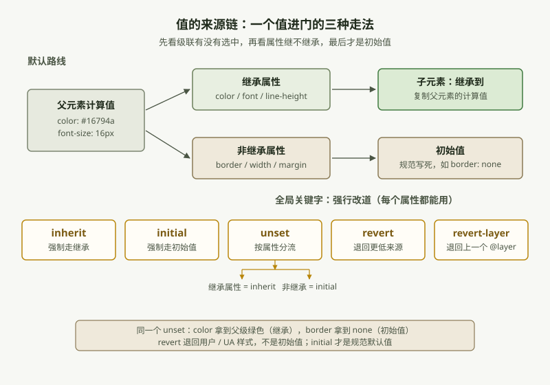

# 04 · 值从哪里来

> **前置**：会用第 03 篇判断一条属性最终由哪条声明胜出（层叠结果）；本篇只处理"胜出之后"和"没选中时"的值。
>
> 上一篇：[谁说了算](03-cascade.md) ｜ [本阶段目录](README.md)

## 1. 本章目标

- 给一个属性，能说出它的指定值来自级联胜出声明、继承、初始值中的哪一个，并写出判断顺序。
- 能预测五个全局关键字在继承属性与非继承属性上的不同结果，解释 `unset` 为什么因属性而异。
- 能解释 `var()` 的回退为什么救不了"定义了但值非法"的自定义属性。
- 能说出 `@property` 让自定义属性可插值必须满足的条件。

**为什么现在学这个**：第 03 篇只选出胜出声明；"没选中怎么办"由本篇回答，而第 05 篇要把这些值变成盒子。一个值取错了，后面算占位、算包含块全是空转。

## 2. 新增模型

先看一组最常见的代码：

```css
.parent { color: #16794a; border: 2px solid #b8860b; }
```

在 `.parent` 里放一个空的 `<span>`，你以为子元素"什么都没写就什么都没有"，实际它显示绿字，边框却一点没有。`color` 顺着父子链传下来了，`border` 没有。

更反直觉的是关键字：

```css
.child-a { color: unset; }   /* 绿色：跟继承走 */
.child-b { border: unset; }  /* none：跟初始值走 */
```

同一个 `unset`，一个表现得像继承、一个表现得像初始值。关键字没有固定含义，它的含义取决于**被用在什么属性上**。

**模型：一个属性的指定值只有三个来源——级联胜出的声明、沿继承链复制的父级计算值、规范写死的初始值；五个全局关键字只是强行改道，并不新增第四个来源。**



*图 4-1 · 值的来源链：一个值进门的三种走法*

图上半段画默认路线：父元素的计算值（`color: #16794a`、`font-size: 16px`）分两路——继承属性（`color / font / line-height`）复制到子元素，非继承属性（`border / width / margin`）取规范初始值（如 `border: none`）。下半段画五个全局关键字作为改道开关：`inherit` 强制继承、`initial` 强制初始值、`unset` 按属性分流、`revert` 退回更低来源、`revert-layer` 退回上一层 `@layer`。

**这张图的一句话结论：先看级联有没有选中，再看属性继不继承，最后才是初始值；同一个 `unset` 因此因属性而异。**

术语落地：

- **指定值**：浏览器在样式计算时给这个属性定下的值，来源只有上面三个。
- **计算值**：指定值经过单位换算、百分比解析后的结果；继承传递的是它，不是父元素写下的字面量。
- **继承属性**：全家应该一致的属性，如文字颜色、字体、字号、行高、对齐方式。
- **初始值**：规范为属性写死的默认值，和浏览器 UA 样式表里的默认样式不是一回事。

## 3. 可运行的 demo

[打开 demo：切换关键字，看值怎么在父子间流动](../../examples/minimal/04-inheritance.html)

<iframe class="demo-frame" src="/css-concept-course/examples/minimal/04-inheritance.html" title="切换关键字，看值怎么在父子间流动" loading="lazy"></iframe>

> **先预测**：父元素设 `color: #16794a`、`border-color: #b8860b`，子元素把 `color` 与 `border-color` 同时设成同一个关键字。四个关键字里，哪一个让子元素的 `border-color` 取到父元素同款琥珀色 `#b8860b`？为什么 `unset` 让文字变回父级绿色，边框却不变琥珀？把两问的答案写下来再揭晓。
>
> **验证**：打开 demo 切换关键字，用页面显示的"父 color / border-color → 子 color (computed) → 子 border-color (computed)"三组读数核对。注意 `border-color` 的初始值是 `currentColor`，不是 `none`——那是 `border` 简写才有的初始值。

demo 把本篇两条主线放在一起：**五个关键字改的是取值路线；自定义属性的回退只看"有没有定义"，不看"定义得对不对"。**

## 4. 原理与规则

### 4.1 指定值只有三个来源

浏览器把"这个属性现在该用什么值"叫指定值。它的来源按顺序只有三个：级联结果（上一关有声明胜出就直接用它）、继承（没有胜出声明且属性继承，取父元素的**计算值**）、初始值（前两个都不成立，取规范定义）。

为什么第 2 步取计算值而不是父元素写的字面量？父元素写 `font-size: 1.2em` 时，子元素继承到的是已经换算好的像素值。继承传递的是结算完的结果，不是原始配方。

哪些属性继承？用一个标准判断：这个属性如果全家不一致会不会很怪。文字颜色、字体、字号、行高、对齐方式、列表样式——一家人应该一致，所以继承；宽度、内外边距、边框、背景、定位——若也继承，每个子元素都会复制父元素的盒子，显然荒唐，所以不继承。

**失效条件**：不继承的属性在没有胜出声明时取初始值，绝不会自动拿到父元素的值；反过来，继承属性即便父元素写的是 `1.2em`，子元素拿到的也是换算后的 `19.2px`（以 16px 为基准），而不是字符串 `1.2em`。

### 4.2 五个全局关键字是改道开关

每个 CSS 属性都能用这五个关键字，它们强迫浏览器走指定路线：

| 关键字 | 走哪条路 | 什么时候用 |
| --- | --- | --- |
| `inherit` | 强制走继承，取父元素计算值 | 给不继承的属性强行统一，如 `border-color: inherit` |
| `initial` | 强制走初始值 | 把属性清回规范默认值 |
| `unset` | 继承属性走 `inherit`，非继承属性走 `initial` | 想"恢复天然状态"，不管它继不继承 |
| `revert` | 回滚到更低来源（用户样式或 UA 样式） | 撤销自己写的样式，露出浏览器默认 |
| `revert-layer` | 回滚到上一个 `@layer`；没有上层则等同 `revert` | 在分层体系里只撤销本层的覆盖 |

`unset` 为什么因属性而异？因为它被定义成"继承属性就继承，不继承就初始"——正是默认来源链的快捷方式。所以 `color: unset` 拿到父级绿色，`border: unset` 拿到初始值 `none`。它不是"清空"，而是"回到没写过声明时的样子"。

`initial` 和 `revert` 最容易混。初始值来自规范，浏览器默认样式来自 UA 样式表，两者不是一回事：

```css
a { color: initial; }   /* 黑色：color 的初始值是 canvastext */
a { color: revert; }    /* 蓝色：露出 UA 样式给链接的默认色 */
```

**失效条件**：`a { color: revert }` 是链接蓝不是黑，因为 `revert` 退到 UA 样式；`revert-layer` 没有更低的层可退时退化为 `revert`，不是原地不动。

### 4.3 自定义属性是继承的 token

自定义属性（以 `--` 开头）有两件事必须先说清：它们默认继承，而且存的是 **token 序列**（一串还没解析的字符），不是解析好的值。浏览器读到 `--size: 20px` 时不校验它是不是长度，只把 `20px` 当字符存着；直到 `var(--size)` 被替换进某个属性，才按那个属性去解析。

为什么这么设计？因为它让自定义属性几乎什么都能存——颜色、长度，甚至一整段 `1px solid red`。代价是浏览器不知道它的类型，动画插值因此失效（下一节补上）。

`var()` 的第二个参数是回退值，但回退只在变量没定义时生效：

```css
.box { --size: 20; width: var(--size, 100px); }
```

这里 `width` **不是** `100px`。因为 `--size` 已经定义了，回退不触发；但 `20` 不是合法长度，声明在计算值时变成 IACVT（computed-value time 无效），`width` 表现得像被设成 `unset`——它不继承，所以取初始值 `auto`。

**失效条件**：回退救不了"定义了但值不对"，只能救"压根没定义"；变量被赋成空值 `--size: ;` 也算已定义（存的是空 token 序列），回退同样不触发，结果仍是 IACVT。

### 4.4 `@property` 让变量可以插值

自定义属性默认是 token 序列，浏览器不知道 `--angle` 是个角度，给它做过渡时只能从起点直接跳到终点，没有中间帧。注册一下就好了：

```css
@property --angle {
  syntax: '<angle>';
  inherits: false;
  initial-value: 0deg;
}
```

注册给变量补上了**类型**，浏览器于是知道怎么在 `10deg` 和 `90deg` 之间插值，动画才平滑。注册时还必须显式写 `inherits`（不再享有"默认继承"），并给出与 `syntax` 匹配的 `initial-value`。

`@property` 在这里只解决一件事：让变量从"一串字符"变成"有类型的值"，从而可插值；更多用法详见第 27 篇。

**失效条件**：像 `<angle>` 这样的语法必须给 `initial-value`；注册后变量不再默认继承，要让它继续沿父子链传递，得显式写 `inherits: true`，否则子元素拿到的是初始值。

## 5. 常见坑

**坑 1：`unset` 等于 `initial`**

- **原因**：只对非继承属性成立；继承属性上 `unset` 等于 `inherit`。
- **确认**：开头两个 `unset` 的结果不同——`color: unset` 是绿色，`border: unset` 是 `none`。
- **修法**：用前先问"这个属性继不继承"；想明确走某条路，直接写 `inherit` 或 `initial`。

**坑 2：`var()` 有回退就万无一失**

- **原因**：回退只在变量未定义时生效；定义了但值非法，回退不触发，属性变成 IACVT，表现得像 `unset`。
- **确认**：写 `.x { --w: 20; width: var(--w, 100px) }`，读 `getComputedStyle(el).width` 得到 `auto` 而不是 `100px`。
- **修法**：把非法定义整行删掉让回退生效，或改用 `@property` 注册类型让浏览器在替换时校验。

**坑 3：`revert` 是清空样式**

- **原因**：它退回的是更低来源（用户 / UA 样式），不是初始值；`a { color: revert }` 是链接蓝，不是黑。
- **确认**：对 `<p>` 和 `<a>` 分别写 `color: revert`，前者黑、后者蓝。
- **修法**：要规范默认值用 `initial`，要露出浏览器默认用 `revert`，两者不要互换。

## 6. 练习

1. **基础**：写 `p { color: initial }` 和 `p { color: revert }` 对比显示，再把元素换成 `<a>`。
   验收：普通 `p` 两者都是黑色；换成 `<a>` 后 `initial` 仍是黑色、`revert` 变回链接蓝。

2. **基础**：写 `.x { --w: 20; width: var(--w, 100px) }`，读 `getComputedStyle(el).width`；再把 `--w: 20` 那行删掉。
   验收：定义非法值时为 `auto`（width 初始值），删掉定义后为 `100px`。

3. **进阶**：父元素写 `font-size: 1.2em`（以根 16px 为基准），子元素不写 `font-size`。
   验收：子元素 `getComputedStyle(el).fontSize` 为 `19.2px`，继承的是父元素换算后的计算值而不是字面量 `1.2em`。

4. **进阶**：用 demo 的父子结构，依次把 `color` 与 `border-color` 设成 `inherit / initial / unset / revert`。
   验收：只有 `inherit` 让 `border-color` 取到 `rgb(184, 134, 11)`；`unset` 下 `color` 回到父级绿、`border-color` 回到 `currentColor`（子元素自己的文字色）。

5. **挑战**：给 `--angle` 做 `0deg → 90deg` 过渡，先不注册，再用 `@property` 注册（`syntax: '<angle>'`）。
   验收：不注册时 computed 角度只有起点和终点两个值（无中间帧）；注册后中间帧连续变化，能读到如 `45deg` 的值。

> 下一篇：[元素到底占多大](05-box-model.md)
