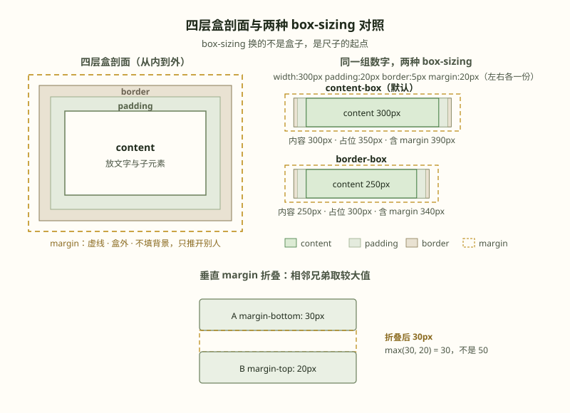

# 05 · 元素到底占多大

> **前置**：会用第 04 篇的"继承 / 初始值 / 指定值"判断一个属性最终取什么值；知道 `width` 是声明，不是结果。
>
> 上一篇：[值从哪里来](04-inheritance.md) ｜ [本阶段目录](README.md)

## 1. 本章目标

- 给定 `width: 300px; padding: 20px; border: 5px`，能分别算出 `content-box` 与 `border-box` 下的**内容宽**和**占位宽**，四个数字一个不错。
- 能解释 `box-sizing` 到底改变了什么、没改变什么。
- 能判断一个 flex 容器为什么被内容撑破，并说出修法。
- 能预测两个相邻块级元素的垂直间距（折叠后取哪个值）。

**为什么现在学这个**：第 04 篇解决了"值从哪来"，但从这一篇开始，值要变成盒子。后面所有的布局章节——包含块（06）、BFC（07）、Flex（15）、Grid（16）——都以"盒子占多大"为计算起点。这一步算错，后面全是空转。

## 2. 新增模型

先看一组最常见的代码：

```css
.box {
  width: 300px;
  padding: 20px;
  border: 5px solid #b8860b;
}
```

你以为它占 `300px`，实际是 `350px`。`padding` 和 `border` 左右各来一份，多出 `40 + 10 = 50px`。

改成 `box-sizing: border-box`，占位变成 `300px`——但真正放内容的宽度只剩 `250px`。

**模型：一个盒子由四层从内到外叠成，`width` 只是"某一层的宽度"，而 `box-sizing` 决定它指的是哪一层。**



*图 5-1 · 四层盒剖面与两种 box-sizing 对照*

左半边是从内到外的剖面：content（装内容）、padding（内容与边框之间的缓冲）、border（边框本身）、margin（盒外、推开别人的透明间距）。右半边用同一组数字并排画两个盒子：content-box 下内容层 300px、总占位 350px；border-box 下总占位锁在 300px、内容层被挤到 250px。两种模式的差别只有一个：`300px` 标在哪一层。

**这张图的一句话结论：`box-sizing` 换的不是盒子，是尺子的起点。**

术语落地：

- **content box**：装文字和子元素的区域。
- **padding box**：content 加上内边距。
- **border box**：再加边框，也就是你眼睛看到的盒子外沿。
- **margin box**：最外层，包含盒外间距。

`width` 描述的是前三个之一，永远不含 margin。

## 3. 可运行的 demo

在往下读原理之前，先动手看一遍现象。带着"为什么 border-box 那栏不动"的疑问读下一节，会比先看规则有效得多。

[打开 demo：调 padding 和 border，实时算占位宽度](../../examples/minimal/05-box-model.html)

<iframe class="demo-frame" src="/css-concept-course/examples/minimal/05-box-model.html" title="调 padding 和 border，实时算占位宽度" loading="lazy"></iframe>

> **先预测**：`width: 300px` 固定，把 padding 从 `0` 调到 `20px`、border 从 `0` 调到 `5px`。content-box 与 border-box 的"内容宽"和"占位宽"分别是多少？先把四组数字写下来再打开。
>
> **验证**：拖动两个滑块，页面会同时显示当前生效的 CSS 和两栏实测读数。用 `getBoundingClientRect().width` 的数值核对你的预测。

如果你发现调滑块时 border-box 那栏的"占位宽"始终钉在 `300px`，说明你已经抓住了这个模型的要害。

## 4. 原理与规则

### 4.1 四层各管什么，margin 为什么在盒外

从内到外，每一层有自己的职责：

- **content**：装文字和子元素，`width` / `height` 默认描述它。
- **padding**：内容与边框之间的缓冲，会填充背景，透明但占位。
- **border**：边框，占据实在的宽度。
- **margin**：盒外间距，不填背景、不放内容，只表达"我和别人隔多远"。

**margin 为什么必须在盒外？** 因为它描述的是**关系**，不是**自身**。两段内容之间的呼吸属于它们之间的空隙，不属于任何一方。把它算进盒子，等于把关系塞进物体，布局和折叠都会乱套（4.3 会看到后果）。

一个自查技巧：背景默认画到 border box 外沿，但绝不铺进 margin。给盒子一个背景色，一眼就能看出盒子到哪为止、哪一段是 margin。

### 4.2 box-sizing 换的是 width 描述哪一层

固定用同一组数字：`width: 300px; padding: 20px; border: 5px`（左右各一份）。

| 量的是什么 | content-box（默认） | border-box |
| --- | --- | --- |
| `width: 300px` 描述的是 | 内容层 = 300px | 内容 + padding + border = 300px |
| 内容实际宽 | 300px | 300 − 2×20 − 2×5 = 250px |
| 盒子占位（不含 margin） | 300 + 40 + 10 = 350px | 300px |
| 加上左右 margin 20px 后 | 390px | 340px |

数字是同一组，只有 `300px` 标在哪一层变了。这就是为什么两种模式看起来像"换了一堆数字"——其实换的是参考点。

**为什么会有两种？** `content-box` 是历史默认：你声明内容多宽，padding 和 border 再额外加价，按栅格算列宽时容易溢出。`border-box` 让"声明多宽就占多宽"，把 padding 和 border 挪到里面消化，更适合按列算尺寸。因此多数项目会设全局默认：

```css
*, *::before, *::after { box-sizing: border-box; }
```

**失效条件**：`border-box` 不会让内容宽也等于 300px——恰恰相反，内容宽被吃掉了。当 padding 与 border 之和超过 `width` 时，内容宽会被压到 0，此时浏览器会让盒子**撑大**以保证内容最小宽度，`border-box` 的"锁宽"就失效了。

### 4.3 垂直 margin 折叠：相邻兄弟取较大值

```css
.a { margin-bottom: 30px; }
.b { margin-top: 20px; }
```

两者间距是 `30px`，不是 `50px`：两个垂直 margin 相遇时折叠成一个，取较大的那个。`max(30, 20) = 30`。

**为什么会折叠？** 因为垂直 margin 表达"两段内容之间至少留多少呼吸"，两个相邻的呼吸叠在一起是浪费。浏览器把它理解成"至少"而不是"累加"，于是取最大值。这正好呼应 4.1：margin 是关系，不是实体，所以它可以重叠。

**失效条件**（这些情况不折叠，间距相加）：
- 水平方向：左右 margin 从不折叠。
- 元素处于 flex 或 grid 容器中：子项之间不折叠。
- 两者之间有边框、内边距、行内内容或建立了 BFC 的边界：折叠被阻断（详见 [第 07 篇](07-bfc.md)）。

### 4.4 min-width: auto 让 flex / grid 子项撑破容器

普通块级元素的 `min-width: auto` 被当作 `0` 使用，所以你能把块压得很窄。flex 和 grid 子项不同：它们的 `auto` 解析为**基于内容的最小尺寸**——内容再挤也不能小于的宽度，比如一个不换行的长单词。

```css
.row  { display: flex; width: 300px; }
.item { flex: 1; }  /* 某一项里是长串不换行文本 */
```

你以为三项均分，实际长文本那项把容器撑破了。原因是 `min-width: auto` 挡住了收缩：`flex: 1` 想把它压到 100px，内容说"我至少要 200px"，auto 选了后者。

**为什么这是默认？** 把内容压到看不清比溢出更糟，这是保护性默认。要让它按你的意愿收缩，得显式解除：

```css
.item { flex: 1; min-width: 0; }
```

`min-width: 0` 把下限改成 0，子项才能真正均分；代价是内容可能被截断，需要配合 `overflow` 或省略号。

grid 踩的是同一个坑：`repeat(3, 1fr)` 遇到长内容时那列会突破均分，解法是 `repeat(3, minmax(0, 1fr))`，本质同样是把下限从 `auto` 改成 `0`。

## 5. 常见坑

**坑 1：三列各写 `width: 33.33%`，加了 padding 就换行**

- **原因**：`content-box` 下 padding 在 `width` 之外额外加价，三列实际总宽超过 100%。
- **确认**：DevTools 里逐列看 `getBoundingClientRect().width`，若大于 `33.33%` 的换算值，就是这个问题。
- **修法**：全局 `box-sizing: border-box`，或改用 `flex: 1` / `grid` 让浏览器分配。

**坑 2：都写了 `flex: 1`，含长 URL 的卡片明显更宽**

- **原因**：`min-width: auto` 解析为内容最小尺寸，长单词把下限顶高，`flex: 1` 压不下去。
- **确认**：给子项临时加 `outline`，看它是否被内容撑开而非按份额分配。
- **修法**：子项加 `min-width: 0`，文本配 `overflow-wrap: anywhere`；代价是内容可能被截断。

**坑 3：写了 `margin: 16px`，卡片间距却只有 16px**

- **原因**：上下相邻卡片的 `margin-bottom` 与 `margin-top` 折叠，取较大值 16px，而不是相加得 32px。
- **确认**：DevTools 选中上面那张卡片，Layout 覆盖层会把两个 margin 区域重叠画在同一段空白上。
- **修法**：容器改用 `gap: 16px`（flex/grid 下不折叠），或只加单侧 `margin-block-start`。

## 6. 练习

1. **基础**：写 `.b { width: 300px; padding: 20px; border: 5px solid; }`，先保持默认，再加 `box-sizing: border-box`。
   验收：默认下 `getBoundingClientRect().width` 为 `350px`；加 border-box 后为 `300px`，且用 `clientWidth - padding` 算出的内容宽为 `250px`。

2. **基础**：写两个相邻 div，上 `margin-bottom: 30px`、下 `margin-top: 20px`，量间距；再把它们放进 `display: flex` 的父容器量一次。
   验收：正常流下间距为 `30px`；放进 flex 容器后为 `50px`（不折叠）。

3. **进阶**：用 `display: flex; width: 300px` 的容器装三个 `flex: 1` 子项，其中一项塞入不含空格的长字符串。先观察溢出，再加修复。
   验收：修复前三项宽度不均且容器出现横向溢出（`scrollWidth > clientWidth`）；给子项加 `min-width: 0` 与 `overflow-wrap: anywhere` 后，三项各为 `100px`，溢出消失。

4. **进阶**：写一个 `width: 200px; padding: 0 100px; box-sizing: border-box` 的盒子，观察内容宽。
   验收：padding 总和等于 `width`，内容宽为 `0`；此时若放入一个不可断行的长单词，盒子会被撑到大于 `200px`——这验证了 4.2 里的失效条件。

5. **挑战**：不查资料，预测下面这条规则下盒子的占位宽，然后用浏览器验证。
   ```css
   .x { box-sizing: content-box; width: 50%; padding: 8%; border: 2px solid; margin: 4%; }
   ```
   验收：说明 `width: 50%` 与 `padding: 8%` 的百分比**都**相对包含块宽度解析（padding 的百分比不以自身宽度为基准），并算出在 400px 容器下内容宽 `200px`、占位宽 `200 + 2×32 + 4 = 268px`，含 margin（4% × 400 = 16px，两侧共 32px）为 `300px`。

> 下一篇：[百分比是谁的百分比](06-containing-block.md)
