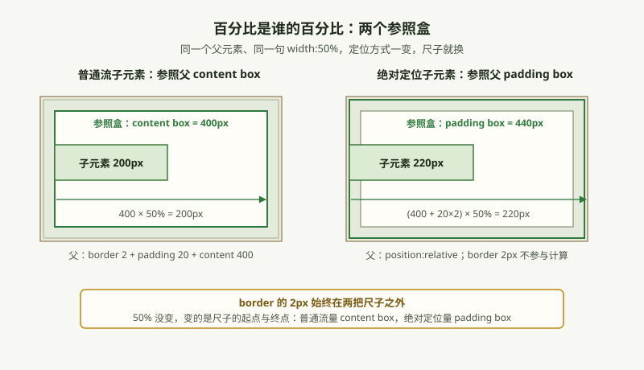

# 06 · 百分比是谁的百分比

> **前置**：会用第 05 篇的四层盒，能区分 content box、padding box、border box，知道 `box-sizing` 决定 `width` 描述哪一层。
>
> 上一篇：[元素到底占多大](05-box-model.md) ｜ [本阶段目录](README.md)

## 1. 本章目标

- 给一个 `width: 50%` 的子元素，能根据定位方式说出它参照哪个盒子，并算出具体像素，误差为 0。
- 能解释为什么普通流是 `200px`、绝对定位是 `220px`，而 border 的 `2px` 两次都不进算式。
- 能判断 `position: fixed` 什么时候不再参照视口，并说出触发条件。
- 能区分"有参照盒"和"参照尺寸已确定"，解释 `height: 50%` 为什么有时按 `auto` 处理。

**为什么现在学这个**：第 05 篇把值变成了盒子，但盒子放在哪、百分比乘谁，取决于包含块。第 07 篇的边界、Flex（详见第 15 篇）与 Grid（详见第 16 篇）的布局都先要定下这把尺子。

## 2. 新增模型

同一个父元素、同一个子元素，只改一句 `position`：

```html
<div class="box">
  <div class="child"></div>
</div>
```

```css
.box {
  width: 400px;          /* 默认 content-box */
  padding: 20px;
  border: 2px solid #888;
}
.child {
  width: 50%;
  height: 40px;
}
/* 情形 A：.child 是普通流子元素 */
/* 情形 B：.box { position: relative } 且 .child { position: absolute } */
```

情形 A 里 `.child` 宽 **200px**，情形 B 里同样一句 `width: 50%` 变成 **220px**。你以为 50% 就是"父元素宽度的一半"，实际父元素的 content box 宽 400px、padding box 宽 440px（400 + 20×2），一半到底是 200 还是 220，取决于浏览器拿哪个盒子当参照。border 那 2px 完全不参与——它已经站在参照盒外面了。

用开发者工具量还能发现更刺眼的细节：情形 B 里子元素左边缘从父元素 padding 外沿开始，情形 A 里从 content box 左边缘开始、被 20px padding 推开。换 `position` 同时换掉了两件事：**量百分比的尺子**和**摆放子元素的原点**。

**模型：`width: 50%` 里的 50% 不是长度，而是待解析的比例；解析前必须先确定参照盒（包含块），定位方式一变，参照盒就换，尺子和原点一起变。**



*图 6-1 · 两个参照盒：content box 与 padding box*

图把同一个父元素画了两遍。左图普通流：50% 的绿色尺子从 content box 左边缘量到右边缘，量的是 400px 的盒子，子元素 200px。右图绝对定位：尺子改从 padding box 边缘量起，padding 被算进画布，同样 50% 量出 440px 的盒子，子元素 220px。两道尺子之外都标着"border 的 2px 始终在外面"。

**这张图的一句话结论：50% 没变，变的是尺子的起点和终点——普通流量 content box，绝对定位量 padding box。**

术语落地：

- **包含块**：浏览器为某个元素临时划定的一块矩形画布，百分比和偏移量都拿它当参照。
- **content box**：装内容的层，普通流子元素的参照盒。
- **padding box**：content 加 padding 的层，绝对定位元素的参照盒。
- **初始包含块**：尺寸等于视口、锚在文档原点的矩形，找不到定位祖先时兜底。

## 3. 可运行的 demo

[打开 demo：切换 position，看 50% 换尺子](../../examples/minimal/06-containing-block.html)

<iframe class="demo-frame" src="/css-concept-course/examples/minimal/06-containing-block.html" title="切换 position，看 50% 换尺子" loading="lazy"></iframe>

> **先预测**：父元素 content 宽 `400px`、padding `20px`、border `2px`。把子元素的复选框从"关（static）"拨到"开（absolute）"后，`width: 50%` 的实际像素从多少变成多少？写下两个数字再揭晓。
>
> **验证**：打开 demo 拨动复选框，用页面显示的"参照盒 / computed width / getBoundingClientRect().width"三栏读数核对；虚线框标出的就是本次用来解析百分比的参照盒。

设计意图不是让你背 200 和 220，而是每切一次都能指着虚线框说出"这次尺子搭在哪一层"。demo 只有一个复选框，padding 和 border 固定不变，所以宽度的数值变化只来自参照盒。

## 4. 原理与规则

### 4.1 百分比必须先找到一个参照盒

百分比是相对值，布局最终要的是绝对长度。浏览器必须在布局阶段把 50% 解析成一个具体的 px 数才能画盒子，这个被拿来乘的数字就来自包含块。

为什么不能"先放着"？因为盒子尺寸、位置、换行都依赖这个数，多个属性会连锁引用它；没有确定的参照，整条布局链都算不下去。所以规范不写"百分比大概是多少"，而是为每种定位方式明确规定一个包含块。

解析是一次性的：包含块一旦定下，50% 立刻被锁成 px 值，后续布局只认这个结果。事后把父元素改宽让子元素跟着变，其实是重新做了一次解析。

**失效条件**：若参照尺寸本身未确定——普通流中父元素高度为 `auto` 时的 `height: 50%`——百分比不会解析成 px，而是按 `auto` 处理；"有参照盒"和"参照尺寸已确定"是两回事。

### 4.2 普通流子元素：参照父元素的 content box

正常流里的块级子元素排在父元素的内容区里，它的包含块就是父元素的 content box，所以 `width: 50%` = 400 × 50% = **200px**。

为什么是 content box？父元素的 padding 是它自己的留白，不是子元素可以占用的地盘；子元素从内容区左上角开始排，自然以内容区为坐标系。

这里有个容易绕晕的细节：本例父元素是默认的 `box-sizing: content-box`，`width: 400px` 描述的就是 content box，加 padding 不会把它从 400 挤小，只会把 padding box 撑到 440。只有父元素写成 `box-sizing: border-box` 时，`width: 400px` 才描述边框外沿，padding 增加才会反过来压缩 content box，普通流子元素的 50% 跟着变小。

**失效条件**：父元素用 `border-box` 时，算式里的 400 不再是 content 宽，必须先减去 padding 和 border 再乘 50%；"加 padding → 子元素变窄还是不变"的差别，根源全在参照盒是谁。

### 4.3 绝对定位子元素：参照最近定位祖先的 padding box

绝对定位元素脱离正常流，不再待在父元素内容区里，而是找一个愿意当坐标系的祖先：最近的 `position` 不为 `static` 的祖先。它的包含块是这个祖先的 **padding box**——注意是 padding box，不是 content box，也不是 border box。

于是算式变成：(400 + 20×2) × 50% = 440 × 50% = **220px**。border 的 2×2px 不属于 padding box，既不进算式，也不决定子元素起点。

为什么只写 `position: relative`、一个 `top/left` 都不给也够？包含块的认定只看 `position` 的值，不看祖先是否真的移动过。祖先原地不动，它的 padding box 已经悄悄成了子元素的坐标系——这是"定位祖先"这个称呼里最容易被误读的地方。

同一把尺子也管偏移：`left: 10%` 参照 padding box 的宽度，`top: 10%` 参照它的高度。包含块就是一个矩形，宽高各取一次即可；这里没有"top 参照宽度"的特殊规则，那种例外出现在百分比 `padding` / `margin` 上——它们一律参照包含块**宽度**，不要混进来。

**失效条件**：一路往上都没有定位祖先时，包含块退化为初始包含块（视口），50% 是视口宽的一半；只写 `z-index` 不能让祖先变成定位祖先，得给非 `static` 的 `position`，或让 transform / filter / contain 等属性接管。

### 4.4 `fixed` 参照视口，但有一道暗门

`position: fixed` 的包含块是视口，所以它不随滚动移动，50% 就是视口宽的一半。为什么是视口？fixed 的语义就是"钉在屏幕上"，当然要用屏幕这块画布做参照。

暗门在于：如果某个祖先带有非 `none` 的 `transform`、`filter`、`perspective`，或 `contain: paint/layout` 等属性，它会悄悄变成 fixed 后代的包含块。这时 fixed 突然开始跟着那个祖先走，50% 也不再是视口的一半——很多"fixed 失效了"的怪事都出自这里。

为什么要留这扇暗门？因为 transform 会创建新的绘制上下文，元素内部的坐标必须相对于变换后的祖先来解释；如果还按视口算，transform 一移动，fixed 子元素就会错位。规范的取舍是：宁可让包含块换人，也要保证变换后的整体自洽。

| 子元素定位 | 参照盒 | 本例数值 |
| --- | --- | --- |
| `static` / `relative`（普通流） | 父元素 content box | 400px → 200px |
| `absolute` | 最近定位祖先的 padding box | 440px → 220px |
| `fixed` | 视口（被 transform 等劫持时改为该祖先 padding box） | 视口宽度的一半 |

**失效条件**：被 transform / filter / contain 劫持后，fixed 虽然是"绝对定位家族"，参照的却是那个祖先的 padding box 而非视口，且会随祖先滚动；此时拿"fixed 永远不动"去推断会翻车。

## 5. 常见坑

**坑 1：50% 就是父元素 `width` 的一半**

- **原因**：父元素 `width` 描述 content box；绝对定位时不拿它算，要拿 padding box。
- **确认**：DevTools 盒子模型高亮里，普通流命中 content 层、绝对定位命中 padding 层；本例两者差 40px。
- **修法**：先判定位方式再选盒子；需要固定参照时，显式设置父元素 `position: relative`。

**坑 2：给子元素加 `box-sizing: border-box` 会改变参照盒**

- **原因**：它只改变子元素自己的 `width` 覆盖哪几层盒，参照盒由定位方式决定，两件事互不相干。
- **确认**：给子元素加 `border-box` 前后，页面"参照盒"一栏读数不变。
- **修法**：把"子元素怎么算自己的宽"和"百分比乘谁"分开处理，别在一个里找另一个的答案。

**坑 3：`height: 50%` 也照这样算**

- **原因**：普通流中父元素高度为 `auto` 时，百分比高度没有确定的参照，会按 `auto` 处理。
- **确认**：父元素不写高度，子元素 `height: 50%`，`getBoundingClientRect().height` 等于内容高度而非父高的一半。
- **修法**：给父元素一个确定高度（如 `height: 200px`）再算；要按视口高度用 `50vh`，别指望百分比。

**坑 4：给祖先加个 `z-index` 就能当定位祖先**

- **原因**：`z-index` 不改变包含块，只影响层叠家族（详见第 08 篇）。
- **确认**：祖先只有 `z-index` 时，绝对定位子元素的 50% 仍参照更上层，读数不变。
- **修法**：要么给祖先一个非 `static` 的 `position`，要么让 transform / filter / contain 等属性接管包含块。

## 6. 练习

1. **基础**：父元素 content 宽 `300px`、padding `10px`、border `1px`，子元素 `position: static; width: 50%`。
   验收：子元素宽 `150px`，参照 content box `300px`；border 的 1px 不出现在算式里。

2. **基础**：保持父元素不变，给父元素加 `position: relative`，子元素改成 `position: absolute; width: 50%`。
   验收：子元素宽 `160px`，参照 padding box = 300 + 10×2 = `320px`；父元素并没有移动，包含块却换了人。

3. **进阶**：在父元素上加 `transform: translateX(0)`，子元素改为 `position: fixed; width: 50%`。
   验收：子元素参照父元素 padding box，宽度仍是 `160px` 且随父元素滚动；移除 `transform` 后变回视口宽度的一半。第 2、3 题数值相同、行为不同，用来确认"尺子"和"原点"是同一件事的两面。

4. **进阶**：在 400px 宽的包含块里给一个元素写 `padding: 10%`。
   验收：`padding` 的上下左右都是 `40px`，因为百分比 padding 一律参照包含块**宽度**，而不是元素自身宽或包含块高度。

5. **挑战**：父元素不写高度（内容自然高），子元素写 `height: 50%`；再给父元素 `height: 200px` 重测。
   验收：前者子元素 `getBoundingClientRect().height` 等于内容自然高度（无内容时为 `0`，百分比按 `auto` 处理），后者为 `100px`——证明"有参照盒"不等于"参照尺寸已确定"。

> 下一篇：[为什么布局会塌](07-bfc.md)
