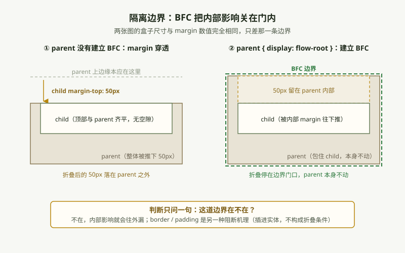

# 07 · 为什么布局会塌

> 一句话模型：BFC（块格式化上下文）不是一串触发条件，而是**一道边界**——它把盒内的竖直 margin 折叠和浮动的影响关在里面，不让它们穿出去改写外面的布局。
>
> 判断时只问一句：这道边界在不在？不在，内部影响就会往外漏。

## 先看一个现象

先是最常见的一种"塌"：

```html
<div class="parent"><p class="child">一段文字</p></div>
```

```css
.parent { background: #e8e3d5; }
.child  { margin-top: 50px; }
```

你以为：子元素与父元素上边缘之间出现 50px 空隙，父元素的米色背景从空隙上方开始。
实际：父元素整体被往下推了 50px，背景的上边缘也跟着下移；父子之间反而没有空隙。

第二种"塌"同样典型：父元素里只放浮动子元素，不给高度。父元素的高度算成 0，背景和边框缩成一条线，浮动的卡片溢出到下面的内容上。

两个现象看起来无关，其实是同一件事：**父元素没有形成一道挡住内部影响的边界**。margin 穿了出去，浮动也跑了出去。

用开发者工具选中父元素，盒子模型高亮会给出线索：第一种情况里 50px 落在父元素的外边距区域；第二种情况里父元素的高度直接显示 0。先看到"影响跑到了哪里"，再去找"为什么没有边界"，顺序不要反。

## 先建立直觉



*图 7-1 · margin 穿透 vs flow-root 隔离*

左图：普通父元素与第一个子元素共用同一个上 margin，50px 被画在父元素之外，父元素被推下去。右图：父元素成为 BFC 后，边界把 margin 拦在内侧，50px 变成父元素内部的一段空白，父元素不再被那段 margin 推下去。两张图的盒子尺寸、margin 数值完全相同，只差那一条边界。

看图时不要去数"这里有几个属性"，只盯住那条边界：**边界之内的 margin 和浮动不能越过它，边界之外的也不能进来。** 剩下的规则都是从这一句推出来的。

## 机制拆成四步

### 1. 竖直 margin 为什么会"穿透"

正常流中，上下相邻的 margin 会折叠：两个 50px 不会叠成 100px，而是合并成一个 50px。父子之间也适用这条规则——如果父元素的上边缘和第一个正常流子元素的上边缘之间，没有 border、没有 padding、也没有行内内容，它们二者的上 margin 就折叠，**并且折叠后的 margin 被放在父元素外面**。

所以例子里父元素没有 `margin-top`，子元素写了 50px，结果不是"子元素在父元素里往下 50px"，而是"这一对盒子整体往下 50px"。所谓穿透，其实是折叠的结果落在了外面。同样的事也发生在底部：最后一个子元素的下 margin 会与父元素的下 margin 折叠，把父元素的底边往下带。

**为什么只在竖直方向？** 水平 margin 从不折叠，这是块布局的既定规则；竖直方向折叠的原始意图是让相邻段落自然取较大的间距，而不是把两个段落的间距相加。理解意图比背结论有用：你看到"该有空隙的地方没有空隙"，先怀疑折叠，再看有没有边界。

### 2. 边界一立，折叠就停在门口

成为 BFC 的元素，它的 margin 不会与内部正常流子元素的 margin 折叠。折叠关系跨不过这道边界，于是子元素的 50px 只能老老实实待在父元素里面，把内容往下推，父元素本身不动。

**为什么 BFC 能阻断？** BFC 是一块独立的布局区域。浏览器计算它的尺寸和位置时，把内部当成另一个世界：内部子元素的 margin 只跟内部发生关系，不与外壳的 margin 合并。边界同时是尺寸的隔离层——内部怎么变，外面对它的定位不受影响。

注意 border 和 padding 是另一种阻断方式：它们不是靠"立边界"，而是靠在父子 margin 之间插进一段实体，让两者不再相邻，从而根本不构成折叠条件。**两种阻断的机理不同，但都表现为" margin 不再穿透"，别把它们记成同一条规则。**

### 3. 立边界的几种方式，代价不一样

下面每条规则**单独**建立 BFC。它们不是可以互换的写法，副作用差别很大，选择时看你能接受什么：

```css
/* 方式一：flow-root —— 专门为建立边界而生，不改变盒的位置、不裁剪内容 */
.parent { display: flow-root; }
```

```css
/* 方式二：overflow 非 visible —— 顺带裁剪溢出内容，可能出现滚动条 */
.parent { overflow: hidden; }
```

```css
/* 方式三：浮动 —— 父元素自己也脱离正常流，会改变它与兄弟元素的关系 */
.parent { float: left; }
```

```css
/* 方式四：绝对定位 —— 同样脱离正常流，参照最近定位祖先 */
.parent { position: absolute; }
```

```css
/* 方式五：contain: layout —— 同时声明内部布局变化不会外溢，优化重排范围 */
.parent { contain: layout; }
```

**为什么不能把这些值堆进同一条规则？** 因为它们建立边界时附带的副作用完全不同：flow-root 只是关起门来；overflow 会裁剪；float 和 absolute 会把父元素自己从正常流里拿走，连带改变父元素与兄弟元素、与后续内容的关系。混着写，出了问题你就分不清是哪个副作用救了你、又是哪个副作用制造了新问题。

实际取舍很简单：想消除"塌"又不想改变别的，`display: flow-root` 是首选；如果本来就打算裁剪溢出，`overflow: hidden` 可以顺手解决；float 和 absolute 只在元素本来就需要脱离文档流时才用。

### 4. 浮动为什么能被"包住"

父元素只含浮动子元素时高度为 0，是因为浮动脱离了正常流，计算父元素高度时不被计入。让父元素成为 BFC 后，规范要求计算它的高度时把**内部的浮动**也纳入，于是高度重新长出来，背景和边框把卡片包住。

**为什么 BFC 必须包含浮动？** BFC 的基本约定是"内外互不干扰"：边界内的浮动不能溢出到边界外影响后面的盒子，边界外的浮动也不能挤进内部。既然不允许溢出，计算边界尺寸时就必须把这些浮动算进去——包住它们是这条约定的必然结果，不是额外补丁。

这也解释了浮动文字环绕：文字所在的 BFC 不会与旁边的浮动重叠，于是自动让出位置，而不是被浮动的背景盖住。

## 动手验证

[打开 demo：一键切换边界，看 margin 和浮动怎么变](../../examples/minimal/07-bfc.html)

<iframe class="demo-frame" src="/css-concept-course/examples/minimal/07-bfc.html" title="一键切换边界，看 margin 和浮动怎么变" loading="lazy"></iframe>

> **先预测**：打开「BFC 开关」后，父元素的位置会下移还是内部出现空隙？父元素里全是浮动子元素时，它的高度会从 0 变成多少？写下答案再揭晓。
>
> **验证**：打开 demo 调节参数，用页面显示的实时读数核对你的预测。

demo 只有一个开关：`display: flow-root` 开或关。页面并排显示两种塌方案例——margin 穿透和浮动高度归零——并实时列出父元素的 `margin-top`、子元素的 `margin-top`、父元素的实际高度。

调参时只动这一个开关：padding、border、浮动方向全部固定。这样任何变化都只能归因于"多了一道边界"，而不是某个尺寸的改动。里面有一行状态文本明确写出父元素当前是否建立了 BFC。

如果开关前后父元素的 `margin-top` 数值没变、变化的是"空隙画在哪里"，你就算真的读懂了折叠；如果只盯着父元素的位置，很容易误以为 flow-root 改了 margin 的值。

## 容易误判的地方

- **"`overflow: hidden` 只是把超出的内容剪掉"** → 它还建立了 BFC，会顺手阻断 margin 折叠、包住浮动。很多时候" margin 突然正常了"其实是它在起作用。
- **"BFC 是某个属性"** → 它是布局区域；属性只是入口。判断标准是"这里有没有一道边界"，不是"我有没有写某个特定声明"。
- **"所有相邻 margin 都会折叠"** → 只有正常流中的竖直 margin；被 border/padding 隔开、跨 BFC 边界、或涉及浮动与绝对定位盒时不折叠。
- **"包住浮动还得写 clearfix 空元素"** → 那是 BFC 普及前的老办法。让父元素成为 BFC 即可；空元素只是人为造一个能创建边界的盒子，不如 `display: flow-root` 直接说明意图。

## 自己再做一次

1. 父元素无 padding/border，子元素 `margin-top: 40px`。给父元素加 `padding-top: 1px`。**预期结果：父元素不再下移，40px 变成父元素内部的空白**，因为 margin 之间被 padding 隔开，折叠条件消失。
2. 回到第 1 题的初始状态（无 padding，父元素被子元素的 40px 推下去），改为给父元素 `display: flow-root`。**预期结果：父元素上移 40px，40px 变成父元素内部的空白**；这说明 flow-root 不是"清掉 margin"，而是改变折叠发生在哪一侧。
3. 父元素只含两个 `float: left` 子元素，不给高度，先记录父元素高度为 0；再给父元素 `display: flow-root`。**预期结果：父元素高度变为子元素的高度之和（同一行时取最高那个）**，背景和边框重新包住卡片。

> 下一篇：[谁盖住谁](08-stacking-context.md)
