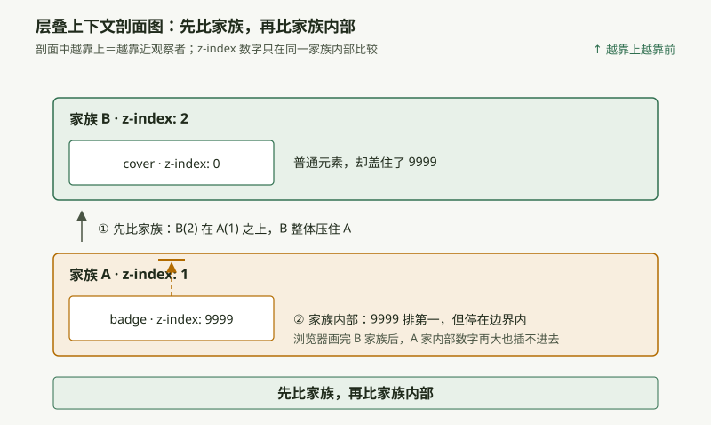

# 08 · 谁盖住谁

> 一句话模型：层叠上下文是一个"家族"。浏览器**先比较家族在整个页面里的层级，再比较家族内部的排位**；`z-index: 9999` 只在自己家族里排第一，出了家族没人认。
>
> 看见 z-index 先别比数字，先问一句：它们俩在同一个家族里吗？

## 先看一个现象

一个弹层徽标，一个盖住它的遮罩：

```html
<div class="a"><span class="badge">9999</span></div>
<div class="b"><span class="cover">0</span></div>
```

```css
.a { position: relative; z-index: 1; }
.b { position: relative; z-index: 2; }
.a .badge { position: absolute; z-index: 9999; }
.b .cover { position: absolute; z-index: 0; }
```

你以为：9999 是全页面最大的数字，徽标一定浮在最上面。
实际：`.cover` 盖在 `.badge` 上面，哪怕它只写了 `z-index: 0`。

原因不在数字大小，而在比较的层级：`.badge` 属于 `.a` 这个家族，`.cover` 属于 `.b` 这个家族。浏览器在比较两者之前，先比较了 `.a`（1）和 `.b`（2）——家族 A 整体排在家族 B 下面，A 家内部再大的数字也翻不过来。

在开发者工具里逐个元素悬停，会看到 `.badge` 的 9999 确实生效了：它在 A 家内部排第一。问题从来不是它没生效，而是生效的范围不包括 B 家。

## 先建立直觉



*图 8-1 · 层叠上下文剖面图：先分层家族，再分家族内部*

图从页面表面往下剖开，每一层是一个层叠上下文（家族）。大的家族在剖面上占更靠前的位置；家族内部再按自己的 z-index 排出前后。注意图中"家族之间"的箭头只比较家族本身，不比较内部的数字；9999 停留在自己家族的格子里，不可能伸到上一层去。

看图时的关键动作是：**先找元素所在的家族，再找家族在整个剖面里的位置，最后才看家族内部的排位。** 三步里最容易被跳过的是第二步，而 9999 输掉恰恰就输在第二步。

## 机制拆成四步

### 1. z-index 的比较范围只到"同一个家族"

`z-index` 不是全页面统一排序的号码，它只在**同一个层叠上下文内部**有效。跨上下文时，先看各自上下文在父上下文里的排位；排在下面的上下文，内部数字再大也会整体被盖住。

**为什么不能全页面统一比？** 因为绘制是按树递归进行的。浏览器把每个层叠上下文当成一个整体，在父上下文的某个层级上一次性画完，再画下一层。一旦开始画某个家族，家族内部的成员就已经按序排好了，没有机会"插队"到家族之间。这也是为什么调高子元素的 z-index 常常毫无效果——你动的是家族内部的牌子，而输赢在家族那一层就定了。

家族内部的队列大致是：家族根的背景与边框 → 负 z-index 的子家族 → 正常流块级后代 → 浮动 → 行内内容 → `z-index: 0/auto` 的定位后代 → 正数 z-index 的子家族。这条队列解释了两个常见困惑：`z-index: 0` 不是"没层级"，它明确排在正常流之上；负 z-index 也不是消失，只是排在家族内部的靠后位置。

### 2. 哪些情况会造出一个家族

不必背完整清单，抓住最关键的几种即可，它们的共同点是：让这棵子树成为独立的绘制单元。

- **定位元素 + `z-index` 非 `auto`**：最常见。为什么？`z-index` 需要一个上下文才有意义，浏览器就地造一个给它用。
- **`opacity` 小于 1**：为什么？半透明要求先把整棵子树画好，再整体与背景混合；没有独立单元，混合结果就没法定义。
- **`transform` 非 `none`**：为什么？变换后的子树要作为一个整体做几何变换，必须先自成一层。`transform: translateX(0)` 也算数，这是个经典陷阱。
- **`isolation: isolate`**：为什么？它的唯一工作就是明确地说"从这里开始新建一个家族，别受外界混合影响"。
- **flex / grid 的子项设了 `z-index`**（即使 `position: static`）：为什么？这两种布局允许子项不定位就参与层级排序，于是子项自己成了上下文。

下面三种写法单独出现时，各自都能造出一个家族：

```css
.a { opacity: .99; }                 /* 有家族：半透明需要整体混合 */
.a { transform: translateX(0); }     /* 有家族：零位移也算 transform */
.a { isolation: isolate; }           /* 有家族：显式隔离 */
```

`filter`、`will-change` 指定相关属性、`contain: paint` 也走同一条路：**先有独立绘制单元，再有独立层级。** 用这条反推，比死记清单可靠。

反过来，`z-index` 写在 `position: static` 的普通子项上通常不起作用——牌子要发给家族成员才有意义，Flex/Grid 子项是明确的例外。

### 3. 根层叠上下文是所有家族的祖宗

文档根元素 `html` 天然建立**根层叠上下文**，其他所有层叠上下文都挂在它下面。整页"谁在最上"的最终比较，就发生在根上下文这一层。

**为什么必须有根？** 没有最外层容器，绘制顺序就没有起点；浏览器需要一个能把所有家族排成一条队列的地方。这也说明一件事：`z-index` 的作用域是树状的，同一层能比的只有兄弟上下文，堂兄弟之间要先回到共同祖先那一层比。

**为什么强调 `html` 而不是 `body`？** `body` 只是根的一个后代，给它设 `z-index` 还得先让它定位，那只是又造了一个普通家族，并非根层叠上下文。根只有一个，也不需要你显式创建。

### 4. 让 9999 真正生效的三条路

既然比较是"先家族、后内部"，解法也只有三种方向：

```css
/* 路子一：抬高它所在的家族 */
.a { position: relative; z-index: 3; }   /* 从 1 改成 3，超过 .b 的 2 */

/* 路子二：把徽标挪出低层级家族，例如直接挂到 body 下 */
.badge { position: fixed; z-index: 9999; }

/* 路子三：取消造出家族的属性 */
.a { opacity: 1; transform: none; isolation: auto; }
```

**为什么只有这三条？** 要么让家族升上去，要么换一个家族，要么让家族不复存在——不存在"让子元素越过家族边界"的第四条路，那等于取消边界本身。

路子三有个前提：得先看清家族到底是谁造的。如果 `.a` 同时有 `position: relative` 和 `z-index: 1`，光把 opacity 改回 1 没用，定位加 z-index 这座家族还在；要把 `z-index` 改回 `auto` 或去掉定位才算真的拆掉。

注意路子二要小心：徽标移出家族后，它的包含块也会变（见上一篇）。层级问题和参照盒问题经常同时出现，改一处要顺手检查另一处。

## 动手验证

[打开 demo：9999 逃不出父级](../../examples/minimal/08-stacking-context.html)

<iframe class="demo-frame" src="/css-concept-course/examples/minimal/08-stacking-context.html" title="9999 逃不出父级" loading="lazy"></iframe>

> **先预测**：把 `.a` 的 `z-index` 从 1 改到 3，9999 会不会赢？只把子元素的 `z-index` 从 9999 再往上加呢？写下答案，再点揭晓。
>
> **验证**：打开 demo 调节参数，用页面显示的实时读数核对你的预测。

demo 只有一个滑块：控制 `.a` 的 `z-index`，范围从 0 到 4。`.b` 固定在 2，两个子元素的 z-index 固定在 9999 和 0。页面实时显示四个数：两个家族的层级、两个子元素的层级，以及当前谁盖住谁。

重点观察：滑块越过 2 的那一刻结果才翻转，而子元素 9999 全程没变。旁边还有一行状态文本点明"本轮比较发生在家族层"，让预测可以被核对。

如果预测的是"再加 9999 就会赢"，滑块会直接证伪：子元素的数字在上下两个格子里都不参与这一轮比较。这比任何口头解释都更有说服力。

## 容易误判的地方

- **"`z-index` 越大越靠上"** → 只在同一层叠上下文内成立。例子里 9999 输给 0，就是因为它和对方不在同一个家族。
- **"`opacity` 只管透明度，不影响层级"** → 小于 1 时会创建层叠上下文；一个本该靠 z-index 赢的元素，可能因为祖先的 `opacity: .99` 被整体压下去。
- **"普通元素写 `z-index` 也有效"** → 对 `position: static` 的普通子项无效（flex/grid 子项是例外）。`z-index` 只是家族内部的牌子，先得有家族。
- **"负 `z-index` 会藏到父元素背景后面"** → 不会。负 z-index 的子家族画在家族根的背景与边框之后、正常流内容之前，所以它在父元素背景之上、在兄弟文字之下。它仍然关在家族内部，逃不出父级的层级。

## 自己再做一次

1. 父元素 A 设 `position: relative; z-index: 1`，子元素设 `z-index: 9999`；兄弟父元素 B 设 `position: relative; z-index: 2`，子元素设 `z-index: 0`。**预期结果：B 的子元素盖住 A 的子元素**，与子元素数字无关。
2. 在第 1 题基础上，把 A 的 `z-index` 改成 3，其余不动。**预期结果：A 的子元素翻到上面**，因为家族 A 现在高于家族 B。
3. 重新用第 1 题的布局，但把 A 的 `z-index` 去掉，改成 `opacity: .99`。**预期结果：B 的子元素仍盖住 A 的子元素**——opacity 同样造出了家族，只是这个家族没有显式的 z-index 牌子；再把 opacity 改回 1，A 不再造出家族，它的子元素带着 9999 直接进入根层叠上下文，于是翻到上面。第 2、3 题结果不同，正好检验你判断的是"家族在不在"，而不是"数字大不大"。

> 下一篇：[文字如何排版](09-typography.md)
