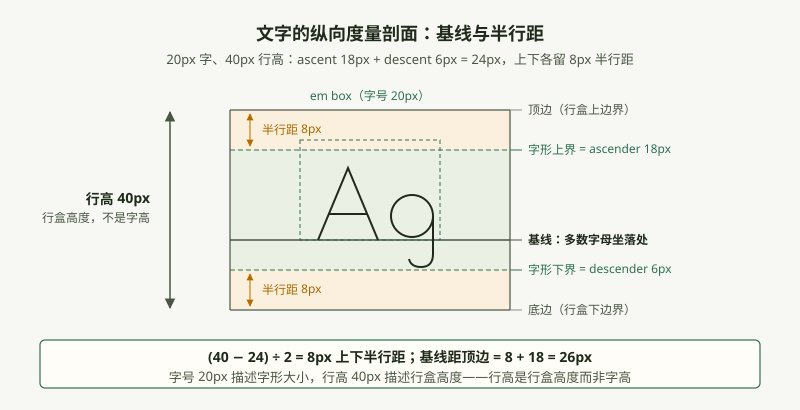

# 09 · 文字如何排成节奏

> **前置**：会用第 04 篇的"继承 / 计算值"判断一个属性最终取什么值；知道 `font-size` 会被继承。
>
> 上一篇：[谁盖住谁](08-stacking-context.md) ｜ [本阶段目录](README.md)

## 1. 本章目标

- 给定 `font-size` 和 `line-height`，能算出父元素与子元素各自的行盒高度，误差为 0。
- 能解释"字号变大、行距没变"由哪一种继承方式造成，并给出修法。
- 能按图 9-1 的数字复算半行距与基线距顶边（20px 字、40px 行高、ascent 18px、descent 6px）。
- 能区分 `text-wrap`、`overflow-wrap`、`text-overflow` 各改哪一环，并写出单行省略号成立的三个条件。

**为什么现在学这个**：前八篇把盒子算清了，但盒子里还没装字。第 10 篇的颜色、第 11 篇的表面都要落在文本上；行盒高度算错，后面所有垂直节奏都会跟着偏。

## 2. 新增模型

一段最常见的正文样式：

```css
.article { font-size: 16px; line-height: 28px; }
.article h2 { font-size: 32px; }
```

你以为标题字号翻倍后行距也跟着放大，实际标题的行高仍是 `28px`——字比行盒还高，两行标题挤在一起。把父级改成 `line-height: 1.75`（28 ÷ 16 = 1.75），基础行高仍是 28px，标题却按 `32 × 1.75 = 56px` 重新算。

**模型：文字是带着度量的盒子——`font-size` 定字形，`line-height` 定行盒高度，而继承方式决定子元素用谁的尺子。**



*图 9-1 · 基线、行高与字体度量的剖面*

这条剖面取 20px 字、40px 行高：字体自带 ascent 18px、descent 6px，合计 24px；行高多出的 `(40 − 24) ÷ 2 = 8px` 平分到上下两侧，成为半行距；基线距顶边就是 `8 + 18 = 26px`。图中的度量是为心算挑的示意值，行盒高度和段落总高则来自实测。

**这张图的一句话结论：`font-size` 描述字形大小，`line-height` 描述行盒高度，两者之差平分到上下成了半行距。**

术语落地：

- **基线**：多数字母坐落的那条线，也是相邻两行对齐的参照。
- **ascent / descent**：字形在基线以上 / 以下的高度，由字体自带，不随行高改变。
- **半行距**：行高减去 ascent+descent 后平分到上下两半的空隙。
- **字体栈**：`font-family` 给出的候选清单，浏览器按序挑选能显示当前字符的字体，可精确到单个字。

## 3. 可运行的 demo

在往下读原理之前，先动手看一遍现象，带着"为什么长度值原样继承、无单位数却重算"的疑问读下一节。

[打开 demo：把固定行高换成无单位数](../../examples/minimal/09-typography.html)

<iframe class="demo-frame" src="/css-concept-course/examples/minimal/09-typography.html" title="把固定行高换成无单位数" loading="lazy"></iframe>

> **先预测**：字号固定 20px，把 `line-height` 从 1.2 调到 1.8，单行行盒高度增加多少像素？两行段落的总高度增加多少？
>
> **验证**：打开 demo 拖动行高滑块，用页面显示的实时读数核对——状态栏同时列出当前 `line-height`、单行行盒高度和两行总高。

demo 只有一个滑块。先算 `20 × 1.2 = 24px` 与 `20 × 1.8 = 36px`，两行分别是 48px 与 72px，再用读数确认。

## 4. 原理与规则

### 4.1 字体栈决定用哪套度量

`font-family` 是一张候选清单，浏览器按序检查字体是否可用、是否包含当前字符；回退可以精确到单个字，一段中文里的某个拉丁字母可能来自清单后面的字体。最后一项必须写 `sans-serif` 之类的通用族，保证前面全部落空时仍有字形；带空格的字体名加引号，通用族名不加。

**为什么设计稿字体不能直接上线？** 它只装在你的电脑上，发布后整段文字会换一套度量：换行位置和元素高度一起变，又回到"字号相同、行距不同"的问题。网络字体还多一层时间维度：`font-display: swap` 让正文先用回退字体显示，字体到达后再替换；替换时字宽若不同，换行跟着变，这是"度量决定排版"的必然结果。

**失效条件**：使用 `font-display: block` 或在慢速连接下，字体替换时刻不可预测；此时不能靠"刚好对齐"的像素微调，要用能容纳两套度量的弹性布局。

### 4.2 继承方式决定子元素用哪把尺子

`font-size` 会继承；`em` 参照父元素字号，`rem` 参照根元素字号（各单位的完整参照物详见第 18 篇），`%` 对 `font-size` 而言也参照父字号。关键在 `line-height` 的写法：

```css
.line  { font-size: 16px; line-height: 28px; }  /* 计算值：原样继承 */
.title { font-size: 32px; }                     /* 行高仍是 28px */

.line  { font-size: 16px; line-height: 1.75; }  /* 数值：子元素拿自身字号相乘 */
.title { font-size: 32px; }                     /* 行高 32 × 1.75 = 56px */
```

无单位数作为**数值**继承，子元素拿自己的字号相乘；`28px` 作为**计算值**继承，子元素直接拿到 28px；百分比走后一条路。`em` 之所以会"复利"，是因为嵌套元素各写 `font-size: 1.2em` 时，第二层的 1.2 倍相对已经放大的第一层。

**失效条件**：子元素自己声明了 `line-height` 时父级继承值被覆盖；父级写 `line-height: normal` 时具体值由字体决定，不能按固定倍数复算。

### 4.3 基线与半行距决定视觉节奏

基线是多数字母坐落的那条线。字体自带的 ascent 与 descent 决定字形上下界，`line-height` 比这个合计多出的部分平分到上下两侧，成为半行距。按图 9-1：`(40 − 24) ÷ 2 = 8px`，基线距顶边 `8 + 18 = 26px`；按 demo 的 20px 字、行高 1.2（24px），半行距 `(24 − 24) ÷ 2 = 0px`，基线距顶边 18px。

**为什么正文推荐无单位行高？** 字号变大时行距按比例放大，不会突然塌陷——这正是第 2 节把 `28px` 换成 `1.75` 的全部意义。需要精确对齐图标或固定高度徽章时才写长度值。`vertical-align` 调整的也是这条基线：行内图片默认把底边压在基线上，文字下方因此留出空隙；想让图标与文字居中，改的是对齐方式，不是去猜那几像素空隙。

行长同样属于节奏：正文每行约 35–65 个拉丁字符，或 20–40 个汉字。行太长，眼睛回到下一行容易串行；行太短，换行过于频繁。字号、行高、行长要一起调，单独优化其中一个没有意义。

**失效条件**：行高小于字体的 ascent+descent 时半行距为负，行盒挤压相邻行；若某个行内盒高度超过 `line-height`，实际行盒由最高的行内盒撑开，设定值不再等于实测高度。

### 4.4 一行装什么：三种"断行"各管一环

`letter-spacing` 改变每个字符占的宽度，`word-spacing` 只作用于词间空格——对没有空格的中文正文影响很小。对齐起点也别写死左右：`text-align: start` 和 `end` 会跟随书写方向，配合同样写逻辑属性，切换书写模式时不必逐条改物理方向。

真正容易混的是三种"断行"，它们作用在一条决策链的不同位置：

| 机制 | 改变的是 | 不改变的是 |
| --- | --- | --- |
| `text-wrap` | 行如何形成：`balance` 均衡标题各行，`pretty` 避免段落末行孤字 | 字符本身的宽度 |
| `overflow-wrap` | 无空格长串在必要时能否断行 | 已经排好的行 |
| `text-overflow` | 在溢出被裁剪处画省略号 | 换行决策与宽度限制 |

`text-overflow: ellipsis` 需要三个条件同时成立：宽度受限、不换行、溢出隐藏。它本身既不设宽度，也不制造溢出。

```css
.single-line {
  max-width: 20ch;
  overflow: hidden;
  white-space: nowrap;
  text-overflow: ellipsis;
}
.long-url { overflow-wrap: anywhere; }
```

`anywhere` 会在必要时断开长 URL，并参与最小内容宽度的计算；`break-word` 更接近旧行为。

**失效条件**：`text-wrap: balance` 针对有限行数，给长正文用会强行拉齐整段行长——段落应使用 `pretty`；截断只影响绘制，DOM 文本依然完整，不能当成内容权限控制。

## 5. 常见坑

**坑 1：父级写了 `line-height: 24px`，两行大标题挤在一起**

- **原因**：固定长度作为计算值原样继承，标题字号接近或超过 24px 时行盒装不下字形。
- **确认**：DevTools 选中标题看 Computed 里的 `line-height`，仍是父级那个长度值。
- **修法**：父级改无单位数（24 ÷ 16 = 1.5），让标题按自身字号重算；代价是行距随字号变大。

**坑 2：`font-size: 2em` 与 `padding: 2em` 算出来不一样**

- **原因**：前者参照父元素字号，后者参照当前元素字号；嵌套时后者还会叠乘。
- **确认**：在 Computed 里展开 `font-size`，看每层实际像素是否等于"父级值 × 2"。
- **修法**：组件尺度想稳定用 `rem`；想让局部间距随文字缩放才用 `em`，并写清参照层级。

**坑 3：写了 `text-overflow: ellipsis`，却什么也没出现**

- **原因**：宽度未受限、未设 `white-space: nowrap` 或溢出未被裁剪，三个条件缺一个都不画省略号。
- **确认**：逐项查 Computed：`overflow` 是否为 hidden/clip、`white-space` 是否为 nowrap、容器是否有确定宽度。
- **修法**：补齐三条件；多行省略要另用 `line-clamp`，且 DOM 文本始终完整。

**坑 4：本地排版正好，上线后段落高度整片变了**

- **原因**：设计稿字体只装在本机，用户端回退到清单后面的字体，度量变了，换行位置与行盒高度一起变。
- **确认**：在 DevTools 的 Fonts 面板看每段文字实际命中的字体，对比本机与设计稿。
- **修法**：把字体栈写完整并以通用族收尾，网络字体用 `font-display: swap` 并预留可容纳两套度量的弹性空间。

## 6. 练习

1. **基础**：写 `.box { font-size: 16px; line-height: 1.5; }`，内部 `h3 { font-size: 24px; }`。
   验收：h3 行高为 36px（24 × 1.5），在 Computed 面板核对，误差为 0。

2. **基础**：把上题父级 `line-height` 改成 `24px` 再测。
   验收：h3 行高仍是 24px，等于其字号，两行字形开始重叠；getComputedStyle 读数为 24px。

3. **进阶**：按图 9-1 的度量（20px 字、ascent 18px、descent 6px），分别计算行高 40px 与行高 1.2（24px）时的半行距与基线距顶边。
   验收：40px 行高时半行距 8px、基线距顶边 26px；24px 行高时半行距 0px、基线距顶边 18px。

4. **进阶**：一段含长 URL 的文本：A 用 `overflow: hidden; white-space: nowrap; text-overflow: ellipsis`，B 用 `overflow-wrap: anywhere` 且允许换行。
   验收：A 显示单行省略号，B 在容器内断成多行且无省略号；DevTools 中两者的文本节点完全一致。

5. **挑战**：`font-size: 20px` 的段落先设 `line-height: 1.2`，再逐步调到 1.8，记录单行行盒高度与两行总高。
   验收：单行从 24px 增到 36px（+12px），两行总高从 48px 增到 72px（+24px），与 demo 读数一致。

> 下一篇：[颜色如何表达](10-color.md)
