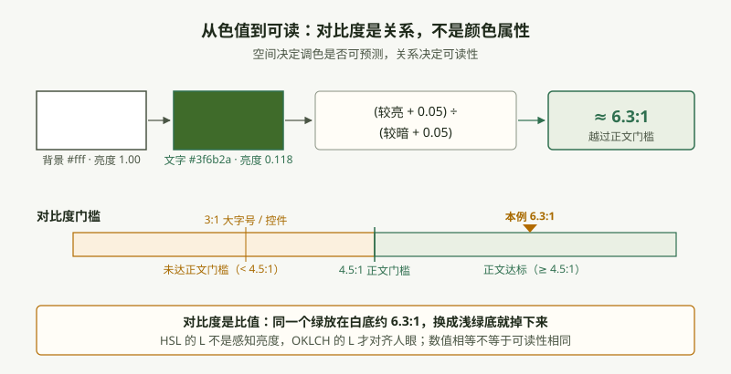

# 10 · 颜色如何表达

> **前置**：会用第 04 篇的"最终生效值"判断一个属性取什么（`currentColor` 取的就是它）；知道第 08 篇的层叠上下文是什么（第 4.4 节讲 `opacity` 时用到）。
>
> 上一篇：[文字如何排成节奏](09-typography.md) ｜ [本阶段目录](README.md)

## 1. 本章目标

- 给定前景色与背景色，能按 `(较亮 + 0.05) ÷ (较暗 + 0.05)` 算出对比度，并判断是否过 4.5:1 / 3:1 门槛。
- 能解释为什么 HSL 里 `L` 相同的两个颜色在白底上对比度不同（本例约 5.1:1 与 10.3:1）。
- 能用 `color-mix()`、`currentColor`、`light-dark()` 把一组颜色写成从种子色派生的关系，而不是写死一串色值。
- 能区分 `opacity: 0.5` 与 `rgb(... / 50%)` 各自影响的对象，并说出前者为什么会创建层叠上下文。

**为什么现在学这个**：第 09 篇把文字占多大算清了，接下来要决定文字和表面画什么颜色。本节的对比度会直接限制第 11 篇的渐变与半透明边框怎么用——好看不等于读得出来。

## 2. 新增模型

两个颜色只换了色相，亮度值一模一样：

```css
.a { color: hsl(105 36% 35%); }
.b { color: hsl(240 36% 35%); }
```

你以为 `lightness` 都是 35%，在白底上应该一样清晰；实际测下来绿那个约 5.1:1，蓝那个约 10.3:1，差了一倍。

**模型：颜色不是一个孤立的色值，而是"某个颜色空间里的坐标 + 与背景的关系"——空间决定你怎么调，关系决定它能不能被读出来。**



*图 10-1 · 从色值到可读：对比度决策图*

图上把白底 `#fff`（相对亮度 1.00）和文字 `#3f6b2a`（相对亮度约 0.118）分别换算成亮度，再取 `(较亮 + 0.05) ÷ (较暗 + 0.05) ≈ 6.3:1`，越过正文 4.5:1 的门槛；图里同时标出 3:1 的大字号 / 控件门槛。

**这张图的一句话结论：对比度是前景与背景亮度的比值，不是颜色自身的属性；背景一换，比值就变。**

术语落地：

- **颜色空间**：描述颜色的坐标系，如 sRGB、HSL、OKLCH；换空间就是换"调亮"的定义。
- **相对亮度**：把颜色按人眼敏感度加权后折算成的 0–1 数值，是对比度计算的输入。
- **对比度**：`(较亮 + 0.05) ÷ (较暗 + 0.05)` 的比值，衡量两个颜色能否互相看清。
- **色域**：一个空间能表达的颜色范围；超出显示设备色域的颜色要被映射，结果需在目标屏幕上确认。

## 3. 可运行的 demo

先亲眼看一下"背景变一点、可读性塌一截"，再读后面的空间与关系规则。

[打开 demo：把文字放到真实背景上算对比度](../../examples/minimal/10-color.html)

<iframe class="demo-frame" src="/css-concept-course/examples/minimal/10-color.html" title="把文字放到真实背景上算对比度" loading="lazy"></iframe>

> **先预测**：背景从纯 `#3f6b2a` 提到与白 50:50 混合（约 `#9fb594`），白字对比度大约变成多少？还过 4.5:1 吗？
>
> **验证**：打开 demo 拖动混合比例滑块，用状态栏显示的当前颜色、对比度数值和达标判定核对你的预测。

demo 只有两个参数：混合比例和插值空间。先在 `srgb` 下把比例从 0 推到 100，对比度会单调下降并跌破 4.5:1；再切到 `oklch` 比较同一比例下的数值。

## 4. 原理与规则

### 4.1 颜色空间：换坐标就是换"调亮"的定义

sRGB 用红、绿、蓝三个通道描述颜色，贴近设备工作方式，但改一个通道不等于"看起来亮了多少"。HSL 换成色相 / 饱和度 / 亮度圆柱，好读，可它的 `L` 是 `(最大值 + 最小值) ÷ 2`，不对应感知亮度——开头的 5.1 与 10.3 就是证据。

OKLCH 把亮度轴对齐人眼感知，从种子色派生状态色时更稳：只要降低 `L`，不同色相上的"变暗"程度相近，不会像 HSL 那样某个色相突然发灰、另一个突然刺眼。

```css
:root {
  --brand: oklch(45% 0.12 142);
  --brand-hover: oklch(40% 0.13 142);
  --brand-subtle: oklch(95% 0.025 142);
}
```

`L` 是感知亮度，`C` 是色度（近似鲜艳程度），`H` 是色相角。`lab()` / `lch()` 同样基于 CIE 的感知模型，`color(display-p3 ...)` 则表达超出 sRGB 的宽色域颜色；它们的区别在坐标系与色域边界，不在"谁更新"。

**失效条件**：OKLCH 不局限于 sRGB，超出屏幕色域时浏览器要做色域映射，最终颜色必须在目标屏幕上确认；`oklch(45% …)` 的"45%"不代表相对亮度 0.45，更不能直接代入对比度公式。

### 4.2 让颜色成为关系：`color-mix()` 与 `currentColor`

```css
.button {
  --accent: #3f6b2a;
  background: var(--accent);
  border-color: color-mix(in srgb, var(--accent), black 20%);
}
.button:hover { background: color-mix(in oklch, var(--accent), white 12%); }
.note { border-inline-start: 3px solid currentColor; }
```

`color-mix(in <空间>, 颜色A [百分比], 颜色B)` 只写一个百分比时另一个自动补足，两个都省略时各占一半。空间决定插值路径：`in oklch` 通常比 `in srgb` 少经过低饱和的灰区，极坐标空间还可用 `shorter hue` 选较短的色相路径。

`currentColor` 取的是该元素**最终生效**的 `color`。边框、图标描边、装饰线和局部底色都能指向它，于是一个语义色改动，整组相关颜色一起跟上。它不是"继承父元素颜色"：元素自己声明 `color` 后，`currentColor` 就改用新值；把 `color` 自身写成 `currentColor` 没有意义，因为不存在可用的非循环来源。

**失效条件**：`color-mix()` 只在计算阶段产出颜色，不检查对比度——混合 20% 黑通常能加深，但"加深"和"达到 4.5:1"是两件事；主题或状态改变了基础色后，所有派生色的对比度都要重新测。

### 4.3 主题切换：`color-scheme` 与 `light-dark()`

```css
:root {
  color-scheme: light dark;
  --surface: light-dark(#fffdf8, #181c16);
  --text: light-dark(#20241b, #eef2e9);
}
```

`color-scheme` 声明页面支持哪些主题，浏览器据此决定表单控件、滚动条、画布等由用户代理绘制的部分用什么外观。`light-dark(浅色值, 深色值)` 依据元素实际采用的 `color-scheme` 选一个值，省掉一整段媒体查询。

**为什么写了 `color-scheme: dark` 页面没变暗？** 它主要作用于用户代理绘制的部分和 `light-dark()` 的取值，不会自动改写作者写死的 `color: black; background: white`。真正的深色主题仍要换一整套令牌，并在两套令牌里分别验证对比度。

**失效条件**：强制颜色模式下系统色可能覆盖自定义颜色，因此不能只靠背景色传递信息；`light-dark()` 依赖元素实际采纳的 `color-scheme`，局部覆盖该属性会让同一对令牌在不同子树里取到不同分支。

### 4.4 能不能被读到：对比度、透明与连续插值

对比度用相对亮度计算，WCAG 的常用底线是：普通正文至少 **4.5:1**，大号文本（约 24px 常规字重或 18.66px 粗体）至少 **3:1**，控件边界、图标与焦点指示通常也是 **3:1**。按图 10-1 的算式，`#3f6b2a` 配白底约 6.3:1，过正文门槛。

**为什么是 4.5:1？** 这是按正常视力下限设定的门槛：低于它，小字号正文在低质量屏幕、强环境光或轻度视觉下降下会难以辨认。3:1 放宽给大字号，是因为字形更大更容易识别。

透明有两个不同的作用层：

```css
.ghost { opacity: 0.5; }
.tint { background: rgb(63 107 42 / 50%); }
```

`opacity` 把整个元素（含子元素、文字、边框）作为一张结果图与背景混合，并创建层叠上下文；`/ 50%` 只让这一个颜色值半透明，子元素完全不受影响。渐变则是颜色沿一条线的连续插值：默认在 sRGB 中插值，色相差较大的两个颜色之间可能经过灰区，`in oklch` 通常更平滑；渐变的类型、角度与色标规则在第 11 篇展开。

**失效条件**：渐变上的文字必须在最不利位置测量——与文字对比度最低的那一小段底色；只测中间色会高估可读性。`opacity` 创建层叠上下文，子元素的 `z-index` 再大也逃不出这张图（第 12 篇展开）。

## 5. 常见坑

**坑 1：`color-scheme: dark` 写了，深色主题没出现**

- **原因**：它只影响用户代理绘制部分和 `light-dark()` 取值，不改写作者写死的 `color` / `background`。
- **确认**：看原生按钮、滚动条是否变暗，再看写死的卡片背景是否仍是浅色。
- **修法**：换一整套令牌并在两套令牌下分别测对比度；别指望一条声明完成主题。

**坑 2：相同 OKLCH 亮度就认为对比度相同**

- **原因**：对比度按相对亮度算，色相、色域映射和实际背景都会介入；`L` 不是相对亮度。
- **确认**：用 demo 或对比度工具量最终渲染色，而不是读声明里的百分比。
- **修法**：以最终颜色在最终背景上重新计算，低于门槛就调 `L` 或换背景。

**坑 3：用 `opacity: 0.5` 给背景"加个半透明"**

- **原因**：`opacity` 混合的是整棵子树并创建层叠上下文，文字和子元素会一起变淡，层级也被封进一张图。
- **确认**：看子元素文字是否也淡了，再看子元素的 `z-index` 是否突然盖不过外部兄弟。
- **修法**：只让色值半透明就写 `rgb(... / 50%)` 或 `color-mix()`；需要整组淡化时再用 `opacity` 并接受层叠后果。

## 6. 练习

1. **基础**：按图 10-1 的算式计算白底 `#fff`（亮度 1.00）上 `#3f6b2a` 文字（亮度约 0.118）的对比度。
   验收：结果约 6.3:1，满足正文 4.5:1 门槛；算式为 `(1.00 + 0.05) ÷ (0.118 + 0.05)`。

2. **基础**：在 sRGB 中把 `#3f6b2a` 与白各占 50% 混合，作为白底上的文字色。
   验收：结果色约 `#9fb594`，对比度约 2.2:1，既不过 4.5:1，也不过大字号 3:1（与 demo 读数一致）。

3. **进阶**：写 `color-scheme: light dark` 与 `--text: light-dark(#20241b, #eef2e9)`，切换系统深浅色偏好。
   验收：浅色下变量取 `#20241b`、深色下取 `#eef2e9`；未显式设色的原生按钮随主题变化，而写死 `background: white` 的卡片不变。

4. **进阶**：给同一品牌色写 `--button-hover: color-mix(in oklch, var(--brand), white 12%)`，换三个不同色相的种子色。
   验收：三个 hover 色都变亮且未明显发灰；每个 hover 色在按钮底色上的文字对比度都 ≥ 4.5:1。

5. **挑战**：解释开头两个 HSL 色（都是 `L: 35%`）在白底上对比度约 5.1:1 与 10.3:1 的差距，并给出用 OKLCH 派生同亮度状态色的写法。
   验收：说明 `hsl()` 的 `L` 是 `(max + min) ÷ 2`、不是相对亮度；派生时降低 `L` 而非改用 HSL 的 `L`，并用对比度工具验证两个状态色都过门槛。

> 下一篇：[表面画在哪一层](11-background-border.md)
