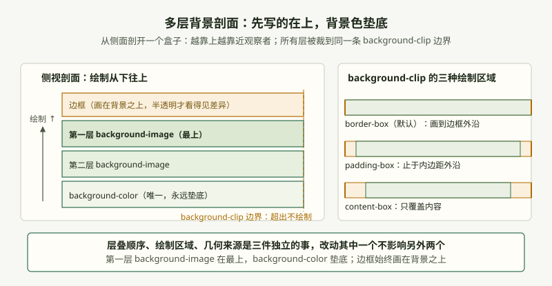

# 11 · 表面画在哪一层

> **前置**：会用第 05 篇的 border-box / padding-box / content-box 区分盒子边界；会用第 10 篇的颜色写法（含半透明色值与渐变）。
>
> 上一篇：[颜色如何表达](10-color.md) ｜ [本阶段目录](README.md)

## 1. 本章目标

- 给定半透明边框和背景，能预测 `background-clip` 三种取值下边框区与 padding 区各自显示什么。
- 能说出两层 `background-image` 谁在上面、颜色垫在哪，并写出 `background` 简写覆盖状态样式时的修法。
- 能解释 `box-shadow` 与 `filter: drop-shadow()` 在透明星形上的轮廓差异，归因到"生成源"。
- 能判断 `outline` 为什么不占布局、适合做什么，以及 `border-radius` 裁不到子元素的真正原因。

**为什么现在学这个**：第 10 篇决定了颜色值，但没回答"画到哪一层"。这一篇把盒子表面拆成绘制区域、层叠顺序、几何来源三件事；第 12 篇再讨论"看不见"的几个开关。

## 2. 新增模型

给卡片一圈半透明边框，背景是亮色渐变：

```css
.card {
  border: 10px solid rgb(0 0 0 / 25%);
  background: linear-gradient(90deg, #f4f8ef, #3f6b2a);
}
```

你以为背景只画在边框里面，实际那 10px 边框区也透出了渐变——背景默认画到边框外沿。加上一行：

```css
.card { background-clip: padding-box; }
```

边框那圈立刻变成纯净的 25% 黑，和内部背景之间出现一道清晰的接缝。背景没变、边框没变，变的只是绘制区域。再加一层条纹背景，把两行对调，条纹就被盖住——背景层也有"谁在上面"。

**模型：盒子的表面是按层、按区域、按几何分别绘制的结果——先写的层在上，`background-clip` 决定画到哪个盒子，阴影贴盒还是贴形取决于生成源。**



*图 11-1 · 多层背景剖面：颜色垫底，图像层依次上叠，每层被裁到同一个盒子*

图从侧面剖开一个盒子：最底下是唯一的 `background-color`，往上依次是第二层、第一层图像（第一层在最上）；虚线标出 `background-clip` 边界，所有层画到这条边界为止。边框画在背景之上，所以只有半透明边框才让你看见边界差异。

**这张图的一句话结论：层叠顺序、绘制区域、几何来源是三件独立的事，改其中一个不影响另外两个。**

术语落地：

- **绘制区域**：背景允许被画到的盒子范围，由 `background-clip` 指定。
- **定位区域**：背景图案从哪个盒子起算，由 `background-origin` 指定，与绘制区域是两个问题。
- **生成源**：阴影依据什么形状投影——盒几何或渲染结果的 alpha 轮廓。
- **圆角裁剪**：`border-radius` 只裁背景、边框和溢出裁剪，不会自动裁掉子元素。

## 3. 可运行的 demo

先动手切换一次裁剪区域，再带着"背景没变为什么外观变了"读规则。

[打开 demo：切换裁剪区域与阴影来源](../../examples/minimal/11-background-border.html)

<iframe class="demo-frame" src="/css-concept-course/examples/minimal/11-background-border.html" title="切换裁剪区域与阴影来源" loading="lazy"></iframe>

> **先预测**：把 `background-clip` 从 `border-box` 改成 `padding-box`，那圈 10px 半透明边框会变成什么？再改成 `content-box`，padding 区又会发生什么？
>
> **验证**：打开 demo 用下拉切换裁剪区域，对照页面显示的当前 CSS 与边框区取样色核对：`padding-box` 下边框区只剩 25% 黑并出现接缝，`content-box` 下 padding 区也露出舞台底色。

demo 把半透明边框、两层背景和星形放在同一屏，控件只改两件事：绘制区域、阴影函数。页面实时显示生效的 CSS 和取样状态文本，预测可以被逐项核对。核对时按这个顺序问：先问"背景画到哪条边"，再问"哪一层在上"，最后问"阴影像盒还是像形"。三个问题对应不同机制，混在一起看就会觉得结果随机。

## 4. 原理与规则

### 4.1 绘制区域与定位区域是两个问题

背景的绘制区域默认是 `border-box`（画到边框外沿），可改成 `padding-box` 或 `content-box`；它不改盒模型尺寸，也不改背景的定位参照。定位区域由 `background-origin` 负责：一个元素上可以同时出现"从 padding 盒定位、只画到 content 盒"的组合。

**为什么要有两个属性？** 因为"从哪儿量位置"和"画到哪儿为止"是不同问题：前者移动图案起点，后者裁掉图案边界。半透明边框是观察差异的前提——边框完全不透明时，边框下面画了什么根本看不出来。

`background-clip: text` 是同一维度的极端情况：绘制区域被裁到字形，配合 `color: transparent` 得到渐变文字。但它不改变元素的 `overflow`，也不等于 `clip-path`。

**失效条件**：文字一旦透明，可读性完全依赖背景，必须给不支持的浏览器留纯色回退；`background-clip: text` 也不会裁掉子元素，它只影响背景这一层的绘制。

### 4.2 多层背景：先写的在最上

`background-image` 用逗号分层，**第一层在最上面，最后一层在最下面**。`background-color` 永远垫在所有层之下，一个元素只有一层颜色，不能为某一层单独指定颜色。

`background-position`、`background-size`、`background-repeat` 都按逗号与图像一一对应：值的数量少于层数时浏览器循环取值，多于层数时多余的值不生效。两层图像只写一个 `background-position` 时，两层共用同一位置；写两个值才依次对应。

**为什么先写的在上面？** 绘制按顺序进行：后面的层先画，前面的层后画、覆盖上去。这和 `z-index` 无关——你排的是同一张背景内部的绘制队列，不是一个层叠上下文。由此还能推出一个陷阱：`background` 简写会把所有背景长属性重置为初始值，包括把 `background-image` 设成 `none`。

**失效条件**：基础样式用简写写了渐变、状态样式里只写 `background-color` 时，hover 会让渐变凭空消失；基础层要写长属性，状态层只覆盖真正要改的那一项。

### 4.3 渐变是颜色沿方向的插值

`linear-gradient(90deg, A, B)` 里的角度定义的是一条**渐变线**，浏览器沿它把色标之间插值成连续颜色，不是几块色带拼起来的图。色标写成 `A 0 25%, B 25% 50%` 这种双位置形式时，同一位置有两个色标，插值长度为零，于是得到硬边界。

**为什么渐变能和图片共用一套背景属性？** 因为渐变在语法上就是一种"背景图像"：同样有定位区域、尺寸和重复方式。区别在于渐变没有固有尺寸——`background-size: 50%` 对图片按比例算，对渐变则直接按定位区域的百分比算。

`radial-gradient()` 让颜色从中心向外插值，`conic-gradient()` 让颜色绕中心按角度插值，`repeating-linear-gradient()` 按渐变线长度重复这段插值，周期由色标间隔决定。三者都是"沿某条路径插值"，区别只在路径形状。

**失效条件**：色标间隔过小时，`repeating-linear-gradient()` 的周期可能低于设备像素密度，出现摩尔纹；渐变文字上的最小对比度出现在最不利的那一小段底色，不能只测中间色（第 10 篇）。

### 4.4 阴影看生成源，边框看是否占位

`border` 参与盒模型尺寸，四边可分别设置；`outline` 通常不占布局空间，现代浏览器会让它跟随 `border-radius`，常用于焦点环。两种阴影的差别在于**生成源**：

| 对比 | `box-shadow` | `filter: drop-shadow()` |
| --- | --- | --- |
| 生成源 | 盒子的矩形 / 圆角几何 | 渲染结果的 alpha 轮廓 |
| 不规则形状 | 阴影仍是盒子轮廓 | 阴影贴合形状 |
| 多元素 | 每个盒独立投影 | 按整组结果的轮廓投影 |

`box-shadow` 不占布局空间，相邻元素不会为它让位；`inset` 把阴影改画到盒内。`clip-path` 和 `mask` 则是另一类操作：它们不画新内容，只把已经画好的结果按几何区域或透明度擦掉一部分。正因为 `outline` 不占位，它适合做 `:focus-visible` 反馈：出现和消失都不会让布局抖动。

**为什么不能互换？** 透明底的星形图标上，`box-shadow` 按不可见的矩形盒投影，`drop-shadow()` 按星形轮廓投影；换成不透明矩形后两者才重合。`filter` 还会建立包含块与层叠上下文，与 `box-shadow` 的差别不止形状。

**失效条件**：`outline: none` 不能单独作为焦点样式——那只是把键盘定位的反馈拿掉了；`border-radius` 只裁背景、边框和溢出裁剪，要裁子元素得靠 `overflow` 或 `clip-path`。

## 5. 常见坑

**坑 1：半透明边框下看到渐变透进边框区**

- **原因**：`background-clip` 默认是 `border-box`，背景一直画到边框外沿，边框的 alpha 让下层透出来。
- **确认**：DevTools 里看 Computed 的 `background-clip` 是否为 border-box；取样边框区颜色是否为渐变与边框色的叠加。
- **修法**：改 `background-clip: padding-box`；代价是边框区只剩边框自身颜色，与内部背景出现接缝。

**坑 2：hover 时渐变消失，只剩纯色**

- **原因**：基础样式用 `background` 简写写了渐变，状态样式里写 `background-color` 触发简写重置，把 `background-image` 清成了 `none`。
- **确认**：在 hover 状态看 Computed 的 `background-image`，是否为 none。
- **修法**：基础层用长属性 `background-image` / `background-color` 分开写，状态层只覆盖要改的那一项。

**坑 3：透明星形的 `box-shadow` 投影是个方块**

- **原因**：`box-shadow` 依据盒的矩形几何投影，不识别图形内部透明区域。
- **确认**：换 `filter: drop-shadow()` 后阴影立刻贴合星形轮廓，即可确认是生成源差异。
- **修法**：要贴形状就用 `drop-shadow()`；但要意识到它还会建立包含块与层叠上下文。

**坑 4：设了 `border-radius`，里面图片却是方角**

- **原因**：圆角只裁背景、边框和溢出裁剪，不作用于普通子元素。
- **确认**：看子元素自身有没有 border-radius，或直接给父级加 `overflow: hidden` 对比。
- **修法**：用 `overflow: hidden` 或 `clip-path` 裁子元素；注意 `overflow` 会同时建立 BFC（第 12 篇）。

## 6. 练习

1. **基础**：写 `border: 10px solid rgb(0 0 0 / 25%)` 配 `linear-gradient(90deg, #f4f8ef, #3f6b2a)`，分别用 `background-clip: border-box` 和 `padding-box`。
   验收：前者边框区是渐变与 25% 黑的叠加，后者边框区只剩 25% 黑并出现清晰接缝，与 demo 取样一致。

2. **基础**：两层背景：上层 `repeating-linear-gradient(90deg, transparent 0 8px, rgb(255 255 255 / 30%) 8px 16px)`，下层 `linear-gradient(90deg, #f4f8ef, #3f6b2a)`。
   验收：条纹只在透出下层处可见；交换两层后渐变盖住条纹，整片看不到条纹。

3. **进阶**：给透明底星形 SVG 分别加 `box-shadow: 0 4px 8px rgb(0 0 0 / 40%)` 和 `filter: drop-shadow(0 4px 8px rgb(0 0 0 / 40%))`。
   验收：前者得到矩形阴影，后者得到星形轮廓阴影；换成同尺寸不透明矩形后两者轮廓一致。

4. **进阶**：基础样式用 `background: linear-gradient(...)`，hover 只写 `background-color: #eee`。
   验收：hover 时 Computed 的 `background-image` 变成 none、渐变消失；改成基础层用长属性后 hover 时渐变仍在。

5. **进阶**：写 `border: 10px solid rgb(0 0 0 / 25%)` 配两层背景，先用 `background` 简写写在基础样式，再用长属性重写一遍，对比 hover 只改 `background-color` 的结果。
   验收：简写版本 hover 时渐变消失（Computed 的 `background-image` 为 none）；长属性版本 hover 时渐变仍在。

6. **挑战**：不查资料，预测 `background-origin: padding-box` 且 `background-clip: content-box`、边框 10px、padding 20px 时，图案从哪里起画、又在何处被裁。
   验收：说明"起点"与"终点"分别由 origin 与 clip 决定，图案从 padding 盒内沿起画但在 content 盒外沿被裁掉，padding 区看不到图案。

> 下一篇：[看见与看不见](12-display-overflow.md)
