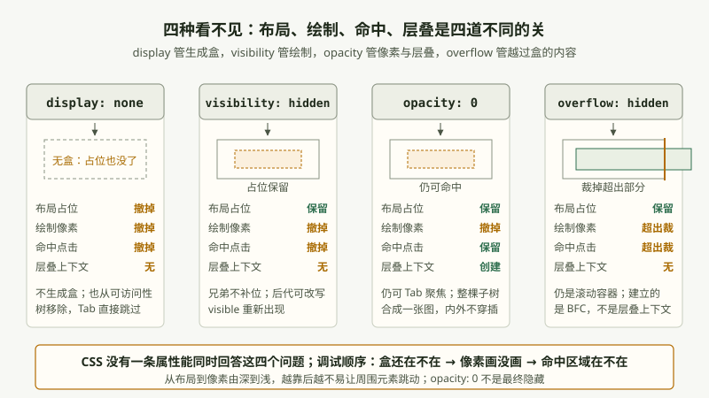

# 12 · 看见与看不见

> **前置**：知道第 04 篇的继承为何能让后代改写 `visibility`；知道第 07 篇的 BFC 与第 08 篇的层叠上下文分别是什么。
>
> 上一篇：[表面画在哪一层](11-background-border.md) ｜ [本阶段目录](README.md)

## 1. 本章目标

- 给定一段 HTML，能分别说出 `display: none`、`visibility: hidden`、`opacity: 0`、`overflow: hidden` 对占位、绘制、命中、可聚焦四件事的答案。
- 能解释为什么 `opacity: 0` 的浮层仍拦截点击、Tab 仍能走进去，并给出同时关掉交互的写法。
- 能预测 `overflow-x: visible; overflow-y: auto` 在 Computed 里的 `overflow-x` 值，并说明原因。
- 能判断 `display: contents` 为什么会丢掉包装元素上的背景和边框。

**为什么现在学这个**：第 11 篇解决了"表面画在哪一层"，但"看不见"不是单一开关。把四个环节拆开，才能在弹层、焦点、裁剪这几类 bug 里快速定位是哪一道关出了问题。

## 2. 新增模型

一个浮层盖在按钮上：

```css
.overlay { position: absolute; inset: 0; opacity: 0; }
```

按钮看起来完全正常，却点不动——透明浮层仍在接收点击，Tab 也能走进里面的控件。改成 `visibility: hidden`，按钮能点了，但浮层原来占的那块高度还在；再改成 `display: none`，那块空白才消失。

**模型：能不能被看见分散在四个互不相干的环节——有没有生成盒（`display`）、盒还在不在原处（`visibility`）、绘制结果透不透（`opacity`）、超出盒的内容拦不拦（`overflow`）；CSS 没有一条属性能同时回答这四个问题。**



*图 12-1 · display 决定生成什么盒：同一段内容在五种值下的结果*

图左是一段 DOM（一个包装元素加两个子元素），图右列出五种结果：`block` 生成占满一行的块盒，`inline` 生成跟着文字走的行内盒，`inline-block` 外部像行内、内部可设宽高，`none` 不生成盒且占位也没了，`contents` 让包装自身没有盒、两个子元素直接顶到父级布局里。

**这张图的一句话结论：`display` 改的是参与哪种格式化上下文，不是简单地把元素变大变小。**

术语落地：

- **布局占位**：元素在流里占的那块空间，决定兄弟元素排在哪。
- **命中测试**：浏览器判断鼠标点击落在哪个元素上的过程。
- **可访问性树**：读屏等辅助技术读取页面结构的视图，与视觉渲染是两条路径。
- **层叠上下文**：一张独立的绘制图，内部元素不能与外部元素互相穿插（第 08 篇）。

## 3. 可运行的 demo

先亲手切换一遍四种方式，再带着"盒还在不在"的疑问读规则。

[打开 demo：四种隐藏方式，谁还占位、谁还能点](../../examples/minimal/12-display-overflow.html)

<iframe class="demo-frame" src="/css-concept-course/examples/minimal/12-display-overflow.html" title="四种隐藏方式，谁还占位、谁还能点" loading="lazy"></iframe>

> **先预测**：把目标块从正常显示改成 `visibility: hidden`，后面的兄弟块会上移吗？再换成 `display: none` 呢？`opacity: 0` 时这块区域还能被点中吗？
>
> **验证**：打开 demo 用下拉切换隐藏方式，对照页面显示的状态文本（是否占位 / 是否可命中 / 是否可 Tab）逐项核对；先写答案再点揭晓。

demo 只有一个下拉，按钮、占位条和状态文本同屏。状态文本里"可 Tab"和"可命中"是两行：很多 bug 正是只关掉了其中一个。

## 4. 原理与规则

### 4.1 `display` 先决定生成什么盒

浏览器布局前先问元素生成什么盒：

| 值 | 生成什么盒 | 直接后果 |
| --- | --- | --- |
| `block` | 块级盒 | 占满可用宽度，宽高有效 |
| `inline` | 行内盒 | 跟着文字走，宽高与竖直 margin 受限 |
| `inline-block` | 外部行内、内部块级 | 能设宽高，仍留在行内流里 |
| `none` | 不生成 | 占位、命中、可聚焦一起消失 |
| `contents` | 自身无盒，子元素顶上 | 背景、边框、padding 无处可画 |

这张表只回答"盒的类型"：`visibility` 和 `opacity` 不在表里，因为它们不改变盒。`display: none` 还会把元素从可访问性树中移除，所以不要用纯视觉判断去猜读屏会不会读到它。现代语法还能把外部类型与内部类型分开写，如 `display: inline flow-root`：第一个值管"自己怎么进父布局"，第二个管"自己的孩子怎么排"。

**失效条件**：在 `<span>` 里放 `<div>` 时，浏览器会把行内盒拆开并生成匿名块盒，结果难以预测——用 `display` 掩盖错误的 HTML 嵌套，只会把问题从结构层搬到布局层。

### 4.2 `visibility: hidden` 保留布局空间

它隐藏的是绘制结果，不是布局盒：元素仍占原来的位置，兄弟元素不会补上来。父级 hidden 时，后代显式写 `visibility: visible` 可以重新出现，但父级的占位依旧。

**为什么它能被子元素覆盖？** 因为 `visibility` 是继承的属性，后代默认拿到 hidden；后代自己改写这个值，就只改回自己的绘制，不会撤销父级那次布局。`visibility: collapse` 主要给表格行、行组用；普通块级元素上多数浏览器把它当作 `hidden`，而不是真的压缩尺寸。

用 `visibility: hidden` 隐藏可聚焦控件后，它通常会被 Tab 跳过；而只把 `opacity` 设为 0 的按钮仍可能被 Tab 聚焦，形成"看不见却能得到焦点"的状态。所以三者的选择顺序是：**要撤掉占位用 `display: none`；要保留占位但撤掉绘制与命中用 `visibility: hidden`；要保留交互、只调透明度用 `opacity`。**

**失效条件**：后代改写 `visibility: visible` 只恢复自己的绘制，父级占位仍在；`collapse` 在非表格元素上多数浏览器按 `hidden` 处理，不会真的压缩尺寸。

### 4.3 `opacity` 把整棵子树当成一张图

`opacity` 小于 1 时（哪怕 0.99），元素及其后代先合成一张结果图，再整体混到页面上，同时创建层叠上下文：子元素的 `z-index` 再大也逃不出这张图。`opacity: 0` 仍占位、仍可命中、仍能被 Tab 聚焦，通常也还在可访问性树里。

**为什么？** 因为透明度是"整组绘制结果"的属性，不是命中测试或布局的开关——交给它来隐藏，等于只关掉了像素，没关掉交互。一个具体后果：父元素 `opacity: 0.99`，子元素写 `z-index: 9999`，仍盖不过兄弟里 `z-index: 1` 的对象——9999 只在父元素那张图内部有效。

```css
.overlay {
  opacity: 0;
  visibility: hidden;
  transition: opacity 180ms ease, visibility 180ms;
}
.overlay.is-open { opacity: 1; visibility: visible; }
```

渐显动画常用 opacity，但结束后应把元素切到 `visibility: hidden` 或配合 `inert`，否则一个已经"看不见"的弹层会一直挡着页面。`visibility` 的切换会在过渡结束时才生效，淡入淡出因此不会被打断。

**失效条件**：`opacity` 影响的是整棵子树，不能只让背景淡出而保留文字清晰；需要单独调色值透明度时用 `rgb(... / 50%)`（第 10 篇）。它还可能让元素进入独立合成层，性能代价属于第 25 篇。

### 4.4 `overflow` 决定超出边界怎么办

`visible` 让内容画到盒外，`hidden` 裁剪但不提供滚动条，`clip` 也裁剪但根本不是滚动容器，`scroll` 总是给滚动条，`auto` 只在需要时给。`clip` 和 `hidden` 都会裁掉视觉内容，但 `hidden` 仍是滚动容器（脚本可以改 `scrollTop`），`clip` 连滚动容器都不是。

两轴并不独立：一个轴是 `visible`、另一个是 `auto` / `hidden` / `scroll` 时，`visible` 会被计算成 `auto`，要看 Computed 而不是读源码。例如写 `overflow-x: visible; overflow-y: auto`，Computed 里的 `overflow-x` 会是 `auto`。

**为什么先查尺寸再选 `overflow`？** 裁剪边界就是盒的一条边；内容之所以越界，通常是固定宽度、长字符串或 Flex / Grid 子项拒绝收缩。上来就写 `hidden` 只会把焦点环、下拉菜单一起裁掉，真正的问题还在。`position: sticky` 受最近滚动祖先约束，`overflow: hidden` 的容器会把绝对定位后代一起裁掉，下拉菜单经常因此消失。

单行省略是同一套机制的特例：`text-overflow: ellipsis` 要生效，容器须是块容器、行内方向被裁剪、文本不换行（第 09 篇）。真正需要滚动的区域用 `auto` 而不是 `hidden`，并让容器可被键盘聚焦。

**失效条件**：`overflow: hidden` 会建立块格式化上下文，把内部 margin 折叠和浮动影响关在盒子里（详见第 07 篇）；它不是隐藏元素的开关，盒本身照常占位、绘制、参与层叠。

## 5. 常见坑

**坑 1：`opacity: 0` 的浮层挡住了底下的按钮**

- **原因**：透明度只关掉像素，命中区域仍在，仍能被 Tab 聚焦。
- **确认**：在浮层上点按钮无反应；DevTools 的 Elements 面板点按钮命中的是浮层。
- **修法**：配合 `visibility: hidden` 或 `inert` 一起关掉交互；只做视觉淡出时用 `pointer-events: none` 仍需自行验证键盘可达性。

**坑 2：写了 `visibility: hidden`，后面的兄弟没上移**

- **原因**：它只撤掉绘制，布局盒仍留在原处。
- **确认**：看父元素的高度没变，元素的 `getBoundingClientRect()` 仍有原来的宽高。
- **修法**：要撤掉占位只能用 `display: none`；代价是进入 / 离开动画没有中间帧，可用 `@starting-style`（第 14 篇）补起点。

**坑 3：`overflow-x` 和 `overflow-y` 互不相干**

- **原因**：一个轴非 `visible` 时，浏览器不允许"一个方向裁掉、另一个方向自由溢出"的混合状态，另一个轴的 `visible` 被改算成 `auto`。
- **确认**：写 `overflow-x: visible; overflow-y: auto` 后看 Computed 的 `overflow-x` 是 `auto`。
- **修法**：按 Computed 结果推理；要保留某轴自由溢出，就把两轴都设成 `visible` 并从布局上解决越界。

**坑 4：用 `overflow: hidden` 掩盖溢出，下拉菜单整片消失**

- **原因**：裁剪边界不只裁内容，也裁绝对定位后代；同时建立 BFC，改变 margin 折叠与浮动行为。
- **确认**：临时改成 `overflow: visible`，菜单重新出现即可确认是裁剪造成。
- **修法**：让菜单浮到容器外（如 top layer，第 22 篇），或只裁真正需要裁的那一层。

## 6. 练习

1. **基础**：把同一个按钮分别用 `display: none`、`visibility: hidden`、`opacity: 0` 隐藏。
   验收：`none` 占位消失且 Tab 跳过；`hidden` 占位保留、通常不可 Tab；`opacity: 0` 占位保留、可 Tab 且仍拦截该区域点击。

2. **基础**：宽 500px 的内容放进宽 300px 的容器，分别设 `overflow: visible`、`hidden`、`auto`。
   验收：`visible` 时内容向右溢出 200px；`hidden` 裁掉 200px 且无滚动条；`auto` 出现滚动条，能滚到末尾。

3. **进阶**：写 `overflow-x: visible; overflow-y: auto`，打开 DevTools 看 Computed 里的 `overflow-x`。
   验收：显示 `auto` 而不是源码里的 `visible`，与 demo 状态文本一致。

4. **进阶**：给 Grid 包装元素写 `display: contents`，其上有背景与边框。
   验收：子元素顶到父级布局中，包装上的背景与边框完全不显示；Computed 里仍能看到这两条声明，说明是"没生成盒"而非"声明失效"。

5. **挑战**：做一个淡出弹层：先只用 `opacity: 0`，再用 `opacity: 0 + visibility: hidden`。
   验收：前者关闭后按钮仍点不动、Tab 仍能进入；后者按钮可点且 Tab 跳过；过渡期间文字仍可见，说明 `visibility` 切换延后到过渡结束。

> 下一篇：[视觉变形](13-transform.md)
