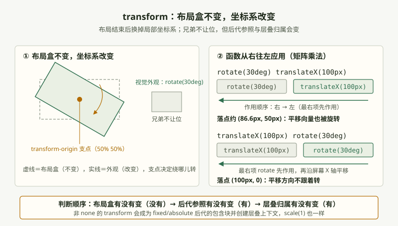

# 13 · 视觉变形

> 一句话模型：`transform` 在布局结束后换掉的是**局部坐标系**，不是布局盒本身——兄弟元素不让位，但非 `none` 的 transform 会成为后代的定位参照并创建层叠上下文。

## 先看一个现象

下面两个场景看起来无关，其实是同一个机制的两个侧面。

```css
.box { transform: translateX(100px); }
```

元素视觉上右移 100px，后面的兄弟却纹丝不动，`offsetLeft` 也没变；页面还可能多出横向滚动条，但布局测量值一个像素都没动。视觉上"越界"和布局上"占位"在这里第一次分家。换成 `rotate(30deg)` 也一样：元素歪了，它在流里占的那块矩形没歪。

真正奇怪的是：子元素写 `position: fixed; top: 0; left: 0`，本该贴住视口左上；一旦给父元素加上 `transform: translateX(0)`（注意位移是 0），子元素突然贴到父元素上，滚动页面时跟着父元素一起走。

再看一个：父元素加了 `transform: scale(1)`（缩放倍数是 1，外观完全没变），子元素写 `z-index: 9999` 却依然被兄弟元素里 `z-index: 1` 的对象盖住。**缩放为 1 也照样创建了层叠上下文**，这是对"transform 只是视觉变化"最直接的反驳。

**同样是 transform，为什么一个"不影响布局"，另一个却改变了后代的参照？**

注意这里的"没变"指布局盒：元素的文字内容、DOM 顺序和语义都没变，变的只是绘制时的坐标映射。看清这一点，才不会把视觉重叠误判成布局错误。

## 先建立直觉



*图 13-1 · 函数顺序示意：从右往左应用，平移向量会不会跟着转*

图并排画同一元素中心出发的两条路径。左：`rotate(30deg) translateX(100px)`——先沿局部 X 轴平移 100px，再把结果绕原点旋转 30deg，落点约 `(86.6px, 50px)`。右：`translateX(100px) rotate(30deg)`——先旋转，再沿屏幕 X 轴平移 100px，落点 `(100px, 0)`。箭头上标"右先左后"，强调每个函数改的是随后的坐标系。

读出一句：**列表里越靠右的函数越先作用到点上**——这是矩阵乘法，不是"依次拖动物体"。

## 机制拆成四步

### 1. 布局完成后换坐标系

`transform` 位于布局之后、绘制之前：元素仍占原来的布局盒，自身尺寸与兄弟位置都不变。视觉溢出可能扩大滚动区域，但 `offsetWidth` 之类的布局测量值不变。

把"不变"和"会变"分开记：

- 不变：元素自身的布局盒尺寸、兄弟元素的位置、`offsetWidth` / `offsetHeight`。
- 会变：视觉位置与形状、命中区域、视觉溢出范围、后代的定位参照、整棵子树的层叠归属。

命中区域也跟着变换：鼠标按视觉位置命中，而不是按布局盒；缩放后的焦点环会被一起放大或压扁。交互控件做大比例缩放时，要重新验证可点击区域和焦点是否仍可见。

**为什么不让兄弟让位？** 因为布局阶段已经结束，兄弟的位置早就算好了。普通小幅位移用 margin 或 gap 更合适；需要旋转、缩放或共享动画基准时才用 transform。把一组元素放在同一个父级 transform 下，旋转时它们共享一个坐标系，比每个元素各自旋转更容易保持相对关系。换个说法：transform 改的是"从哪个坐标系看这个元素"，而布局早已把"元素占哪块地"定死了。用 DevTools 的盒模型看它，看到的仍是变换前的矩形；用屏幕坐标看它，才是变换后的位置。两个视图不一致不是工具坏了。

### 2. 多个函数从右往左应用（矩阵乘法）

对列表 `A B C`，浏览器算的是 `A × B × C × p`：最右侧的 C 先作用到点上，然后 B，最后 A。

```css
/* 先平移（沿局部 X 轴），再把结果旋转 30deg */
transform: rotate(30deg) translateX(100px);
/* 先旋转，再沿屏幕 X 轴平移 100px */
transform: translateX(100px) rotate(30deg);
```

默认原点下前者落点约 `(86.6px, 50px)`，后者是 `(100px, 0)`：**平移向量也被旋转了**。把坐标系想象成一支跟着元素走的笔：前一种写法是先把笔沿当前 X 轴推 100px，再转手腕 30deg，所以推的方向跟着一起转；后一种先转手腕再沿屏幕 X 推，落点自然不同。这也带来一个实际选择：`rotate(30deg) translateX(100px)` 让物体沿自己旋转后的方向移动，适合"沿边走"的效果；反过来写则始终沿屏幕方向移动。要的是绑定还是解耦，决定了顺序。

**为什么不是从左到右？** 每个函数都在改写局部坐标系，而不是搬动画好的像素。调试时先只留一个函数，再逐个往左加，就能看清每一步坐标系怎么变。

底层表示是 `matrix(a, b, c, d, e, f)`：a、b、c、d 管缩放、旋转和错切，e、f 管平移。上面两个例子合成后 e、f 不同，正是"平移向量有没有被旋转"的数值证据；DevTools 的 Computed 里能直接读到这个 matrix，不必靠肉眼猜。

把常用 2D 函数按"改坐标系的哪一项"分类，比按名字背更容易推演：

| 函数 | 改了什么 | 参数参照 |
| --- | --- | --- |
| `translate()` | 原点位置 | 长度，或自身参考盒的百分比 |
| `rotate()` | 坐标轴角度 | 角度 |
| `scale()` | 单位长度 | 无单位数字，负数产生镜像 |
| `skew()` | 轴间夹角 | 角度 |
| `matrix()` | 一次性给出全部 | 六个数字 |

### 3. 原点是支点，百分比参照自身盒

`transform-origin` 默认 `50% 50% 0`，旋转和缩放都绕这个点；改成 `0 0` 就绕左上角。`translate()` 的百分比也参照元素**自身**的参考盒（HTML 元素通常是 border-box），不是父容器：一个 200×100 的元素写 `translate(50%, 25%)`，位移是 `(100px, 25px)`。

**为什么两个"百分比"都指向自身？** 因为变换发生在元素自己的局部坐标系里，量尺自然是它自己的盒——这让"按自身尺寸做居中微调"变得可靠，但别把它当成父级宽度的百分比。

`transform-origin` 可以写三个值，第三个是 Z 轴偏移，必须是长度，不能写百分比。另一个相关属性是 `transform-box`：HTML 元素默认按 border-box 取参考盒，SVG 元素却可能按 viewBox 或 fill-box 算，所以 SVG 图标里的 `center` 未必是屏幕上的中心，旋转前先确认参考盒。

原点改变的是轨迹而不是终点尺寸：绕中心旋转 45deg 与绕左上角旋转 45deg，包围盒大小可能相同，位置却差很多。缩放同理——`transform-origin: 20% 80%` 会让放大主要朝右上角生长。

注意区分两个百分比：`transform-origin: 20% 80%` 决定绕哪儿转，`translate(20%, 80%)` 决定走多远；前者参照参考盒的宽高定位支点，后者参照同一个盒的宽高算位移。数值可能相同，作用完全不同。

### 4. 3D 要透视，副作用要记牢

`rotateX()` / `rotateY()` 才会让元素"立起来"，`rotate(90deg)` 绕 Z 轴，只是平面转圈。要看深度效果还需要 `perspective`：可以写在父级（多个子元素共享消失点），也可以作为 `perspective()` 写进 transform 列表（只作用于本元素）。父级 `perspective` 不改变父元素自身外观。

透视距离越小，近大远小的差异越强；距离越大越接近正交投影。`perspective()` 在列表里的位置也会改变最终矩阵——放在最前面相当于先建立透视坐标系，再做旋转。多个嵌套层反复叠加强透视，结果很难预测。3D 还有一个常见前提：默认 `transform-style: flat` 会把子元素压平，立方体的多个面无法共享空间；要保留 3D 位置需要 `preserve-3d`，而 `overflow` 非 visible、`opacity` 小于 1 等 grouping 属性可能强制扁平化。这里只点到为止，不展开具体 3D 场景。

**还有一个容易漏掉的副作用：** 非 `none` 的 transform 会成为 `position: fixed` / `absolute` 后代的**包含块**，并创建**层叠上下文**。所以"transform 完全不影响布局"是错的——它不改自身布局盒和兄弟位置，却改了后代的定位参照和整棵子树的层叠归属。开篇那个 fixed 子元素跟着父元素走，正是这个原因。

**为什么会有这个副作用？** 变换后的坐标系需要一个原点来挂相对定位；同时整棵子树要作为一张结果图参与层叠，才不会出现"子元素逃出变换后形状"的错乱。排查弹层错位时，先看祖先链上有没有非 `none` 的 `transform`、`filter` 或 `perspective`——它们都能产生类似的包含块效果。

判断顺序建议固定为：先问"布局盒有没有变"（没有），再问"后代参照有没有变"（有），最后问"层叠归属有没有变"（有）。

这三问缺一不可：只记住第一问，就会在 fixed 子元素错位时找不到原因；只记住后两问，又会在兄弟元素没有让位时误以为布局算错了。性能方面，transform 在合适条件下可以只走合成——那是 [25 · 变化如何发生](25-rendering.md) 的话题，这里只记住"能只走合成"这个指针，不展开。

## 动手验证

[打开 demo：调角度，核对从右往左的落点](../../examples/minimal/13-transform.html)

<iframe class="demo-frame" src="/css-concept-course/examples/minimal/13-transform.html" title="调角度，核对从右往左的落点" loading="lazy"></iframe>

> **先预测**：`rotate(30deg) translateX(100px)` 的元素中心最终落在哪里（相对原点的 x, y）？把顺序反过来呢？
>
> **验证**：打开 demo 调节参数，用页面显示的实时读数核对你的预测。

验证：打开 demo，用角度滑块从 0 调到 30deg，页面实时显示当前 transform、合成的 matrix 与计算落点；再用开关切换函数顺序，看落点是否变成 `(100px, 0)`。先写答案再点揭晓。

demo 只有两个控件：角度、函数顺序。落点数值和 CSS 同步更新，预测可以直接核对。核对时别只看形状：`scale(1)` 或 `translateX(0)` 这类"看起来没变"的变换同样会创建层叠上下文，demo 里会单独提示这一点。判断顺序也可以反过来用：先看到落点不对，再检查是不是函数顺序写反了，而不是先怀疑布局。

## 容易误判的地方

- **"transform 完全不影响布局"** → 它不改自身布局盒与兄弟位置，但会成为 fixed/absolute 后代的包含块、创建层叠上下文，视觉溢出还可能扩大滚动区域。
- **"`translate(50%)` 是父元素宽度的一半"** → 参照的是元素自身参考盒；200px 宽的元素移动 100px。
- **"`rotate(90deg)` 能做 3D 翻转"** → 它绕 Z 轴；要 `rotateX()` / `rotateY()` 加上 `perspective` 才有深度。

## 自己再做一次

1. 给宽 200px、高 100px 的元素设 `translate(50%, 25%)`，用 `getBoundingClientRect()` 对比变换前后。**预期结果**：水平位移 100px、垂直位移 25px；元素自身布局尺寸不变。
2. 分别写 `rotate(30deg) translateX(100px)` 和 `translateX(100px) rotate(30deg)`，记录元素中心相对原点的落点。**预期结果**：前者约 `(86.6px, 50px)`，后者 `(100px, 0)`，差别来自平移向量是否被旋转。
3. 父元素设 `transform: translateX(0)`，子元素设 `position: fixed; top: 0; left: 0`，滚动页面观察。**预期结果**：子元素贴在父元素的变换后坐标系左上、随页面滚动而移动；删掉父级 `transform` 后回到视口左上。

> 下一篇：[状态的变化](14-animation.md)
