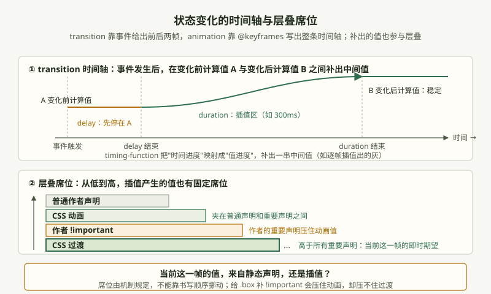

# 14 · 状态的变化

> **前置**：会用第 03 篇的层叠顺序判断谁覆盖谁；知道第 04 篇的"计算值"是什么。
>
> 上一篇：[视觉变形](13-transform.md) ｜ [本阶段目录](README.md)

## 1. 本章目标

- 给定一段 `transition`，能说出触发插值的三个条件，并判断首次加载或 `display: none` 时为什么不触发。
- 能写出 `@keyframes` 时间轴，并说明缺省 `0%` / `100%` 帧取的是 underlying style。
- 能说出普通作者声明、CSS 动画、作者 `!important`、CSS 过渡在层叠中的相对位置，并解释为什么 `!important` 压得住动画却压不住过渡。
- 能用 `prefers-reduced-motion` 关闭装饰运动而保留状态反馈。

**为什么现在学这个**：第 13 篇让元素"换坐标系"，但直接跳变会丢失状态信息。动画把变化补成中间帧；而补出来的值也参与层叠，不搞清席位就会出现"`!important` 居然失效"这类反直觉现象。

## 2. 新增模型

一段文字配循环动画，颜色本该在深灰和琥珀之间来回变：

```css
.box { color: #23291e; animation: recolor 2s infinite alternate; }
@keyframes recolor { to { color: #c47f17; } }
```

给 `.box` 补一句 `color: #23291e !important`，动画突然"坏了"，文字恒定深灰。可 `!important` 不是号称最强吗？

另一边：

```css
.box { background: #f7f8f4; transition: background-color 300ms linear; }
.box.dark { background: #23291e !important; }
```

切换 `.dark` 的 300ms 里，你看到的是一层层插值出来的灰，而不是那条 `!important` 声明的深灰——过渡结束后才稳定在深灰。

**模型：元素的"变化"不是属性自己动了，而是浏览器在两个计算值之间补出中间帧；补出的值在层叠里占固定席位，动画夹在普通声明与重要声明之间，过渡高于所有重要声明。**



*图 14-1 · 状态变化的时间轴与层叠席位*

图上半是 transition 时间轴：事件发生时浏览器已算出变化前的计算值 A，变化后得到 B，在 duration 内用 timing-function 把"时间进度"映射成"值进度"，补出中间值；delay 只让元素先停在 A。图下半是层叠席位：从低到高依次是普通作者声明、CSS 动画、作者 `!important`、CSS 过渡。

**这张图的一句话结论：插值产生的值也是参与层叠的值，席位由机制规定，不能靠书写顺序挪动。**

术语落地：

- **插值**：浏览器在两个可插值计算值之间算出中间值的过程。
- **计算值**：属性经过继承、级联与单位换算后的结果（第 04 篇），是插值的输入。
- **underlying style**：去掉这条动画后元素本来的样式，用作缺省关键帧的值。
- **填充模式**：`animation-fill-mode` 决定时间轴之外（延迟期间与结束后）用哪一帧。

## 3. 可运行的 demo

先亲眼看看 `!important` 对动画和过渡的两种结果，再读层叠席位的规则。

[打开 demo：把 duration 调到 0，看插值怎么消失](../../examples/minimal/14-animation.html)

<iframe class="demo-frame" src="/css-concept-course/examples/minimal/14-animation.html" title="把 duration 调到 0，看插值怎么消失" loading="lazy"></iframe>

> **先预测**：给动画盒和过渡盒的变化都加上 `!important`，哪个会被压住？哪个压不住？
>
> **验证**：打开 demo 勾选 `!important` 开关，用状态文本里的 computed color / background 与过渡进度核对——动画盒文字恒定 `#23291e`，过渡盒在 600ms 内仍是逐帧插值的灰。

demo 的读数同时显示动画盒与过渡盒的计算值、过渡进度和当前 duration，可直接与预测对账。把 duration 拖到 0 时，中间帧会消失，这能反过来验证"插值需要大于 0 的时长"。

## 4. 原理与规则

### 4.1 先有两帧，才谈插值

过渡要同时满足三个条件：属性在两端都是**可插值类型**（长度、数值、颜色、`transform` 之类可以）；有一个**触发事件**让计算值从 A 变成 B（`:hover`、类名切换、媒体查询命中）；`transition-duration` 大于 `0s` 且属性列进 `transition-property`。

```css
.button {
  transition: background-color 180ms ease-out; /* 写在基础状态 */
}
.button:hover { background-color: #315b24; }
```

**为什么 `transition` 要写在基础状态，而不是只写在 `:hover` 里？** 因为鼠标移出时也要从 B 回到 A，那时命中的是基础规则。写在基础状态，进入和离开共用同一组参数；只写在 hover 里，离开往往瞬间跳回。页面首次加载直接以某状态出现、或元素处于 `display: none` 时，都没有"变化前的已计算样式"，通常不会触发过渡；`@starting-style` 就是给"首次出现"补起点。

**失效条件**：`display: none` 到 `block`、结构差异大的关键字传统上不可插值，会直接跳变；属性列表没写进 `transition-property` 或时长为 0 时同样没有中间帧。

### 4.2 `@keyframes` 自己写出时间轴

动画不需要事件，它把一段时间切成若干关键帧，浏览器在帧与帧之间插值：

```css
.dot { animation: pulse 900ms ease-in-out infinite; }
@keyframes pulse {
  0%   { opacity: 0.55; scale: 0.98; }
  50%  { opacity: 1;    scale: 1.02; }
  100% { opacity: 0.55; scale: 0.98; }
}
```

未写出的 `0%` / `100%` 会用元素在"没有这条动画时"的计算值，也就是 underlying style。**为什么这点重要？** 它意味着动画的起点不一定是 0，而可能是你平时写的那条样式。

`animation-fill-mode` 决定时间轴之外的两帧：

| 取值 | 延迟期间 | 结束后 |
| --- | --- | --- |
| `none` | 用元素本身的值 | 用元素本身的值 |
| `backwards` | 用第一帧 | 用元素本身的值 |
| `forwards` | 用元素本身的值 | 保留最后一帧 |
| `both` | 用第一帧 | 保留最后一帧 |

**为什么不能把 `forwards` 理解成"永久固定最终值"？** 它只在动画仍然应用时保留结果；一旦移除动画或元素被隐藏，样式回到 underlying value。最终状态要长期存在，应写进基础样式，而不是靠填充模式。滚动进度条这类"进度由滚动位置决定"的动画换的不是时钟而是时间轴，属于第 27 篇的机制。

**失效条件**：`animation-delay: -1s` 不是提前结束，而是让动画立刻从迭代中对应位置开始播放、总时长不变；负延迟与 `fill-mode` 组合时，延迟期间那一帧可能由 `backwards` 提供。

### 4.3 插值的值在层叠里的位置

这里只借用第 03 篇的结论：从低到高大致是"普通作者声明 → CSS 动画 → 作者 `!important` → … → CSS 过渡"。开头的现象因此有统一解释：

- 动画值高于普通作者声明，所以能盖掉 `.box { color: #23291e }`，把文字染成琥珀。
- 作者 `!important` 高于动画值，所以补上 `!important` 后动画被压住，文字恒定深灰。
- 过渡值高于**所有**重要声明，所以那条 `background: #23291e !important` 在过渡期间压不住插值出来的中间灰。

**为什么过渡被排到最高？** 它表达的是用户对"当前这一帧"的即期期望；动画只是样式来源之一，用户用重要声明表达的辅助需求理应能盖过它。理解了席位，判断"为什么不动"就多了一个固定动作：先看这一帧的值来自静态声明还是插值。

**失效条件**：动画与过渡的席位只在它们实际运行时成立——动画结束且没有 `forwards` 后回到普通声明，`transition-duration: 0` 时根本没有插值帧；`!important` 不能用来"关掉"过渡，只能改它最终稳定到的值。

### 4.4 是否应该动，也是机制的一部分

`prefers-reduced-motion` 是用户偏好，不是设备性能检测。尊重它不等于把所有时长改成 `0.01ms`——大幅位移和缩放仍可能引起不适。正确做法是关掉装饰运动、把反馈运动改为即时切换、让状态揭示直接呈现最终结果，同时保留状态反馈本身。

```css
@media (prefers-reduced-motion: reduce) {
  .dot { animation: none; }
  .button { transition-duration: 0.01ms; }
}
```

**失效条件**：把所有过渡时长统一压到 `0.01ms` 会丢失状态反馈——用户仍需要知道"发生了什么"；大幅位移动画即便缩短时长也不等于安全，应直接取消而非压缩。

## 5. 常见坑

**坑 1：给动画属性加了 `!important`，动画停了**

- **原因**：作者 `!important` 高于动画值，动画帧被压住，元素呈现静态声明。
- **确认**：Computed 里 `animation-name` 仍在，但当前帧颜色恒定不变。
- **修法**：移除该 `!important`，或把最终状态写进基础样式后撤掉动画；不要用 `!important` 去"修"动画。

**坑 2：用 `!important` 想压住过渡，过渡照常渐变**

- **原因**：过渡值在所有重要声明之上，`!important` 只改变过渡最终稳定到的值。
- **确认**：切换状态后立刻读计算值，仍是中间色而非声明色。
- **修法**：接受过渡按设计播放，或用 `transition-duration: 0` 直接关闭插值。

**坑 3：`transition` 只写在 `:hover` 里，移出时瞬间跳回**

- **原因**：离开状态命中的是基础规则，那里没有 transition 参数。
- **确认**：对比进入与离开的耗时，离开明显更快或为瞬时。
- **修法**：把 `transition` 移到基础状态，进入与离开共用同一组参数。

**坑 4：reduce 模式下把所有时长改成 `0.01ms` 就认为处理好了**

- **原因**：用户要减少的是运动，不是功能；大幅位移和缩放仍可能引起不适。
- **确认**：开启系统的"减少动态效果"后，观察装饰动画是否仍在、状态揭示是否还有反馈。
- **修法**：关掉装饰动画、把反馈改为即时切换或直接呈现结果，保留状态反馈。

## 6. 练习

1. **基础**：`.box { background: #fff; transition: background-color 300ms linear; }`，`.box.on { background: #000; }`。切换 `.on` 后第 150ms 读计算值。
   验收：约 `rgb(128, 128, 128)`，线性插值在黑白中点，而不是黑色。

2. **基础**：`@keyframes fade { from { opacity: 0 } to { opacity: 1 } }`，`.el { animation: fade 400ms both; animation-delay: 200ms; }`。
   验收：延迟的 200ms 内 `opacity` 为 0（`both` 提供 backwards）；去掉 `both` 后延迟期间显示元素原值 1。

3. **进阶**：`.el { color: red; animation: recolor 1s infinite; }`，关键帧把颜色设为 blue，再加 `.el { color: red !important; }`。
   验收：加之前动画期间显示蓝色，加之后始终红色；说明作者 `!important` 压住动画，却不改变过渡席位最高的结论。

4. **进阶**：把 `transition: background-color 300ms` 只写在 `:hover` 规则里，对比进入与离开的耗时。
   验收：离开时瞬间跳回；移到基础状态后进出都耗时约 300ms，与 demo 的状态读数一致。

5. **挑战**：一个从 `opacity: 0; translate: 0 40px` 进入的弹层，分别在默认偏好与 `prefers-reduced-motion: reduce` 下打开。
   验收：默认下 300ms 内透明度与位移同时变化；reduce 下位移取消、透明度即时到位，弹层最终同样可见——功能未丢失，只是运动被移除。

> 下一篇：[一维空间怎么分](15-flex.md)
