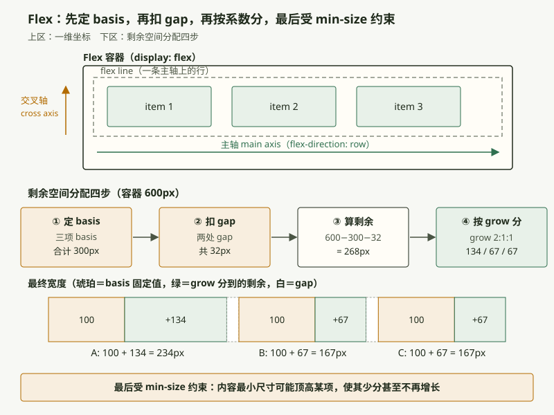

# 15 · 一维空间怎么分

> 一句话模型：Flex 不是"自动排列"，而是先给每项一个**基准尺寸**，算出剩余空间，再按系数分配，最后被最小尺寸拦截。

## 先看一个现象

三张卡片，第一张写 `flex: 2`，另两张写 `flex: 1`。你以为宽度是 2:1:1，实际量出来第一张往往没到两倍：

```css
.row { display: flex; gap: 16px; width: 600px; }
.row > :first-child { flex: 2; }
.row > :nth-child(n+2) { flex: 1; }
```

原因藏在 `flex` 的简写里：`flex: 2` 展开是 `2 1 0%`，`flex: 1` 是 `1 1 0%`，两者的 basis 都是 0，此时按 2:1:1 分没问题。但如果你写的是 `flex-grow: 2`，展开后 basis 仍是 `auto`——每项先按内容占好位置，再分配剩下的空间，结果自然不是 2:1:1。

**Flex 的核心不是"对齐"，而是"空间分配"。** 对齐只是分配之后的附加动作。

## 先建立直觉



*图 15-1 · Flex 的空间分配四步*

上图先分清两条轴：主轴决定空间往哪个方向流，交叉轴决定对齐方向。下图用具体数字走一遍分配过程，最后一步的 min-size 是很多"算对了却不对"的原因。

## 机制拆成四步

### 1. 定方向：主轴与交叉轴

`flex-direction: row` 时主轴是水平方向，`column` 时主轴是垂直方向。交叉轴永远与主轴垂直。

`justify-content` 只管主轴，`align-items` 只管交叉轴——记混了就会调错属性。一个常见误区是给单行 Flex 写 `align-content`，它只在换行产生多行后才起作用。

### 2. 定基准：flex-basis

`flex-basis` 是**分配开始前**每项在主轴上的尺寸。它优先于 `width`（`row` 方向时），`auto` 表示先看 `width`，再看内容尺寸。

```css
.item { flex: 1 1 100px; }  /* basis = 100px */
```

`flex: 1` 等价于 `1 1 0%`，`flex: none` 等价于 `0 0 auto`，`flex: auto` 等价于 `1 1 auto`。写简写时把 basis 想清楚，比背口诀有用。

### 3. 算剩余，按系数分

```text
剩余空间 = 容器主轴尺寸 − 所有 basis 之和 − 所有 gap
```

拿图里的数字走一遍：容器 600px，两项 gap 共 32px，三个 basis 各 100px 共 300px，剩余 `600 − 32 − 300 = 268px`。`grow` 为 2:1:1，按四份分：`134 / 67 / 67`，最终每项 `234 / 167 / 167 px`。
空间不足时 `flex-shrink` 按"系数 × basis"加权收缩，不是简单按系数平分——items 基准越大，承担的收缩越多。

### 4. 被最小尺寸拦截

Flex 子项默认 `min-width: auto`（`column` 方向是 `min-height: auto`），意思是"别比我内容的最小尺寸还窄"。长 URL、长单词会卡在这一步，导致前面的计算全部失效：

```css
.row > .url {
  min-width: 0;             /* 允许收缩到内容最小尺寸以下 */
  overflow-wrap: anywhere;  /* 再给文本一个可断行的出路 */
}
```

**为什么不是默认就让它收缩？** 因为默认行为优先保护内容不被裁掉；你需要主动声明"这里允许截断"。

## 动手验证

[打开 demo：拖动容器宽度，看每一项实际分到多少](../../examples/minimal/15-flex-space.html)

<iframe class="demo-frame" src="/css-concept-course/examples/minimal/15-flex-space.html" title="拖动容器宽度，看每一项实际分到多少" loading="lazy"></iframe>

> **先预测**：容器 600px、gap 16px、三项 basis 各 100px、grow 为 2:1:1 时，第一项最终多少 px？写下答案再揭晓。
>
> **验证**：打开 demo 调节参数，用页面显示的实时读数核对你的预测。

demo 会把每项实测像素和计算式一起显示。拖动滑块时重点观察：**剩余空间怎么变、每项的增量比例是否保持 2:1:1、什么时候 min-size 开始拦截。**

## 容易误判的地方

- **`flex: 1` 与 `flex-grow: 1` 不一样** → 前者 basis 是 0，后者 basis 是 auto，二者分配结果不同。
- **"设了 width 就固定了"** → basis 为 0 或 auto 时，width 只是起点，最终尺寸由剩余空间分配决定；要固定就用 `flex: none`。
- **图标被压扁** → 默认是 `flex-shrink: 1`，给图标 `flex: none` 才能保住尺寸。

## 自己再做一次

1. 三个子项 basis 均为 0，grow 为 1:2:3，容器 600px、无 gap。**预期结果：100 / 200 / 300 px**。
2. 把上题改成 basis 各 100px、grow 为 1:2:3。**预期结果：先各扣 100，剩余 300 按 1:2:3 分，总计 150 / 200 / 250 px**。
3. 一个很长的 URL 子项设置 `flex: 1 1 0`，容器缩到 300px，先观察溢出，再加 `min-width: 0`。**预期结果：加之前 URL 撑破容器，加之后子项收缩、文本按你的换行策略截断。**

> 下一篇：[二维空间怎么画](16-grid.md)
