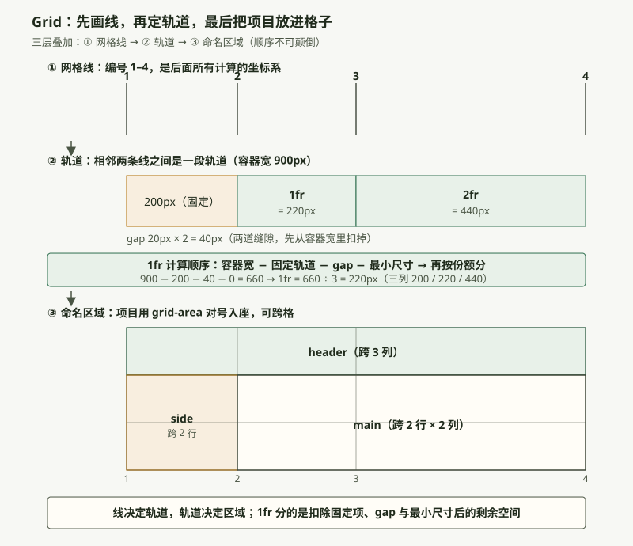

# 16 · 二维空间怎么画

> 一句话模型：Grid 先画线，再给线之间的轨道定尺寸，最后把项目放进格子；`1fr` 分的是**扣掉固定轨道和 gap 之后的剩余空间**，不是"三列就各三分之一"。

## 先看一个现象

想要三列等宽，写下：

```css
.grid { display: grid; grid-template-columns: repeat(3, 1fr); gap: 20px; }
```

```html
<div class="grid">
  <div>短</div>
  <div>短</div>
  <div>Supercalifragilisticexpialidocious</div>
</div>
```

前两列正常，第三列放了一个不允许换行的长单词 `Supercalifragilisticexpialidocious`，它突然比另外两列宽了一大截，甚至撑破了容器。

你以为：三个 `1fr` 就是三等分。实际：第三列的内容把这一列的**最小尺寸**顶高了，`1fr` 只能分扣除这个最小值之后的剩余空间。等宽的前提是每列的"下限"相同。

## 先建立直觉



*图 16-1 · 网格线、轨道、区域三层叠加*

先在容器里画出纵横的线；相邻两条线之间是轨道；项目占据若干轨道，形成一个区域。记住这个先后顺序：线的位置决定轨道，轨道决定项目能落在哪里。

图里最重要的是第三层：我们平时说的"列"，其实是**两条竖线之间的一段轨道**。项目不是被"摆"到任意位置，而是被放进由线围出来的格子里。

## 机制拆成四步

### 1. 先画线：显式轨道与隐式轨道

`grid-template-columns` / `grid-template-rows` 声明的是**显式轨道**，它们同时定义了网格线的名字和编号。如果一个项目被放到显式网格之外，比如第 5 行，浏览器会自动补出轨道来容纳它，这就是**隐式轨道**，尺寸由 `grid-auto-rows` / `grid-auto-columns` 决定。

**为什么先画线？** 因为线是坐标系。没有线，就没有"第几列""跨两列"这些概念；后面所有尺寸计算都是在这套坐标上进行的。

```css
.grid {
  display: grid;
  grid-template-columns: 200px 1fr;  /* 两条显式列 */
  grid-auto-rows: 80px;               /* 多出来的行高 80px */
}
```

给项目设 `grid-row: 5` 而只声明了 3 行时，浏览器会补出第 4、5 行，它们的高度取 `grid-auto-rows` 的值（默认 `auto`，按内容算）。**为什么隐式轨道值得单独记住？** 因为你以为"只有三行"时，一个写错的行号会悄悄造出新行，把容器撑高，而你盯着 `grid-template-rows` 却找不到来源。

### 2. 再定轨道：fr 分的是剩余空间

计算有严格顺序：

1. 用容器宽度减去所有**固定轨道**；
2. 再减去所有 **gap**；
3. 再减去每条轨道的**最小尺寸**（下一步解释）；
4. 把剩下的空间按 fr 系数分配。

假设容器宽 900px，`grid-template-columns: 200px 1fr 2fr`，`gap: 20px`（两道缝隙共 40px），且各轨道最小尺寸为 0：

- 剩余 = 900 − 200 − 40 = 660px
- fr 总数 = 1 + 2 = 3，`1fr = 220px`
- 三列分别是 200px、220px、440px（合计 200+220+440+40 = 900px）

写成 CSS 就是：

```css
.grid {
  display: grid;
  width: 900px;
  grid-template-columns: 200px 1fr 2fr;
  gap: 20px;
}
```

**为什么先扣固定值和 gap？** 因为它们是确定的，不随剩余空间变化；fr 本质上是一个"占剩余空间几份"的比例，分母必须是被确定项占用之后剩下的部分。所以 `1fr 1fr 1fr` 只在每列最小尺寸相同时才等于三等分。

### 3. 最小尺寸：为什么 `1fr` 会被内容撑开

`1fr` 的完整含义是 `minmax(auto, 1fr)`：下限是 `auto`，也就是该轨道里内容的**最小内容尺寸**。长单词、不可换行的代码块、固定宽度的图片都会把这个下限顶高，于是轨道无法收缩到按 fr 算出来的值。

把 `1fr` 换成 `minmax(0, 1fr)`，就把下限从"内容最小尺寸"改成 0：

```css
.grid { grid-template-columns: repeat(3, minmax(0, 1fr)); }
```

**为什么这样有效？** 上限仍是 1fr，分配规则没变；变的只是下限不再被内容抬高。配合 `overflow-wrap: anywhere` 或让子元素 `min-width: 0`，长内容就会换行或溢出到轨道内部，而不是把轨道本身撑宽。

### 4. 最后放项目：命名线与命名区域

`grid-template-areas` 用名字描述每格属于哪个区域；项目用 `grid-area: 名字` 对号入座：

```css
.grid {
  grid-template-columns: 200px 1fr;
  grid-template-areas:
    "nav  main"
    "foot foot";
}
.item-main { grid-area: main; }
```

也可以给线起名（`[nav-start] 200px [nav-end] 1fr`），再用 `grid-column: nav-start / nav-end` 放置。

**为什么用名字？** 列名和区域名把"第几列"换成语义标签，调整列数时不用逐个数线去改 `grid-column` 的数字。

> 一句带过：子网格需要跟父级对齐时，`subgrid` 让子网格**直接继承父网格的轨道**，而不是自己新建一套线。

## 动手验证

[打开 demo：改模板，看轨道怎么变](../../examples/minimal/16-grid.html)

<iframe class="demo-frame" src="/css-concept-course/examples/minimal/16-grid.html" title="改模板，看轨道怎么变" loading="lazy"></iframe>

> **先预测**：容器宽 600px、`grid-template-columns: 150px 1fr 2fr`、`gap: 12px`，第二条轨道分到多少像素？
>
> **验证**：打开 demo 调节参数，用页面显示的实时读数核对你的预测。

验证：打开 demo，把模板改成这个值，读取状态文本里的实际轨道宽度；再打开"长单词"开关，观察 `1fr` 与 `minmax(0,1fr)` 的差别。

demo 会把当前模板、gap 和每条轨道的实际像素宽同时显示出来，你可以把自己按四步算出的结果和它对账。

## 容易误判的地方

- **"`repeat(3, 1fr)` 就是三等分"** → 只在各列最小尺寸相同且容器足够大时成立；内容下限不同就会不等宽。
- **"隐式轨道也走 `grid-template-columns`"** → 不，它走 `grid-auto-columns/rows`；显式轨道只管你声明出来的那部分。
- **"fr 不能和 px 混用"** → 可以混用，这正是 fr 的设计目的：固定项先扣，剩余按 fr 分。

## 自己再做一次

1. 容器 900px，模板 `200px 1fr 2fr`，gap 20px，各列最小尺寸为 0。**预期结果：三列为 200px / 220px / 440px**，总和含 gap 正好 900px。
2. 把第 1 题改成 `repeat(3, 1fr)`，其中一列放禁止换行的长单词。**预期结果：那一列明显宽于另外两列**；改成 `repeat(3, minmax(0, 1fr))` 后三列恢复等宽（内容换行或溢出）。
3. 一个 `grid-template-areas: "nav main" "foot foot"` 的两列网格，给一个项目设 `grid-area: foot`。**预期结果：它横跨两列、占据第二行**，无需写任何列号。

> 下一篇：[组件自己的断点](17-container-query.md)
