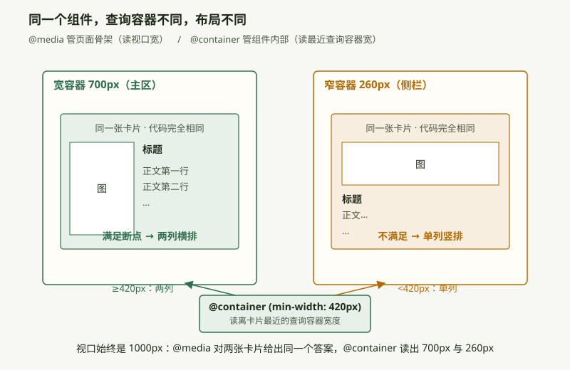

# 17 · 组件自己的断点

> 一句话模型：媒体查询按**视口**改页面骨架，容器查询按**组件自己所在的空间**改内部布局；组件不能只靠视口断点，因为同一个视口能把它放进侧栏、主区或弹窗，而这些位置给它的宽度完全不同。

## 先看一个现象

一张卡片组件，用 `@media (min-width: 800px)` 控制"横向排列"：视口大于 800px 时，图片在左、文字在右。

```css
.card { display: block; }
@media (min-width: 800px) {
  .card { display: flex; }   /* 横排：图片在左，文字在右 */
}
.sidebar { width: 260px; }
.main    { width: 700px; }
```

把它放进 1000px 页面的主区，横向排列，很好。再把它放进同页面的 260px 侧栏——视口仍然是 1000px，`@media` 条件依然成立，卡片还是横排，于是图片和文字挤成一团，文字被压到只剩几十像素。

你以为：写够了视口断点，组件就能适应任何位置。实际：视口只有一个，组件可能被放进很多不同宽度的容器；**断点该问的是"我有多宽"，而不是"页面有多宽"**。

这张卡片的 CSS 本身没写错，它只是把"视口够宽"当成了"我有足够空间"。这两件事在侧栏里并不等价。

## 先建立直觉



*图 17-1 · 视口查询与容器查询的作用范围*

外层是视口，`@media` 读的是它的宽度；视口里有侧栏和主区两个盒子，各自建立查询容器；`@container` 读的是**离自己最近的那个查询容器**的宽度。同一个组件放进不同盒子，读到的数就不同。

图的关键：两张卡片代码完全相同，只是所在容器不同，就读出不同的宽度。这正是视口查询做不到的事——它对所有卡片返回同一个数。

读图时按这个顺序：先看 `@media` 拿到的是哪个数，再看每个 `@container` 拿到的是哪个数。两者相等时，容器查询没有提供额外信息；只有当容器宽度分化时，它才有用武之地。

## 机制拆成四步

### 1. 谁在响应：视口管骨架，容器管内部

页面级的两栏/三栏切换由视口决定，因为那是**页面整体**的形状；卡片内部的图文排列由容器决定，因为那是**组件局部**的形状。

**为什么组件不能只靠视口断点？** 同一个视口宽度下，组件可能被放进窄侧栏、宽主区、弹窗、网格单元格，可用宽度各不相同。视口断点无法区分这些位置，所以它只能管"整体骨架"，管不了"每个格子里长什么样"。

| 要回答的问题 | 由谁回答 | 读的数 |
| --- | --- | --- |
| 页面整体分几栏 | 媒体查询 `@media` | 视口宽 |
| 卡片内部横排还是竖排 | 容器查询 `@container` | 离它最近的查询容器宽 |
| 卡片字号用哪个参照 | `cqi` / `cqw` 或 `vw` | 容器宽或视口宽 |

三者各管一层，互相不替代。选之前先问"这个决定依赖的是整体还是局部空间"。

### 2. 建立查询容器：container-type 与它的副作用

要让组件能被查询，先给它的父容器声明 `container-type`：

```css
.slot { container-type: inline-size; }   /* 只按行内方向（通常是宽度）可查询 */
.card { ... }
```

```html
<div class="slot"><div class="card">…</div></div>
```

**副作用必须知道**：`container-type` 会开启对应方向的**尺寸包含（size containment）**——容器在该方向上的尺寸不再由内容撑开。用 `inline-size` 时，宽度不再被内容撑开，所以你必须显式给它一个宽度（比如 `width: 100%` 或网格轨道宽度）；高度仍由内容决定，不受影响。如果写 `size`，两个方向都被包含，高度也会塌成 0，除非显式指定。

**为什么要有这个副作用？** 查询容器若能被自己的内容改变尺寸，就会出现"尺寸影响查询条件、条件又反过来改变内容"的循环。先让尺寸独立于内容，查询结果才稳定、可解析。

### 3. @container：条件读的是容器尺寸

```css
.card { display: block; }
@container (min-width: 420px) {
  .card { display: flex; gap: 16px; }
}
```

条件成立时，卡片改成横向。这里的 420px 读的是 `.slot` 的宽度，不是视口。页面上有多个查询容器时，用 `container-name` 指定查哪一个：

```css
.slot { container-type: inline-size; container-name: aside; }
@container aside (min-width: 420px) { ... }
```

**为什么条件要按容器读？** 因为响应的是组件被分配的可用空间；离它最近的可查询祖先，正是分配这块空间的盒子。

查找规则要记准：不带名字时，找**最近的查询容器祖先**；带名字时，找最近的**同名**查询容器祖先；都没找到，条件不成立，样式回退到默认分支。它不会跳过中间那个容器去读更外层的宽度。

### 4. cqw / cqi：以容器为参照的长度

`1cqw` 等于查询容器宽度的 1%；`1cqi` 等于查询容器**行内轴**尺寸的 1%（在横排书写下就是宽度）。它们让组件内部的字体、间距随容器连续缩放，而不是只在断点处跳变。

```css
.card-title { font-size: clamp(16px, 4cqi, 24px); }
```

容器 400px 时 `4cqi = 16px`，容器 200px 时 `4cqi = 8px`（会被下限兜到 16px）。回到开头的场景：260px 侧栏里 `4cqi ≈ 10.4px`，标题被兜到下限 16px；700px 主区里 `4cqi = 28px`，标题被上限压到 24px——同一个组件，字号自然不同。

**为什么需要这类单位？** `vw` 以视口为参照，同一个组件在不同宽度的容器里会得到相同字号；`cqi` 以容器为参照，才能做到"侧栏里小、主区里大"。

## 动手验证

[打开 demo：拖动容器宽度，看同一张卡片重排](../../examples/minimal/17-container-query.html)

<iframe class="demo-frame" src="/css-concept-course/examples/minimal/17-container-query.html" title="拖动容器宽度，看同一张卡片重排" loading="lazy"></iframe>

> **先预测**：一个 `container-type: inline-size` 的容器，初始宽 320px，卡片用 `@container (min-width: 420px)` 切换横排。当宽度拖到 500px 时，卡片是横排还是竖排？
>
> **验证**：打开 demo 调节参数，用页面显示的实时读数核对你的预测。

验证：打开 demo 拖动宽度滑块，观察卡片布局切换的临界点是否正好在 420px，并对照视口宽度保持不变这一点。

demo 同时显示视口宽度和容器宽度两个数值，你会看到视口没变而卡片已经重排——这正是容器查询的证据。

## 容易误判的地方

- **"`@container` 查的是元素自己的宽度"** → 查的是**最近的查询容器祖先**的宽度，元素自己需要先有 `container-type` 才能被它的后代查询。
- **"加了 `container-type` 容器会自己撑开"** → 相反，它在该方向开启尺寸包含，宽度不再由内容撑开；忘记给宽度会导致容器塌缩。
- **"容器查询能取代媒体查询"** → 不能；页面的整体骨架仍由视口决定，两者分工不同。

## 自己再做一次

1. 一个 260px 侧栏和一个 700px 主区放同一张卡片，卡片用 `@container (min-width: 420px)` 横排。**预期结果：主区卡片横排，侧栏卡片竖排**，尽管两者视口相同。
2. 给容器只设 `container-type: inline-size` 而不设宽度。**预期结果：容器宽度塌成 0（或被父级限制），卡片看不到内容**；补上 `width: 100%` 后恢复。
3. 卡片标题用 `font-size: 4cqi`，把容器从 300px 拖到 600px。**预期结果：标题字号从约 12px 连续变到约 24px**，视口宽度不影响这个值。

> 下一篇：[长度以谁为参照](18-units.md)
