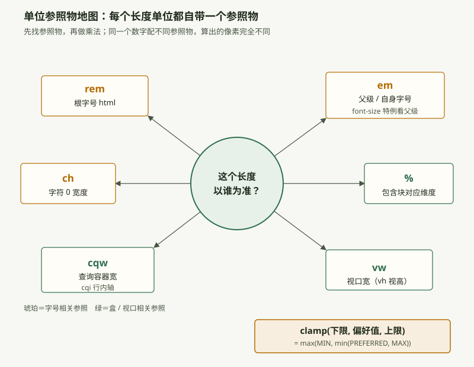

# 18 · 长度以谁为参照

> **前置**：会用第 04 篇的继承判断 `font-size` 从哪里来；知道第 06 篇的包含块是百分比参照的盒；知道第 17 篇的查询容器由 `container-type` 建立。本篇只把字号当参照物读取，不依赖字体度量的细节。
>
> 上一篇：[组件自己的断点](17-container-query.md) ｜ [本阶段目录](README.md)

## 1. 本章目标

- 给定 `rem` / `em` / `%` / `vw` / `cqw` 和对应参照物的数值，能算出像素值，五个里不错一个。
- 能解释 `font-size: 1.25em` 嵌套三层为何越嵌越大，而 `1.25rem` 每层都是 20px。
- 能说出 `padding` / `margin` 四个方向的百分比参照哪个盒，并说明为什么上下方向也参照宽度。
- 能算出 `clamp(12px, 4vw, 24px)` 在 300px、450px、700px 视口下的结果，并指出哪一端被兜住。

**为什么现在学这个**：第 17 篇让组件能按自己的容器重排，但重排只是跳变；字号和留白还需要连续插值。本篇给每个单位找到参照物，第 19 篇的响应式尺度才有着落。

## 2. 新增模型

想要"每级标题比父级大 1.25 倍"，写：

```css
html { font-size: 16px; }
.text { font-size: 1.25em; }
```

```html
<div class="text">一级
  <div class="text">二级
    <div class="text">三级</div>
  </div>
</div>
```

你以为三级差不多是 25px，实际二级已经 25px、三级 31.25px，越嵌越大，最后撑破排版。换成 `font-size: 1.25rem`，每一级都稳定在 20px。

**模型：每个长度单位都自带一个参照物；把它换算成像素，就是"先找到它问谁，再做乘法"。**



*图 18-1 · 单位参照物地图*

图从中间的"这个长度以谁为准"分出六条线：`rem` 指向根字号，`em` 指向父级（写在 `font-size` 上时）或自身字号，`%` 指向包含块的对应维度，`vw` / `vh` 指向视口，`cqw` / `cqi` 指向查询容器，`ch` 指向字符 `0` 的宽度。六个单位配同一个数字，算出的像素各不相同。

**这张图的一句话结论：换单位就是换参照物；不先确定参照物，乘法无从下手。**

术语落地：

- **参照物**：单位换算成像素时要去读取的那个量，比如根字号、自身字号、包含块宽度。
- **根字号**：`html` 元素的 `font-size`，`rem` 唯一读取的对象；改它会影响所有 rem。
- **`clamp()`**：把首选值夹在上下限之间的函数，不是某种"智能响应"。

单位用错时页面通常不报错，只会"算出一个你没预期的数"，所以推演参照物比背取值列表更有用。

## 3. 可运行的 demo

先把参照物看一遍，再读下面的规则。带着"为什么调字号时有些色条不动"的疑问往下走，会比先看定义有效得多。

[打开 demo：同屏显示各类单位的实时计算值](../../examples/minimal/18-units.html)

<iframe class="demo-frame" src="/css-concept-course/examples/minimal/18-units.html" title="同屏显示各类单位的实时计算值" loading="lazy"></iframe>

> **先预测**：根字号 16px、查询容器宽 400px、视口宽 1000px 时，五个探针 `1rem`、`1em`（探针自身 `font-size: 1rem`）、`50%`、`10vw`、`10cqw` 换算成像素各是多少？写出五个数再揭晓。
>
> **验证**：读页面"状态（浏览器实测）"里的五项实测读数核对：16 / 16 / 200 / 100 / 40 px；再把"根字号"滑块拖到 20px，确认只有前两项跟着变。

如果你发现调字号时 `%`、`vw`、`cqw` 三条色条纹丝不动，说明你已经抓住了"参照物决定单位"的要害。

## 4. 原理与规则

### 4.1 rem 与 em：一个看根，一个看自身

`rem` 取根元素 `html` 的 `font-size`；`em` 取**当前元素自身**的 `font-size`。唯一例外是当 `em` 出现在 `font-size` 属性上时，它参照**父元素**的 `font-size`。

**为什么有这个例外？** `font-size` 本身定义了 `em` 的含义，若它又参照自身，就成了"用自己定义自己"的循环；参照父级才能打破循环。设根字号 16px、父元素 `font-size: 1.25em` 得到 20px：

| 写法 | 参照物 | 三层嵌套后的结果 |
| --- | --- | --- |
| `font-size: 1.25rem` | 根字号 16px | 每层都是 20px |
| `font-size: 1.25em` | 父元素字号 | 20px → 25px → 31.25px |
| `padding: 1.25em` | 元素自身字号 | 随该元素自己的字号缩放 |

**为什么 rem 更适合全局尺寸？** 它只有一个参照物，不会因为嵌套层级漂移；`em` 适合"跟着本组件字号走"的局部尺寸，比如按钮内边距随按钮字号一起变。

**失效条件**：把 `font-size` 上的 `em` 结论照搬到别的属性上就会算错——`padding: 1.25em` 参照的是元素**自身**字号，不是父级；元素字号为 20px 时它是 25px，与父级是谁无关。

### 4.2 %：先找包含块，再找对应维度

百分比要解析成像素，参照物就是**包含块**（详见第 06 篇）。`width: 50%` 参照包含块宽度；`top: 10%` 参照包含块高度；而 `padding` 和 `margin` 的百分比——**包括上下方向**——都参照包含块的**宽度**。

```css
.box { width: 400px; padding: 10% 5%; }  /* 上下各 40px，左右各 20px */
```

**为什么 `padding-top` 也参照宽度？** 这样垂直内间距能随宽度一起缩放，保持排版比例；若参照高度，而高度常由内容决定，就会形成"高度依赖内边距、内边距又依赖高度"的循环依赖。

`height: 50%` 是另一回事：它只有在包含块有**确定高度**时才能解析成像素；父元素高度是 `auto` 时没有分母，它被当成 `auto` 处理。

**失效条件**：父元素高度由内容决定（`height: auto`）时，`height: 50%` 解析不出数，退化为 `auto`，你写的百分比等于没写；百分比 `padding` / `margin` 在横向书写下永远按包含块**宽度**算，把 `padding-top: 10%` 当成"高度的 10%"必然算错。

### 4.3 vw / cqw / ch：视口、容器与字符

- `vw` / `vh`：视口宽 / 高的 1%，参照物是视口，窗口一变它跟着变；`vh` 常用于全屏区块的高度。
- `cqw` / `cqi`：查询容器宽 / 行内轴尺寸的 1%（详见第 17 篇）。在 400px 容器里 `10cqw = 40px`。
- `ch`：数字 `0` 在当前字体下的前进宽度，适合按字符数控制行文宽度。

```css
.article { max-width: 65ch; }  /* 约容纳 65 个 "0" 的宽度 */
```

**为什么需要 `ch`？** 它把宽度单位换成"能放下多少字符"，而不是像素；换字体时文本框会自动保持相近的每行字数。同一个 `65ch` 在不同字体下像素值不同，这正是它的用处，也是它不适合像素级对齐的原因。

**失效条件**：元素不在任何查询容器里时，`cqw` / `cqi` 回退到视口单位，参照物从容器变成视口；`ch` 随字体改变，所以不要把 `65ch` 写进需要与某个像素盒严丝合缝对齐的布局。

### 4.4 clamp：带上下限的插值

`clamp(MIN, PREFERRED, MAX)` 把首选值限制在区间内，数学上等价于：

```css
font-size: max(12px, min(4vw, 24px));  /* 等价于 clamp(12px, 4vw, 24px) */
```

先取 `PREFERRED` 与 `MAX` 中较小的，再取它和 `MIN` 中较大的。设 `MIN = 12px`、`MAX = 24px`：

- 视口 300px：`4vw = 12px` → 落在下限，结果 12px。
- 视口 450px：`4vw = 18px` → 落在区间内，结果 18px。
- 视口 700px：`4vw = 28px` → 超过上限，结果 24px。

**为什么用 `clamp` 而不是 `calc`？** `calc(4vw)` 只给出一个可能过大或过小的值；`clamp` 让它在小屏和大屏分别被 `MIN` / `MAX` 兜住，中间连续插值。它不是额外算法，就是 `min` 和 `max` 的组合。

**失效条件**：`MIN` 写成大于 `MAX` 时，规范取 `MIN`，中间值永远取不到，上下限反写等于把区间锁死；写成 rem 的上下限会跟随根字号——`clamp(1rem, 4vw, 2rem)` 在根字号 16px 时是 `clamp(16px, 4vw, 32px)`，根字号改成 20px 就变成 `clamp(20px, 4vw, 40px)`，整个夹逼区间跟着平移。

## 5. 常见坑

**坑 1：`font-size: 1.25em` 嵌套三层越嵌越大**

- **原因**：`em` 写在 `font-size` 上参照父元素字号，每层都把上一层再乘 1.25。
- **确认**：DevTools 里逐层看 computed `font-size`，20px → 25px → 31.25px 就是累乘。
- **修法**：改成 `1.25rem`，每层固定 20px；代价是它不再跟随组件自身字号。

**坑 2：`padding: 10%` 的上下留白算错**

- **原因**：`padding` 四个方向的百分比都参照包含块宽度，400px 容器下上下也是 40px，不是高度的 10%。
- **确认**：看 computed `padding-top` 是否为 40px，再和包含块 `clientHeight` 的 10% 对比，两者不同即命中。
- **修法**：想按高度缩放就写 `vh` 或具体 `px`；按宽度缩放时保留百分比。

**坑 3：`clamp` 的 rem 上下限按 10px 算错**

- **原因**：`rem` 参照根字号，根字号是 16px 时 `1rem = 16px`，不是旧教程里假设的 10px。
- **确认**：读 `getComputedStyle(document.documentElement).fontSize`，再看 `clamp` 的计算结果是否落在换算后的区间。
- **修法**：先把 rem 换成实际像素再推理，根字号一变就重新换算整个区间。

## 6. 练习

1. **基础**：根字号 16px，父元素 `font-size: 1.25em`（20px），子元素 `font-size: 1.25em`。
   验收：子元素 computed `font-size` 为 25px；改成 `1.25rem` 后为 20px，且继续嵌套不再变化。

2. **基础**：包含块宽 400px，子元素 `padding: 10% 5%`。
   验收：computed `padding-top` 与 `padding-bottom` 各 40px、`padding-left` 与 `padding-right` 各 20px，四个值都按 400px 算。

3. **进阶**：视口 800px、查询容器 400px，`font-size: clamp(12px, 4cqi, 24px)`。
   验收：`4cqi = 16px`，落在区间内，结果 16px；容器缩到 200px 时 `4cqi = 8px`，被下限兜到 12px。

4. **进阶**：`clamp(12px, 4vw, 24px)`，视口分别取 300px、450px、700px。
   验收：结果为 12px（下限）、18px（区间内）、24px（上限）；三个数都能用 `4vw` 复算出来。

5. **挑战**：把根字号从 16px 改成 20px，`clamp(1rem, 4vw, 2rem)` 的区间与视口 500px 时的结果怎么变？
   验收：区间由 `16–32px` 变成 `20–40px`；视口 500px 时 `4vw = 20px` 正好落在下限，结果为 20px。说明 rem 参照物改变会让整个夹逼区间平移。

> 下一篇：[从视口到组件](19-responsive.md)
