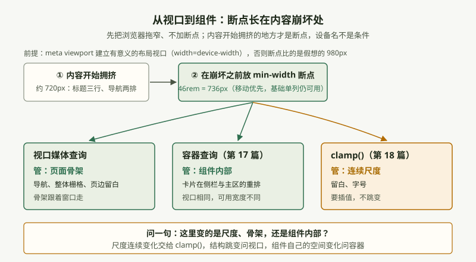

# 19 · 从视口到组件

> **前置**：知道第 17 篇的 `@container` 读的是最近查询容器，第 18 篇的 `clamp()` 做连续插值。本篇把两者与视口媒体查询放在一张分工表里，媒体查询只按"宽度是否命中"使用，不依赖它的层叠细节。
>
> 上一篇：[长度以谁为参照](18-units.md) ｜ [本阶段目录](README.md)

## 1. 本章目标

- 给定一段在 720px 左右开始挤压的布局，能定出移动优先断点并写出 `min-width: 46rem`，说清 736px 的来处。
- 面对一个具体变化，能判断该交给视口查询、容器查询还是 `clamp()`，并说出理由。
- 能写出 `(hover: hover) and (pointer: fine)`，并分别说出触屏与桌面鼠标下悬停效果是否生效。
- 给定 `srcset="p-400.jpg 400w, p-800.jpg 800w, p-1200.jpg 1200w"` 与 `sizes="(min-width: 48rem) 45vw, 100vw"`，能算出视口 1000px、DPR 1 时浏览器倾向选哪张。

**为什么现在学这个**：前两篇分别给了容器查询和单位；把它们与视口查询放在一起，才知道谁该对哪种变化负责。第 20 篇起进入内容与组件，先有一套不靠设备名的响应式骨架。

## 2. 新增模型

照着某款手机的宽度写一串断点：

```css
@media (min-width: 393px) { /* 某型号手机 */ }
@media (min-width: 768px) { /* 某型号平板 */ }
@media (min-width: 1024px) { /* 某型号桌面 */ }
```

新机型 412px 也命中第一条，但间距是按 393px 调的，放上去就偏；横屏平板 1024px 命中"桌面"，两列被拉得很空。真正逼你改布局的是把浏览器从 1200px 慢慢拖窄到约 720px 的那个位置：标题折成三行、导航挤成两排、按钮开始重叠——它和任何设备型号都无关。

**模型：断点是内容开始失效的位置，不是设备名的别名；连续变化交给单位插值，结构跳变才交给断点。**



*图 19-1 · 从视口到布局的推断链*

图是一条分叉链：视口与环境的输入先经过 `meta viewport` 建立有意义的布局视口，然后在内容开始拥挤处（约 720px）放 `min-width: 46rem` 断点。之后分三条路——留白和字号交给 `clamp()`（第 18 篇）连续插值，页面骨架交给视口媒体查询跳变，组件内部交给容器查询（第 17 篇）。图片资源走另一条支线，由 `srcset` / `sizes` 协商候选。

**这张图的一句话结论：先问"变的是尺度、骨架还是组件内部"，再决定交给 `clamp`、视口还是容器。**

术语落地：

- **移动优先**：默认写最窄也成立的单列布局，再用 `min-width` 往上增强。
- **`meta viewport`**：让移动浏览器按设备宽度建立布局视口的声明，否则断点比的是假想的宽度。
- **候选协商**：浏览器结合 `srcset`、`sizes`、设备像素比与网络挑一张图，不是作者指定一张。

## 3. 可运行的 demo

先亲眼看到断点在哪一像素生效，再读下面的分工规则。带着"为什么是 736px 而不是某个机型宽度"的疑问往下走，效果最好。

[打开 demo：拖动视口宽度，看断点在哪一像素生效](../../examples/minimal/19-responsive.html)

<iframe class="demo-frame" src="/css-concept-course/examples/minimal/19-responsive.html" title="拖动视口宽度，看断点在哪一像素生效" loading="lazy"></iframe>

> **先预测**：卡片默认单列，`min-width: 46rem`（根字号 16px）时切成两列。切换发生在多少像素？900px 和 700px 时各是几列？写下答案再揭晓。
>
> **验证**：拖动"模拟视口宽度"滑块，核对页面读数里的"46rem 换算"和"实际列数"两行：736px 是临界点，900px 为两列、700px 为单列。

如果你看到切换点正好落在 `46 × 16 = 736`，而不是任何手机或平板的型号宽度，说明断点该长在哪儿已经清楚了。

## 4. 原理与规则

### 4.1 断点长在内容崩坏处，不是设备名上

先把浏览器拖窄，**不加任何断点**，让内容自己流动。找到溢出、过度换行、导航难扫、按钮互相挤压的那一刻，在它之前放一条断点，并用注释记录内容原因。

```css
/* 导航链接与品牌标识在约 720px 处开始挤成两行 */
.stack { display: grid; gap: 1rem; grid-template-columns: 1fr; }
@media (min-width: 46rem) {
  .stack { grid-template-columns: repeat(2, minmax(0, 1fr)); }
}
```

**为什么用移动优先？** 基础布局在"没有任何断点命中"时仍然可用，增强规则是在已经能用的布局上加能力，而不是在宽屏布局上做削减。桌面优先的 `max-width` 适合改造已有系统，但同一组件里不要来回混用两个方向。

前提是页面里有这行声明：

```html
<meta name="viewport" content="width=device-width, initial-scale=1" />
```

**为什么没有它断点会错位？** 移动浏览器会先按约 980px 的布局视口渲染再缩小显示，你写的 `min-width` 比的是这个假想值，而不是设备宽度。

**失效条件**：缺 `meta viewport` 时，上面那条 46rem 断点在手机上几乎总是命中，单列增强永远不生效；加 `user-scalable=no` 或 `maximum-scale=1` 禁缩放既不修布局，又伤低视力用户。

### 4.2 媒体特性查的是环境，不是机型

宽度之外，媒体查询还能读用户环境与偏好：

```css
@media (hover: hover) and (pointer: fine) {
  .card:hover { border-color: #4c7884; }
}
@media (prefers-color-scheme: dark) {
  :root { color-scheme: dark; }
}
@media (prefers-reduced-motion: reduce) {
  .card { transition: none; }
}
```

**为什么这叫"环境"而不是"设备"？** 触屏笔记本会同时报告触控与精确指针，用户也能随时切换系统主题或减弱动画偏好。把 `(pointer: coarse)` 当成"手机"就会误判；悬停效果只放进 `(hover: hover) and (pointer: fine)`，触屏上不依赖悬停也能完成任务。

`prefers-color-scheme: dark` 只告诉作者用户选了深色，页面背景与文字仍要自己写；配合 `color-scheme: dark` 才能让原生控件、滚动条一起跟上。

**失效条件**：触屏笔记本同时报告 `coarse` 与 `fine`，单独用 `(pointer: coarse)` 判机型必然误判；命中深色查询却没写背景和文字颜色时，页面主体仍是浅色，只有滚动条变暗，等于没适配。

### 4.3 三个响应者分工

同一个宽度变化，响应者不同：

| 变化的对象 | 交给谁 | 理由 |
| --- | --- | --- |
| 页面骨架：导航、整体栅格、页边留白 | 视口媒体查询 | 骨架跟着窗口走 |
| 组件内部：卡片在侧栏与主区的重排 | 容器查询（第 17 篇） | 视口相同，可用宽度不同 |
| 连续尺度：字号、间距、`clamp()` | 流式单位（第 18 篇） | 它要插值，不是跳变 |

**为什么容器查询不能替掉视口查询？** 同一张卡片放进 20rem 侧栏和 60rem 主区，视口宽度一模一样，卡片却必须在两个宽度下换排版；它该问的是"我的容器多宽"。反过来，整页导航结构跟容器无关，问视口就够了。

**为什么 `clamp()` 不能替掉断点？** `clamp(1rem, 4vw, 2rem)` 给出的是连续插值，适合留白和字号；断点负责"从一列变两列"这种结构跳变。混着用就会给每个属性补一条媒体查询，最后满屏断点。

**失效条件**：页面只有一个满宽容器时，视口与容器读数相同，此时改用容器查询只是徒增复杂度；反过来，若发现自己在给字号、留白逐档补断点，说明本该交给 `clamp()` 的连续尺度被误当成了结构跳变。

### 4.4 图片资源也要参与协商

```html

```

`w` 描述符说明每张候选图的固有宽度，`sizes` 告诉浏览器这张图在各视口下大约占多宽；浏览器再结合设备像素比、缓存和网络挑一张。视口 1000px、DPR 1 时命中 `45vw = 450px`，倾向选 800w；把 `sizes` 改成 `100vw` 后需求变成 1000px，倾向选 1200w。

**为什么必须写 `sizes`？** 用 `w` 却省略它，浏览器通常按 `100vw` 估算，容易下载过大的图片。一个 `srcset` 里不要混用 `w` 和 `x`：尺寸随视口变的内容图用 `w` + `sizes`，尺寸基本固定的头像用 `x`。

**失效条件**：`sizes` 只是候选提示，不强制下载某张图，最终请求还看 DPR、缓存与浏览器策略，所以别把 `45vw` 当成"必定下载 800w"；竖屏方图、宽屏宽图属于艺术指导，该用 `<picture>`，堆叠多个 `media` 只为了换更大尺寸是误用。

## 5. 常见坑

**坑 1：给断点起机型名，新机型一出来间距就偏**

- **原因**：设备名不是条件，内容开始挤压的宽度才是；412px 新机命中为 393px 调的规则，间距自然偏，而注释写机型会诱使后来者继续照机型加断点。
- **确认**：拖窄窗口记录标题折行、导航换行发生的像素，再拿它和断点值比。
- **修法**：按内容宽度定断点（如 46rem），注释写内容原因；代价是每次内容改版都要重新观察一次。

**坑 2：把 `pointer: coarse` 当手机，触屏笔记本上悬停失效**

- **原因**：触屏笔记本同时报告两种指针，单独的 coarse 判断不了输入方式。
- **确认**：在触屏笔记本上看 `(hover: hover) and (pointer: fine)` 是否命中，再对比只写 coarse 的结果。
- **修法**：悬停效果放进 `(hover: hover) and (pointer: fine)`，触屏上不依赖悬停也能完成任务。

**坑 3：以为 `sizes` 指定了下载哪张图**

- **原因**：它只是候选提示，浏览器还会考虑设备像素比、缓存和网络。
- **确认**：网络面板看实际请求的图片 URL，与 `sizes` 算出的需求宽度对比。
- **修法**：用 `w` + `sizes` 描述随视口变化的内容图，固定尺寸头像用 `x`，不要在同一 `srcset` 混用。

## 6. 练习

1. **基础**：两列卡片从 1000px 拖窄，约 720px 时标题折三行、按钮挤压，断点设 `min-width: 46rem`。
   验收：`46 × 16 = 736px`；≥736px 两列、<736px 单列；720px 时已是单列；禁用媒体查询后基础单列布局仍成立。

2. **基础**：`srcset="p-400.jpg 400w, p-800.jpg 800w, p-1200.jpg 1200w"`，`sizes="(min-width: 48rem) 45vw, 100vw"`，视口 1000px、DPR 1。
   验收：命中 `45vw = 450px`，倾向选 800w；把 `sizes` 改成 `100vw` 后需求 1000px，倾向选 1200w。

3. **进阶**：写 `@media (hover: hover) and (pointer: fine) { .card:hover { border-color: #4c7884; } }`，再用 Tab 聚焦卡片。
   验收：触屏环境不出现悬停变色，桌面鼠标环境出现；键盘焦点样式由 `:focus-visible`（详见第 20 篇）提供，与这条查询无关。

4. **进阶**：把同一张卡片放进 320px 侧栏和 900px 主区，视口固定 1200px。
   验收：视口媒体查询对两者给出同一个数；容器查询分别读 320px 与 900px，卡片在侧栏单列、主区两列。

5. **挑战**：给同一段留白分别用 `clamp(12px, 4vw, 24px)` 和 600/900/1200px 三条断点实现。
   验收：`clamp` 版在视口 300/450/700px 给出 12/18/24px 三个连续值，断点版只能给出有限几档；据此说明"尺度连续插值不该用断点"。

> 下一篇：[表单控件与状态](20-forms.md)
