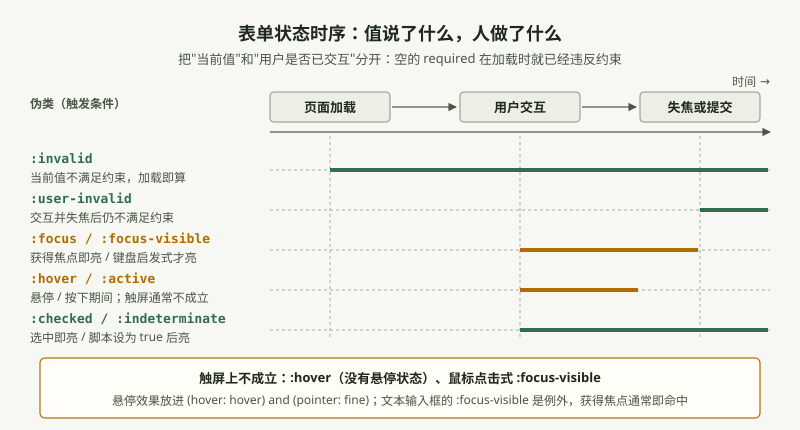

# 20 · 表单控件与状态

> **前置**：会用第 02 篇的伪类选择器写 `:focus` / `:checked`；知道第 19 篇的 `(hover: hover) and (pointer: fine)` 只在有精确指针的环境命中。本篇读状态、不改层叠规则。
>
> 上一篇：[从视口到组件](19-responsive.md) ｜ [本阶段目录](README.md)

## 1. 本章目标

- 给定空的必填邮箱框，能说出页面加载时 `:invalid` 与 `:user-invalid` 各自的命中情况，不错判。
- 能区分 `:focus` 与 `:focus-visible`：对鼠标点击复选框与 Tab 键聚焦复选框分别说出是否命中。
- 能说出 `accent-color` 与 `appearance: none` 的差别，以及后者必须自己补回哪些状态。
- 能解释为什么 placeholder 不能替代 label，并写出能关联的 label 与错误提示。

**为什么现在学这个**：第 19 篇让布局跟着环境变；从本篇起进入内容与组件，先解决控件状态——它决定用户能不能看见自己正在做什么。

## 2. 新增模型

一个必填邮箱框，刚打开页面就红了：

```css
input:invalid { border: 2px solid #b42318; }
```

```html
<input id="email" type="email" required />
```

用户还没碰过它，空值当然不满足约束，于是 `:invalid` 立刻命中。你以为在提示错误，其实在冤枉用户。另一个现象：为了换个颜色写 `appearance: none`，checkbox 变成空白方框——能点，但看不出是否选中，Tab 到它也没有焦点环。

**模型：控件天生带语义与行为，CSS 只覆盖外观；状态伪类说的是"当前值满足什么"或"人做过什么"，两者不能混用。**



*图 20-1 · 控件状态的触发时机*

图是一条时间轴：页面加载 → 用户交互 → 失焦或提交。`:invalid` 在加载那一刻就能亮，因为空的 `required` 已经违反约束；`:user-invalid` 要等用户交互并失焦后才亮；`:checked` 选中即亮；`:indeterminate` 由脚本设置后亮；`:focus` 获得焦点就亮；`:focus-visible` 只在键盘等启发式场景亮。

**这张图的一句话结论：加载即算的 `:invalid` 说的是值，交互失焦后才亮的 `:user-invalid` 说的是人。**

术语落地：

- **UA 样式**：浏览器给原生控件的默认外观，作者样式可以在它上面做增量覆盖。
- **可访问名称**：辅助技术读到的字段名字，由 `label` 等关联文本提供，不由边框颜色提供。
- **inert**：背景不可聚焦、不可点击的状态，由 `dialog.showModal()`（详见第 22 篇）带给背景。

## 3. 可运行的 demo

先切换几个状态看清谁先亮，再读下面的触发时机。带着"为什么加载时只有 `:invalid` 亮"的疑问往下走，会比背伪类清单有效得多。

[打开 demo：切换状态，看哪个伪类先亮](../../examples/minimal/20-forms.html)

<iframe class="demo-frame" src="/css-concept-course/examples/minimal/20-forms.html" title="切换状态，看哪个伪类先亮" loading="lazy"></iframe>

> **先预测**：页面刚打开、邮箱框为空时，`:invalid` 和 `:user-invalid` 哪个命中？鼠标点击复选框与 Tab 键聚焦复选框，`:focus-visible` 分别怎样？写出答案再揭晓。
>
> **验证**：看页面"命中伪类"读数与六个 gate 的高亮：加载时只有 `:invalid`；输入 `x` 再失焦后 `:user-invalid` 才亮；复选框用键盘聚焦时 `:focus-visible` 亮、鼠标点击时通常不亮。

如果你发现鼠标点进邮箱框时 `:focus-visible` 也亮了，别急着否定模型——文本输入框正是这个伪类的例外，下一节会解释。

## 4. 原理与规则

### 4.1 先接受原生，再决定覆盖多少

一个 `input` 同时带着三层东西：HTML 的语义（类型、名称、必填、校验）、浏览器的交互（键盘、焦点、粘贴、选择）、以及 UA 样式。前两层是 CSS 给不了的。

```css
.choice input {
  inline-size: 1.15rem;
  block-size: 1.15rem;
  accent-color: #3157d5;  /* 只改强调色，保留原生绘制与行为 */
}
```

`accent-color` 改的是 checkbox、radio、range 等控件的强调区域，改动最小、风险最低。`color-scheme` 是另一层：它告诉 UA 页面采用浅色还是深色主题，原生控件与滚动条据此调整，但不会自动把你的背景和文字改暗。

`appearance: none` 则撤掉控件的原生绘制路径，由作者重新画：

```css
.custom { appearance: none; }
```

**为什么要谨慎？** 撤掉的是绘制，不是行为——Tab、空格切换、分组互斥仍然存在，但选中态、焦点环、禁用态和对比度都得自己补回来。

**失效条件**：`accent-color` 管不到文本输入框或 `select` 的边框，也保证不了所有平台上的勾选标记对比度，仍要实测选中态；只要写了 `appearance: none` 却没补每一种状态的视觉，控件就变成"能操作但看不见状态"。

### 4.2 label 给控件一个可访问名称

```html
<label for="email">邮箱</label>
<input id="email" type="email" autocomplete="email" required
       aria-describedby="email-help" />
<p id="email-help">用于接收确认邮件。</p>
```

辅助技术读的是**可访问名称**，不是你画的边框。`for` / `id` 显式关联最清晰，包裹式 label 也可以；说明文字不在 label 里时用 `aria-describedby` 关联；一组 radio 或 checkbox 用 `fieldset` + `legend` 分组。

**为什么 placeholder 不能当 label？** 它会在输入后消失，用户回看表单时就失去了字段名；它也不是稳定的可访问名称。字段名称、必填说明、格式要求和错误原因，都要写在真正可见、可关联的文本里。

**失效条件**：字段说明只写在 `placeholder` 里时，输入后文字消失，用户无法回看字段名；一组 radio / checkbox 少了 `fieldset` + `legend` 时，辅助技术读不到组名，只能逐个念选项。

### 4.3 焦点：`:focus` 与 `:focus-visible`

```css
.field input:focus-visible {
  outline: 3px solid #3157d5;
  outline-offset: 2px;
}
```

`:focus` 只要元素获得焦点就命中，鼠标点一下也算。`:focus-visible` 由浏览器的启发式判断命中，通常在键盘操作或文本输入场景出现，鼠标点击按钮、复选框时一般不出现。

**为什么要分开？** 键盘用户必须看见当前位置，否则等于盲操作；鼠标用户点了按钮还弹出粗焦点环，视觉上很吵。两者兼顾的办法是把明显的焦点环交给 `:focus-visible`，而不是写 `outline: none` 把提示彻底删掉。

文本输入框是例外：只要它获得焦点，`:focus-visible` 通常就会命中，因为你必然要往里打字；按钮和复选框才真正由浏览器判断输入方式。

**失效条件**：把 `:focus-visible` 的预期套到文本输入框上就会判断错误——鼠标点进邮箱框它也亮；反过来，写 `outline: none` 且不补任何替代样式时，键盘用户完全失去焦点位置。

### 4.4 状态伪类的触发时机不同

| 伪类 | 何时点亮 | 典型误区 |
| --- | --- | --- |
| `:checked` | 控件处于原生选中态 | 以为脚本改外观就等于选中 |
| `:indeterminate` | 脚本把 `indeterminate` 设为 true | 以为"未选中"就是 indeterminate |
| `:valid` / `:invalid` | 当前值是否满足约束，加载时即计算 | 以为只有提交后才判断 |
| `:user-invalid` | 用户交互并失焦后仍不满足约束 | 以为它和 `:invalid` 等价 |

**为什么需要 `:user-invalid`？** 空的 `required` 在页面加载时就违反约束，`:invalid` 立即命中；若用它标红边框，用户还没开始填就被判错。`:user-invalid` 把判定推迟到交互之后，更适合作为"现在真的需要修"的视觉信号：

```css
.field input:user-invalid { border-color: #b42318; }
.field input[aria-invalid="true"] { border-color: #b42318; }
```

视觉提示与语义状态要一致：需要向辅助技术播报错误时，配合 `aria-invalid="true"` 与具体错误文案，而不是只靠颜色。`:indeterminate` 也不是 `:checked` 的反面，它是第三种状态，表示"部分选中 / 尚未决定"，点击后会被清除并进入 `:checked`。

**失效条件**：`content` 生成的文字不保证进入可访问名称，"警告""必填"这类关键含义不能只写在生成内容里；`:user-invalid` 在未交互的字段上永远不亮，想做"提交后一次性标红"还得另外设置 `aria-invalid`。

## 5. 常见坑

**坑 1：`:invalid` 一亮就标红边框，用户还没填就被判错**

- **原因**：空的 `required` 在加载时已违反约束，`:invalid` 立即命中，它说的是值，不是人。
- **确认**：demo 加载后看 gate，只有 `:invalid` 高亮、`:user-invalid` 不亮。
- **修法**：改用 `:user-invalid`，或提交失败后设置 `aria-invalid="true"` 与错误文案；代价是错误提示会晚一点出现。

**坑 2：`appearance: none` 以为只是换个颜色**

- **原因**：原生绘制被撤掉后，焦点环、选中态、禁用态和对比度都要作者自己补。
- **确认**：改成 `appearance: none` 且不写替代样式后，方框空白、选中态不明显，但 Tab 与空格仍能切换——行为来自 HTML，不是 CSS。
- **修法**：只改颜色优先用 `accent-color`；必须自定义时用伪元素或背景画出每一种状态，代价是代码量明显增加。

**坑 3：用 `div` 画 checkbox 更自由**

- **原因**：键盘操作、分组互斥、语义和名称全都要自己实现，原生控件已经给了这些。
- **确认**：自绘控件用 Tab 走一遍，看是否可聚焦、空格能否切换、读屏能否念出名称。
- **修法**：优先原生控件加 `accent-color`；确有视觉需求时再覆盖外观，不要连语义一起重造。

## 6. 练习

1. **基础**：写 `<label for="email">邮箱</label>`、`<input id="email" type="email" required>` 和一个 `<button>保存</button>`，打开页面不填。
   验收：`:invalid` 命中、`:user-invalid` 不命中；Tab 到按钮时按钮 `:focus-visible` 命中、鼠标点击时通常不命中；邮箱框鼠标点进去时 `:focus-visible` 也命中。

2. **基础**：给 checkbox 加 `accent-color: #3157d5`，再在开发者工具里改成 `appearance: none` 且不写替代样式。
   验收：前者勾选标记变蓝且键盘可操作；后者方框空白、选中态不明显，但 Tab 与空格仍能切换。

3. **进阶**：用脚本把 checkbox 的 `indeterminate` 设为 true，再点它一次。
   验收：点击前 `:indeterminate` 命中、显示横杠而非对勾、`:checked` 不命中；点击后 `indeterminate` 被清除、变为 `:checked`，`:indeterminate` 熄灭。

4. **进阶**：在必填邮箱框里输入 `x` 再失焦，并加上 `aria-describedby` 的错误文案。
   验收：加载时只有 `:invalid`；失焦后 `:user-invalid` 命中；加 `aria-invalid="true"` 后读屏能播报错误，颜色不再是唯一提示。

5. **挑战**：用 `:invalid` 做"实时校验条"，再改成 `:user-invalid`，对比两者。
   验收：`:invalid` 版在用户未输入时已经报错（空必填框即不合法）；`:user-invalid` 版必须交互并失焦才亮，是唯一满足"没碰过不报错"的写法。

> 下一篇：[表格：语义先于视觉](21-tables.md)
