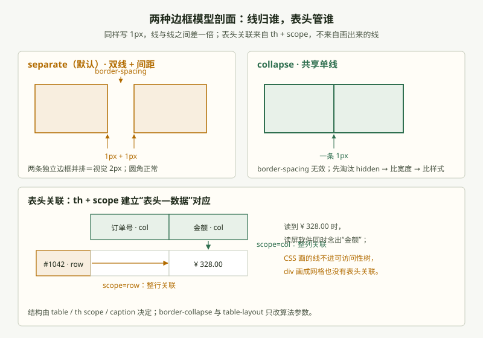

# 21 · 表格：语义先于视觉

> 一句话模型：行列关系、表头关联和序号都是 HTML 与浏览器给的，CSS 只决定边框怎么合、列宽怎么分、序号长什么样——**别拿视觉去冒充结构**。

## 先看一个现象

```html
<table class="sheet">
  <tr><td>姓名</td><td>邮箱</td></tr>
  <tr><td>林晓</td><td>lin@example.com</td></tr>
</table>
```

```css
.sheet td { border: 1px solid #c9d2d7; }
```

看着像表格，读屏软件却念不出"第一行是表头"：没有 `thead`、没有 `th`、没有 `caption`，"姓名"只是一个普通单元格。你以为画了网格就等于做了表格，实际 CSS 画出来的只是线，**结构信息一条都没生成**。

另一个现象：给单元格写 `border: 1px solid` 后，相邻两格之间出现 2px 的双线；改成 `border-collapse: collapse` 才变成 1px。同样写的是 1px，线却不一样粗——因为折叠模式改变了边框的归属。

## 先建立直觉



*图 21-1 · 两种边框模型与列宽决策*

左边是 `separate`：每个格子自带完整边框，相邻两条并排，间距由 `border-spacing` 控制；右边是 `collapse`：相邻边框合并成一条，宽度相同时按样式优先级选胜者。图的下半部分是列宽：`auto` 先看内容再分，`fixed` 先定轨道再塞内容。看图时只问一句：这条线、这一列，到底由谁决定？

一句话记住：**结构由标签决定，边框和列宽由算法决定**。CSS 改的是算法的参数，不是结构本身。

## 机制拆成四步

### 1. 语义来自 HTML 标签

`caption` 给表格命名，`thead/tbody` 分组，`th scope="col"` 声明"这一格是整列的表头"，`th scope="row"` 声明"这一格是整行的表头"。

```html
<table class="sheet">
  <caption>本周订单</caption>
  <thead><tr><th scope="col">订单号</th><th scope="col">金额</th></tr></thead>
  <tbody>
    <tr><th scope="row">#1042</th><td>¥ 328.00</td></tr>
  </tbody>
</table>
```

**为什么不能用背景色和粗体代替 `th`？** 读屏软件靠 `th` + `scope` 建立"表头—数据"的对应关系，用户读到 ¥ 328.00 时才能同时听到"金额"。视觉样式不进入可访问性树，画得再像也只是装饰。别为了样式把 `th` 换成 `td`；`caption` 可以视觉隐藏，但别从辅助技术里删掉。复杂表里若 `scope` 不足以表达多对一关系，再给表头加 `id`、给单元格加 `headers` 引用这些 id——依旧是 HTML 层的事，CSS 帮不上忙。

### 2. `border-collapse` 决定边框归谁

`separate`（默认）时每个单元格画自己的完整边框，两条相邻边框并排，中间还隔着 `border-spacing`。

```css
.sheet { border-collapse: collapse; }
.sheet th, .sheet td { border: 1px solid #c9d2d7; }
```

| 对照项 | `separate`（默认） | `collapse` |
| --- | --- | --- |
| 相邻边框 | 两条各自独立、并排 | 合并成一条 |
| `border-spacing` | 生效，控制格间距 | 无效 |
| `border-radius` | 单元格圆角正常 | 常失去预期圆角 |

**为什么 `separate` 也要记住？** 它才是默认值；不少"边框对不齐"的问题，根源是只按折叠模式写了一半样式，却忘了两组属性在两种模式下含义不同。

`collapse` 时相邻边框合并成一条。合并不是"取平均"，而是一场冲突裁决：先淘汰 `hidden`（`none` 不参与），再选 `border-width` 更大的；宽度相同才比样式优先级 `double > solid > dashed > dotted`。

**为什么要记这套顺序？** 这样你才能解释"我明明给这格写了 3px solid，显示出来却是 3px double"——是邻格的 `3px double` 赢了，不是你的样式没生效。还有两个连带后果：`border-spacing` 在 `collapse` 下无效；`border-radius` 在折叠表格上也常失去预期圆角。

### 3. 列宽由 table-layout 与内容共同决定

```css
.sheet { table-layout: fixed; width: 600px; }
.sheet col:nth-child(1) { width: 100px; }
.sheet col:nth-child(2) { width: 200px; }
.sheet col:nth-child(3) { width: 300px; }
```

`fixed` 先看表格与首行（或 `col`）声明的宽度，列宽立刻确定：上例是 100 / 200 / 300，加起来正好 600px。后面单元格文字再长也不改变列宽，超出的内容要靠 `overflow-wrap` 或容器滚动处理。

`auto` 则要先读完所有单元格的内容才算列宽，`<td>` 里一段特别长的文字会把所在列撑宽，其他列被压缩。**为什么 `auto` 要读完整张表？** 列宽取决于所有行里最宽的那格内容，浏览器必须缓冲整张表才能定轨道；内容多的表因此先渲染慢、再跳动。

**为什么会有两种？** `fixed` 的代价是"不迁就内容"，换来的是布局只扫首行、列宽可预测；`auto` 迁就内容，但表一大，列宽要等整张表算完才稳定。列宽对不齐时先问自己用的是哪一种，而不是逐个去调 `width`。

### 4. 序号是数出来的，不是写出来的

CSS 计数器三个动作：在祖先上 `counter-reset` 建立并重置计数器；在每个项目上 `counter-increment` 递增；在伪元素里 `content: counter(名字)` 输出。

```css
.steps { counter-reset: step; list-style: none; }
.steps li { counter-increment: step; }
.steps li::before { content: counter(step) "."; }
```

`counter-reset: step` 从 0 起，第一项递增后输出 1、第二项 2、第三项 3。想从 5 开始就写 `counter-reset: step 4`，第一项输出 5。嵌套结构用 `counters()` 输出多级编号。`counter-reset` 的作用域从声明它的元素延伸到后代与后续兄弟；嵌套列表里每层各自重置，内层序号才不会把外层带跑。

**为什么有时用 `::before` 而不是原生 marker？** 需要绝对定位的圆形序号时才用 `::before`；普通圆点直接用 `list-style` 和 `::marker` 更省事。`::marker` 能改颜色、字体，但不能像普通伪元素那样任意定位或加背景。注意：`content` 生成的文字不保证进入可访问名称，"警告""必填"这类关键含义不能只写在生成内容里。

普通圆点、`decimal` 序号这些需求，原生列表已经给了，不必动计数器。

顺带一句历史用途：flex/grid 普及前，`display: table` / `table-cell` 常被借来做等高列和垂直居中；现在遇到这种需求优先用 Grid/Flex，不必再借表格布局。

## 动手验证

[打开 demo：切换边框与布局，看线和列宽怎么变](../../examples/minimal/21-tables.html)

<iframe class="demo-frame" src="/css-concept-course/examples/minimal/21-tables.html" title="切换边框与布局，看线和列宽怎么变" loading="lazy"></iframe>

> **先预测**：把 `border-collapse` 从 `separate` 切到 `collapse`，相邻两格之间的边框厚度会从 2px 变成多少？把 `table-layout` 从 `auto` 切到 `fixed`，往某一格塞一段很长的文字，那一列会变宽吗？写下答案再揭晓。
>
> **验证**：打开 demo 调节参数，用页面显示的实时读数核对你的预测。

验证：打开 demo，调这两个开关，核对面板显示的边框厚度与三列像素宽度；再用计数器开关看序号从 1 还是从 5 开始。

## 容易误判的地方

- **"画成网格就是表格"** → 语义来自 `table` / `th scope` / `caption`，CSS 只画视觉；用 `div` 画得再像也没有表头关联。
- **"`border-collapse: collapse` 只是去掉一条线"** → 它触发边框冲突裁决，`border-spacing` 同时失效，圆角也可能丢失。
- **"`table-layout: fixed` 等于响应式"** → 它固定的是列宽算法，超长内容仍会溢出；窄屏要么横向滚动，要么重新设计结构。

## 自己再做一次

1. 写一个三列订单表，含 `caption`、`thead` 的 `th scope="col"` 和 `tbody` 每行的 `th scope="row"`。**预期结果：在无障碍树里读金额单元格时能听到"金额"这个列头；`caption` 显示为表格标题。**
2. 让相邻两格都写 `border: 3px solid`，再把第二格的 `border-left` 改成 `3px double`，并设 `border-spacing: 0`，分别看 `separate` 与 `collapse`。**预期结果：`separate` 下两格之间是并排两条 3px 边框（共 6px）；`collapse` 下合并为一条 3px double，因为宽度相同而 `double` 的样式优先级高于 `solid`。**
3. 写 `table-layout: fixed; width: 600px`，用 `col` 定 100 / 200 / 300，再往第二列塞 200 个连续字母。**预期结果：三列仍为 100 / 200 / 300px；字母在 200px 列里溢出或换行（取决于 `overflow-wrap`），不会把列撑宽。**

> 下一篇：[原生弹层](22-native-ui.md)
