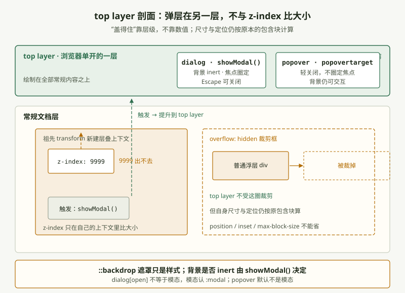

# 22 · 原生弹层

> **前置**：知道第 08 篇的层叠上下文把 `z-index` 圈在家族内部；知道第 05 / 06 篇的包含块决定尺寸与定位；会写第 20 篇的 `:focus-visible`。本篇只讲层级归属，不新增定位模型。
>
> 上一篇：[表格：语义先于视觉](21-tables.md) ｜ [本阶段目录](README.md)

## 1. 本章目标

- 能说出 `details/summary`、`dialog.showModal()`、`popover` 各解什么问题，并为一个具体场景选出该用的那个。
- 能解释为什么 `z-index: 99999` 盖不住模态 `dialog`，而 top layer 能。
- 能预测打开模态 `dialog` 后 Tab 与 Escape 的行为，并说出 popover 默认是否圈定焦点。
- 能区分 `dialog[open]` 与 `dialog:modal`，说出各自对应哪种打开方式。

**为什么现在学这个**：第 20 / 21 篇把控件和表格的语义讲清；弹层是最后一个"行为由浏览器给、CSS 只管外观"的组件。第 23 篇开始讲怎么约束样式影响范围，先把该交给浏览器的部分划出去。

## 2. 新增模型

```html
<div class="modal" style="display: block">
  <p>确认删除？</p>
</div>
```

```css
.modal { position: fixed; inset: 0; z-index: 99999; }
```

你以为 `z-index: 99999` 能盖住一切，实际它可能被某个祖先的层叠上下文困住——`z-index` 只在自己的上下文里比大小。背景照样能 Tab 到、能点击，Escape 也没反应；父容器若有 `overflow: hidden`，它还会被裁掉。你造了一个"看起来像弹窗"的 `div`，但模态最要紧的三件事——背景不可交互、焦点圈定、Escape 关闭——一件都没有。

**模型：浏览器已经给了三种弹层，它们进的是 top layer，键盘与焦点也由浏览器管；`z-index` 只是常规层里的一场比大小，越不过层级。**



*图 22-1 · top layer 与常规文档层的剖面*

图是一条竖直剖面：下方大块是常规文档层，里面画着祖先 `transform` 新建的层叠上下文和 `overflow: hidden` 的裁剪框，一个 `z-index: 9999` 的浮层被关在里面；上方窄带是 top layer，放着模态 `dialog` 与 popover。箭头从"触发"指向"元素被提升到 top layer"。图上还标明：top layer 绘制在所有常规内容之上、不受祖先 `overflow` 裁剪，但元素自身的尺寸与定位仍按原本的包含块计算。

**这张图的一句话结论：`z-index: 9999` 出不了祖先的层叠上下文，top layer 是浏览器另开的一层。**

术语落地：

- **top layer**：浏览器单独维护的绘制层，绘制在所有常规内容之上，且不受祖先 `overflow` 裁剪。
- **inert**：让背景不可聚焦、不可点击的状态，模态 `dialog` 打开时由浏览器自动施加。
- **light dismiss**：点元素外部或按 Escape 就关闭的行为，`auto` 类型 popover 默认具备。

## 3. 可运行的 demo

先亲手开一次弹层，看徽标和焦点怎么变，再读下面的层级规则。带着"为什么 9999 盖不住"的疑问往下走，会比先背 API 有效得多。

[打开 demo：三种弹层逐个开，看焦点和背景怎么变](../../examples/minimal/22-native-ui.html)

<iframe class="demo-frame" src="/css-concept-course/examples/minimal/22-native-ui.html" title="三种弹层逐个开，看焦点和背景怎么变" loading="lazy"></iframe>

> **先预测**：右上角 `z-index: 9999` 的徽标，在 `dialog.showModal()` 打开后能盖住对话框吗？打开 popover 后呢？两者按 Escape 分别会不会关闭？写出答案再揭晓。
>
> **验证**：依次点"打开 dialog.showModal()"和"切换 popover"，核对页面"状态（浏览器实测）"里 `:modal`、`:popover-open`、"背景是否 inert"与"徽标能否盖住 dialog"四行读数，再用 Tab 和 Escape 实际操作一次。

如果你看到徽标的 `z-index` 读数始终是 9999、却怎么也盖不到弹层上，说明"层级不是数值"已经不再是口号。

## 4. 原理与规则

### 4.1 三种原生能力，各解一种问题

`details/summary` 是零 JS 的 disclosure（折叠展开）：点 `summary` 展开内容，状态、键盘和读屏都由浏览器负责。`details[open]` 是原生状态，不要再维护一套 `is-open` 类；`summary` 前面的小三角由浏览器绘制，可以用 `::marker` 改颜色，但别为了换图标把 `summary` 换成 `div`。

`<dialog>` 面向模态任务：调 `showModal()` 后背景变成 inert、焦点被圈进对话框、Escape 可关闭、关闭后焦点回到原触发元素。只用 `open` 属性打开的是非模态对话框，没有这些能力。

`popover` 属性面向轻量浮层：`popovertarget` 不写 JS 就能开关，脚本则用 `showPopover()` / `hidePopover()`。它默认**不是模态**：背景仍可交互，也不圈定焦点；`auto` 类型支持 light dismiss，`manual` 类型不会。

| 场景 | 选谁 | 理由 |
| --- | --- | --- |
| 可折叠的问答、说明 | `details/summary` | 零 JS，状态与键盘由浏览器管 |
| 必须完成或取消的任务（确认、编辑） | `dialog.showModal()` | 背景 inert、焦点圈定、Escape |
| 非阻塞的提示、菜单、气泡 | `popover` | 轻量、light dismiss、不打断页面 |

一个 popover 连脚本都不用：

```html
<button type="button" popovertarget="help">帮助</button>
<div id="help" popover>这里是填写说明。</div>
```

**为什么不能三选一通用？** 它们的能力是正交的：disclosure 不阻塞，modal 阻塞且要管焦点，popover 不阻塞但要浮在上方并轻关闭。用 modal 做 FAQ 会逼用户先关掉它；用 popover 做删除确认，用户还能点背景里的其他按钮，任务就不完整了。

**失效条件**：只用 `open` 属性打开的 `dialog` 是非模态，没有背景 inert、焦点圈定与 Escape 关闭；`manual` 类型的 popover 不会因点外部关闭，必须另放一个带 `popovertargetaction="hide"` 的按钮或调 `hidePopover()`。

### 4.2 top layer 不是"很大的 z-index"

被提升的元素绘制在所有常规内容之上，也不再被祖先的 `overflow: hidden` 裁剪——这是层级规则，不是 `z-index` 的数值。`::backdrop` 只在元素进入 top layer 后才有，是背景遮罩的样式入口：

```css
dialog::backdrop { background: rgb(16 24 40 / 55%); }
[popover]::backdrop { background: rgb(16 24 40 / 12%); }
```

**为什么"逃出 overflow"不等于"逃出布局"？** top layer 改的是绘制层级与裁剪关系，元素自身的尺寸、定位和包含块仍按 CSS 正常计算。该写的 `position: fixed`、`inset`、`max-block-size` 一个都不能省。在常规层里，祖先的 `transform` 会新建层叠上下文，把内部的 `z-index: 9999` 关在里面；top layer 位于所有常规上下文之上，所以不必再盘点祖先有没有 `transform` 或 `overflow`。

判断一个浮层是不是模态，别看它有没有遮罩，看它有没有让背景 inert。

**失效条件**：给 popover 加深遮罩不会让它变成模态，背景是否 inert 由打开方式决定；top layer 只解决层级与裁剪，不负责把元素摆到正确位置，漏写 `position` / `inset` 时弹层仍按普通流定位。

### 4.3 打开状态用原生选择器表达

```css
details[open] summary { font-weight: 700; }
dialog:modal { border: 1px solid #c9d2d7; }
[popover]:popover-open { animation: pop-in 140ms ease-out; }
@media (prefers-reduced-motion: reduce) {
  [popover]:popover-open { animation: none; }
}
```

`details[open]`、`dialog:modal`、`[popover]:popover-open` 分别对应三种原生状态。注意 `dialog[open]` 包含非模态对话框，单凭 `[open]` 判断不出是否模态，要用 `:modal`。

**为什么要用原生状态而不是自己加类？** 自己加的类会和浏览器状态脱节：用户按了 Escape、点了背景，浏览器已经关掉弹层，你的类还留在 DOM 上，样式就卡在"打开"态。这些伪类都是只读的——CSS 能读取它们改变外观，但写伪类不会把元素变成模态。键盘验收其实只有两件事：Tab 能不能进到该进的地方，Escape 能不能按预期退出。

**失效条件**：`dialog[open]` 命中不代表模态，用它写模态专属样式会误伤非模态对话框；自己维护的 `is-open` 类在浏览器关掉弹层后残留，样式与真实状态不同步。

### 4.4 CSS 只管外观，行为交给浏览器

CSS 负责位置、尺寸、背景、边框、遮罩、动画和状态视觉变化；浏览器负责焦点、键盘、light dismiss、背景隔离与打开关闭 API。

```js
const dialog = document.querySelector('#confirm');
dialog.showModal(); // 而不是 dialog.setAttribute("open", "")
```

用 `showModal()` 打开的对话框关闭时，浏览器会把焦点还给打开前获得焦点的元素；所以触发按钮最好留在 DOM 里，而不是打开后把它删掉。

**为什么这层分工不能糊弄？** 焦点圈定、Escape、焦点恢复都挂在 `showModal()` 带来的模态语义上。用 `div` 或只加 `open` 属性，CSS 画得再像也没有这些行为；确有复杂需求时再用少量 JS 补足，而不是从零重造。

**失效条件**：触发按钮在打开后被移出 DOM 时，关闭后焦点无处可回，键盘用户会回到页面顶部；用 `div` 重造弹层时，焦点圈定、Escape 与焦点恢复都要自己实现，代价远超换一个颜色。

## 5. 常见坑

**坑 1：`z-index: 99999` 以为等于 top layer**

- **原因**：`z-index` 只在自己的层叠上下文里比大小，还会被祖先 `overflow` 裁剪。
- **确认**：demo 里看徽标的 computed `z-index` 是 9999，但打开 dialog 后"徽标能否盖住 dialog"显示不能。
- **修法**：改用 `dialog.showModal()` 或 popover，让浏览器把元素提升到 top layer；代价是打开方式要由脚本或 `popovertarget` 管理。

**坑 2：给 popover 加 `::backdrop` 就当模态**

- **原因**：遮罩只是样式；背景 inert 与焦点圈定由 `showModal()` 决定，popover 默认没有，`::backdrop` 只在进入 top layer 后才存在。
- **确认**：打开 popover 后用 Tab 还能走到背景按钮，状态面板"背景是否 inert"为否。
- **修法**：要模态就用 `showModal()`，判断认 `:modal`；popover 保持轻量语义，别靠遮罩冒充模态。

**坑 3：`dialog[open]` 就是模态**

- **原因**：`[open]` 包含非模态对话框，只有 `showModal()` 打开的才命中 `:modal`。
- **确认**：用 `open` 属性打开后看 demo 的 `:modal` 读数为 false，背景仍可 Tab。
- **修法**：打开一律用 `showModal()`，样式判断用 `dialog:modal`，两者配套才不会误判。

## 6. 练习

1. **基础**：写三个 `<details>` 组成的 FAQ，其中第一个默认带 `open`。
   验收：不用任何 JS，点 `summary` 能展开 / 收起；Tab 能聚焦 `summary`，Enter / Space 能切换；第一个初始就是展开态，`details[open]` 命中。

2. **基础**：写一个 `<dialog>`，分别用 `showModal()` 和 `open` 属性打开。
   验收：`showModal()` 下背景无法 Tab 到、Escape 可关闭、`:modal` 命中；`open` 属性下背景仍能操作、`:modal` 不命中。

3. **进阶**：写一个 `<div popover>`，把触发按钮放进 `overflow: hidden; height: 60px` 的容器，再用 `popovertarget` 打开。
   验收：弹层显示在容器之外不被裁掉；点外部或按 Escape 可关闭（`auto` 类型）；手动加 `::backdrop` 后背景依旧可交互。

4. **进阶**：把 popover 改成 `popover="manual"`，并加 `prefers-reduced-motion` 规则。
   验收：点外部不再关闭，必须用 `popovertargetaction="hide"` 按钮或 `hidePopover()`；系统开启减少动态效果后，弹层动画 computed `animation-name` 为 `none`。

5. **挑战**：给 `dialog` 套一个 `transform: translateX(0)` 的祖先（会新建层叠上下文），对比普通 `position: fixed; z-index: 9999` 浮层与 `showModal()`。
   验收：普通浮层被祖先的层叠上下文与 `overflow` 限制；dialog 仍绘制在最上层且背景 inert，因为 top layer 不受祖先 `transform` / `overflow` 影响。

> 下一篇：[样式架构与设计令牌](23-architecture.md)
