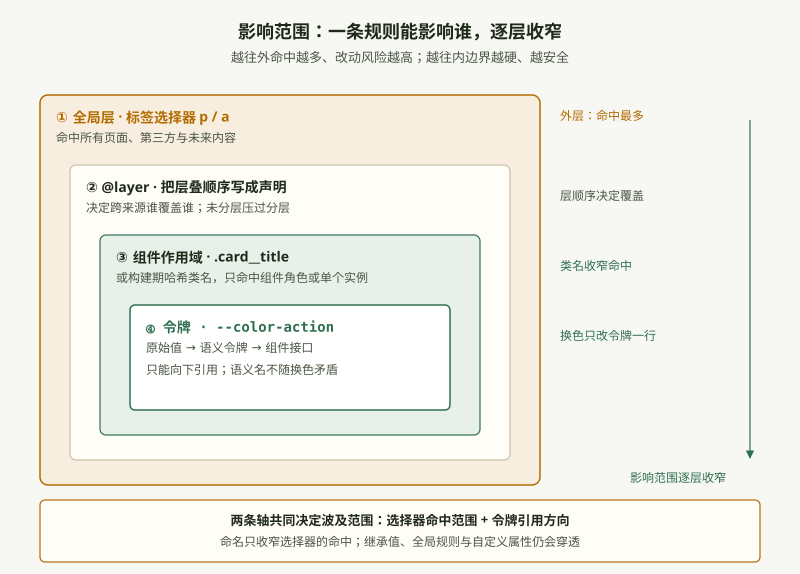

# 23 · 样式架构与设计令牌

> **前置**：会用第 03 篇的"来源、重要性、层叠层、优先级、书写顺序"判断一条规则是否生效，知道 `@layer` 与 `:where()` 各自影响层叠的哪一环（第 03 篇）；知道自定义属性默认继承、可作为运行时值沿 DOM 树传递（第 04 篇）。
>
> 上一篇：[原生弹层](22-native-ui.md) ｜ [本阶段目录](README.md)

## 1. 本章目标

- 给定一条 `.footer p` 规则，能说出它会命中哪些未写出的元素，并改写为只命中组件角色的选择器。
- 给定语义令牌与原始值两层定义，能在切换 `[data-theme]` 时只改令牌、不改组件，并说出为什么组件必须消费语义名。
- 给定 `@layer reset, components, utilities` 声明，能判断同一元素上两条规则谁胜出，并解释未分层规则为何压过分层规则。
- 能说明构建期哈希类名与继承值、全局规则的差别，指出哪些样式仍会穿透边界。

**为什么现在学这个**：前面 22 篇都在解决"这条规则怎么生效"，从本篇起进入"一阶段"的第三程——能维护。代码从几十行涨到几万行后，真正的成本不是写对一条规则，而是改一处别处不坏。后面几篇（可访问性、性能、新特性）都假设样式有清晰边界，否则增强与回退会互相踩踏。

## 2. 新增模型

先看一条看起来很安全的规则：

```css
/* 页脚样式 */
.footer p { color: gray; }
```

它一开始只想改页脚文字。半年后嵌进 `.footer` 的新卡片文字也变灰了；有人加 `!important` 把颜色夺回来，接着另一处又失效。你以为在改"页脚文字"，实际这条规则命中所有出现在 `.footer` 后代里的 `p`——包括你还没写出来的那些。

另一件事：同一个绿色在 14 个文件里写着 `#245d4d`。换品牌色时你改了 13 处，上线后某个按钮还是旧的。

两件事指向同一个根因：**一条规则的影响范围没有被显式约束**。

**模型：一次改动波及多少地方，等于选择器的命中范围乘以令牌的引用方向；架构就是把这两件事写成明确的边界，而不是靠记性。**



*图 23-1 · 影响范围：从全局到组件的同心边界*

图是一组同心矩形：最外层是全局标签选择器，命中所有页面、第三方和未来内容；往里依次是 `@layer` 声明的顺序边界、组件根类名与构建期哈希类名；每往里一层，能命中它的元素少一层。右侧叠一条令牌分层——原始值 → 语义令牌 → 组件接口，箭头向下，表示只能向下引用。

**这张图的一句话结论：越靠外的选择器命中越多、改动风险越高；令牌只能向下引用，换色才只需改一行。**

术语落地：

- **影响范围**：一条规则能命中的元素集合，以及一次改动会波及的地方。
- **原始值**：像 `#245d4d` 这样的具体数值，可以很多。
- **语义令牌**：像 `--color-action` 这样表达用途的变量，少而稳定；原始值是它的取值来源。
- **构建期边界**：CSS Modules 的哈希类名或框架 `scoped` 的属性选择器，在编译时把命中范围钉到单个组件。

## 3. 可运行的 demo

在往下读之前，先用一个开关看清"边界"和"优先级"的关系。带着"为什么 `:where()` 一改工具类就能赢"的疑问去读原理，会比先背规则有效。

[打开 demo：改一处，看影响范围有多大](../../examples/minimal/23-architecture.html)

<iframe class="demo-frame" src="/css-concept-course/examples/minimal/23-architecture.html" title="改一处，看影响范围有多大" loading="lazy"></iframe>

> **先预测**：标题同时带组件类 `card__title` 和工具类 `u-accent`，工具类写在组件规则之后。把组件规则从 `.mode-normal .card__title` 换成 `.mode-where :where(.card__title)`，标题颜色会不会从绿色变成琥珀色？唯一答案是"会"——先把理由写下来再揭晓。
>
> **验证**：勾选"用 :where() 定义组件标题颜色"，用页面读数核对：组件规则优先级从 `(0,0,2,0)` 降到 `(0,0,1,0)`，与工具类持平；`标题 color（实测）` 从绿色变为琥珀色，`谁胜出` 一栏切到工具类。

如果你发现收窄影响范围靠的是把优先级让出去、而不是加 `!important`，就已经抓住这一篇的要害。

## 4. 原理与规则

### 4.1 选择器命中范围：用类名给影响范围画圈

BEM 这类命名把类名绑到一个组件边界：

```css
.card__title  { font-weight: 700; }
.card--compact { padding: 0.5rem; }
```

`card__title` 只表达"卡片内部标题"这个角色，不会误伤别处文字。它的命中范围由类名决定，与页面结构无关。下表按影响范围从大到小对照四种常见写法：

| 选择器 | 典型影响范围 | 改动风险 |
| --- | --- | --- |
| `p` | 全站所有段落，含第三方 | 极高 |
| `.footer p` | 页脚内所有后代段落 | 高 |
| `.card__title` | 卡片中表达"标题"的角色 | 低 |
| 构建期哈希类名 | 单个组件实例 | 极低 |

**为什么不用标签选择器？** `p`、`a`、`button` 会命中页面每一个同类元素，包括第三方组件和未来新增内容；范围越大，覆盖它就越依赖 `!important` 和书写顺序，最后谁也改不动。

**失效条件**：类名只收窄选择器的命中范围，挡不住继承值与全局规则。`.card__title` 里的元素仍会继承页面的 `font-family`，`html/body` 上的规则、`::backdrop`、自定义属性照样穿透；组件边界不等于浏览器隔离。

深嵌套是同一个问题的另一面：

```css
.page .main .card .list .item .icon { color: red; }
```

它把样式钉死在一条具体 DOM 路径上，模板插一层包装就全失效，优先级还一路堆高。**为什么这是坏味道？** 它说明组件边界划错了——该由组件自己的类名表达角色，而不是父级穿过五层去点名子元素的图标。

**失效条件**：当被选中的元素是第三方组件、无法为其添加类名时，临时用祖先限定选择器是合理的兜底；代价是结构耦合，一旦DOM 层级变化就要同步改样式。

### 4.2 设计令牌：用语义名，不用颜色名

自定义属性默认继承，所以能作为运行时值沿 DOM 树往下传。令牌的关键是**名字表达用途**：

```css
:root {
  --green-700: #245d4d;              /* 原始值 */
  --color-action: var(--green-700);  /* 语义令牌 */
}
.button { background: var(--color-action); }
[data-theme="dark"] { --color-action: #8fd0b8; }
```

组件消费 `--color-action`，而不是 `--green-700`。**为什么要用语义名？** 品牌色从绿换成蓝时只改语义令牌的指向，不必翻遍每个组件；而 `--green-700` 这个名字一旦换色就自相矛盾。换主题时只替换语义值，布局与结构不动。

令牌要克制：原始值可以很多，语义令牌少而稳定，别为一次性的像素调整建立全局变量。

**失效条件**：令牌只在"组件真的用 `var()` 消费它"时才起作用。如果组件把颜色写死，改令牌不会有任何效果；反过来，用 `--green-700` 这种颜色名做语义层，换色时名字与取值冲突，令牌的收益归零。

### 4.3 @layer：把层叠顺序写成声明

样式来源多了以后，"谁覆盖谁"不该靠文件导入顺序碰运气。做法是在入口一次性声明层顺序（语法见第 03 篇），把第三方样式放进独立层，再按明确顺序排列自己的层：

```css
@layer reset, base, components, utilities;
```

**为什么这对架构重要？** 它把"重置 < 基础 < 组件 < 工具类"变成一句可读的声明：新加一条规则时，能从层名判断它该赢还是该输，而不是靠选择器堆优先级。

未分层的普通样式会压过所有分层的普通样式，所以临时样式不能散落在层外。第三方样式也放进独立层，它就不会凭"未分层"压过你的组件层。

**失效条件**：`!important` 会反转层的优先顺序——后声明的层里的 `!important` 反而排在前面，先声明的层里的 `!important` 最强。因此别把 `!important` 当常规工具；一旦用了，层的顺序就不按直觉走。

### 4.4 构建期边界与按变化频率分层

CSS Modules 和框架的 `scoped` 样式在构建期给类名加哈希或属性选择器，把匹配范围收窄到当前组件：

```css
/* Card.module.css */
.title { font-weight: 700; }  /* 编译后变成带哈希的唯一类名 */
```

框架的 `scoped` 样式原理相同：给元素加唯一属性，把选择器改写成 `.title[data-v-xxx]` 这类形式。

**为什么这是"构建期"边界而不是浏览器隔离？** 它只把类名选择器唯一化；继承的字体颜色、全局 `::backdrop`、`html/body` 规则、自定义属性仍会穿透。要强隔离得靠 Shadow DOM（第 30 篇），代价是焦点、表单和主题的穿透方式都变了。

目录按"变化频率"分层，而不是按页面名堆文件：

```text
styles/
  tokens/       颜色、间距、字号——几乎不改
  base/         重置与语义默认值——很少改
  layout/       骨架与区域——偶尔改
  components/   业务组件——经常改
  utilities/    少量受控工具类——经常改
  main.css      集中声明层顺序与导入
```

**为什么按变化频率？** 高频改动的组件样式与低频改动的令牌/重置分开放，日常改动落在小范围，便于缓存和评审；按页面名组织则常把同一组件复制到多个目录，改一次要跟好几处。

**失效条件**：这套目录依赖入口文件集中声明层顺序才能成立；如果每个组件各自导入、顺序由打包器决定，层顺序就不可控，声明式边界退化回导入顺序赌博。

## 5. 常见坑

**坑 1：以为加更多类名前缀就能隔离一切**
- **原因**：命名只收窄选择器命中范围；继承值、全局规则和自定义属性仍会穿透，构建期边界也不等于浏览器隔离。
- **确认**：给组件加 `outline` 后，检查内部文字的 `font-family` 是否仍来自页面全局；`.card__title` 命中数是否仍包含你想排除的元素。
- **修法**：把真正要隔离的边界交给令牌（只开放少数入口）或 Shadow DOM；代价是后者要重新处理焦点与主题的穿透。

**坑 2：把令牌当作"把所有颜色换成变量"**
- **原因**：令牌要表达稳定决策；用 `--green-700` 这种颜色名做语义层，换色时名字与取值矛盾。
- **确认**：搜索组件里直接出现的原始值变量名，若组件消费的是 `--green-700` 而非 `--color-action`，换主题时组件不会跟着变。
- **修法**：分原始值与语义令牌两层，组件只引用语义名；代价是多一层间接，需要维护映射。

**坑 3：把 @layer 当成可选的编排技巧**
- **原因**：它决定跨来源的覆盖顺序；未分层的普通样式会压过所有分层样式，散落层外会破坏整个体系。
- **确认**：在 DevTools 里看某条规则的胜出理由，若显示来自未分层样式而非你预期的层，说明有规则漏在层外。
- **修法**：入口集中声明层顺序，所有样式显式归层，第三方也放进独立层；代价是迁移期要梳理既有导入。

## 6. 练习

1. **基础**：把 `.page .content .card h3 { color: red }` 改用组件根类名加一个元素类名表达。
   验收：选择器只剩两类（如 `.card__title`），不再依赖 `.page/.content`；给 `.card` 外面插一层包装后，颜色仍为红色。

2. **基础**：定义 `--green-700: #245d4d` 与 `--color-action: var(--green-700)`，按钮用 `--color-action`；在 `[data-theme="dark"]` 里把 `--color-action` 改成 `#8fd0b8`。
   验收：切主题前后按钮背景分别为 `rgb(36,93,77)` 与 `rgb(143,208,184)`，组件规则一行未改。

3. **进阶**：建立 `@layer reset, components, utilities`，在 `reset` 层写 `h2 { color: red }`，在 `components` 层写 `.card__title { color: blue }`，观察同一标题的颜色；删掉后者再看一次。
   验收：两者都在时标题为蓝色（后层胜），删掉后变红；把 `h2 { color: red }` 移到层外后标题变红（未分层压过分层的组件规则）。

4. **进阶**：把一条工具类规则从 `.u-accent { color: var(--amber) }` 改为在 `.mode-where` 下用 `:where()` 包住组件规则，对比胜负。
   验收：普通写法组件优先级 `(0,0,2,0)`、工具类盖不过；换成 `:where()` 后组件优先级 `(0,0,1,0)`，工具类因写在后面而胜出，标题变琥珀色。

5. **挑战**：不查资料，预测下面代码里按钮文字的最终颜色，再用浏览器验证，并回答"换主题会不会跟着变"。
   ```css
   :root { --green-700: #245d4d; --color-action: var(--green-700); }
   [data-theme="dark"] { --color-action: #8fd0b8; }
   .btn { color: var(--green-700); }
   .btn.action { color: var(--color-action); }
   ```
   验收：同时命中两条规则时 `.btn.action` 优先级 `(0,0,2,0)` 更高，取语义令牌；切到 dark 主题后文字变为 `rgb(143,208,184)`，而只用 `.btn` 的元素颜色不变——证明语义令牌的收益只在组件真正消费它时才兑现。

> 下一篇：[页面是给谁用的](24-accessibility.md)
