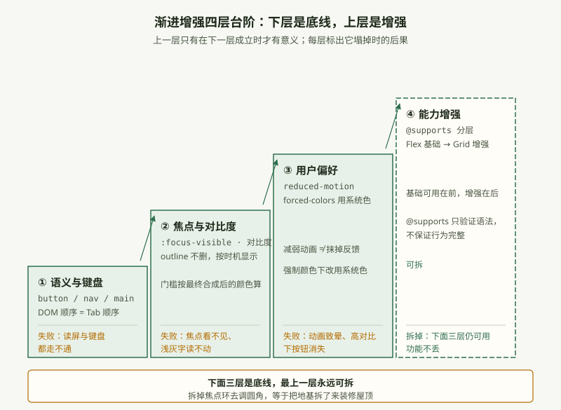

# 24 · 页面是给谁用的

> **前置**：会按第 19 篇的媒体查询判断"当前环境是什么"（交互能力 `hover`/`pointer`、系统偏好 `prefers-reduced-motion`）；知道第 10 篇的对比度门槛是按最终合成后的颜色算的。
>
> 上一篇：[样式架构与设计令牌](23-architecture.md) ｜ [本阶段目录](README.md)

## 1. 本章目标

- 给定一段只照顾鼠标的样式，能指出键盘、低视力、触屏、前庭敏感、高对比度五条路径各自断在哪，并给出修法。
- 能把 `outline: none` 改写成基础 `:focus` 保底、`@supports selector(:focus-visible)` 只区分显示时机的写法，并说明两种环境下焦点是否还在。
- 能把只为增强的动画包进 `prefers-reduced-motion`，把状态色改用系统色，且保证反馈不丢。
- 能解释 `@supports` 与 `CSS.supports()` 只验证语法、不保证行为，并把增强写成"叠加"而非"替换基础状态"。

**为什么现在学这个**：上一篇解决了"样式影响谁"，但样式写对了还可能把人挡在门外。可访问性的顺序不能反——先保证语义和键盘能完成任务，再来谈视觉；这一篇给后面所有增强（第 25 篇性能、第 27 篇新特性）立下底线：增强可以拆，基础必须独立可用。

## 2. 新增模型

先看一组很常见的代码：

```css
.button { outline: none; color: #b9b9b9; }
.menu { display: none; }
.card:hover .menu { display: block; }
.spinner { animation: spin 800ms linear infinite; }
```

你以为这只是"把按钮做清爽、把菜单收起来"：鼠标用户点得动，页面也干净。实际：键盘用户 Tab 到按钮看不到焦点，低视力用户读不动那行浅灰字，触屏用户永远打不开只在 `:hover` 出现的菜单，前庭敏感用户被旋转图标转得头晕，开了高对比度的用户看到按钮和背景合成同一种颜色。

这不是五个互不相干的 bug，而是同一个问题：**样式只照顾了"鼠标 + 正常视觉 + 默认系统 + 新版浏览器"这一条路径**。

**模型：可访问性是一叠自下而上的依赖层，下层是底线、上层是增强；CSS 的职责只在"焦点与状态始终可见、尊重系统偏好、逐层增强"，不在把页面画得像。**



*图 24-1 · 可访问性是一叠自下而上的依赖层*

图里是四级台阶：语义与键盘（原生元素、地标、Tab 顺序）→ 可见的焦点与对比度 → 用户偏好（减弱动画、强制颜色）→ 能力增强（`@supports` 分层）。每层都标出塌掉的后果，箭头向上表示"上一层只有在下一层成立时才有意义"；最上一层用虚线画成可拆。

**这张图的一句话结论：下面三层是底线，最上一层才是增强；拆掉焦点环去调圆角，等于把地基拆了装修屋顶。**

术语落地：

- **可访问性树**：浏览器给辅助技术看的语义结构，"这是按钮、这是导航、现在展开着"来自 HTML 标签与属性，不是 CSS 画得像不像。
- **地标（landmark）**：`<nav>`、`<main>`、`<header>` 这类语义分区，让屏幕阅读器能直接跳转。
- **能力查询**：`@media (hover: hover)` 这种问"环境支持什么"的条件，与 `:hover` 这个"指针停在元素上"的伪类是两回事。
- **强制颜色**：系统用 `Canvas`、`ButtonFace` 等系统色覆盖作者颜色、并忽略背景图与阴影的模式。

## 3. 可运行的 demo

在往下读原理之前，先用两个开关切到"底线层"看一眼。带着"为什么 `outline: none` 一勾焦点就没了"的疑问读下一节，会比先看规则有效。

[打开 demo：删掉 outline 之后，谁还能完成任务](../../examples/minimal/24-accessibility.html)

<iframe class="demo-frame" src="/css-concept-course/examples/minimal/24-accessibility.html" title="删掉 outline 之后，谁还能完成任务" loading="lazy"></iframe>

> **先预测**：勾选"设置 outline: none"后，只用键盘 Tab 到示例按钮，`焦点环是否保留` 会变成什么？再勾"模拟强制颜色"，焦点环用的是 outline 还是阴影？唯一答案是"焦点环消失""仍可用 outline"——先把理由写下来。
>
> **验证**：用 Tab 把焦点移到示例按钮，读页面的 `outline-style / width（实测）` 与 `焦点环是否保留`；切换两个开关各看一次，并对照"当前生效的核心 CSS"里基础 `:focus` 与 `@supports` 分支的写法。

如果你发现焦点环靠的是写在基础规则里的 `outline`，而 `:focus-visible` 只负责"减掉鼠标的环"，就已经抓住这一篇的要害。

## 4. 原理与规则

### 4.1 语义与键盘先成立，CSS 才登场

可访问性树里的信息来自 HTML 标签与属性。用 `<button>` 而不是 `<div onclick>`，用 `<nav>` / `<main>` / `<header>` 当地标，链接用于导航、按钮用于执行动作。

**为什么 CSS 排不上这个班？** 屏幕阅读器和键盘只认语义与焦点顺序，不认 `border-radius`。一个画得再像按钮的 `div`，Tab 键会直接跳过它；给 `<div>` 补 `role="navigation"` 勉强能用，但不如直接写 `<nav>` 稳。

键盘顺序跟着 DOM 顺序走，不跟视觉位置走。用 `order`、`grid-area`、绝对定位把视觉重排之后，Tab 仍按 DOM 走，焦点会在页面上"乱跳"。

键盘用户还需要一条绕过重复导航的路，就是"跳到主要内容"链接：

```css
.skip-link { position: fixed; transform: translateY(-200%); }
.skip-link:focus { transform: translateY(0); }
```

**为什么平时藏起来、聚焦时才出现？** 它要跳过的是页头和导航，键盘用户按第一下 Tab 时它必须出现；对鼠标用户又不能常驻占位置。它靠 `:focus` 显示，不靠 `:hover`——后者对键盘用户等于不存在。

**失效条件**：视觉重排幅度过大时，同步 DOM 顺序可能破坏设计意图；此时要么减少重排，要么补 `aria-flowto` 之外的真实顺序，别指望 CSS 改变 Tab 路径。

### 4.2 焦点与对比度：CSS 真正要扛的两件事

不要写 `outline: none`。`:focus-visible` 不是为了取消焦点，而是为了**区分由谁来显示焦点环**：

```css
:focus { outline: 3px solid #0b63ce; outline-offset: 3px; }
@supports selector(:focus-visible) {
  .button:focus:not(:focus-visible) { outline: none; }
}
```

基础的 `:focus` 写在 `@supports` 外面，在所有环境都有效；支持 `:focus-visible` 的环境里，鼠标点击不再显示环，键盘 Tab 仍由基础规则显示。

**为什么不能把 `outline: none` 写在外面？** 那样在不支持该选择器的环境里焦点就被彻底删掉了——增强只能"减掉鼠标的环"，不能"拿走键盘的环"。

对比度的门槛第 10 篇已经算过，只补一条推理：**门槛按"最终合成后的颜色"算，不是按你写下的色值算**。`opacity: 0.6` 的禁用态、半透明遮罩、悬停时的插值、渐变上最不利的那一小段底色，都会改变最终对比度。而且不要用颜色单独表达错误、选中或必填——配上文字、图标或 ARIA 状态，颜色丢了信息还在。

焦点环本身也会被 CSS 吃掉：父级 `overflow: hidden` 会把 `outline-offset` 挪出边界的那几像素裁掉；用 `opacity: 0` 藏起来的控件仍可被 Tab 聚焦，焦点会走到看不见的目标上。

**失效条件**：这两处都不是"焦点样式不够粗"，而是**焦点存在但看不见**。加粗边框无效；要按"键盘走到哪一步看不见了"定位，分别去查裁切与 opacity。

### 4.3 用户偏好是输入，不是装饰

`prefers-reduced-motion` 和 `forced-colors` 表达的是用户环境，不是特效开关：

```css
@media (prefers-reduced-motion: reduce) {
  html { scroll-behavior: auto; }
  .spinner { animation: none; }
}

@media (forced-colors: active) {
  .button {
    border: 1px solid ButtonText;
    color: ButtonText;
    background: ButtonFace;
  }
}
```

减少动态要关掉的是**非必要运动**，不是把所有状态一起抹掉：加载指示器换成静态文字或进度条，反馈仍在，只是不转了。

**为什么强制颜色下要改用系统色？** 该模式用 `Canvas`、`CanvasText`、`ButtonFace`、`ButtonText` 覆盖作者颜色，并忽略背景图和阴影。用 `box-shadow` 画的焦点环在这里可能整圈消失，所以焦点优先用 `outline`；边框与文字也要能独立表达边界，不能只靠背景色区分状态。

**失效条件**：把整个反馈都关掉（例如把加载指示器和结果一起隐藏）就越界了——减少的是运动，不是功能；强制颜色下若两个状态只靠背景色区分，转成系统色后会变成同一个颜色。

### 4.4 能力差异靠特性检测，不靠浏览器名字

渐进增强的顺序永远是"基础可用在前，增强在后"：

```css
.cards { display: flex; flex-wrap: wrap; gap: 1rem; }
@supports (display: grid) {
  .cards {
    display: grid;
    grid-template-columns: repeat(auto-fit, minmax(min(100%, 18rem), 1fr));
  }
}
```

Flex 版本在所有目标环境成立，Grid 版本只给认识它的浏览器。**为什么要检测特性而不是浏览器？** 浏览器版本回答不了"这条语法到底支不支持"：同一版本的 WebView 可能落后好几个版本，新版本也可能只在部分语法上完整实现。`@supports` 问的是"你认不认这条声明"，`CSS.supports()` 是同一件事的 JS 版本。

需要脚本控制时，用同一套推理的 JS 版本，并保证无脚本时核心内容仍可用：

```js
if (CSS.supports('selector(:focus-visible)')) {
  document.documentElement.classList.add('has-focus-visible');
}
```

**为什么加类名而不直接改样式？** 类名只是给 CSS 多一个可判定条件，视觉样式仍写在 stylesheet 里，不会散落到 JS 中；没有脚本时基础规则照常成立。

**失效条件**：`@supports` 只证明语法被解析，不证明行为完整。增强必须写成"叠加上去"，基础状态独立成立；绝不能把取消焦点、隐藏内容、固定高度放进增强分支——那样语法通过但行为不完整时，用户拿到的是一个坏掉的基础状态。

## 5. 常见坑

**坑 1：以为 `outline: none` 只是去掉丑边框**
- **原因**：没提供替代焦点样式时，它等于让键盘用户失去定位；替代方案要写在基础规则里，`focus-visible` 只负责区分显示时机。
- **确认**：Tab 走一遍，在 DevTools 里看每个可聚焦元素的 `outline-style`，凡显示 `none` 且无其他可见焦点提示的就是问题点。
- **修法**：基础 `:focus` 留 `3px solid` 的 outline，用 `@supports selector(:focus-visible)` 只减掉鼠标的环；代价是多一条检测分支。

**坑 2：把对比度当审美偏好，调顺眼就行**
- **原因**：它是"能否被读到"的底线；叠加 `opacity`、悬停插值、系统覆盖色后要重新测，且不能只靠颜色表意。
- **确认**：在禁用态、遮罩态、悬停态各取一次最终色，按第 10 篇门槛重算；再关掉背景图看状态是否还能区分。
- **修法**：状态同时给文字或符号，颜色只做加强；门槛不够就调最终色，而不是只调源色值。

**坑 3：以为 `@supports` 返回真就万事大吉**
- **原因**：它只检测语法，不保证行为完整；增强必须是叠加，基础状态必须独立可用。
- **确认**：把增强分支删掉再看一遍页面，若内容消失、焦点没了或功能不可用，说明基础状态不成立。
- **修法**：把关键状态写在 `@supports` 外，增强只加不减；子特性多时逐个检测，别只看一个属性名。

## 6. 练习

1. **基础**：把 `<div class="button" onclick="save()">保存</div>` 改成 `<button class="button" type="button">保存</button>`，只用键盘操作。
   验收：Tab 能聚焦，回车与空格都能触发，焦点环可见，全程不写额外 JS。

2. **基础**：写 `:focus { outline: 3px solid #0b63ce }`，再用 `@supports selector(:focus-visible)` 包住 `.button:focus:not(:focus-visible) { outline: none }`。
   验收：支持该选择器时鼠标点击不显示环、键盘 Tab 显示 `3px` 环；把 `:focus` 规则也删掉后，两种输入都失去焦点提示——证明环来自基础规则而非增强分支。

3. **进阶**：把 `.spinner { animation: spin 800ms linear infinite }` 包进 `@media (prefers-reduced-motion: no-preference)`，并给 `reduce` 分支换成静态文字"加载中"。
   验收：开启减弱动画后 `getComputedStyle(spinner).animationName` 为 `none`，静态文字仍可见；关掉后动画恢复。

4. **进阶**：把卡片列表的 Grid 布局包进 `@supports (display: grid)`，基础用 `display: flex; flex-wrap: wrap; gap: 1rem`。
   验收：在支持 grid 的环境 `display` 为 `grid`，删除增强规则后回退为 `flex` 且卡片仍按行排列、不重叠。

5. **挑战**：给按钮写 `padding: 0.75rem` 紧跟 `padding: max(0.75rem, env(safe-area-inset-top))`，开启强制颜色。
   验收：在不支持 `max()` / `env()` 的环境第二条被丢弃、第一条仍生效（实测 padding 为 `12px`）；强制颜色下背景图与阴影消失，但用系统色写的边框与文字仍可辨认。

> 下一篇：[变化如何发生](25-rendering.md)
