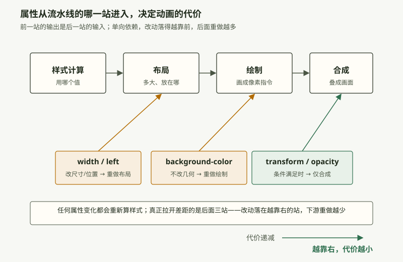

# 25 · 变化如何发生

> **前置**：知道 `width` 决定布局盒大小、`transform` 只做视觉变换（第 05、13 篇）；知道 `position: fixed`/`absolute` 的偏移相对最近的定位祖先（包含块，第 06 篇），以及 `z-index` 在层叠上下文里比较（第 08 篇）。第 24 篇立下的底线在这里继续成立：性能增强不能让基础状态失效。
>
> 上一篇：[页面是给谁用的](24-accessibility.md) ｜ [本阶段目录](README.md)

## 1. 本章目标

- 给一个会变化的属性，能说出它从"样式计算 → 布局 → 绘制 → 合成"的哪一站进入，以及后面哪几站必须重做。
- 能解释为什么 `width` 动画每帧有 Layout 段、`transform` 动画（元素独立成层时）没有，并说出 `transform` 的"只走合成"前提。
- 能说明 `transform` 不改自身布局盒、却换了后代 `fixed`/`absolute` 的包含块，并区分它与 `opacity`、`will-change` 的差异。
- 能用"读几何值就是同步点"判断一段 JS 会不会触发强制同步布局，并说出哪些帧间位移计入 CLS、哪些不计。

**为什么现在学这个**：前 24 篇都在把页面画对，本篇第一次问"画对的代价"。它是第三阶段"能维护"的性能支柱：后面第 27 篇的滚动驱动动画、视图过渡，全都建立在"哪些改动便宜"这个判断上；判断错了，增强反而把页面拖卡。

## 2. 新增模型

两根绿条都要从 120px 走到视觉上的 300px：

```css
.mover { width: 120px; height: 40px; transform-origin: left; }
/* 写法一 */
.a { animation: grow-width 1s linear; }   /* to { width: 300px } */
/* 写法二 */
.b { animation: grow-x 1s linear; }       /* to { transform: translateX(180px) } */
```

`120 + 180 = 300`，两根条的视觉终点重合，肉眼几乎分不出。你以为只是两种写法；实际打开 Performance 录制，第一根每帧都写着 Layout 和 Paint，第二根只有 Composite Layers。页面上有几十个元素、或主线程正忙着处理点击时，第一根开始掉帧，第二根照常走。

差别不在"动不动"，而在于两行 CSS 把改动交给了流水线的不同站点。背景是 60Hz 屏幕约每 16.7ms 出一帧，主线程要在这段时间里处理输入、算样式、布局和绘制，合成器再把结果送上屏。第一根把布局和绘制塞进每帧预算，赶上复杂页面就超时；第二根几乎不占主线程时间。

**模型：属性改动从流水线的某一站进入，落得越靠前，下游重做的越多；`width` 从布局进，`background-color` 从绘制进，`transform`/`opacity` 在独立成层时只从合成进。**



*图 25-1 · 属性从流水线的哪一站进入，决定动画的代价*

图是一条自左向右的流水线——样式计算 → 布局 → 绘制 → 合成，前一站的输出是后一站的输入。三支箭头分别从布局、绘制、合成三站进入：从布局进的必须连着重做绘制和合成，从绘制进的只需重做绘制和合成，从合成进的没有下游可做。

**这张图的一句话结论：流水线单向依赖，卡不卡取决于箭头插在哪，而不是动画时长。**

术语落地：

- **布局（重排）**：算出每个盒子多大、放在哪；改了几何，依赖它的换行与兄弟位置一起失效。
- **绘制（重绘）**：把盒子变成像素指令；几何不变、只改颜色时，布局结果可原样复用。
- **合成**：把画好的层按层叠顺序叠成画面；`transform`/`opacity` 只动整层，不重新生成像素。
- **合成层**：元素拥有自己的层时，浏览器才能把变换交给合成器独立完成。

## 3. 可运行的 demo

在往下读原理之前，先动手看一遍现象。带着"为什么改 transform 兄弟标记不动"的疑问读下一节，会比先看规则有效。

[打开 demo：width 与 transform，同一段位移两种代价](../../examples/minimal/25-rendering.html)

<iframe class="demo-frame" src="/css-concept-course/examples/minimal/25-rendering.html" title="width 与 transform，同一段位移两种代价" loading="lazy"></iframe>

> **先预测**：方块从 120px 走到视觉上的 300px。点"改 width"和点"改 transform"，哪种会让旁边的兄弟标记位移？唯一答案是"改 width 位移、改 transform 不位移"——先把理由写下来。
>
> **验证**：分别点两个模式按钮，用页面读数核对：`改 width` 时 `方块 offsetWidth` 变 `300px`、`兄弟标记相对起点位移` 为 `+180px`；`改 transform` 时 `offsetWidth` 仍是 `120px`、视觉右边缘到 `300px`、兄弟标记位移为 `0px`。当前生效 CSS 一栏会标出改动从哪一站进入。

如果你发现视觉终点相同、布局盒却一个变一个不变，就已经抓住这一篇的要害。

## 4. 原理与规则

### 4.1 四站各回答一个问题

样式计算回答"每个元素最终用哪个值"，布局回答"每个盒子多大、放在哪"，绘制回答"把这些盒子画成哪些像素指令"，合成回答"按层叠顺序把各层叠成最终画面"。

把开头的方块走一遍：样式阶段算出 `width` 此刻是 180px；布局阶段据此定出盒子的宽高和起点；绘制阶段生成"这条 40px 高的绿色矩形"指令；合成阶段把它所在的层叠上去。等 `width` 变成 181px，前两站的结论都过期了，只能重算。

**为什么必须先分清这四站？** 每站的输入就是上一站的输出。改 `width` 让盒子变宽，依赖它的换行、兄弟位置、绘制区域全部失效；改 `background-color` 时几何没变，布局结果仍有效，可以跳过；改 `transform` 时连像素都没重新生成，只是把画好的层做一次几何变换。把"失效范围"想清楚，后面两站做不做就自动推出了。

任何属性变化都会重新算样式，这一步几乎省不掉；真正拉开差距的是后面三站。所以"只走合成"说的是跳过布局和绘制，不是零成本。

**失效条件**：当改动发生在不存在合成层的元素上时，"只走合成"不成立——浏览器得先把这一层重新绘制一次，再交给合成器；`transform` 并不永远不触发绘制。

### 4.2 判断方法：连问三个问题

不用背优化清单，对每个会变的属性依次问：

| 提问 | 命中就从这一站进入 | 典型属性 |
| --- | --- | --- |
| 会改变盒子在文档流里的尺寸或位置吗？ | 布局（连带绘制、合成） | `width` `height` `margin` `font-size` `left` `top` |
| 不改几何，但改"画出来长什么样"吗？ | 绘制（连带合成） | `background-color` `color` `box-shadow` `border-color` |
| 只改整层的位移、缩放、旋转、透明度吗？ | 合成（前提：独立成层） | `transform` `opacity` |
| 都不命中（如只改 `content` 文本） | 回到布局重来 | 影响尺寸的文本 |

**为什么第一问优先？** 改几何同时改写布局的产物，后两站消费的正是这份产物，只能从布局重跑。第一问只要命中一次就停止，下游会被连带重做，答案确定。

**为什么第二问能跳过布局？** 元素仍占同样大小、同样位置，只是颜色或阴影不同，布局阶段算出的坐标可原样复用。

**为什么第三问有个前提？** `transform`/`opacity` 描述"整层怎么摆、多透明"，不需要知道内部盒子多大；但只有元素拥有自己的合成层，浏览器才能把变换交给合成器独立完成。所以"只走合成"是条件结论，不是属性保证。

**失效条件**：`animation` 简写会重置 `animation-timeline` 与 `animation-range`（第 27 篇），写的时候简写在先、时间轴在后；同理，给元素加 `filter`、`clip-path` 等可能强制生成新层，反而改变它进入流水线的站点。

### 4.3 transform 不改布局盒，却改掉后代的包含块

这是最容易说错的地方。给元素 `transform: translateX(100px)`：

- 它自身的布局盒没变：`offsetWidth` 不变，流中占位不变，兄弟不会挪过来。`getBoundingClientRect()` 返回的是变换后的视觉位置，不是布局盒尺寸。
- 它同时成为 `position: fixed` 和 `position: absolute` 后代的**包含块**，并建立层叠上下文。后果很具体：

```css
.panel { transform: translateX(0); }        /* 非 none 即可，0 也算 */
.pin   { position: fixed; top: 0; right: 0; }
.cover { position: absolute; inset: 0; }    /* inset 是四边简写 */
```

`.pin` 本该贴视口右上角，现在改为相对 `.panel` 定位，会跟着 `.panel` 移动和滚动；`.cover` 也不再填最近的定位祖先，而是填 `.panel` 的内边距盒。

**为什么这不矛盾？** 准确说法是"transform 不改变元素的布局盒尺寸与流中占位"，而不是"transform 对布局没有影响"。它换了后代的参照系，这属于布局语义，却不需要重新排版兄弟元素——两件事管的是不同对象。

反例能划清边界：`opacity: 0.5` 也会建立层叠上下文，但**不会**成为包含块；`will-change: transform` 则因为规范要求，在真正设置 transform 前就建立相同的上下文，同样改参照系。层叠上下文管"谁画在前面"，包含块管"偏移量从哪算"。

**失效条件**：`transform: none` 时不建立包含块也不建层叠上下文；`transform: translateX(0)` 虽视觉等价，却会建立——一个值的差别，后代定位就换了参照。

### 4.4 两个把"卡"放大的机制

**强制同步布局（布局抖动）**：浏览器平时把样式改动攒着，到出帧时一次算完。但你若先写样式、紧接着读一个依赖布局的值——`offsetWidth`、`getBoundingClientRect()`、`scrollTop`、`getComputedStyle()` 的几何值——浏览器必须立刻把攒着的布局算出来才能给准确数字，这一读把流水线硬拉回布局站。

```js
for (const box of boxes) {
  box.style.width = '300px';   // 写：让布局失效
  total += box.offsetWidth;    // 读：强制立刻布局一次
}
```

**为什么会抖？** 循环里每次读都逼浏览器把上一次写的布局结算掉，N 个元素就是 N 次同步布局，而不是攒成一次。判断方法很简单：读几何值就是同步点，把读集中到写之前，或用 `requestAnimationFrame` 把写集中到下一帧。

**CLS（累积布局偏移）**：衡量视觉稳定性，累计可见元素在帧之间发生的非预期起始位置移动。常见来源是没写尺寸的图片、晚到的字体、页面顶部后插入的横幅。

**为什么它属于这一篇？** 偏移的本质是布局位置变了：改 `width`、`top`、`margin` 的动画会改布局位置，可能计偏移；基于 `transform` 的合成动画只动视觉层、不推动其他元素，因此不计入 CLS。注意边界：用户输入后 500ms 内的偏移带 `hadRecentInput` 标记，会被排除。

**失效条件**：`contain: layout/paint` 只把影响范围关进子树，不是让重排消失——代价是元素成为后代的包含块、建立层叠上下文，`paint` 还会裁切溢出；`contain: size` 更会让元素不再由内容撑开，必须自己给尺寸。改 `top`/`left` 即使元素已在自己层上，仍产生布局偏移。

## 5. 常见坑

**坑 1：以为 transform 永远不重绘**
- **原因**：只有元素在独立合成层上才可能只合成；和别人共层时仍要重绘，`opacity` 同理。
- **确认**：Performance 录一段 `transform` 动画，若仍有成片 Paint 段，或 Rendering 面板的 Layer borders 看不出独立层，就是没独立成层。
- **修法**：对真正会频繁动的元素用 `will-change: transform` 提示独立成层；代价是每层占显存，滥用更慢。

**坑 2：以为 will-change: transform 能随便加**
- **原因**：它是提示，浏览器可忽视；且按规范只要非初始值会建立层叠上下文/包含块，`will-change` 命名该属性时也必须建立，会改后代定位参照。
- **确认**：加前后各看一次后代 `position: fixed` 元素的参照系，或对 Layers 面板数层数与显存。
- **修法**：只在确实要动画的元素上短暂加，动画结束移除；别把它当无副作用的默认样式。

**坑 3：以为 contain 能让重排消失**
- **原因**：`contain: layout/paint` 只是把影响关进子树，`paint` 裁切溢出；`contain: size` 让元素不再由内容撑开，必须自己给尺寸。
- **确认**：给容器加 `contain: size` 后看它是否塌成 0 高；加 `paint` 后看溢出内容是否被切。
- **修法**：需要固定尺寸时显式给 `width`/`height`；只要限制影响范围就用 `layout`，别默认加 `size`。

## 6. 练习

1. **基础**：写一个 120px 宽的块，分别用 `width: 300px` 和 `transform: translateX(180px)` 做 1 秒动画。
   验收：两者视觉右边缘都到 `300px`；前者 `offsetWidth` 为 `300px`、兄弟标记位移 `+180px`，后者 `offsetWidth` 仍为 `120px`、兄弟标记位移 `0px`。

2. **基础**：给背景色和边框色各做一次 1 秒过渡，用 Performance 录制 Main 轨道。
   验收：两类动画都不出现 Layout 段（几何未变），但出现 Paint 段；与第 1 题的 `width` 动画对照，后者有成片 Layout 段。

3. **进阶**：给一个有 `position: fixed` 子元素的容器加 `transform: translateX(0)`，再改回 `none`。
   验收：加 `translateX(0)` 后子元素不再贴视口、改以容器为参照；改回 `none` 后恢复贴视口；两次容器 `offsetWidth` 不变。

4. **进阶**：在循环里交替执行 `box.style.width = '300px'` 与 `box.offsetWidth` 各 50 次，再用 Performance 录制；随后把读移到循环外。
   验收：前一种 Main 轨道出现约 50 个独立 Layout 段，后一种 Layout 只剩约 1 次。

5. **挑战**：判断一个用 `top` 从 0 移到 100px 的元素与一个用 `transform: translateY(100px)` 的元素，在开启 Rendering 的 Layout shift regions 后哪个被高亮，并说明原因。
   验收：`top` 动画的区域被高亮并可能计入 CLS，`transform` 动画的区域不被高亮；两者视觉位移同为 `100px`，差别只在是否改了布局位置。

> 下一篇：[谁真的缩小了范围](26-scope-nesting.md)
