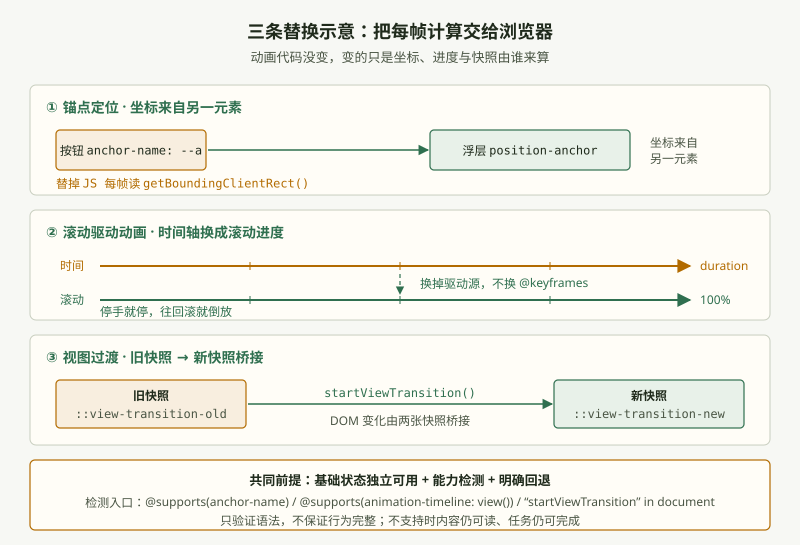

# 27 · 让浏览器替你算

> **前置**：会用第 24 篇的 `@supports` / `CSS.supports()` 做能力检测、并把增强写成"叠加"而非替换基础状态；知道第 25 篇的强制同步布局——每帧先读 `getBoundingClientRect()` 再写样式，会把流水线硬拉回布局站。
>
> 上一篇：[谁真的缩小了范围](26-scope-nesting.md) ｜ [本阶段目录](README.md)

## 1. 本章目标

- 给定一段每帧读坐标的提示框 JS，能用锚点定位重写，并说出删掉增强后提示框掉回哪里。
- 能把阅读进度条的"滚动监听 + 手算比例"换成滚动驱动动画，并说明为什么停手即停、往回滚会倒放。
- 能用 `document.startViewTransition()` 桥接一次 DOM 变更，并说出不支持时内容是否仍更新。
- 面对任一新特性，能给出"基础独立可用 + 能力检测 + 明确回退"三步，并解释为什么 `@supports` 通过不代表行为完整。

**为什么现在学这个**：第 25 篇算清了每帧计算的代价，第 24 篇立下了增强不能替换基础的底线。这一篇把两条合起来落地：锚点定位、滚动驱动、视图过渡都没发明新画面，只是把原本 JS 每帧算坐标、算进度、算快照的活交还浏览器。它是第三阶段"能安全落地新特性"的核心。

## 2. 新增模型

给一个按钮加跟随提示框，传统写法是：

```js
function place() {
  const r = button.getBoundingClientRect();
  tip.style.top = `${r.bottom + 8}px`;
  tip.style.left = `${r.left}px`;
}
addEventListener('scroll', place);
addEventListener('resize', place);
```

你以为只是"几行定位代码"；实际每次滚动都触发布局读取加样式写入，正好撞上第 25 篇的强制同步布局。类似的事还在别处重演：进度条靠 `scrollTop / (scrollHeight - clientHeight)` 算比例，卡片揭示靠 `IntersectionObserver` 加类，页面切换靠手写 FLIP 记录前后位置再倒推变换。

你以为是四个互不相干的效果，其实是同一个问题：**谁在每一帧做计算**。新平台把这几件事交给浏览器——你只声明关系，进度和快照由引擎算。

**模型：锚点定位、滚动驱动动画、视图过渡都没有发明新画面，它们把原本 JS 每帧算坐标、算进度、算快照的活交还浏览器；前提永远是"基础可用 + 能力检测 + 明确回退"。**



*图 27-1 · 把时间轴的驱动源换掉*

图上并排三条替换示意：锚点定位把浮层坐标的来源换成另一个元素；滚动驱动把动画横轴从墙钟时间换成滚动进度；视图过渡用旧快照到新快照的桥接替代手写 FLIP。中间那条画了两根共享同一组 `@keyframes` 的时间轴，一根横轴是时间走到 duration，另一根横轴是滚动位置走到 100%，虚线箭头标注"换掉驱动源，不换动画代码"。

**这张图的一句话结论：动画代码没变，变的只是坐标、进度与快照由谁来算；关掉增强，基础和任务都必须还在。**

术语落地：

- **锚点定位**：给元素命名锚点，浮层声明跟随它，坐标由浏览器在布局/合成时算，不再每帧读 `getBoundingClientRect()`。
- **滚动驱动动画**：把动画进度绑到滚动容器位置（`scroll()`）或元素进出视口的过程（`view()`）。
- **视图过渡**：捕获 DOM 变更前后的两张快照，用一组 `::view-transition-*` 伪元素播放桥接动画。
- **回退路径**：增强特性不可用时仍能完成任务的那一套基础写法。

## 3. 可运行的 demo

在往下读原理之前，先关掉一次原生能力，看谁还在算。带着"为什么关掉后提示框没消失"的疑问读下一节，会比先看规则有效。

[打开 demo：关掉原生能力，看谁还在算](../../examples/minimal/27-modern-features.html)

<iframe class="demo-frame" src="/css-concept-course/examples/minimal/27-modern-features.html" title="关掉原生能力，看谁还在算" loading="lazy"></iframe>

> **先预测**：一个跟随按钮的提示框，勾"禁用原生锚点（走回退）"后 `提示框 position（实测）` 会从什么变成什么？提示框内容还可不可见？唯一答案是"从 `fixed` 变成 `absolute`""内容仍可见"——先把理由写下来。
>
> **验证**：点"显示 / 隐藏提示"让提示框出现，读 `当前路径` 从"原生锚点定位"切到"基础定位回退"，`CSS.supports(anchor-name)` 始终为 `true`；对照 `提示框内容可见` 一栏在两种路径下都为 `true`。

如果你发现关掉的只是增强、不是内容，就已经抓住这一篇的要害。

## 4. 原理与规则

### 4.1 锚点定位：把"跟着谁"写进 CSS

三个角色：被跟随的元素用 `anchor-name` 命名；浮层以 `position-anchor` 指向该名字，且必须是 `absolute` 或 `fixed` 定位；再用 `position-area` 或 `anchor()` 真正摆放它。

```css
.tip {
  position: absolute;                  /* 基础定位，先写 */
  inset-block-start: calc(100% + 0.5rem);
}
@supports (anchor-name: --tip-anchor) {
  .tip {
    position: fixed;
    inset: auto;
    position-anchor: --tip-anchor;
    position-area: bottom span-right;
    margin-block-start: 0.5rem;
    position-try-fallbacks: flip-block, flip-inline;
  }
}
```

**为什么它能替掉那段 JS？** 按钮和浮层的几何关系被声明出来，浏览器在布局/合成时直接算，不再每帧读 `getBoundingClientRect()`。`anchor()` 返回锚点某条边对应的长度并可带兜底值；`@position-try --name` 可封装候选位置，`position-try-fallbacks` 按序尝试——按钮贴到视口边缘时翻到另一侧，是浏览器试出来的。

`anchor()` 取位置，`anchor-size()` 取尺寸——想让下拉与触发按钮等宽，写 `inline-size: anchor-size(width, 12rem)`。**为什么尺寸也要关联？** 过去只能在 JS 里读 `offsetWidth` 再写回，滚动时同样触发同步布局；交给引擎后按钮尺寸一变浮层跟着变。

**失效条件**：`anchor()` 的兜底值只是"函数无法解析时"用的值，不是一套布局；基础 `position: absolute` 必须写在 `@supports` 前面。锚点名在一屏内要唯一，否则浮层可能绑错元素；浮层本身太大时，再多候选位置也放不下。

### 4.2 滚动驱动动画：把时钟换成滚动进度

```css
.progress__bar {
  animation: grow linear both;          /* 简写先写 */
  animation-timeline: scroll(root block);
}
.reveal {
  animation: fade-up linear both;
  animation-timeline: view();
  animation-range: entry 0% entry 100%;
}
```

`scroll()` 取滚动容器的位置（适合进度条），`view()` 取元素进出 scrollport 的过程（适合揭示卡片），`animation-range` 把动画限制在某个阶段。**为什么"停手就停"不用额外写？** 进度来自滚动位置而非时间，滚动一动进度才动，反向滚动自然倒放，正好替掉 `scroll` 事件加 rAF 那套手算。

局部滚动容器还可以命名时间轴：

```css
.gallery { overflow-x: auto; scroll-timeline: --gallery x; }
.gallery__bar { animation: grow linear both; animation-timeline: --gallery; }
```

**为什么要命名？** `scroll(root block)` 只能指根滚动容器；横向画廊这类局部容器要先起名，进度条才知道读谁的位置。

**失效条件**：`animation` 简写会重置时间轴与范围，所以简写在先、时间轴在后；命名时间轴与 `animation-range` 是子特性，检测时不能只看 `animation-timeline` 一个属性名。没它时要监听滚动、读 `scrollTop`、算比例、写 `transform`，是第 25 篇说的同步布局来源。

### 4.3 视图过渡：用快照桥接 DOM 变化

```js
if ('startViewTransition' in document) {
  document.startViewTransition(() => { title.textContent = '新标题'; });
} else {
  title.textContent = '新标题';        // 基础路径：内容立即更新
}
```

API 捕获旧快照、执行 `update()`、捕获新状态，再用 `::view-transition-*` 伪元素播放过渡；`view-transition-name` 给需共享位置的元素起唯一名字。伪元素树大致是 `::view-transition` → `::view-transition-group(root)` → `::view-transition-image-pair(root)`，下面再分 `::view-transition-old` 与 `::view-transition-new`。

**为什么分成 old 和 new？** old 是静态旧快照，new 是新视图区域，两者交叠播放才形成"桥"；共享元素各自多出一组同名伪元素。

**为什么它比 FLIP 省心？** FLIP 要自己读 First、Last 两组几何再倒推变换；视图过渡直接拿两张快照桥接，DOM 结构变了也能连起来。JS 只决定"什么时候变"，动画交给 CSS。

**失效条件**：`"startViewTransition" in document` 为假时直接调用 `update()`，内容照常更新；开启减弱动画偏好时应跳过动画而非硬播。同名元素必须唯一，否则 `ready` 被拒绝、过渡被跳过——别把 `view-transition-name` 写死在列表每一项上。跨文档导航还要双方页面都 opt-in，支持范围比这个 API 更窄。

### 4.4 共同的边界：检测、回退，以及一条指针

| 特性 | 把什么交给了浏览器 | 检测入口 | 不支持时 |
| --- | --- | --- | --- |
| 锚点定位 | 浮层相对锚点的坐标与翻转 | `@supports (anchor-name: --a)` | 保留 `position: absolute` 基础定位 |
| 滚动驱动动画 | 每帧的进度值 | `@supports (animation-timeline: view())` | 基础状态可见，进度关键时用 JS |
| 视图过渡 | 前后两帧快照与插值 | `"startViewTransition" in document` | 直接执行 DOM 更新 |

**为什么必须逐个检测？** 三者都有多个子特性：`position-area`、`@position-try`、`scroll()` / `view()`、`animation-range`、跨文档导航都可能处于不同支持阶段。`@supports` 与 `CSS.supports()` 只验证语法被接受，不保证行为完整；最终仍要在最小页面里看一次真实效果。想在更底层把绘制或布局开放给 JS，是 Houdini 的方向，这里只留指针不展开。

`prefers-reduced-motion` 对三者同样适用：锚点浮层取消位移、滚动动画直接呈现终态、视图过渡把时长压到极短——减少的是运动，不是功能。

**失效条件**：把关键信息只挂在增强分支上，一旦语法通过但行为不完整，用户拿到的是坏掉的状态；正确做法永远是增强叠加上去，基础状态独立可用、任务在回退路径下仍可完成。

## 5. 常见坑

**坑 1：以为 anchor() 的兜底值就是降级方案**
- **原因**：它只是函数无法解析时使用的值，不是一套布局；基础定位必须独立写在前面。
- **确认**：关掉 `@supports` 分支后看提示框是否仍定位在按钮下方、内容是否可见。
- **修法**：基础 `position: absolute` 写在增强前，`@position-try` 只解决候选翻转；代价是多维护一套基础坐标。

**坑 2：以为不支持滚动动画就让元素保持 opacity: 0**
- **原因**：内容会直接消失；基础状态必须完整可见，动画是叠加层。
- **确认**：禁用时间轴后看进度条与揭示卡片是否还在、是否可读。
- **修法**：基础状态设为可见（进度条满格、卡片不透明），动画只增强；进度是关键功能时用 JS 兜底，不留静态满条误导。

**坑 3：以为视图过渡只写 CSS 就能触发**
- **原因**：同文档需要 `document.startViewTransition()`，跨文档还要双方 opt-in；同名元素重复时过渡被跳过。
- **确认**：删掉调用后看内容是否仍更新；给两个元素起同名后看 `ready` 是否被拒绝。
- **修法**：把调用包进能力检测、给共享元素起唯一名字；代价是要处理减弱动画偏好和重复名的情况。

## 6. 练习

1. **基础**：写一个跟随按钮的提示框，先用 `getBoundingClientRect()` 加 rAF 跟随，再用 `anchor-name` / `position-anchor` / `position-area` 重写。
   验收：滚动时两者都跟随；原生版在 Performance 里没有每帧 Layout 段；按钮贴到视口底部时 `position-try-fallbacks: flip-block` 让提示框翻到上方。

2. **基础**：用 `CSS.supports('anchor-name', '--a')` 检测锚点定位，检测失败时给提示框保留 `position: absolute`。
   验收：关掉增强开关后 `提示框 position（实测）` 为 `absolute`、`提示框内容可见` 为 `true`；开着且支持时为 `fixed`。

3. **进阶**：给长页面加 `animation-timeline: scroll(root block)` 的进度条，基础状态写可见满格，动画包进 `@supports`。
   验收：支持时进度随滚动从 0 到 1、停手即停；删掉时间轴后进度条仍可见，内容不消失。

4. **进阶**：用 `document.startViewTransition(() => { title.textContent = '新标题' })` 切换标题，给标题加唯一的 `view-transition-name`。
   验收：支持时旧标题淡出、新标题淡入且位置连续；把调用改成直接赋值时内容仍立即更新；给两个元素起同名时过渡被跳过、内容直接切换。

5. **挑战**：把三者同时接入一个页面，开启 `prefers-reduced-motion: reduce`，检查增强是否只减运动不减功能。
   验收：锚点浮层无位移但仍跟随、滚动动画直接呈现终态、视图过渡时长被压到极短；三处的任务（看到提示、看到进度、看到新标题）都能完成，内容均可见。

> 下一篇：[屏幕上的长页，怎么落到有限的纸上](28-print.md)
