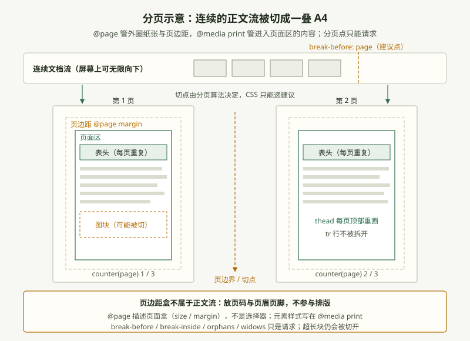

# 28 · 屏幕上的长页，怎么落到有限的纸上

> **前置**：会用第 19 篇的媒体查询判断当前输出环境；知道第 03 篇的层叠——`@media print` 里的规则在打印时参与比较；知道第 05 篇的盒模型与第 06 篇的定位，理解"元素盒"和"纸张"不是同一种对象。
>
> 上一篇：[让浏览器替你算](27-modern-features.md) ｜ [本阶段目录](README.md)

## 1. 本章目标

- 给定一份屏幕长页样式，能说出在打印时哪些东西必须退出布局（导航、工具栏、深色背景）以及如何用 `@media print` 改写。
- 能区分 `@media print` 管"画什么"与 `@page` 管"纸多大、页边放什么"，并解释为什么 `size` 写进元素类不会改变纸张。
- 能用 `break-*` 与 `orphans`/`widows` 降低无意义切断的概率，并说出为什么分页点只能请求、不能保证。
- 能保证跨页后仍读得懂：重复表头、颜色靠文字符号兜底，并解释 `print-color-adjust: exact` 的边界。

**为什么现在学这个**：前面所有章节都假设画布可以无限向下滚。打印第一次把画布换成一叠尺寸固定的纸，交互状态与颜色控制都失去前提。它是"能维护"阶段里容易被忽略的一环——页面在屏幕上完美，打印出来却缺字、断图，问题往往不是没写样式，而是用错了对象。

## 2. 新增模型

一份长报告页：深色背景、固定在顶部的导航、悬停才显示的工具提示、一张带图注的插图。屏幕上滚动顺畅，点打印，预览里却变成这样：深色背景没印出来（或印出一整版墨），导航占着正文空间，悬停提示消失，图注被切成上下两半分在两页，标题孤零零落在页底。

```css
body { background: #14231b; color: #f4f1e9; }
.nav { position: sticky; top: 0; }
.tip { display: none; }
.card:hover .tip { display: block; }
```

你以为打印只是"把屏幕缩小到 A4"；实际排版引擎换了一套规则：画布从连续变成离散的页，交互状态不复存在，颜色由用户和设备共同决定。你写的 CSS 仍在，但一部分东西失去了成立的前提。

**模型：屏幕是一块可无限向下滚的画布，打印是一叠尺寸固定的纸；`@media print` 决定画什么，`@page` 决定每张纸多大、页边放什么，而分页点只能请求、不能保证。**



*图 28-1 · 一张纸的剖面：页边距盒与页面区*

图从外到内三层：最外是纸张（A4，210mm × 297mm），中间一圈是页边距，最内是页面区。页边距被划成 16 个槽位，上中放页码、右下放章节名，正文只进入页面区。图上标出两条边界：`@page` 管外圈——`size` 定纸张、`margin` 定页边、槽位用 `content: counter(page)` 填；`@media print` 管进入页面区的内容。一条虚线穿过页面区，表示正文流被切成一页一页。

**这张图的一句话结论：纸张的物理边界不属于正文流；页码在页边距盒里，正文只能在页面区里被切分。**

术语落地：

- **页面盒**：`@page` 描述的纸张对象，没有 DOM 对应物，选不中任何元素。
- **页边距盒**：纸张边缘的 16 个槽位，放页码与页眉页脚，不参与正文排版。
- **页面区**：页边距之内、正文真正排布并被分页的区域。
- **分页点**：引擎切开正文的位置，CSS 只能递建议，不能钉死。

## 3. 可运行的 demo

在往下读原理之前，先把页面切到打印视图看一眼。带着"为什么页眉一勾就消失"的疑问读下一节，会比先看规则有效。

[打开 demo：段落数与 break-inside，看断点落在哪里](../../examples/minimal/28-print.html)

<iframe class="demo-frame" src="/css-concept-course/examples/minimal/28-print.html" title="段落数与 break-inside，看断点落在哪里" loading="lazy"></iframe>

> **先预测**：勾选"模拟打印视图"后，页眉的 `页眉 display（实测）` 会变成什么？外部链接的 `链接 ::after content（实测）` 会不会多出地址文本？唯一答案是"变成 `none`""多出地址"——先把理由写下来。
>
> **验证**：切换开关，用页面读数核对：`当前视图` 变成"打印模拟"，`页眉 display`、`导航 display`、`工具栏 display` 都为 `none`，`页面背景` 从深色变白，`链接 ::after content` 出现 ` (https://example.com/spec)`。真实打印仍以打印预览为准。

如果你发现打印只是让一批元素退出布局、并把地址补出来，就已经抓住这一篇的要害。

## 4. 原理与规则

### 4.1 @media print 与 @page 管两个对象

`@media print` 是一条媒体查询：输出目标是打印或打印预览时，它内部的规则才参与层叠。它管的是元素——隐藏导航、展平阴影、把链接地址显示出来。

```css
@media print {
  .nav, .toolbar { display: none; }
  a[href^="http"]::after { content: " (" attr(href) ")"; }
  body { color: #000; background: #fff; }
}
```

`@page` 不是选择器，选不中任何 DOM 元素。它描述页面盒：纸张尺寸、页边距，以及页边距盒里放什么。

```css
@page {
  size: A4;
  margin: 18mm 16mm;
}
```

**为什么必须分开？** "哪些内容出现"是内容问题，交给能命中元素的 `@media print`；"每张纸多大"是输出设备和页面盒问题，页面盒没有 DOM 对应物，只能由 `@page` 表达。

**失效条件**：把 `size` 写进 `.page` 类不会改变打印纸张；想让打印规则与屏幕规则分开维护，就把 `@page` 嵌进 `@media print`。浏览器打印对话框里的纸张、缩放、页眉页脚选项仍可能覆盖这些设定，CSS 不能独占最终输出。

### 4.2 页边距盒与 @page :first

页边距不是空白，它被切成 16 个槽位：上下左右各有角、中、边三类位置。槽位用 `content` 填，页码由页面计数器提供：

```css
@page {
  margin: 18mm 16mm;
  @bottom-center { content: counter(page) " / " counter(pages); }
}
@page :first {
  margin-top: 24mm;                  /* 首页留出标题空间 */
  @bottom-center { content: none; }  /* 首页不显示页码 */
}
```

`:first` 只命中第一页；同一组里还有 `:left`、`:right`、`:blank`。**为什么首页要单独写？** 封面或报告首页的排版与正文页不同——更大的上边距、没有页码——但 `@page` 默认作用于所有页，只有伪类能收窄到某一类页。

这里的 `content` 是页边距盒的排版指令，不是给普通元素生成文字；`counter(page)`、`counter(pages)` 也是页上下文里的计数器。

**失效条件**：页边距盒里放的是页码和页眉页脚，不参与正文排版；`@page` 里写普通元素选择器无效。用户在打印对话框关掉"页眉和页脚"时，槽位内容可能被整体覆盖。

### 4.3 分页只能请求，不能保证

正文进入页面区后被切成多页。你可以在切点附近递建议：

```css
h2, h3 { break-after: avoid; }           /* 标题别留在页底 */
figure, pre, tr { break-inside: avoid; } /* 整块别被切开 */
.chapter { break-before: page; }         /* 从这里另起一页 */
p { orphans: 3; widows: 3; }             /* 页底/页顶至少保留的行数 */
```

**为什么是"建议"？** 分页发生在布局之后，引擎要在有限高度里放下连续的盒。一张图比整页还高，`break-inside: avoid` 根本无法满足，引擎仍会切开它；两个建议冲突时，规范定义了取舍规则（强制分页压过 `avoid`），而不是两个都照办。

`orphans` 和 `widows` 是同类请求：分别规定页底、页顶至少保留几行文字，避免只剩一行的段落。它们初始值是 2，写成 3 是更严格的要求，同样可能被空间挤掉。

**失效条件**：`break-inside: avoid` 在元素高于一页时失效；容器高度不足、`break-before: page` 与前一个 `break-after` 冲突时按取舍规则处理。你能降低无意义切断的概率，不能钉死每一页。

### 4.4 跨页后仍要读得懂：表头与颜色

长表格跨页时，重复表头靠显示角色，不靠复制 DOM：

```css
@media print {
  thead { display: table-header-group; } /* 每页顶部重复 */
  tfoot { display: table-footer-group; }
  tr { break-inside: avoid; }            /* 行不被拆开 */
}
```

**为什么这样就能重复？** 浏览器把 `table-header-group` 识别为"表头组"，分页时会在每页表格顶部重画它。别把 `thead` 改成 `display: block` 或 `none`，那会同时取消重复能力；多数浏览器默认就是这个值，显式写出是为了不被别的规则覆盖。

颜色是另一类取舍：

```css
@media print {
  * { print-color-adjust: exact; }
}
```

`print-color-adjust: economy`（初始）允许引擎为省墨丢掉背景；`exact` 是"尽量保留"的请求。**为什么关键状态不能只靠颜色？** 黑白打印或用户关掉背景后，绿色"通过"和红色"失败"可能变成同一个灰；状态要同时有文字或符号，背景色只做加强。

**失效条件**：`exact` 不能保证背景被打印——用户仍可在打印对话框里关掉背景图形；`display: block` 的 `thead` 失去重复能力；`economy` 下背景被主动丢弃，依赖背景色的状态消失。

## 5. 常见坑

**坑 1：以为 @page 里能选中元素设置样式**
- **原因**：它描述页面盒，不是选择器；元素样式写在 `@media print`，页面尺寸与页边距写在 `@page`。
- **确认**：在 `@page` 里写 `.nav { display: none }` 后看导航是否仍在打印预览中出现。
- **修法**：元素样式移进 `@media print`，`@page` 只放 `size`、`margin` 与槽位；代价是要分两处维护。

**坑 2：以为 break-inside: avoid 保证不拆开**
- **原因**：元素高于一页时照样拆；它是降低切断概率的请求，不是硬约束。
- **确认**：给一张高于页面区的图加该声明，看它是否仍在页边界被切开。
- **修法**：缩小图块或允许跨页，配合 `break-before: page` 控制起点；代价是版面可能多出空白。

**坑 3：以为 print-color-adjust: exact 保证背景被打印**
- **原因**：用户仍可关闭背景图形；黑白打印下只能用文字和符号承载关键状态。
- **确认**：在打印预览里关掉"背景图形"，看状态是否还能区分。
- **修法**：关键状态加文字或符号，颜色只做加强；代价是设计上要克制纯色表意。

## 6. 练习

1. **基础**：给一份带导航、深色背景和悬停提示的报告写 `@media print`：隐藏导航、白底黑字、展开外部链接地址。
   验收：模拟打印视图后 `导航 display` 为 `none`、`页面背景` 为白；每个 http 链接后多出 ` (地址)`，页内锚点不追加。

2. **基础**：写 `@page { size: A4; margin: 18mm 16mm }`，再用 `@page :first { margin-top: 24mm; @bottom-center { content: none } }`。
   验收：打印预览里纸张为 A4、正文距左右边各 `16mm`；首页上边距 `24mm` 且底部无页码，第二页起底部居中显示页码。

3. **进阶**：写一个跨 3 页的表格，设置 `thead { display: table-header-group }` 与 `tr { break-inside: avoid }`。
   验收：每页表格顶部都重复表头；没有任何一行被页边界切成上下两半。

4. **进阶**：给 `h2` 加 `break-after: avoid`、给 `figure` 加 `break-inside: avoid`，用一个刚好在页尾的标题和插图验证。
   验收：标题不再单独留在页底，而是与后文同页；插图若高于剩余空间则整体移到下一页。

5. **挑战**：不查资料，预测 `p { orphans: 3; widows: 3 }` 在页尾只剩 2 行、页首只剩 2 行时的排版，再在打印预览里核对。
   验收：页尾 2 行的段落整体移到下一页、页首不只剩 2 行；把值改回初始的 2 后，该段落允许在页尾保留 2 行——证明这是"建议"而非硬约束。

> 下一篇：[分栏、绕行与叠色，各管一层](29-shapes-mix.md)
