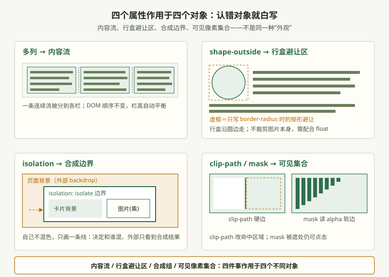

# 29 · 分栏、绕行与叠色，各管一层

> **前置**：知道层叠上下文"谁画在前面、在哪一层"（第 08 篇），知道 Grid 把项目摆进显式行列（第 16 篇），知道 `float: left/right` 让盒脱离正常流、行盒会避开它（浮动，第 07 篇）。
>
> 上一篇：[屏幕上的长页，怎么落到有限的纸上](28-print.md) ｜ [本阶段目录](README.md)

## 1. 本章目标

- 给定 `columns: 18rem 3` 的容器，能算出不同宽度下的栏数，并说明多列与 Grid 分别把内容放进什么。
- 能给一张圆形浮动图片配上 `shape-outside`，让文字沿圆边而非矩形外框避让，并说出为什么必须写 `float`。
- 给定 `mix-blend-mode` 与 `isolation: isolate`，能判断混色发生在哪一层、去掉隔离后 backdrop 变成什么。
- 面对渐隐与硬切两种需求，能在 `mask` 与 `clip-path` 之间做出选择，并说出两者对命中区域的不同影响。

**为什么现在学这个**：前面章节大多在改"一个盒子长什么样"。这一篇第一次把对象拆开——内容流、文字避让区、颜色合成组、可见像素集合是四个不同对象。认错对象，属性不是效果弱，而是根本没作用在你以为的地方；这是维护阶段排查"样式写了却没用"的关键。

## 2. 新增模型

同一段带图片的排版，你做了三件事：

```css
.portrait { float: left; border-radius: 50%; }
.title { mix-blend-mode: multiply; }
.fade { clip-path: linear-gradient(90deg, #000, transparent); }
```

图片变圆了，旁边文字却还按矩形留白；标题在深色页面上一会儿发灰、一会儿看不见；渐隐那行 `clip-path` 被浏览器直接忽略。你以为都在"改外观"；实际图片轮廓、文字避让区、颜色合成组、像素可见集合是四层不同对象。用错属性，不是效果弱，是没作用到正确的对象上。

**模型：多列改内容流如何分配，形状改行盒避让的区域，混合改颜色合成的边界，遮罩与裁剪决定哪些像素留下——四件事作用于四个不同对象，认错对象就白写。**



*图 29-1 · 混合隔离剖面：颜色在哪一层合成*

图把四个对象画成四格：多列把一条连续流分到各栏、DOM 顺序不变；`shape-outside` 用虚框标出"只写 `border-radius` 时的矩形避让"，实线圆是文字真正沿行的边；`isolation: isolate` 画成一道边界，边界外的页面背景被挡住，图片只与组内卡片背景混合；最下一格左边是 `clip-path` 的几何硬切、右边是 `mask` 读 alpha 的软边。

**这张图的一句话结论：`mix-blend-mode` 决定算法，`isolation` 决定算法的作用范围；四层对象各管一层，互不替代。**

术语落地：

- **内容流**：先填满一栏再进下一栏的连续文本，多列改的是它的分配方式。
- **行盒避让区**：浮动元素周围文字让出的区域，`shape-outside` 改的是它，不是图片轮廓。
- **隔离组**：`isolation: isolate` 创建的合成边界，组内元素不再与组外背景混合。
- **可见像素集合**：`mask` 与 `clip-path` 决定哪些像素被留下，前者软边、后者硬边。

## 3. 可运行的 demo

在往下读原理之前，先切一次绕行开关。带着"为什么只画圆还不够"的疑问读下一节，会比先看规则有效。

[打开 demo：切换 isolation，看图片跟谁混色](../../examples/minimal/29-shapes-mix.html)

<iframe class="demo-frame" src="/css-concept-course/examples/minimal/29-shapes-mix.html" title="切换 isolation，看图片跟谁混色" loading="lazy"></iframe>

> **先预测**：图片已经写了 `border-radius: 50%`、看起来是圆的。勾掉"启用 shape-outside: circle(50%)"后，文字会沿圆边走还是回到矩形外框？唯一答案是"回到矩形外框"——先把理由写下来。
>
> **验证**：切换开关，用页面读数核对：`shape-outside（实测）` 在 `circle(...)` 与 `none` 之间切换，`文字避让区` 一栏从"沿圆避让"变成"矩形外框避让"；`浮动盒尺寸（实测）` 始终是 `160 x 160 px`、`border-radius` 没变，证明图片轮廓根本没被裁剪。

如果你发现图片轮廓和文字避让区是两回事，就已经抓住这一篇的要害。

## 4. 原理与规则

### 4.1 多列是把内容倒进栏里，Grid 是把项目摆进格子

```css
.article {
  columns: 18rem 3;         /* 理想栏宽 18rem，最多 3 栏 */
  column-gap: 2rem;
  column-rule: 1px solid #d8d3c5;
}
.article > h2 { column-span: all; }  /* 标题跨全部栏 */
```

`column-count` 是上限，`column-width` 是算法输入，实际栏数由容器宽度算出来。**为什么这不是 Grid？** 多列里内容是一条连续流：先填满第一栏再进第二栏，浏览器自动平衡栏高，DOM 顺序不变；Grid 是你显式把每个项目放进命名的行和列。要"卡片各自对齐"选 Grid，要"一段长文自动分栏"才选多列。

| 要做的事 | 选谁 | 判断依据 |
| --- | --- | --- |
| 一段长文均匀分栏、栏高自动平衡 | 多列 | 内容是连续流，断点由浏览器决定 |
| 每个卡片占据指定行与列 | Grid | 位置是你显式指定的 |
| 标题横跨所有栏 | 多列 + `column-span: all` | 仍留在同一条内容流里 |

栏线画在 `column-gap` 之内，不额外吃宽度；`break-inside: avoid` 在多列里也能减少引文被栏边界切开。`column-fill` 默认 `balance`，自动高度下各栏高度接近；只有容器高度固定时 `auto` 才明显地按顺序填满第一栏。

**失效条件**：把 `column-count` 写死为 3，窄屏时每行可能只剩几个字——应把它当上限，让宽度自己降栏。`column-fill` 不是"控制阅读顺序"的开关，DOM 顺序始终不变，变的只是内容在哪一栏结束。

### 4.2 shape-outside 改文字避让区，不是图片轮廓

```css
.portrait {
  float: left;
  inline-size: 12rem;
  aspect-ratio: 1;
  border-radius: 50%;                    /* 画成圆的 */
  shape-outside: circle(50% at 50% 50%); /* 文字按圆绕开 */
  shape-margin: 0.75rem;                 /* 避让区外再留一圈 */
}
```

普通浮动让行盒避开元素的矩形外框，所以圆形图片周围仍是方角留白；`shape-outside` 在浮动元素之外重新定义避让区，行盒沿这个形状排列。

**为什么必须写 `float`？** `shape-outside` 作用于浮动元素；没有浮动就没有需要绕开的区域，属性写了也不会让文字回流。它也**不裁剪元素本身**——想让图片真的变圆，靠 `border-radius` 或 `clip-path`，两者用同一几何才对齐。

图片轮廓来自带 alpha 的 PNG 时，可用 `shape-outside: url(...)` 配 `shape-image-threshold: 0.3`（alpha 大于或等于阈值的像素算进形状）。`shape-image-threshold` 默认 0，此时所有像素（包括全透明）都算进形状，得到完整矩形；调到 1 只保留完全不透明像素，复杂边缘可能锯齿。`shape-margin` 是避让区外侧的额外留白，不是元素 `margin`，也不负责清除浮动。

**失效条件**：阈值只对带透明信息的图片有意义，完全不透明的图不会被"抠"出形状；`shape-outside` 不清除浮动，收尾仍要靠容器的 `display: flow-root` 或 clearfix。

### 4.3 混合先找边界，再谈模式

```css
.card {
  isolation: isolate;   /* 画一条混合边界 */
  background: #fffdf7;
}
.card > img {
  mix-blend-mode: multiply; /* 与本组内的背景混合 */
}
.texture {
  background-image:
    linear-gradient(#3f6b2a55, transparent),
    url("./grain.png");
  background-blend-mode: multiply, multiply; /* 只混自己的背景层 */
}
```

`mix-blend-mode` 把元素像素与背后的画面混合；`background-blend-mode` 只混同一元素的背景层与背景色，不碰后代。`isolation: isolate` 自身不混色，它创建层叠上下文和隔离组，让组内元素不再与组外页面背景混合。

**为什么去掉 isolation 后颜色会"随页面变"？** 没有边界时，元素的 backdrop 一直向上找到页面背景；把卡片放进深色区块就换了 backdrop。加上隔离组，外部只看到合成后的结果，卡片内部视觉稳定。

```text
无隔离：  页面背景 + 卡片背景 + 图片(乘) + 文字  ← 混色一直找到页面
有隔离：  页面背景 | [卡片背景 + 图片(乘) + 文字] ← 外部只看到合成结果
```

注意 `opacity < 1`、`filter`、`transform` 也会建立层叠上下文，可能意外切断混合（第 08 篇）；`z-index` 只管绘制先后，不定义混合边界。标题和正文保持默认的 `normal`，别跟着一起混。

**失效条件**：`isolation: isolate` 只在有混合需求时才有意义；给所有元素都加会割裂应有的混合。若组内没有 `mix-blend-mode` 元素，边界只是多建一个层叠上下文，没有视觉收益。

### 4.4 mask 看 alpha，clip-path 看几何

```css
/* 硬边：几何裁剪 */
.geo { clip-path: inset(0 40% 0 0); }
/* 软边：alpha 遮罩 */
.fade { mask-image: linear-gradient(90deg, #000 60%, transparent); }
```

`clip-path` 用几何路径判定内外：路径外像素被丢弃，边缘是硬切，而且被裁掉的区域不再接收点击——它真的改变元素的命中区域。`mask` 用遮罩图或渐变的 alpha 调制可见度：alpha 为 0 的像素透明、0.5 的半透明，因此能做渐隐；被遮住的区域仍可接收点击。

**为什么不能互换？** 要"从右往左淡出"需要连续 alpha，`clip-path` 只有边界内外两种状态；要"精确切掉左侧 40%、并让该处点击穿透"就该用 `clip-path`，`mask` 不改变命中测试。两者都可和 `shape-outside` 同时出现，但遮罩与裁剪管元素被看见的部分，`shape-outside` 管文字绕行的部分。

`mask` 默认按 alpha 读遮罩；`mask-mode: luminance` 改按亮度读，白色保留、黑色透明，适合复用灰度图。写成简写 `mask` 时还会带上 `mask-size` / `mask-position` / `mask-repeat`，决定遮罩图怎么铺到元素上。

**失效条件**：`mask-mode: luminance` 下用纯 alpha 渐变会得到整块保留或透明、没有软边；`clip-path` 无法表达连续过渡，`mask` 无法改变命中区域——把 `clip-path: linear-gradient(...)` 这种值写出来会被浏览器忽略，因为 `clip-path` 不接受渐变图像。

## 5. 常见坑

**坑 1：以为 columns: 3 就是每栏 1/3 宽**
- **原因**：栏宽与栏数都是输入，实际栏数由容器宽度算出。
- **确认**：逐段缩窄容器，数 `getComputedStyle` 的 `column-count` 是否随之变化。
- **修法**：把 `column-count` 当上限、配合 `column-width` 让它自动降栏；代价是栏数不再固定。

**坑 2：以为 shape-outside 会把图片裁成那个形状**
- **原因**：它只改文字避让区；视觉轮廓要靠 `border-radius` / `clip-path` 同步。
- **确认**：用 demo 读 `浮动盒尺寸` 与 `shape-outside`，关掉开关后图片仍圆、文字却走矩形。
- **修法**：让 `border-radius` 与 `shape-outside` 用同一几何；代价是两处要同步维护。

**坑 3：以为 mask 和 clip-path 都能做渐隐**
- **原因**：只有 `mask` 读 alpha 能做软边；`clip-path` 是几何硬切，还改命中区域。
- **确认**：在元素边缘放一个可点区域，看被"去掉"的部分是否还能触发点击。
- **修法**：渐隐用 `mask-image`，精确硬切用 `clip-path`；代价是要分清"看不见"与"点不到"是不是同一需求。

## 6. 练习

1. **基础**：容器 1200px、`columns: 18rem 3`、`column-gap: 2rem`（根字号 16px），给 `h2` 加 `column-span: all`。
   验收：1200px 下 3 栏（3×18rem + 2×2rem = 928px 放得下）；缩到 800px 变 2 栏、400px 变 1 栏；标题横跨全部栏，正文 DOM 顺序不变。

2. **基础**：圆形图片只写 `border-radius: 50%` 让它浮动，观察文字，再补 `shape-outside: circle(50%)` 和 `shape-margin: 1rem`。
   验收：只有 `border-radius` 时文字按矩形绕行；补上后沿圆边走；`shape-margin` 让文字距圆边增加 `1rem`，而图片轮廓本身未被裁剪。

3. **进阶**：把 `shape-outside: circle(50%)` 的浮动图片换成带透明通道的 PNG，配 `shape-image-threshold: 0.3`。
   验收：alpha ≥ 0.3 的像素算进避让区；把阈值改到 1 后只剩完全不透明像素参与，边缘出现锯齿——证明阈值只对带透明信息的图片有效。

4. **进阶**：给同一张图分别应用 `clip-path: inset(0 40%)`、`mask-image: linear-gradient(90deg, #000 60%, transparent)`。
   验收：前者在 60% 处出现硬边、被裁区域点击穿透到下层；后者从 60% 到 100% 渐变透明、被遮区域仍能点中图片。

5. **挑战**：给卡片内图片设 `mix-blend-mode: multiply`，卡片米色背景、页面深绿背景，切换卡片上的 `isolation: isolate`。
   验收：有隔离时图片只与卡片背景混合、颜色不随页面变；去掉后 backdrop 变成页面深绿，合成结果改变；把模式换成 `screen` 后算法随之改变——证明边界与算法是两个独立变量。

> 下一篇：[状态何时成立，样式到哪里为止](30-component-boundary.md)
