# 30 · 状态何时成立，样式到哪里为止

> **前置**：会用第 03 篇的层叠比较判断两条规则谁胜出（含跨树的普通声明 vs `!important`）；会用第 24 篇的 `:focus-visible` 与能力查询；会按第 19 篇区分主输入（`hover`/`pointer`）与任意输入（`any-hover`/`any-pointer`）。第 04 篇的继承与第 23 篇的令牌是变量穿透边界的基础。
>
> 上一篇：[分栏、绕行与叠色，各管一层](29-shapes-mix.md) ｜ [本阶段目录](README.md)

## 1. 本章目标

- 给定 `:hover`、`:focus-visible`、`:active`、`:disabled` 四条同优先级规则，能说出同时命中时谁生效，以及如何排序让禁用态不被覆盖。
- 面对触屏主输入，能判断 `:hover` 会不会粘住，并用 `(hover: hover) and (pointer: fine)` 把悬停增强限定到正确的输入。
- 给定 Shadow DOM 组件，能判断页面里的 `button { color: red }` 能否命中影子树内部，并说出 `:host`、`::part()`、CSS 变量三条通道各自改什么。
- 能用 `all: initial` 给组件归零起跑线并补回必要属性，说明 `display` 为何必须重设，以及为何该公开令牌与 Part 而非堆高 `:host` 优先级。

**为什么现在学这个**：这是主线最后一章，也是"能维护"的收口。前面的边界（命名、令牌、`@scope`）都是同本文档里的约定；Shadow DOM 是浏览器级的硬边界，普通选择器第一次真正过不去。把状态时序和组件边界一起讲清，才不会在最后的集成环节把"样式没生效"误判成优先级不够。

## 2. 新增模型

三件看起来都是"样式没生效"的事：

```css
/* 页面全局 */
button { color: red; }
:focus-visible { outline: 3px solid #3157d5; }
```

你给按钮写了悬停变色，手机点开后颜色"粘"在按钮上不消失；你把 `button { color: red }` 写成想顺手改第三方卡片里的按钮，页面其余按钮都红了，组件里那个纹丝不动；你把 `:focus-visible` 加在页面全局，组件内部输入框还是没有焦点环。

你以为是"样式没生效"；实际是两件事：状态在错误的时间被触发，或者样式撞到了一堵墙。判断错原因，就会在错误的地方加大选择器优先级——而那两件事都不靠优先级解决。

**模型：交互状态是一条有先后的时序，输入能力决定哪些状态成立；组件边界是一道有闸门的墙——普通选择器过不去，`:host`、`::part()` 和 CSS 变量只按约定的通道穿过。**



*图 30-1 · Shadow DOM 边界：哪条线能过去*

图是一道竖墙把左侧页面文档与右侧影子树分开，墙上的 `:host` 是关口。左侧三条箭头被挡回：`.card button`、页面全局 `button`、页面里的 `:focus-visible`。右侧三条带标签的箭头穿过关口：CSS 变量沿继承链进入、`:host` 从内部描述宿主、`::part()` 只命中显式标了 `part` 的节点。图上注明：跨树普通声明由外层胜出，`!important` 则反过来。

**这张图的一句话结论：边界不是"全封闭"，而是"只有列出的通道能过"；想改组件内部，要么改它公开的令牌和 Part，要么别越过边界。**

术语落地：

- **影子树（Shadow DOM）**：组件内部的独立 DOM 树，内外样式表互不穿透。
- **宿主（host）**：承载影子树的自定义元素本身，页面能选中它，但选不中内部节点。
- **Part**：组件用 `part="xxx"` 显式开放的内部节点，页面才能用 `::part(xxx)` 命中。
- **时序**：状态按事件发生有先后，优先级相同时由书写顺序裁决。

## 3. 可运行的 demo

在往下读原理之前，先用开关看看谁能改影子树里的按钮。带着"为什么普通选择器被挡住"的疑问读下一节，会比先看规则有效。

[打开 demo：两道开关，看谁改得动影子树里的按钮](../../examples/minimal/30-component-boundary.html)

<iframe class="demo-frame" src="/css-concept-course/examples/minimal/30-component-boundary.html" title="两道开关，看谁改得动影子树里的按钮" loading="lazy"></iframe>

> **先预测**：页面写 `demo-card button { color: #b26b1f }`，影子树里的按钮会变色吗？勾"启用 demo-card::part(action) 样式"后，按钮的 `color（实测）` 会变成什么？唯一答案是"普通规则被挡、不会变色""变绿色"——先把理由写下来。
>
> **验证**：看 `页面选择器命中数（实测）` 始终为 `0`（普通规则进不去）；勾选开关后 `内部按钮 color（实测）` 从初始色变为 `rgb(47,111,79)`、`border-color` 变为琥珀色，`命中通道` 从"被边界挡住"切到"::part(action)"。

如果你发现改内部靠的是组件公开的 Part，而不是加大选择器优先级，就已经抓住这一篇的要害。

## 4. 原理与规则

### 4.1 四个状态是一条时序，优先级却相同

```css
.btn:hover         { background: #2d4d1d; }
.btn:focus-visible { outline: 3px solid #3157d5; outline-offset: 3px; }
.btn:active        { background: #17340f; transform: translateY(1px); }
.btn:disabled      { background: #e5e7eb; color: #9aa2ad; cursor: not-allowed; }
```

时序是：鼠标移入先 `:hover`，按下时 `:active`，键盘 Tab 到位时 `:focus-visible`，控件被禁用后 `:disabled`。四者都是伪类，优先级同为 `(0,0,1,0)`，同时命中时由**书写顺序**决定谁生效，所以最"不可逆"的 `:disabled` 放最后——禁用按钮仍可能被 `:hover` 命中，不能让悬停色盖掉禁用态。

**为什么不写 `:focus`？** `:focus` 在鼠标点击后也会匹配，容易给每一处点击都加一圈焦点环；`:focus-visible` 由浏览器判断何时该显示焦点提示，通常是键盘或辅助技术操作时（第 24 篇）。需要"内部有焦点时高亮宿主"，在影子树里写 `:host(:focus-within)`，而不是指望页面全局规则钻进去。

| 状态 | 何时成立 | 触屏上的表现 |
| --- | --- | --- |
| `:hover` | 指针停在元素上 | 可能点后粘住，不承载关键信息 |
| `:active` | 按压/激活期间 | 短暂成立，适合即时反馈 |
| `:focus-visible` | 浏览器判断需要可见焦点时 | 键盘与辅助技术触发，与指针无关 |
| `:disabled` | HTML 有 `disabled` 属性 | 不可聚焦、不参与提交，与输入方式无关 |

**失效条件**：四条规则优先级相同，换书写顺序就换结果；把 `:disabled` 写到 `:hover` 前面，禁用按钮被悬停时会露出悬停色——这不是优先级问题，是顺序问题。

### 4.2 输入能力决定哪些状态能成立

```css
@media (hover: hover) and (pointer: fine) {
  .btn:hover { background: #2d4d1d; transform: translateY(-2px); }
}
@media (any-pointer: coarse) {
  .btn { min-block-size: 3rem; }
}
```

`:hover` 是伪类，`(hover: hover)` 是能力查询，两者不是一回事（第 19 篇）。触屏主输入报告 `hover: none`、`pointer: coarse`：点按后 `:hover` 可能粘住，但它不该承载唯一的功能或信息；`:active` 在按压期间短暂成立，适合即时反馈；`:focus-visible` 与 `:disabled` 跟输入方式无关。

**为什么要把悬停规则包进查询？** 混合设备很常见——触屏笔记本同时报告鼠标与触控。只关心主输入时用 `hover`/`pointer`，"只要有任一触控输入"时用 `any-hover`/`any-pointer`。把关键操作藏在悬停里，触屏用户就够不到；悬停位移只是增强，还要配 `prefers-reduced-motion`（第 24 篇）。

`@media (any-hover: hover)` 只问"有没有任意一个输入能悬停"，混合设备可能同时命中它和 `hover: none`。写样式前先想清楚"这条规则是给主输入的增强，还是给任何输入的兜底"，再选 `pointer` 或 `any-pointer`；把触控目标放大这类通用改进写在查询外，所有环境都得到。

**失效条件**：`(hover: hover) and (pointer: fine)` 只命中主输入是精确指针的环境；触屏笔记本主输入若为触控，悬停增强收不到——这是有意的，因为悬停本就不是它的可靠交互。把关键功能放进该分支就会漏掉这类用户。

### 4.3 Shadow DOM 把样式切成两个域

影子树内部的样式表与外部文档互不穿透：页面里写 `.card button { color: red }` 选不中影子树里的按钮；反过来，组件内部的类名也不会漏到页面。能跨越边界的只有几条明确通道：

| 通道 | 写在哪 | 能改什么 | 边界 |
| --- | --- | --- | --- |
| 宿主选择器 | 页面 | 自定义元素本身的尺寸、布局、主题令牌 | 选不中内部节点 |
| `:host` | 影子树 | 宿主的默认样式 | 只在组件自己内部生效 |
| `::slotted()` | 影子树 | 被 `<slot>` 分发的直接节点 | 不穿透到节点的深层后代 |
| `::part()` | 页面 | 内部显式标了 `part` 的节点 | 没标 `part` 的结构不可选 |
| CSS 变量 | 两侧 | 用 `--token` 传颜色、间距等设计值 | 内部必须用 `var()` 消费 |

```css
/* 页面文档：能改宿主，改不了内部 */
demo-card { --accent: #3f6b2a; width: 20rem; }
demo-card::part(action) { border-color: gold; }
demo-card button { color: red; }   /* 无效：内部按钮在影子树里 */

/* 影子树内部：自己决定内部结构 */
:host { color: var(--accent, #172033); }
.action { padding: 0.5rem 1rem; }   /* 外部类名选不中它 */
```

**为什么跨树的普通声明外层赢？** 层叠比较时，来自外层文档的普通声明胜过影子树内部的 `:host` 声明，与选择器优先级无关；`!important` 时顺序反转，内部赢（第 03 篇）。所以别靠在 `:host` 里堆高优先级抵抗页面样式——把允许外部改的项设计成令牌或 Part，才是稳定的契约。Part 名属于对外接口，改名会让外部规则直接失效。

**失效条件**：`::slotted()` 只命中被分发的直接节点，不穿透到它的深层后代；CSS 变量要内部写了 `var()` 才起作用，且 `var()` 的回退只在变量**缺失**时使用——外部传了非法颜色，回退不会救它。

### 4.4 :host 与 all 决定组件的起跑线

```css
:host {
  all: initial;              /* 切断从页面继承来的排版 */
  display: inline-block;     /* all 之后必须自己补回布局 */
  font: 500 1rem/1.5 var(--font-ui, system-ui);
  color: var(--accent, #172033);
}
```

`all` 把几乎所有属性一次性重置：`all: initial` 设为各属性的初始值，`all: unset` 让继承属性继承、非继承属性回到初始，`all: revert` 退到用户代理样式；`direction`、`unicode-bidi` 和自定义属性不在重置范围内。

**为什么组件需要它？** 组件可能被放进任何页面，页面的全局 `font`、`line-height`、`color` 会通过继承渗进来（第 04 篇），让同一个组件在不同站点长得不一样。在 `:host` 里用 `all: initial` 归零起跑线，再显式补回需要的布局与字体；`display` 的初始值是 `inline`，不补回 `inline-block` 组件就退回行内盒，宽高设置不再生效。想沿用页面字体就显式写 `font: inherit`。

**失效条件**：`all` 不重置 `direction`、`unicode-bidi` 与自定义属性，所以主题令牌仍能穿透——这正是设计想要的；但误以为 `all: initial` 会清掉所有继承，就会漏掉令牌通道。把组件对外公开令牌时，最好用 `@property` 注册语法与初始值：`--accent` 注册为 `<color>` 后，外部非法值在赋值时被丢弃，而不是等到 `var(--accent)` 使用处才让整条声明失效。

## 5. 常见坑

**坑 1：以为 :focus-visible 等于 :focus**
- **原因**：前者只在需要可见焦点提示时匹配，鼠标点击通常不触发；组件内部焦点要在影子树里写样式，或用 `:host(:focus-within)`。
- **确认**：用鼠标点和用键盘 Tab 各聚焦一次，看 `:focus-visible` 是否只在键盘时匹配。
- **修法**：基础用 `:focus` 保底（第 24 篇），增强用 `:focus-visible` 区分；代价是要维护两条分支。

**坑 2：以为触屏上 :hover 不存在**
- **原因**：它可能粘住；关键是别把功能只放在悬停里，并用 `(hover: hover) and (pointer: fine)` 限定增强。
- **确认**：在触屏模拟下点按钮后移开指针，看悬停色是否还留着。
- **修法**：把悬停增强包进能力查询，核心操作不依赖悬停；代价是触屏上少一层视觉增强。

**坑 3：以为提高 :host 选择器优先级就能盖过页面**
- **原因**：跨影子树比较时普通声明由外层胜出；该开放的是令牌与 Part，不是优先级。
- **确认**：在 `:host` 里堆高优先级后看页面规则是否仍胜出；再用 `::part()` 看是否命中。
- **修法**：把可改项设计为令牌或 `part`，外部按需消费；代价是要提前定义对外接口，改 Part 名会让外部规则失效。

## 6. 练习

1. **基础**：同一按钮按 `:hover`、`:focus-visible`、`:active`、`:disabled` 顺序写四种背景色（优先级相同）。
   验收：鼠标悬停未按显示 hover 色；按下瞬间 active 色覆盖 hover；Tab 聚焦显示焦点环、背景为 focus-visible 色；加 `disabled` 后即使鼠标悬停也保持 disabled 色。把 `:disabled` 移到第一行后，悬停时露出 hover 色——验证顺序决定胜负。

2. **基础**：把第 1 题的悬停规则包进 `@media (hover: hover) and (pointer: fine)`，用触屏模拟（`hover: none`、`pointer: coarse`）打开。
   验收：触屏模拟下悬停变色消失；键盘 `:focus-visible` 与 `disabled` 样式仍成立；点击时只有短暂的 `:active` 反馈。

3. **进阶**：用 Shadow DOM 封装一张卡片，内部按钮写 `part="action"` 和 `color: var(--accent, #172033)`。页面写 `.card button { color: #b26b1f }`、`--accent: #3f6b2a` 与 `::part(action) { border-color: gold }`。
   验收：内部按钮文字是绿色（变量穿透）而非红色（普通选择器被挡）；边框变金色（`::part()` 命中）；删掉 `part` 属性后金色边框消失。

4. **进阶**：给组件 `:host` 写 `all: initial; display: inline-block`，放进一个全局设了 `font`、`line-height`、`color` 的页面。
   验收：组件不继承页面的字体与颜色；`display` 的实测值为 `inline-block`，宽高设置生效；删掉 `display` 后退回 `inline`、宽高失效。

5. **挑战**：把令牌 `--accent` 用 `@property` 注册为 `<color>`、初始值 `#172033`，然后从页面传入非法值 `not-a-color`。
   验收：注册后非法值在赋值时被丢弃、`getPropertyValue('--accent')` 仍为初始值 `#172033`，内部 `var(--accent)` 正常解析；未注册时非法值传到使用处才会让整条声明失效——证明令牌是带类型的接口。

> 下一篇：[附录 A · 属性速查表](appendix-a-cheatsheet.md)
