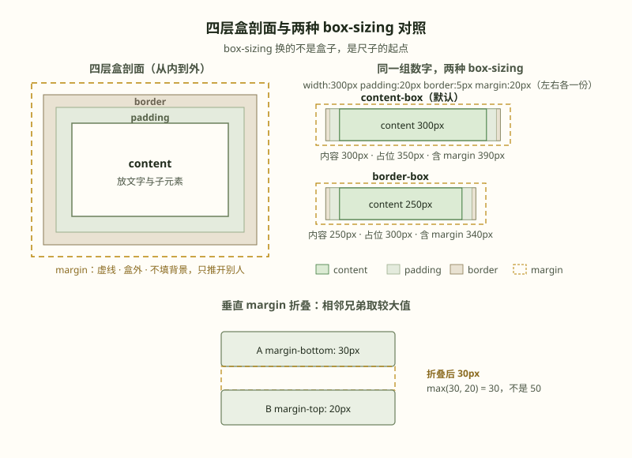

# 技术教程写作规范

本文件约束 `docs/course/` 下全部正文的写法。它是写给作者的施工图，不是给读者的导读。

---

## 1. 这份材料是什么

它是**技术教程**：按依赖顺序组织的一组能力训练，读者从第一页读到最后一页，能独立完成一类工作。

判断一份稿子是不是教程，只看三条：

| 判据 | 具体表现 |
| --- | --- |
| **可预测** | 给一段没见过的代码，读者能说出结果 |
| **可复现** | 按文中步骤做，得到同样的现象与数值 |
| **可迁移** | 换一个场景，模型仍然成立，不需要重新背规则 |

三条缺一条，它就退化成了别的东西：

- 只有"可复现"→ 操作手册，换个需求就废。
- 只有"可预测"→ 概念散文，读完仍写不出页面。
- 只有"可迁移"→ 原理课，落不了地。

### 一条硬红线

**任何一节都不允许写成"属性 → 作用"的清单。** 讲一个属性，必须回答三件事：它在模型里负责哪一环、不写它会怎样、什么条件下它会失效。只报作用是不合格的。

表格可以用，但只有三种合法用途：

1. **对照**：两种模式差在哪（`content-box` vs `border-box`）。
2. **决策**：什么情况选哪个（`gap` vs `margin`）。
3. **排查**：症状 → 根因。

属性取值表属于附录，正文里出现即退回。

---

## 2. 完整学习路径

读者必须随时知道三件事：我在哪、我依赖什么、学完能干什么。

### 2.1 三阶段

| 阶段 | 篇目 | 学完能做到 |
| --- | --- | --- |
| **一 · 能预测** | 01–08 | 给一段 CSS，说出哪个声明生效、元素占多大、落在哪、谁盖住谁 |
| **二 · 能构建** | 09–22 | 独立做出排版、配色、布局、表单、弹层的完整界面，并说清为什么这样写 |
| **三 · 能维护** | 23–30 | 控制样式影响范围、保证可访问性、处理性能与兼容、安全落地新特性 |

### 2.2 依赖规则

- 每章只能使用**前面已经讲过的模型**。必须提前用时，在句中标注"（详见第 NN 篇）"，并且不许依赖它做推理。
- 每章开头写"前置"，只写真正被用到的模型；没有就写"无"。
- 章末必须有一条"下一篇"链接，全书链条不断裂。
- 一章只解决一个核心问题。出现两个互不依赖的核心模型，或正文超过 300 行，就拆章。

> 拆章不是失败。把两件事硬塞进一章，读者会在第二件事上放弃。

---

## 3. 章节结构（六段）

顺序不可调换。这个顺序本身是教学设计：**先知道学什么 → 先建立模型 → 先看见现象 → 再拆规则 → 再认坑 → 最后自测**。

| 段 | 回答的问题 | 大致配比 | 典型失败 |
| --- | --- | --- | --- |
| 1 本章目标 | 学完我能做什么 | 5% | "了解 / 熟悉 / 掌握" |
| 2 新增模型 + 图示 | 这套东西怎么运转 | 25% | 只描述现象，不给因果 |
| 3 可运行的 demo | 我亲眼看到了吗 | 10% | 控件一堆，没有预测 |
| 4 原理与规则 | 为什么，何时失效 | 40% | 退化成取值枚举 |
| 5 常见坑 | 我会在哪翻车 | 12% | "注意兼容性" |
| 6 练习 | 我是真的会了吗 | 8% | 没有验收标准 |

配比是用来发现失衡的，不是配额：如果"原理"占到七成而"坑"只有两行，通常说明作者在解释机制，却没想过读者会在哪里用错。

### 3.1 本章目标

写 2–4 条**可核对的能力**，每条都要能用一句话检验。

```markdown
- 给定 width/padding/border，能算出元素占位宽，误差为 0。
- 能解释同一组数字在两种 box-sizing 下为何不同。
```

不合格：`了解盒模型` / `熟悉 box-sizing` / `掌握常见布局`。这些无法检验，等于没写。

末尾补一句**为什么现在学**：它接住上一章留下的哪个困惑，或为后面哪一章铺路。这句话决定读者是否愿意继续读。

### 3.2 新增模型 + 图示

一段好模型必须能**生成推论**：读者掌握它之后，能自己推出文中没写的结论。

写法固定为四步：

1. **一个具体现象**：一段真实代码 + 一句反直觉的结果。
2. **一句模型**：加粗，一句话，能解释上面的现象。
3. **一张图**：只画这一个关系。
4. **术语落地**：给新术语一句人话解释，然后直接使用术语。

```markdown


*图 5-1 · 四层盒剖面与两种 box-sizing 对照*

左半边是……（图注：这张图在讲什么关系，读者应该读出哪一句结论）
```

图后必须紧跟一句"**这张图的一句话结论：……**"。图是论据，不是装饰；读完图说不出结论，说明图没画对。

模型段落里禁止出现"首先/其次/另外"式的并列罗列——那是清单，不是模型。

### 3.3 可运行的 demo

**demo 放在原理之前，是有意的。** 先看到现象，读者带着"为什么会这样"去读规则；反过来，规则读完时已经没有参照物了。

```markdown
[打开 demo：调 padding 和 border，实时算占位宽度](../../examples/minimal/05-box-model.html)

> **先预测**：width: 300px，把 padding 调到 20px、border 调到 5px，两种 box-sizing 的内容宽与占位宽各是多少？
>
> **验证**：拖两个滑块，用页面上 getBoundingClientRect().width 的读数核对。
```

这三样都是标准 Markdown：链接、引用块、加粗。学习站会把它们渲染成一张内嵌的可交互卡片（iframe + 默认折叠的答案），GitHub 与编辑器里则是一个可点击的链接加两行提示，不会变成裸文本。

硬要求：

- 一个 demo 只演示本章这一个模型。
- 只有 1–2 个可调参数，标签写清"改变的是什么"。
- **必须有一个唯一正确答案的预测题**，答案默认折叠。
- 页面显示当前生效的 CSS 与实测数值，让预测能被当场核对。

### 3.4 原理与规则

把模型拆成 3–5 步，每步回答"为什么"，而不是"有哪些取值"。

- 每条规则后面必须有**失效条件**：什么情况下它不成立。没有失效条件的规则是谣言。
- 涉及数值时给可复算的算式，全文数字自洽。
- 需要对照、决策、排查时才用表格。
- 本节最多允许出现一次属性罗列，且必须紧跟一句"这些属性各负责模型里的哪一环"。

判据很简单：把这段读给一个会写 CSS 但没读过本章的人听，他能复述出因果关系，才算合格。

### 3.5 常见坑

只写真正会踩的，2–4 条。标题就是症状，正文三行，顺序固定：

```markdown
**坑 N：一句话说清现象**
- **原因**：回到本章模型里的哪一环，不要另起一套说法。
- **确认**：在 DevTools 里看哪个数、量哪个值，能判定是这个问题。
- **修法**：怎么改，代价是什么。
```

"注意浏览器差异""视情况而定"这类话一律删掉：没有具体条件，就没有信息。

### 3.6 练习

4–6 题，分三档，每题带**验收标准**。

- **基础**：直接套本章模型，1–2 题。
- **进阶**：需要组合前面章节，1–2 题。
- **挑战**：暴露模型边界，1–2 题。

```markdown
1. **基础**：写 .b { width: 300px; padding: 20px; border: 5px solid; }。
   验收：默认下 getBoundingClientRect().width 为 350px；加 border-box 后为 300px。
```

验收标准必须可测量：一个数、一个比值、一个可见结果。"完成后观察效果"不是验收。

---

## 4. 语言与数字

- 单篇 **150–260 行**。低于 150 行通常说明失效条件或验收没写。
- 读者画像：会写常见样式，但靠试错。不解释 `color: red`，也不假设他知道包含块。
- 术语首次出现给一句人话解释，之后直接用。
- 一节里不能连续三句都是陈述句，至少一句回答"为什么"。
- 不写空话。把"可能""一般""视情况"换成具体条件与后果。
- 数字必须自洽：写 `width: 300px`，算式里就不许出现 344px。
- 代码块用 ASCII 直引号；行内代码只包标识符与值，不包整句。
- 优先级等记号全文统一，例如 `(行内, ID, 类/属性/伪类, 标签/伪元素)`。

---

## 5. 图示

- 真图：`figures/NN-slug.svg`。字符画不算图。
- 一图一关系：一条流水线、一棵决策树、一个剖面、一组对照。塞不下就拆成两张。
- 纯 SVG，无脚本、无外部字体与图片；`viewBox="0 0 800 H"`，自带浅色底与深色字。
- 中文标注，术语与正文逐字一致；箭头表示方向或层级；颜色只区分两类/两态。
- **图中的数字必须与正文算式一致。** 图错一个数，读者会怀疑整章。
- 引用语法必须是**标准 Markdown 图片**，文件名写进 `alt`，下一行用斜体写图注：

  ```markdown
  

  *图 N-1 · 图题*
  ```

  理由：GitHub、编辑器、学习站三处都能正确显示。自定义容器语法在 GitHub 上会退化成一行裸文本，等于把图弄丢。图注行写"这张图讲什么"，不写"示意图"。

---

## 6. Demo

- 单文件 `examples/minimal/NN-slug.html`：内联 CSS/JS，无框架、无 CDN、无构建，双击可开，移动端可用。
- 只演示一个模型，1–2 个参数。
- 必备三块：**先预测**（一个问题）、**揭晓**（默认折叠）、**实测读数**（`getComputedStyle` / `getBoundingClientRect`）。
- 实时显示当前生效的核心 CSS，让读者能对照规则读代码。
- 支持 `prefers-reduced-motion`；不用 emoji；与示例库配色一致；底部"← 返回教程"指回本章。

---

## 7. 交稿自检

写完逐条打勾，任何一条不过就不算完成：

- [ ] 六段齐全，顺序未变。
- [ ] 目标 2–4 条，每条可核对，没有"了解/熟悉/掌握"。
- [ ] 有一句加粗的模型，且它能解释开头的现象。
- [ ] 有一张图，图后有一句结论，图中数字与正文一致。
- [ ] demo 在原理之前，有唯一答案的预测题，答案默认折叠。
- [ ] 每条规则都写了失效条件。
- [ ] 数值算式可复算，全文无矛盾数字。
- [ ] 坑 2–4 条，四行结构完整。
- [ ] 练习 4–6 题、三档齐全、每题有可测量验收。
- [ ] 前置、上一篇、下一篇、阶段目录四个链接都在且有效。
- [ ] 全文搜索"属性表"式段落：没有。
- [ ] `npm run docs:build` 构建通过，无死链、无编译错误。

---

## 8. 文件与构建

- 正文 `docs/course/NN-slug.md`，NN 为两位编号，slug 与图示、demo 同名。
- 图示 `docs/course/figures/NN-slug.svg`；demo `examples/minimal/NN-slug.html`。
- Markdown 是唯一源，**只用标准语法**：图用 ``，demo 用 `[打开 demo：…](../../examples/minimal/…)` + 引用块。不要自定义 `:::` 容器——它在 GitHub 上会退化成裸文本，等于把图和 demo 弄丢。
- 改完 Markdown 必须运行 `npm run docs:build` 验证构建；推送到 `main` 后 GitHub Actions 自动发布 Pages。
