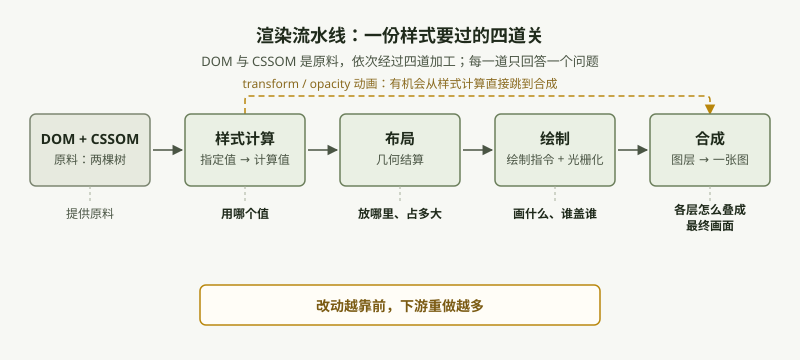

# 01 · 你写的 CSS 是怎么变成画面的

> **前置**：会写基本的 HTML。本章是快速通道章，有经验的读者可以跳到 [04 盒子到底占多大](04-box-model.md)。
>
> 下一篇：[选择器：精准选中元素](02-selectors.md) ｜ [教程总览](README.md)

```html
<p style="color: gray">这是一段话</p>
```

```css
p { color: royalblue; }
```

同一段文字，行内说灰色，样式表说蓝色——最后显示的是**蓝色**。为什么行内反而输了？要回答这类问题，得先知道浏览器拿到 CSS 之后做了什么。这一章讲五件事：样式怎么交给浏览器、一条规则长什么样、CSS 为什么故意"容错"、浏览器默认样式从哪来、以及它按什么流程把规则变成画面。

## 三种入口，一种合并

| 方式 | 写法 | 适合 |
| --- | --- | --- |
| 外部样式表 | `<link rel="stylesheet" href="style.css">` | 正式项目：可缓存、可复用，**默认选它** |
| 内嵌样式表 | `<style> … </style>` | 单页 demo、首屏关键样式 |
| 行内样式 | `style="color: gray"` | JS 动态计算的值，偶尔覆盖 |

三种方式可以同时用，浏览器把它们**合并收集**成一份规则清单再统一裁决——"行内一定赢"不是行内写法本身的魔力，而是层叠裁决里"来源"一档的排序结果（第 03 篇展开）。

两个工程细节值得知道：

- **`<link>` 放在 `<head>` 里**。CSS 下载和解析会阻塞首次渲染（render-blocking），放在 body 中间会导致页面先以无样式状态闪一下（FOUC），再突然套上样式跳一下。
- **`@import` 少用**。它必须等所在样式表下载解析完才发起下一个请求，串行链越长首屏越慢；需要拆模块时用多个 `<link>` 或构建工具合并。

## 一条规则的结构，以及规则之外的东西

```css
p {                       /* 选择器：管谁 */
  color: crimson;         /* 声明 = 属性 + 值 */
  font-size: 18px;
}
```

- **选择器**决定这条规则命中哪些元素（第 02 篇）；
- **声明块**里的每条声明是一个"提议"；
- **属性名不区分大小写，值区分**（自定义属性名也区分大小写，`--Color` 和 `--color` 是两个变量）。

规则之外还有 **at-rule（@ 规则）**——控制样式表自身行为的语句，先混个脸熟，后面各章会用到：

| at-rule | 作用 | 出现在 |
| --- | --- | --- |
| `@media` | 按设备条件开关一段样式 | 响应式篇 |
| `@supports` | 按特性支持与否开关 | 兼容篇 |
| `@keyframes` | 定义动画关键帧 | 动画篇 |
| `@font-face` | 注册自定义字体 | 排版篇 |
| `@layer` | 给规则分层，改变层叠排序 | 层叠篇 |
| `@import` / `@charset` | 引入样式表 / 声明编码 | — |

## CSS 是故意设计成"容错"的

这是 CSS 和大多数编程语言最不一样的地方，值得单独一节。**一条声明写错了，浏览器不报错、不中断，只安静地跳过它**：

```css
.box {
  colour: red;          /* 属性名拼错 → 整条声明被忽略 */
  width: 300;           /* 缺单位 → 非法值，忽略 */
  display: flexx;       /* 值拼错 → 忽略这条，display 保持默认 */
  padding: 10px;        /* 合法，正常生效 */
}
```

- 拼错的**属性名**：整条声明跳过。
- 拼错的**值**：只跳过这条声明，同一块里其他声明不受牵连。
- 少了分号或引号：解析器会尝试恢复，读到下一个能理解的位置继续。
- 完全损坏的规则块：跳到下一个 `}` 之后接着解析。

**为什么这么设计？** CSS 要跑几十年、兼容无数写错的网页，还要能"向前兼容"——老浏览器遇到新属性（当年遇到 `border-radius`）就安静跳过，页面照常工作；新浏览器自动增强。代价是：**错字没有任何提示**，`colour: red` 在控制台里不红不警，只是无声失效。所以"样式没生效"的第一排查动作永远是：打开 DevTools，看这条声明是**显示划线（被层叠压掉）**还是**根本没出现（写错了）**。

## 浏览器自带一份默认样式表

即使你一个字都不写，链接是蓝色带下划线、标题是加粗的大字、列表有缩进圆点、`b` 和 `strong` 都变粗——这份"出厂样式"叫 **UA stylesheet（浏览器默认样式表）**。

它解释了两件事：

1. **reset / normalize 存在的意义**：你写的样式永远"垫"在默认样式之上；不同浏览器默认值有差异（尤其表单控件），项目开头用一小段全局重置拉齐起点。
2. **表单控件最难看也最难改**：`<input>` 的外观大部分来自 UA 样式和操作系统原生绘制，改它需要专门的姿势（进阶篇表单章展开）。

默认样式的优先级是所有来源里最低的，任何你写的普通规则都能覆盖它——这也是层叠裁决的一部分。

## 四站流水线：从规则到像素



*图 1-1 · 样式计算 → 布局 → 绘制 → 合成，每站只回答一个问题*

**这张图的一句话结论：每一步都是"先算出中间结果，再进入下一站"；上游输入一变，下游就可能重跑。**

1. **样式计算**：收集全部规则 → 选择器匹配 → 冲突裁决 → 算出每个属性的计算值。
2. **布局**：算出每个盒子的大小位置——盒模型怎么参与，见 [第 04 篇](04-box-model.md)。
3. **绘制**：把盒子画成像素：颜色、背景、边框、阴影。
4. **合成**：把各层画面拼装上屏。

改动落在哪一站，代价就到哪一站——这张表值得背下来：

| 你改了什么 | 重跑的站 | 代价 |
| --- | --- | --- |
| `color`、`background` | 绘制（+合成） | 小 |
| `width`、`padding`、`font-size` | 布局 → 绘制 → 合成 | 大，整棵相关子树重排 |
| `transform`、`opacity` | 合成 | 最小，动画首选 |

"动画卡不卡"的根源就在这张表里，高级篇性能章深挖。

## 值的四级链条：你写的不是最终结果

一条值从你写下到上屏，要过四道：

- **指定值**：你写的，或层叠裁决的胜者（`width: auto`）。
- **计算值**：解析成统一形态（`em` 换算成 px；`auto` 在某些属性保持 auto）。
- **使用值**：布局之后才确定的最终数（`width: auto` 在这里才变成"具体多少像素"）。
- **实际值**：设备适配后的值（亚像素取整）。

排查问题时记住这句话：**声明是提议，计算值是事实**——DevTools 的 Computed 面板显示的就是第二级，`width: auto` 在那里保持 auto 不是 bug，是它还没走到第三级。

## 动手验证

[打开 demo：改声明，看计算值怎么变](../../examples/minimal/01-computed.html)

<iframe class="demo-frame" src="/css-concept-course/examples/minimal/01-computed.html" title="改声明，看计算值怎么变" loading="lazy"></iframe>

改一改声明，对照右侧读数：你写的值和 `getComputedStyle()` 返回的值哪里一样、哪里不一样。再把一个属性名故意拼错——注意页面毫无反应，这就是容错解析的样子。

## 本章要点

- 三种入口合并收集、统一裁决；外链放 `<head>`，`@import` 串行慎用。
- 规则 = 选择器 + 声明块；`@media` / `@keyframes` 等 at-rule 控制样式表自身行为。
- CSS 故意容错：错字静默跳过、页面照常——所以排查先看 Computed 面板里"划线"还是"缺失"。
- UA 默认样式垫底，reset 是拉齐起点的手段。
- 四站流水线：改 `width` 重排、改 `color` 只重绘、改 `transform` 只合成。
- 值有四级：指定 → 计算 → 使用 → 实际，"声明是提议，计算值是事实"。

下一篇 [02 · 选择器：精准选中元素](02-selectors.md)：浏览器怎么知道一条规则管谁，以及为什么 id 这么难覆盖。
