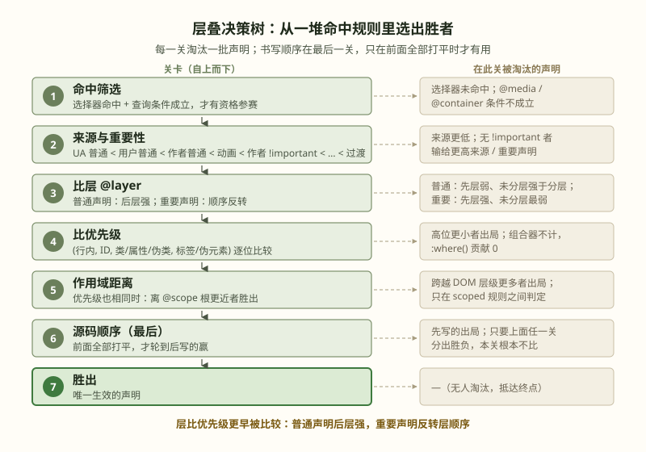

# 03 · 谁说了算：层叠与继承

> **前置**：[02 · 选择器](02-selectors.md)——会算优先级四元组。
>
> 上一篇：[02](02-selectors.md) ｜ 下一篇：[盒子到底占多大](04-box-model.md) ｜ [教程总览](README.md)

```css
.menu li   { color: #1f6f43; }
li         { color: #555555; }
```

一个 `li` 同时在 `.menu` 里，两条规则都命中它的 `color`——最终是绿色还是灰色？答案是绿色，但不是"`.menu` 更具体"这么简单，而是一套有明确次序的裁决流程。这一章讲透两件事：**冲突时谁赢（层叠的完整算法）**，以及**没写的属性从哪来（继承）**——加上中间那层常被忽略的"@layer"。

## 一个属性的取值，先过这两关

任何元素任何属性，最终取值都遵循同一句话：**先层叠，后继承**。层叠解决"写的打架"，继承兜底"没写的取值"：

1. 收集所有命中该元素的声明（各来源、各层）；
2. 同属性冲突 → **层叠裁决**出唯一胜者；
3. 没人写这个属性 → 看**能不能继承**父元素的值；
4. 继承不了 → 取该属性的**初始值**。

层叠裁决是这套流程的主干，分三步。

## 层叠裁决：来源 → 优先级 → 顺序

**第一步，来源与重要性。** 声明按来源分档，从低到高：

```
浏览器默认(UA) < 用户设置 < 作者样式(你写的)
```

`!important` 会**反转**作者/用户两档的顺序（用户加 important 的无障碍样式能压过你的 important），日常只记住两点：默认样式垫底、`!important` 别用。

还有两个"插队"的特殊档位，顺序上**动画高于普通作者样式、过渡又高于动画**：

```
作者普通样式 < @keyframes 动画 < 作者 !important < transition 过渡
```

这解释了一个常见现象：正在播放的动画会"暂时压住"你写的同名样式，动画结束瞬间样式跳变——不是 bug，是层叠位次。

**第二步，优先级。** 上一篇的四元组逐位比较，`(0,1,1,0)` 的 `#main .card` 赢过 `(0,0,1,1)` 的 `.list .card`。补充三条精确规则：通配和组合器不计数；`:is()`/`:not()`/`:has()` 取括号内最高项；`:where()` 恒为 0。

**第三步，顺序。** 前两步全平，**后写的赢**——同一文件里如此，多个 `<link>` 按出现顺序排队，`@import` 按它的书写位置插队，`@media` 里的规则也按文档顺序参与。

## @layer：给"顺序"加一层可管理的排序

样式多了之后，"后写的赢"变成负担：第三方组件库的样式总在最后加载，你的覆盖就得跟它比顺序，脆弱。**`@layer`（2022 年全面落地）让你给规则声明"层"，层的先后在第一条声明处固定，之后谁先谁后无关紧要**：

```css
@layer reset, base, components, overrides;   /* 预先声明顺序 */

@layer reset   { *, *::before, *::after { box-sizing: border-box; } }
@layer base    { p { line-height: 1.6; } }
@layer overrides { p.lead { color: #1f6f43; } }  /* 覆盖 base，不用管书写位置 */
@import url(vendor.css) layer(components);      /* 第三方塞进固定的层 */
```

规则很简单：**普通重要性下，未分层的样式赢过所有层；层与层之间按声明顺序**。配合 `:where()`（层内零优先级）可以做出"随便覆盖"的组件库默认样式。`!important` 会反转层的顺序——高级篇架构章再展开这层博弈。

## 继承：有些值会传给孩子

你没给 `<p>` 写 `color`，它却继承了父元素的深灰色——**继承**是取值的另一个来源，且选择性很强：

- **会继承的**：`color`、`font-family`、`font-size`、`line-height`、`letter-spacing`、`text-align`、`visibility`、`cursor`、`list-style`……全是**环境类**属性——子元素在父元素的环境里写字，理应沿用同样的文字环境。
- **不继承的**：`width`、`height`、`margin`、`padding`、`border`、`background`、`position`、`display`……全是**盒子构造类**属性——父元素的盒子尺寸和边框抄给子元素是灾难，每个盒子自己负责自己。

**为什么这么分？** 一句话：继承传递"文脉"，不传递"结构"。



*图 3-1 · 冲突时走层叠三步；没冲突的属性再看继承*

**这张图的一句话结论：先层叠后继承——层叠解决"写的打架"，继承兜底"没写的取值"。**

继承还有个连锁效应要注意：`font-size` 继承的是**值**，而 `em` 基于自己的 `font-size`——多层 `1.2em` 会复合成 `1.44em`（第 05 篇详解）。自定义属性（CSS 变量）默认也走继承，这是"主题色定义在 `:root` 全页生效"的原理，进阶篇展开。

## 五个控制继承的关键字

| 关键字 | 效果 | 典型用途 |
| --- | --- | --- |
| `inherit` | 强制继承父值（即使默认不继承） | 让子元素借用父元素的 `box-sizing` |
| `initial` | 回到规范初始值 | 把 `color` 拉回黑色 |
| `unset` | 可继承的属性→`inherit`；不可继承的→`initial` | "清掉别人塞给我的值" |
| `revert` | 回退到**上一个来源**的值（绕过你的样式回到 UA） | 让一条规则"当自己不存在" |
| `revert-layer` | 回退到**上一层**的值 | 层内覆盖后"撤销这层" |

`all: unset` 是"整个声明块全部 unset"，重置第三方组件常用——代价是把默认可用性（焦点、颜色对比）一起清掉，用完记得补回。`revert` 更温和：只退到你写这条之前的状态，适合做可逆的主题开关。

## 动手验证

[打开 demo：改优先级和顺序，看谁赢](../../examples/minimal/03-cascade.html)

<iframe class="demo-frame" src="/css-concept-course/examples/minimal/03-cascade.html" title="层叠裁决实验" loading="lazy"></iframe>

[打开实验台：用 @layer 管理覆盖关系](../../examples/foundations/cascade-layers-theme.html)

<iframe class="demo-frame" src="/css-concept-course/examples/foundations/cascade-layers-theme.html" title="层叠分层实验" loading="lazy"></iframe>

先预测：把两条规则改成同优先级谁赢？再调换顺序验证。实验台里把第三方样式塞进固定的层，观察你的覆盖怎么不再依赖书写顺序。

## 本章要点

- 取值流程：层叠 → 继承 → 初始值；"先层叠后继承"。
- 裁决三步：**来源 → 优先级 → 顺序**；动画与过渡是两个插队档位。
- `@layer` 把"顺序"变成可声明的排序：未分层赢过分层，层序在首次声明处固定。
- 继承传"文脉"不传"结构"；自定义属性默认继承。
- 关键字家族：`inherit` / `initial` / `unset` / `revert` / `revert-layer`，按"撤到哪一步"选。

下一篇 [04 · 盒子到底占多大](04-box-model.md)：值裁决完要"变成盒子"了——`width: 300px` 为什么实际占 350px。
