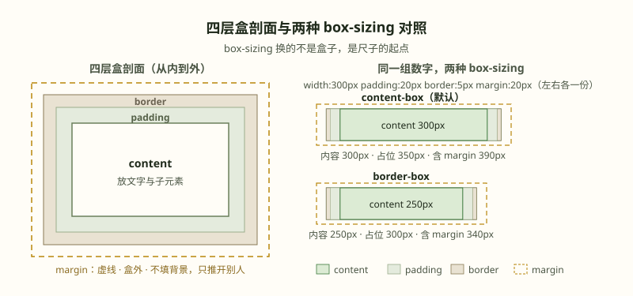

# 04 · 盒子到底占多大

> **前置**：[03 · 层叠与继承](03-cascade-inheritance.md)——知道值最终怎么定下来。
>
> 上一篇：[03](03-cascade-inheritance.md) ｜ 下一篇：[单位：长度以谁为基准](05-units.md) ｜ [教程总览](README.md)

```css
.box {
  width: 300px;
  padding: 20px;
  border: 5px solid #b8860b;
}
```

你以为它占 `300px`，量出来是 `350px`——多出来的 `50px` 你一个字都没写。更别扭的是，加一行 `box-sizing: border-box`，占位变回 `300px`，内容却只剩 `250px`。这一章把"盒子的尺寸"讲全：四层结构、`box-sizing` 换尺子、`auto` 的真实含义、内容驱动的三兄弟（min/max/fit-content）、纵横比，以及那个绕不开的 margin 折叠。

## 模型：四层盒，width 只是其中一层的宽度

**一个盒子由四层从内到外叠成，`width` 只是"某一层的宽度"，而 `box-sizing` 决定它指的是哪一层。**



*图 4-1 · 四层盒剖面与两种 box-sizing 对照*

**这张图的一句话结论：`box-sizing` 换的不是盒子，是尺子的起点。**

四个术语，一人话一句：

- **content**：装文字和子元素的区域。
- **padding**：content 与边框之间的缓冲，透明但占位，填背景色。
- **border**：边框本身，占实在的宽度。
- **margin**：盒子外面的透明间距，不填背景、不放内容，只负责"我和别人隔多远"。

margin 为什么必须在盒外？因为它描述的是**两个盒子之间的关系**，不属于任何一方——把"关系"塞进"物体"，间距计算和折叠都会乱套（本节末尾的折叠就是后果之一）。

自查技巧：给盒子一个背景色。背景默认铺到 border 外沿、绝不铺进 margin——一眼看出盒子到哪为止。

## box-sizing：同一组数字，两种算法

| 量的是什么 | content-box（默认） | border-box |
| --- | --- | --- |
| `300px` 标在哪层 | 内容层 | 内容 + padding + border |
| 内容实际宽 | `300px` | `300 − 2×20 − 2×5 = 250px` |
| 占位宽（不含 margin） | `300 + 40 + 10 = 350px` | `300px` |
| 加 margin 20px 后 | `390px` | `340px` |

数字是同一组，只有 `300px` 标在哪一层变了。**为什么默认是 content-box？** 历史包袱：早年"声明内容多宽"的直觉占上风，但 padding 和 border 变成"额外加价"，按列算尺寸极易溢出。`border-box` 让"声明多宽就占多宽"，加价挪进盒子内部消化，所以现代项目的全局重置几乎都是：

```css
*, *::before, *::after { box-sizing: border-box; }
```

三条失效边界：

- **border-box 不保内容宽**——加 padding/border 吃的是内容。要内容 `300px`，写 `width: 300 + 2×20 + 2×5 = 350px`。
- **padding 与 border 之和 ≥ width 时，内容宽被压到 0**；塞进不可断行的长单词，最小内容宽度会反过来把盒子撑大——"锁宽"失效，这是浏览器的保护行为。
- **margin 永远在尺子之外**，两种模式都不管它。

## width: auto 到底是多宽

`auto` 是"让浏览器看着办"，但对不同盒子含义完全不同：

| 盒子类型 | `width: auto` 的含义 |
| --- | --- |
| 块级元素 | **吃满包含块**的可用横向空间（不是"由内容决定"） |
| 行内元素 | 无效，尺寸由内容决定 |
| 浮动 / `inline-block` / 绝对定位 | **收缩到合适（shrink-to-fit）**：紧贴内容，最大不超过可用空间 |
| flex/grid 子项 | 由弹性/网格算法分配（进阶篇） |

所以"块级元素水平居中"要先收缩（定宽或 `fit-content`），再 `margin-inline: auto` 把剩下的空间平均分给两侧 margin——`auto` 在这里的意思是"把剩余空间分给我"。

高度同理但更挑剔：**`height: 100%` 之所以常常失效**，是因为百分比高度需要一个**已确定高度**的包含块；父元素高度是 auto（由内容撑出）时，`100%` 无从解析、被当作 auto。这是"百分比以谁为基准"问题的第一课，高级篇包含块章给全图。

## 内容驱动三兄弟：min-content / max-content / fit-content

不给具体值，让尺寸"跟着内容算"，有三个档位：

| 关键字 | 含义 | 直观例子 |
| --- | --- | --- |
| `max-content` | **永不换行**时的理想宽度 | 一整行长 URL 的宽度 |
| `min-content` | **怎么断都断**后的最小宽度（最长一个不可断单元） | 最长那个单词的宽度 |
| `fit-content` | 先想用 `max-content`，超出可用空间就收缩，但不小于 `min-content` | 大多数"自适应组件"想要的 |

```css
.tag { width: fit-content; padding-inline: .8em; }  /* 标签紧贴文字，可换行 */
```

它们还是布局引擎的内部语言：flex/grid 的 `auto` 轨道、`1fr` 的计算都建立在这两个值上（进阶篇反复出现）。配合上下限，就得到现代最常用的"内容优先 + 有边界"：

```css
.column { width: clamp(15rem, 50%, 30rem); }  /* 见第 05 篇 calc/clamp */
```

另外别忽略 **`min-width` / `max-width` / `min-height` / `max-height`**：它们在 `width` 之后**再设一道闸**，且优先级高于 width——`min-width` 赢过 `max-width`，两者都赢过 `width`。当"内容最小尺寸"作为隐式下限（`min-width: auto`）存在时，它就是 flex 子项撑破容器的元凶（进阶篇 Flex 章专讲）。

## aspect-ratio：给盒子一个形状约束

```css
.cover { width: 100%; aspect-ratio: 16 / 9; }
```

定了宽，高自动按比例算出——视频封面、正方头像（`aspect-ratio: 1`）、卡片缩略图不再需要 padding 撑高技巧。规则：一边是 auto 时按比例推导；两边都定了或内容撑爆时，比例让位（除非配 `object-fit`）。这是替代"padding-top 百分比占位"的现代方案。

## margin 折叠：相邻垂直 margin 取大值

```css
.a { margin-bottom: 30px; }
.b { margin-top: 20px; }
```

两者间距是 `30px`，不是 `50px`——两个垂直 margin 相遇时**折叠成一个，取较大者**：`max(30, 20) = 30`。

**为什么？** 垂直 margin 表达的是"两段内容之间至少留多少呼吸"，相邻的呼吸叠一起是浪费，浏览器把它理解成"至少"而非"累加"。这正呼应本节开头：margin 是关系不是实体，所以它可以重叠。

记住四条边界，坑就避开了大半：

- 只有**普通块流的垂直方向**才折叠；**水平 margin 永不折叠**。
- **flex / grid 容器里，子项之间不折叠**——想让间距永远相加，就用 flex/grid + `gap`。
- 父子之间也会折叠（第一个孩子的 margin-top"穿出"父元素），需要父元素有 border / padding / 行内内容隔开——完整机制在高级篇 BFC 章。
- 一正一负折叠时：`较大正值 + 较小负值` 之和。

[打开 demo：调上下 margin，看间距怎么折](../../examples/foundations/box-model-margin.html)

<iframe class="demo-frame" src="/css-concept-course/examples/foundations/box-model-margin.html" title="margin 折叠实验" loading="lazy"></iframe>

## 动手验证

[打开 demo：调 padding 和 border，实时算占位宽度](../../examples/minimal/04-box-model.html)

<iframe class="demo-frame" src="/css-concept-course/examples/minimal/04-box-model.html" title="盒模型四层实验" loading="lazy"></iframe>

拖动滑块，盒子下方的四层色条跟着变形，页面底部是 `getBoundingClientRect` 实测读数——把 border 调到 0、padding 调到 10px，先写下四个数字再看读数。

## 本章要点

- 四层盒：margin 描述关系所以永远在盒外；背景铺到 border 外沿可自查。
- `box-sizing` 换尺子不换盒子；全局 `border-box` 是现代默认，但它不保内容宽。
- `width: auto` 因盒类型而异：块级撑满、浮动/行内块收缩、居中靠 `fit-content + margin auto`。
- `height: 100%` 需要确定高度的包含块，否则视为 auto。
- 内容三兄弟：`max-content` 不换行、`min-content` 最长单元、`fit-content` 自适应；`min/max-width` 是 width 之上的闸，`min-width` 最硬。
- `aspect-ratio` 定形状；margin 折叠只在普通块流垂直方向发生，flex/grid + `gap` 一劳永逸。

下一篇 [05 · 单位：长度以谁为基准](05-units.md)：本章所有算式里的 px 和 %，各有自己的参照物——把单位讲全。
