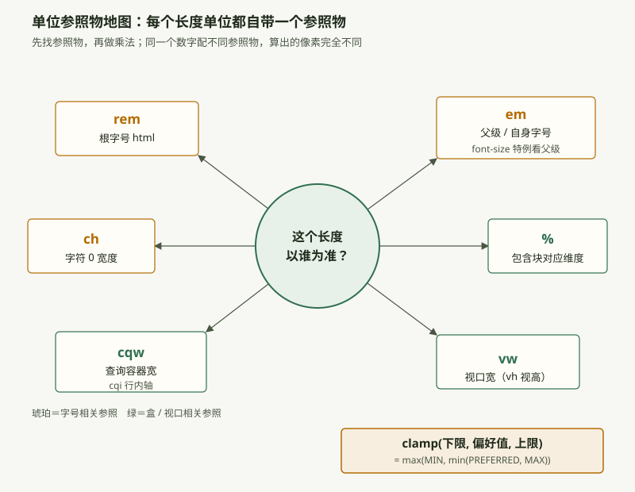

# 05 · 单位：长度以谁为基准

> **前置**：[04 · 盒模型](04-box-model.md)——知道盒子四层结构和包含块。
>
> 上一篇：[04](04-box-model.md) ｜ 下一篇：[颜色与背景](06-colors-backgrounds.md) ｜ [教程总览](README.md)

按钮里写着 `font-size: 14px; padding: 6px 12px;`，产品说要整体放大一档。你从按钮改到标题、再改到卡片内距，改了十几处——只因为长度单位全是 `px`，没有一处会跟着字号走。这一章把 CSS 的单位按"**以谁为基准**"讲全：绝对单位、百分比、字号系（em/rem + ch/ex）、视口系（含 svh/dvh 家族），再把 **`calc()` / `min()` / `max()` / `clamp()`** 这套数值运算一次讲透。

## 一张表先建全景

| 基准 | 单位 | 典型用途 |
| --- | --- | --- |
| 不随环境变 | `px`（屏幕）、`pt/cm/mm/in`（打印） | 边框、阴影偏移 |
| 包含块 | `%` | 布局骨架、等比占位 |
| 字号 | `em`（自身）、`rem`（根）、`ch`、`ex`、`ic` | 字体、间距、等宽对齐 |
| 视口 | `vw` `vh` `svh/lvh/dvh` `vmin/vmax` | 全屏布局、流体标题 |

先问"我想让它跟着谁变"，答案直接决定选哪个单位——这句话是本章的总纲。

## px：绝对单位，用在"不随环境变"的地方

`px` 是屏幕像素基准的绝对长度。它适合描述**与内容无关的物理细节**：`border: 1px`、`box-shadow` 偏移、`border-radius`。打印场景的另一套单位（`pt`、`cm`、`mm`）见打印篇；屏幕上 `1px` 不保证等于物理像素（受设备像素比影响），但作为"CSS 像素"的基准是稳定的。

## %：基准是包含块，而且垂直方向也按宽度算

百分比永远有一个参照盒——块级元素的百分比以**包含块**（通常是父元素的 content 区）为基准：

```css
.child { width: 50%; }        /* 父容器 content 宽的一半 */
```

两个必须记住的细节：

- **垂直 `padding` / `margin` 的百分比基准也是包含块的宽度**，不是高度。`padding-top: 10%` 在 400px 宽的容器里是 40px——和自身高度无关。等比占位框（宽 100% + `padding-top: 56.25%` = 16:9）就是靠这个特性。
- `height: 50%` 要生效，包含块必须有**确定高度**（第 04 篇讲过失效条件）。

## em 与 rem：跟着字号走

- **`em`**：以**当前元素自己的 `font-size`** 为基准。`padding: 1em` 在 14px 字号的按钮里是 14px，在 20px 的标题里是 20px——内距随文字一起呼吸，按钮、徽章这类"包着文字的组件"特别适合。
- **`rem`**：以**根元素 `<html>` 的 `font-size`**（默认 16px）为基准，全局唯一。改一处根字号，全页按比例缩放：

```css
html { font-size: 16px; }
@media (min-width: 60em) { html { font-size: 18px; } }  /* 这里的 em 以根字号解析 */
```

**em 的坑：嵌套复合。** 父元素 `font-size: 1.2em`、子元素再 `1.2em`，实际 `16 × 1.2 × 1.2 ≈ 23px`——em 会逐层放大。组件内部自己用 em 没问题，跨层级的"全局尺度"交给 rem。

还有三个字号系小单位，知道了一辈子受用：

- **`ch`**：当前字体数字 `0` 的宽度——等宽对齐的天生利器（`width: 20ch` 让两栏输入框永远对齐）。
- **`ex`**：小写字母 x 的高度，做上下微调（对齐下划线）时比猜像素靠谱。
- **`ic`**：一个汉字（"水"）的宽度——中文排版按"字"计尺寸的正确单位。

## 视口单位：vw/vh 及它的三个兄弟

`1vw` = 视口宽的 1%，`1vh` = 视口高的 1%。移动端有个著名坑：**地址栏伸缩导致 `100vh` 时大时小**——浏览器把"含地址栏的全高"和"收起地址栏的全高"来回切。现代解法是视口高度三兄弟：

| 单位 | 语义 | 什么时候用 |
| --- | --- | --- |
| `100svh` | 小视口高（地址栏**展开**时的高） | 永远能完整放进屏幕 |
| `100lvh` | 大视口高（地址栏**收起**时的高） | 允许被地址栏遮一部分 |
| `100dvh` | 动态视口高（跟着地址栏实时变） | 大多数"全屏"需求的默认答案 |

横向的 `svw/lvw/dvw` 同理。外加 `vmin` / `vmax`（取视口宽高中的较小/较大者），做"永远等比于屏幕短边"的元素很方便。

## calc()：让不同单位互相运算

长度、百分比、角度、时间之间可以跨单位运算，`+ − × ÷` 全支持：

```css
.banner   { width: calc(100% - 2rem); }        /* 百分比减长度 */
.sidebar  { width: calc(100% / 3 - 2rem); }    /* 除法右侧必须是纯数字 */
.half     { width: calc(50% * 2); }            /* 乘法一侧必须是纯数字 */
```

三条硬规则，踩一次记一辈子：

1. **`+` 和 `-` 两侧必须有空格**——`calc(100%-2rem)` 会把 `-2rem` 当成一个负值解析，直接失效（`*` `/` 不强制，但统一加空格最稳）。
2. **除法的右边、乘法的一边必须是纯数字**，除以 `1px` 这种写法不存在。
3. `calc()` 可以**嵌套**，也常和变量组合：`width: calc(var(--sidebar) + 2rem)`。

在此基础上，CSS 提供了三个"带边界的运算"快捷方式：

| 函数 | 含义 | 等价写法 |
| --- | --- | --- |
| `min(a, b)` | 取较小 | 手写比较 |
| `max(a, b)` | 取较大 | 手写比较 |
| `clamp(min, val, max)` | 钳制在区间内 | `max(min, min(val, max))` |

最常用的是**流体尺寸**：

```css
h1     { font-size: clamp(1.75rem, 4vw, 3rem); }      /* 小屏不小、大屏不大 */
.hero  { padding-block: clamp(2rem, 6vw, 5rem); }      /* 流体内距，少写断点 */
```

含义：首选 `4vw`，但最小不小于 `1.75rem`、最大不超过 `3rem`——"小屏太小、大屏太大"两个问题一句解决。

## 其他量纲速览

后面几篇会用到，先认个脸：**角度** `deg / grad / rad / turn`（transform 旋转、渐变方向）；**时间** `s / ms`（过渡与动画）；**分辨率** `dpi / dppx`（媒体查询）。注意**时间为 0 也必须带单位**（`0s` 合法，`0` 非法），而**长度为 0 可以不带**（`margin: 0` 等价 `0px`）——两条规则不对称，是解析歧义的历史决定。



*图 5-1 · 每个单位自带一个参照物：像素、父盒、根字号、视口*

**这张图的一句话结论：写任何长度之前，先问"我想让它跟着谁变"——答案直接决定选哪个单位。**

## 动手验证

[打开 demo：改基准字号，看 px 和 rem 谁跟着走](../../examples/minimal/18-units.html)

<iframe class="demo-frame" src="/css-concept-course/examples/minimal/18-units.html" title="单位实验" loading="lazy"></iframe>

[打开实验台：流体单位与 clamp 实测](../../examples/responsive/fluid-units.html)

把根字号从 16px 调到 20px：`rem` 写的间距跟着放大，`px` 写的纹丝不动。实验台里拖窗口宽度，观察 `clamp()` 的三段表现——贴下限、线性增长、贴上限。

## 本章要点

- 选单位先问**以谁为基准**：不变（px）、父盒（%）、字号（em/rem/ch）、视口（vw/vh 系）。
- 垂直 `padding` / `margin` 的百分比也按**宽度**算。
- rem 管全局尺度，em 管组件内部；em 嵌套会复合；`ch` 对齐等宽、`ic` 计汉字。
- 移动端全屏高用 `dvh`（或明确选 `svh`/`lvh`），别再用裸 `vh` 赌地址栏。
- `calc()`：加减要空格、除号右边是纯数字；`min/max/clamp` 是带边界的运算，流体尺寸首选 `clamp()`。
- 长度 0 可省单位，时间 0 不行。

下一篇 [06 · 颜色与背景](06-colors-backgrounds.md)：长度定了，接下来让盒子"穿上颜色"——为什么推荐用 hsl/oklch 造色阶。
