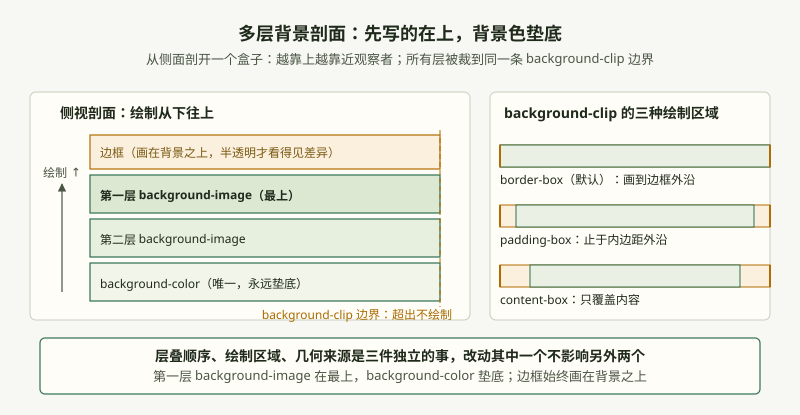

# 06 · 颜色与背景

> **前置**：[04 · 盒模型](04-box-model.md)——知道背景默认铺到 border 外沿。
>
> 上一篇：[05](05-units.md) ｜ 下一篇：[文字排版](07-typography.md) ｜ [教程总览](README.md)

设计稿给了主色 `#3f6b2a`，你要做按钮的三态：默认、悬停亮一点、禁用灰一点。在 rgb 里手调三个数很容易调脏——这相当于在"混光"坐标系里凭感觉走。这一章把"给盒子上色"讲全：**颜色记法（含现代的 oklch 与 color-mix）、背景五旋钮与多层叠加、渐变家族、阴影、边框圆角与 outline**。

## 颜色记法：从 hex 到 oklch

```css
color: #3f6b2a;                    /* hex：最常用，够短 */
color: rgb(63 107 42);             /* rgb：直观，方便加透明度 */
color: hsl(97deg 44% 29%);         /* hsl：色相/饱和度/亮度 */
color: oklch(45% 0.09 130);        /* oklch：感知均匀的现代记法 */
```

**hsl 的优势：三个轴有独立含义。** 色相（什么颜色，0–360 色环）、饱和度（艳不艳）、亮度（明不明）。按钮三态因此只是改一个数：

```css
.btn          { background: hsl(97deg 44% 29%); }  /* 基准 */
.btn:hover    { background: hsl(97deg 44% 38%); }  /* 只提亮度 */
.btn:disabled { background: hsl(97deg 10% 55%); }  /* 降饱和提亮度 = 灰化 */
```

透明度统一用第四位：`hsl(97deg 44% 29% / .5)` 或 `#3f6b2a80`。遮罩、浮层的"半透明主色"都这么写。

**hsl 有个隐藏缺陷**：它的"亮度"不感知均匀——`hsl(60deg 100% 50%)` 的黄色看起来远比 `hsl(240deg 100% 50%)` 的蓝色亮。想让"同亮度"真的看起来同亮度，用 **oklch**（L 感知均匀、C 色度、H 色相）：给主题做色阶时，`oklch` 里加减 L 得到的相邻色，肉眼看才是真的"亮一档"。三大引擎均已支持，新项目值得直接上。

现代工具还有三个，按需取用：

- **`currentColor`**：引用自身的 `color` 值。`border-color: currentColor` 让边框永远跟随文字色——图标继承文字颜色的标准做法。
- **`color-mix()`**：两个颜色按比例混合，`color-mix(in oklab, var(--brand), white 20%)` 一句得到"主色加白 20%"，不用调色盘。
- **相对颜色语法**：`hsl(from var(--brand) h s calc(l + 10%))`——从现有颜色**拆轴改一轴**再装回去，主题派生色阶的最终形态。

## 背景：五个旋钮，一个缩写

背景不是一个属性，是五个旋钮：**color / image / position / size / repeat**。缩写里有个著名的坑：**size 必须紧跟 position，且用 `/` 隔开**：

```css
background: url(bg.jpg) center / cover no-repeat;
/*                     位置 / 尺寸           */
```

漏写 `/` 直接 `center cover`，整条声明作废——"背景图怎么不显示了"有一半是这个。

`size` 的两个关键值要做对照：**`cover`**（铺满容器、保持比例、可能裁掉边）和 **`contain`**（完整显示、保持比例、可能留白）。头像用 contain 不裁脸，封面用 cover 不留边——选错的症状一眼可辨。

**多层背景**：逗号分隔，**写在前面的在上层**。渐变、纹理、主图按层叠放：

```css
background:
  linear-gradient(rgb(0 0 0 / .35), rgb(0 0 0 / .35)),  /* 上：暗色遮罩 */
  url(hero.jpg) center / cover no-repeat;               /* 下：照片 */
```

另外两个不常提但会咬人的属性：`background-clip` 决定"铺到哪一层"（`text` 可让背景只铺进文字，渐变字就是这么做的）；`background-attachment: fixed` 让背景相对视口固定——桌面端还行，**移动端 Safari 性能差且行为怪**，移动页面用遮罩层 + `position: fixed` 伪元素替代。



*图 6-1 · 背景铺色范围与多层背景的叠放顺序*

**这张图的一句话结论：背景默认铺到 border 外沿（呼应第 04 篇），多层背景先写的盖在上面。**

## 渐变家族：linear / radial / conic

渐变不是图片，是**按需计算的函数图像**，拉伸不失真。三种形状各管一类活：

```css
background: linear-gradient(180deg, #4b7a34, #2d5420);      /* 线性：按钮、横幅 */
background: radial-gradient(circle at 30% 20%, #fff, #ccd); /* 径向：光斑、球面 */
background: conic-gradient(from 0deg, red 0 90deg, #fc0 90deg 180deg);
                                                            /* 锥形：饼图、色环 */
```

色标可以带位置，位置之间才产生过渡——**实色分段**是排色板、进度条的钥匙：

```css
linear-gradient(90deg, #3f6b2a 0 40%, #a7631d 60% 100%)
/* 0–40% 实绿，40–60% 过渡，60–100% 实橙 */
```

## box-shadow：阴影的完整语法

```css
box-shadow: 0 2px 8px rgb(0 0 0 / .15);      /* x偏移 y偏移 模糊 扩散 颜色 */
box-shadow: 0 0 0 3px #fff inset;            /* inset：内阴影 */
box-shadow:
  0 1px 2px rgb(0 0 0 / .2),
  0 8px 24px rgb(0 0 0 / .12);               /* 多层阴影：近处清晰 + 远处弥散 */
```

- 前两个偏移必填；**blur 不能为负**，spread 可正可负（负值收缩阴影）。
- `inset` 反转成内阴影——按下态、内凹输入框的质感来源。
- **性能注意**：阴影的绘制成本随模糊半径涨，长列表里每项都挂大 blur 阴影会拖慢滚动；密集列表可以用"背景色分层"或 `filter: drop-shadow`（跟随透明轮廓，但更贵）权衡。
- 阴影与 `border-radius` 无关地画在盒子外，但会跟随 `border-radius` 的形状。

## 边框、圆角与 outline

- `border` 三件套（宽、样式、颜色），**样式不可省**——没写 `solid` 整条失效。四边可分别设置，`border-inline-start` 这类逻辑写法见第 08 篇。
- `border-radius` 支持四角分别给值；斜杠语法分别定义水平/垂直半径做出椭圆角（`border-radius: 10px / 20px`）。圆角**裁的是盒子的绘制结果**，配合 `overflow: hidden` 可以裁掉子元素溢出。
- `outline` 和 `border` 是两回事：outline **不占布局空间**、画在 border 之外、不跟随圆角（除非 `outline` 现代 Safari/Chrome 已支持圆角轮廓），键盘焦点环（`:focus-visible`）默认就是它。自定义控件做焦点样式用它，别动 border 挤布局。

## 动手验证

[打开 demo：拖三个滑块调 hsl，实时看色变](../../examples/minimal/10-color.html)

<iframe class="demo-frame" src="/css-concept-course/examples/minimal/10-color.html" title="hsl 调色实验" loading="lazy"></iframe>

[打开 demo：调背景五旋钮与多层叠放](../../examples/minimal/11-background-border.html)

<iframe class="demo-frame" src="/css-concept-course/examples/minimal/11-background-border.html" title="背景与边框实验" loading="lazy"></iframe>

[打开实验台：背景、边框、滤镜综合玩法](../../examples/visual/background-border-filter.html)

第二个 demo 里把多层背景顺序对调，观察"上层遮罩"怎么变成"被盖住"；实验台里试 `background-clip: text` 的渐变字配方。

## 本章要点

- 造**色阶**用 hsl；要"感知均匀"的亮度用 **oklch**；派生色用 `color-mix()` 或相对颜色语法。
- `currentColor` 是"跟随文字色"的万能引用，图标颜色继承靠它。
- `background` 缩写里 size 必须写 `位置 / 尺寸`；多层背景**先写在上**；`cover` 铺满可裁、`contain` 完整留白。
- 渐变三形状：linear 按方向、radial 按圆心、conic 按角度；色标带位置可做实色分段。
- `box-shadow`：blur 不可负、`inset` 内阴影、多层组合出质感；大 blur 有绘制成本。
- `outline` 不占空间，是焦点环的正确载体；border 样式漏写整条失效。

下一篇 [07 · 文字排版](07-typography.md)：盒子有了颜色，往里装文字——`line-height` 为什么必须写无单位数字。
