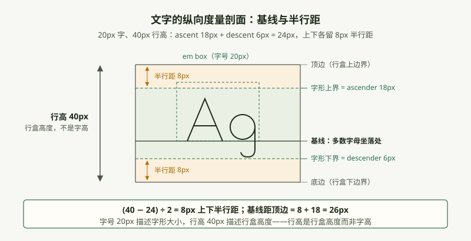

# 07 · 文字排版

> **前置**：[05 · 单位](05-units.md)——知道 em/rem 的基准。
>
> 上一篇：[06](06-colors-backgrounds.md) ｜ 下一篇：[display 与文档流](08-display-flow.md) ｜ [教程总览](README.md)

```css
.card p { line-height: 20px; }
```

这行样式在字号 14px 时行距正常；某天全局字号提到 16px，行距没变，文字挤成一团。把 `20px` 改成无单位的 `1.5`，问题永远消失——为什么？这一章把文字排版讲全：**字体加载（@font-face 与 font-display）、字体度量与行高、字重、white-space 与断行控制、对齐分工、文本装饰与省略**。

## font-family：给浏览器一个回退队列

```css
body {
  font-family: "PingFang SC", "Microsoft YaHei", system-ui, sans-serif;
}
```

浏览器从左到右找，找到第一个本机可用的为止，**最后一个永远放通用族**（`sans-serif` / `serif` / `monospace`）兜底。中英文混排把英文字体放前面、中文放后面：英文走拉丁字形、汉字走中文字形。

系统字体栈值得整段收藏——零加载成本、贴近平台原生观感：

```css
font-family: system-ui, -apple-system, "Segoe UI", Roboto,
             "PingFang SC", "Microsoft YaHei", "Noto Sans SC", sans-serif;
```

## @font-face：把字体文件变成"第 0 号备选"

```css
@font-face {
  font-family: "Brand Sans";                        /* 你给它起的本地名字 */
  src: url("brand-sans.woff2") format("woff2");     /* woff2 是唯一该用的格式 */
  font-weight: 400;                                 /* 这个文件对应哪个字重 */
  font-style: normal;
  font-display: swap;                               /* 加载期间的显示策略 */
}
```

注册后 `font-family: "Brand Sans", sans-serif` 即可使用。关键知识点两个：

- **`font-display` 决定"字体没下载完时显示什么"**：`swap`（先显示回退字体，下载完替换——首屏最快，代价是字体闪动 FOUT）；`block`（先空 3 秒等字体，超时才显示回退——标题字体常用，代价是白屏闪烁）；`optional`（网络慢时干脆用回退且不替换——追求绝对稳定）。正文用 `swap`，装饰性大标题可考虑 `block`/`optional`。
- **一个字重一个文件**：`font-weight: 700` 的粗体不是"把 400 那份加粗"，而是另一个 `@font-face` 注册。缺字重时浏览器**算法加粗**（描边模拟），看起来发虚。

**可变字体（variable fonts）**把多个字重打包进一个文件，`font-weight: 350` 这种中间值连续可用——设计系统想要"细腻的字重阶梯"就用它，一份文件全包。

`font` 简写有个必须知道的坑：`font: 16px/1.5 sans-serif` 里 `/1.5` 是行高；**简写会把它没写的字段全部重置为初始值**（字重、字形、行高……），所以简写只能用在根级或确认覆盖一切的场景，组件内老老实实写单属性。

## 字体度量与 line-height：为什么必须写无单位数字

文字的实际占位高 ≈ `font-size × line-height`，行与行之间的透气感全由这个比例决定：正文 1.5–1.7，标题 1.2 左右。

```css
body { line-height: 1.6; }   /* ✓ 继承的是比例 */
p    { line-height: 24px; }  /* ✗ 字号一变就挤 */
```

**为什么无单位是对的？** `line-height` 会**继承**。写 `1.6`，每个元素按**自己的** `font-size × 1.6` 计算——继承的是比例；写 `24px`，子元素无论字号多大都锁死 24px。



*图 7-1 · 一行文字占位高 = 字号 × 行高，行盒决定行间距*

**这张图的一句话结论：行高是无单位比例，随每个元素自己的字号伸缩。**

字号用 `rem`（跟全局缩放）、组件内微调用 `em`（第 05 篇的结论）。

## white-space 与断行控制：中文页面最该细看的一节

**`white-space` 决定"空白与换行符怎么处理"**，五个值一张表：

| 值 | 连续空白/换行符 | 自动折行 | 典型场景 |
| --- | --- | --- | --- |
| `normal`（默认） | 折叠成一个空格 | 折行 | 正文 |
| `nowrap` | 折叠 | **不折** | 单行省略、横向滚动条 |
| `pre` | **原样保留** | 不折 | 代码块 |
| `pre-wrap` | 原样保留 | 折 | 聊天记录、评论 |
| `pre-line` | 折叠空白，**保留换行符** | 折 | 用户输入的段落 |

"长单词/长 URL 撑破容器"是另一类问题，归**断行控制**管：

- `overflow-wrap: anywhere`：任何字符处可断，并把它计入最小宽度计算（`break-word` 只断不计，两者都能救急，`anywhere` 对布局更"诚实"）。
- `word-break: break-all`：拉丁文也逐字断（表单窄列）；**`keep-all` 对中文意义重大**——禁止在汉字之间断行，让中文句子按词组换行。
- `hyphens: auto`：英文连字符断行，需要正确声明 `<html lang>`。

单行省略三件套（`overflow: hidden` + `white-space: nowrap` + `text-overflow: ellipsis`）缺一不可；多行用已标准化的 line-clamp：

```css
.clamp-2 {
  display: -webkit-box;
  -webkit-box-orient: vertical;
  -webkit-line-clamp: 2;
  overflow: hidden;
}
```

## 字距、对齐与文本装饰

- `letter-spacing`：字间距，中文海报排版常用的"加字距"就是它；负值可微调大标题的密度。`text-indent` 管首行缩进（`2em` 是中文段首的答案）。
- **对齐三个属性各管一层**：`text-align` 管**块容器里行内内容**的水平对齐；`vertical-align` 只管**行内级**元素之间的垂直对齐（图片与文字的基线问题就是它），对块级无效；块级盒子自身居中是 `margin-inline: auto`。三者混用是"居中失灵"的头号来源。`text-align: justify` 两端对齐在中文里问题不大、在西文里需要配 `hyphens` 才不难看。
- `text-decoration` 完整形态：`text-decoration: underline crimson 2px underline-offset 4px` 可控粗细、颜色、偏移——下划线别再压着文字了。
- `text-transform: uppercase` 不改内容只改显示（表单字母输入、标签风格化常用）。
- 首字下沉用 `::first-letter`（第 02 篇的伪元素），段落排版立刻有杂志感。

## 动手验证

[打开 demo：调行高与字号，看行盒怎么变](../../examples/minimal/09-typography.html)

<iframe class="demo-frame" src="/css-concept-course/examples/minimal/09-typography.html" title="行高与行盒实验" loading="lazy"></iframe>

[打开实验台：中英混排与字体栈切换](../../examples/visual/typography-lab.html)

先把行高从 `1.6` 改成 `24px` 再放大字号，复现开头的事故，然后改回无单位修好它；实验台里切换 `white-space` 五个值，观察同一段文本的不同命运。

## 本章要点

- `font-family` 是回退队列，最后留通用族兜底；系统字体栈零成本。
- `@font-face` 一个字重一个文件；`font-display` 里 `swap` 是正文默认答案；可变字体一份文件管全部字重。
- `font` 简写会重置未写字段，组件内慎用。
- `line-height` 用无单位数字——继承比例而非固定值。
- `white-space` 五值管空白与折行；断行救急用 `overflow-wrap: anywhere`，中文不断句用 `word-break: keep-all`。
- `text-align` 管容器内行内内容、`vertical-align` 只管行内级、块级居中是 `margin-inline: auto`。

下一篇 [08 · display 与文档流](08-display-flow.md)：文字排好了，回到更大的问题——元素凭什么独占一行、并排一行。
