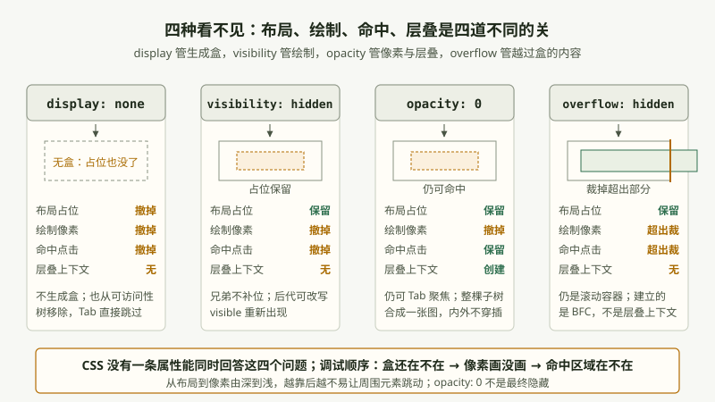

# 08 · display 与文档流

> **前置**：[04 · 盒模型](04-box-model.md)——知道 `width: auto` 因盒类型而异。
>
> 上一篇：[07](07-typography.md) ｜ 下一篇：[position：定位的参照系](09-position.md) ｜ [教程总览](README.md)

```css
span.tag { width: 120px; padding: 10px; }
```

这个 `span` 的 `width` 完全没生效，垂直方向的 padding 还压到了上一行——为什么？因为 `span` 默认是 `display: inline`，而 inline 盒子**根本不吃这两样**。元素"怎么排"由 display 决定，这是布局一切的地基。这一章讲全：正常流与书写方向、display 的现代两轴模型、inline 盒子的限制与经典坑、`display: contents`，以及三种"隐藏"的真实差别。

## 正常流：没人干预时的默认排版

不给任何布局样式时，浏览器按**正常流**排版：

- **块级元素**：沿**块方向**（默认从上往下）依次排列，每个独占一行，宽度撑满父容器（`width: auto` 的块级是"吃满可用的横向空间"，不是"由内容决定"——浮动、`inline-block`、绝对定位才是"收缩到内容"，见第 04 篇的表）。
- **行内元素**：沿**行内方向**（默认从左往右）排，排不下自动折行，像文字一样流动。

两个方向的名字不是白起的——**它们会随书写模式变化**：

```css
.vertical { writing-mode: vertical-rl; }
```

`vertical-rl` 让行内方向变成"从上到下、行从右往左推进"——中文竖排、日文原版排版的实现方式。方向一变，"上下/左右"这组物理词就不可靠了，于是有了下一节的逻辑属性。

## 逻辑属性：用"块方向/行内方向"代替"上下左右"

物理属性 `margin-top`、`padding-left` 绑定死方向；**逻辑属性**绑定书写方向， Writing mode 变了它们自动跟随：

| 物理属性 | 逻辑属性（水平排版下对应） |
| --- | --- |
| `margin-top` / `margin-bottom` | `margin-block-start` / `margin-block-end` |
| `margin-left` / `margin-right` | `margin-inline-start` / `margin-inline-end` |
| `padding-top` 等 | `padding-block-*` / `padding-inline-*` 同理 |
| `text-align: left` | `text-align: start` |
| `top` / `left`（定位） | `inset-block-start` / `inset-inline-start` |
| `width` / `height` | `inline-size` / `block-size` |

为什么值得换：**多语言站点**（阿拉伯文从右往左）只需改 `dir="rtl"`，用逻辑属性写的样式自动镜像；同一套组件在竖排容器里也不变形。从今天起新代码优先 `padding-inline`、`margin-block`、`inset-inline`、`inline-size`。

## display 的现代两轴：外侧 + 内侧

```css
display: block flow;    /* 可以只写 block，单值是两轴的简写 */
display: inline flex;
```

| 轴 | 取值 | 决定什么 |
| --- | --- | --- |
| **外侧** | `block` / `inline` | 这个盒子**对外**怎么参与排列：占独立块行，还是混进行内流 |
| **内侧** | `flow` / `flow-root` / `flex` / `grid` / `table` | 这个盒子**对内**怎么安排孩子 |

两轴组合出日常全部选择：`block` = 块级 + 正常流；`inline-block` = 混进行内流 + 内部当块管；`inline-flex` = 混进行内流 + 内部弹性布局。**"外轴管它怎么被排，内轴管它怎么排孩子"**——记住这句，`inline-block` 与 `inline-flex` 的差别一目了然。

还有两个特殊值：

- **`flow-root`**：块级 + "创建新的格式化上下文"——阻止子元素 margin 穿透、包含浮动，是高级篇 BFC 章的现代答案。
- **`contents`**：**元素自身的盒子消失**，孩子直接参与父元素的布局。多了一层语义 `<div>` 又不想它参与 flex/grid 布局时用它——但注意它也会移除该元素自身的语义（可访问性场景慎用于带事件监听的元素）。



*图 8-1 · 外轴决定盒子怎么参与排列，内轴决定它怎么安排孩子*

**这张图的一句话结论：改 display 同时改变了"它怎么被排"和"它怎么排孩子"两件事。**

## inline 盒子的限制，与那个经典空隙坑

回到开头的 `span.tag`，inline 的三个限制一次说清：

1. **`width` / `height` 无效**——尺寸由内容决定，声明被忽略。
2. **垂直 `margin` 无效**——水平 margin 有效，上下不生效。
3. **`padding` 上下"画得出但占不了位"**——背景能画出来，却不推开周围内容，于是压到上一行。同理，行高换行时 inline 的背景/padding 会"断成两截"。

需要"像文字并排、又像块吃尺寸"时上 `inline-block` / `inline-flex`。但 `inline-block` 有个传世之坑：**元素之间出现莫名空隙**——因为 HTML 里标签间的换行和空格也是行内内容，正常流把它们渲染成一个空格宽。三种解法按推荐排序：

```css
.row { display: flex; gap: 8px; }        /* ① 最推荐：flex 管间距，无此坑 */
.row { font-size: 0; }                    /* ② 祖传：空格随字号消失，子元素再设字号 */
```

```html
<a>…</a><a>…</a>          <!-- ③ 标签紧贴书写，可读性差，不推荐 -->
```

同一根源还有一个：`inline-block` 默认按**基线**对齐（`vertical-align: baseline`），内含文字高度不一的元素会参差错位——用 `vertical-align: top` 或改 flex 容器。

## 隐藏的三种方式，差别在"还占不占位"

| 方式 | 占位 | 能否交互/聚焦 | 可否加过渡 |
| --- | --- | --- | --- |
| `display: none` | 不占，从布局移除 | 不能 | 旧式否；现代配 `transition-behavior: allow-discrete` 可过渡 |
| `visibility: hidden` | 占位 | 不能 | 可（visibility 可插值） |
| `opacity: 0` | 占位 | **能**（仍可被点到、聚焦到！） | 可 |

第三行是重点：`opacity: 0` 的按钮**仍然可以点击和 Tab 聚焦**，拿它做"消失"是无障碍陷阱。纯视觉淡入淡出配 `visibility` 组合，要彻底移出就 `display: none`；现代浏览器里 `@starting-style` + `allow-discrete` 已能让 display:none 参与过渡动画（进阶篇动画章演示）。

## 动手验证

[打开 demo：切 display 与隐藏方式，看占位变化](../../examples/minimal/12-display-overflow.html)

<iframe class="demo-frame" src="/css-concept-course/examples/minimal/12-display-overflow.html" title="display 与隐藏实验" loading="lazy"></iframe>

先给 inline 元素设 width 看它无动于衷；切成 `inline-block` 后同一段代码立刻生效——再仔细看相邻两个元素之间那条空隙。分别切三种隐藏方式，用鼠标试着"点到"透明按钮，验证 `opacity: 0` 还活着。

## 本章要点

- 正常流沿"块方向 + 行内方向"排版；`writing-mode` 能改变两个方向。
- 逻辑属性（`margin-inline` / `padding-block` / `inset-*` / `inline-size`）绑定方向而非方位，多语言布局的标配。
- display 是**外侧 + 内侧**两轴：外轴管它怎么被排，内轴管它怎么排孩子；`flow-root` 断 margin 穿透，`contents` 让盒子消失。
- inline 三限制 + inline-block 空隙坑（根源是 HTML 空白，flex 一劳永逸）。
- `display: none` 移出布局、`visibility` 占位不可交互、`opacity: 0` 占位**仍可交互**——别拿它当删除。

下一篇 [09 · position：定位的参照系](09-position.md)：文档流之内讲完了，元素怎么"脱离"文档流浮到指定位置。
