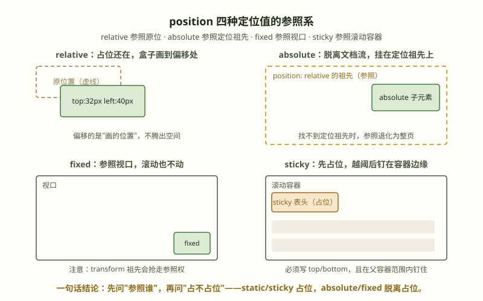

# 09 · position：定位的参照系

> **前置**：[04 · 盒模型](04-box-model.md)——知道占位宽与 `width: auto`；[08](08-display-flow.md)——知道正常流。
>
> 上一篇：[08](08-display-flow.md) ｜ 下一篇：[Flexbox](10-flex.md) ｜ [教程总览](README.md)

```css
.badge { position: absolute; top: 8px; right: 8px; }
```

徽章没挂到卡片右上角，而是挂到了**页面**右上角——因为它的父元素没有 `position`。position 的一切问题最终都归结为两句话：**它参照谁定位？它还占不占位？** 这一章把五个定位值讲全：参照系、占位行为、auto 偏移的"静态位置"、`inset` 逻辑属性，最后是一节高频翻车现场。

## 五个值，一张对照表



*图 9-1 · relative 参照原位，absolute 参照定位祖先，fixed 参照视口，sticky 参照滚动容器*

**这张图的一句话结论：先问"参照谁"，再问"占不占位"——static/sticky 占位，absolute/fixed 脱离占位。**

| 值 | 占位 | 参照谁 | 偏移属性生效 |
| --- | --- | --- | --- |
| `static`（默认） | 占 | 无 | 否（top/left 被忽略） |
| `relative` | **占**（原位留着） | 自己的**原位置** | 是 |
| `absolute` | **不占** | **最近的定位祖先**（padding box） | 是 |
| `fixed` | 不占 | **视口**（例外见下） | 是 |
| `sticky` | 占 | **滚动容器** | 是（当阈值条件） |

## relative 与"静态位置"

`relative` 元素先按正常流排好，再用 `top/left` 把**绘制位置**偏移——原来的空位仍然留着，偏移造成"视觉重叠"而非重新布局。它最常用的三件事：给 absolute 子元素当参照物（只写 `position: relative` 不写偏移）、让 `z-index` 生效（static 元素的 z-index 无效）、微调对齐。

absolute 还有一个鲜为人知的细节——**静态位置（static position）**：如果不写任何 `top/left/right/bottom`，absolute 元素会停在"它本来会在的正常流位置"上再脱流。所以"脱流后出现在奇怪的地方"有时不是参照错了，是它用了静态位置；写明偏移方向即可定位。

## absolute：参照与拉伸的两条规则

absolute 元素从正常流移除，参照**最近 position ≠ static 祖先**的 padding box。关于尺寸有两条精确规则，配对记忆：

| 约束方式 | `width: auto` 的解析 | 效果 |
| --- | --- | --- |
| 只写 `left`（或只写 `right`） | 收缩到合适（shrink-to-fit） | 紧贴内容 |
| **四个方向都约束**（`inset: 0`） | 拉伸填满参照盒 | "贴满父元素"的正规写法 |

所以"absolute 撑满父级"的正确答案是 `inset: 0`，而不是 `width: 100%; height: 100%`——后者按包含块尺寸再算一遍，叠加父元素的 padding 时会**溢出**（100% 参照的是 content box，而 absolute 本身挂在 padding box 上）。

居中配方同理：

```css
.modal {
  position: fixed;
  inset: 0;                 /* 四向约束：先拉伸 */
  margin: auto;             /* 再用 auto margin 平分剩余空间 */
  width: fit-content;       /* 收缩回内容尺寸，margin 才有的分 */
  height: fit-content;
}
```

## fixed：参照视口，但有个著名例外

fixed 参照**视口**，滚动也不动——导航条、回到顶部的标配。例外：**祖先设置了 `transform` / `filter` / `perspective` / `will-change: transform` 时，fixed 改挂到那个祖先**，"视口钉死"失效（根源见第 13 篇：transform 创建新包含块）。排查"fixed 跟着卡片跑"，沿祖先链找这几个属性。

移动端还有一层：**键盘弹起改变的是"视觉视口"而不是布局视口**，fixed 元素不会跟着键盘避让（第 12 篇讲两个视口的分工）。聊天输入框这类"贴键盘"的 UI，要么监听 `visualViewport` 调整，要么改用 sticky/普通流。

## sticky：占位的"半脱流"定位

sticky 是唯一**占位**且能偏移的定位值：先按正常流占位，滚动越过阈值（**必须写 `top: 0` 之类**）后钉在**最近的滚动容器**边缘，且只在父元素范围内钉——父元素滚出视口，它跟着走。

```css
thead th {
  position: sticky; top: 0;
  background: var(--card);   /* 不垫底会透出滚过来的行 */
}
```

它的"最近滚动容器"语义是理解失效的钥匙（见下节坑 2）。

## 常见问题

**问题 1：absolute 元素挂到了页面角落，不是父元素里**
- **原因**：父元素（或更近的祖先）没有非 static 的定位，参照退化为初始包含块。
- **修法**：给父元素 `position: relative`；团队约定——**凡会出 absolute 子元素的容器，显式写 relative**。

**问题 2：sticky 完全不生效**
- **原因**（按概率排序）：没写 `top`（阈值是开关）；中间某个祖先有 `overflow: hidden/auto`——sticky 钉的是"最近的滚动容器"，被一个不滚动的容器截胡；父元素高度只有一行，没给它留下可钉的行程。
- **修法**：补阈值方向；排查祖先链的 overflow（把 hidden 换成 `clip` 可保留裁剪又不当滚动容器，第 17 篇）；确认父元素有滚动行程。

**问题 3：`inset: 0` + `width: 100%` 撑破了父元素**
- **原因**：`100%` 参照 content box，而 absolute 的参照盒是 padding box——两者叠加把 padding 也算进去了。
- **修法**：四向约束拉伸时不要写 width/height；或反过来只写 `width: 100%` 不写 right。

**问题 4：fixed 元素在 transform 过渡的弹层里"跟着跑"**
- **原因**：transform 祖先成为包含块（第 13 篇），fixed 的参照从视口变成弹层。
- **修法**：把 fixed 元素挪出 transform 祖先之外；或弹层改用 `position: fixed` 整体定位、内部不再做 transform 包裹。

**问题 5：手机上 fixed 底栏被键盘顶飞/挡住**
- **原因**：键盘改变视觉视口，fixed 仍锚定布局视口，两者错位（第 12 篇）。
- **修法**：表单场景改普通文档流 + `env(keyboard-inset-*)`/JS 监听 `visualViewport`；或接受 iOS 键盘策略，输入时收起底栏。

## 动手验证

[打开实验台：定位 + 层叠综合玩法](../../examples/layout/positioning-stacking.html)

<iframe class="demo-frame" src="/css-concept-course/examples/layout/positioning-stacking.html" title="定位实验台" loading="lazy"></iframe>

先故意不给父元素 `position`，看徽章飞到页面角落；补上 `relative` 看它回位；再把 `width: 100%` 换成 `inset: 0`，对比例 3 的差别。

## 本章要点

- 一切定位问题先问两个：**参照谁、占不占位**；absolute 不写偏移时用"静态位置"。
- 拉伸用 `inset: 0`（四向约束），`width: 100%` 参照 content box 会叠 padding 溢出。
- fixed 参照视口；transform/filter/will-change 祖先会抢参照权；键盘动的是视觉视口。
- sticky 钉在"最近的滚动容器"，阈值是开关，父元素决定行程——失效三连按此排查。
- 居中配方 `inset: 0 + margin: auto + fit-content`。

下一篇 [10 · Flexbox](10-flex.md)：一行空间到底怎么分——为什么 `flex: 1` 不一定等宽。
