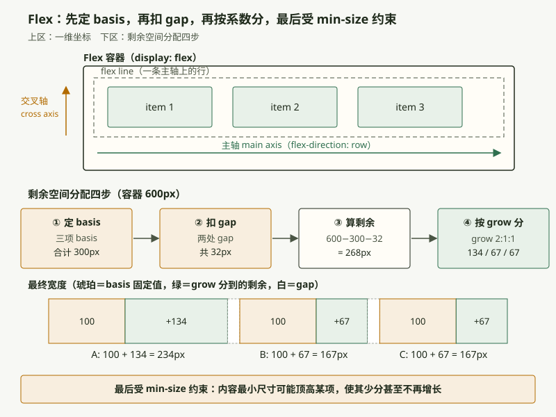

# 10 · Flexbox：一行空间怎么分

> **前置**：[04 · 盒模型](04-box-model.md)——知道 `min-width: auto` 的隐式下限；[08](08-display-flow.md)——知道内轴布局。
>
> 上一篇：[09](09-position.md) ｜ 下一篇：[Grid](11-grid.md) ｜ [教程总览](README.md)

```css
.row  { display: flex; width: 600px; }
.item { flex: 1; }
```

你以为三项均分 200px，实际其中一项 260px、两项各 170px——因为那项里有一条不换行的长 URL。`flex: 1` 为什么不等分？Flex 有一套**四步分配算法**，`flex: 1` 只控制其中一步。这一章把算法连同**收缩的加权规则**讲透，再补齐换行、对齐，最后收一节 Flex 最高频的翻车现场。

## 两轴与两级：属性的记忆框架

`flex-direction` 定主轴（`row` 默认横向 / `column` 纵向），另一根自动成为交叉轴：

| 容器属性 | 管什么 |
| --- | --- |
| `flex-direction` | 主轴方向（reverse 反向） |
| `justify-content` | **主轴**对齐与剩余空间分配 |
| `align-items` / `align-content` | **交叉轴**对齐（后者管多行） |
| `flex-wrap` | 装不下是否换行 |
| `gap` | 子项间距（主/交叉轴都管） |

子项属性三个：`flex`（主轴尺寸三合一）、`align-self`（交叉轴单独对齐）、`order`（视觉排序）。

## 核心：四步分配算法与收缩加权



*图 10-1 · Flex：先定 basis，再扣 gap，再按系数分，最后受 min-size 约束*

**这张图的一句话结论：`flex: 1` 只控制第三步的分配系数，第一步的 basis 和第四步的最小尺寸都能改写结果。**

1. **定基准**：子项先按 `flex-basis` 取初始尺寸（默认 `auto`，即内容的 `max-content` 趋势）。
2. **扣刚性部分**：容器宽度减去 gap、margin、`flex: none` 项，得到**可分配的剩余空间**（可正可负）。
3. **分配/收缩**：剩余为正按 `flex-grow` 系数比例分；为负按 `flex-shrink` 收缩——**收缩量按"basis × shrink"加权**：基准越宽的项贡献越多收缩量，这就是"内容多的项收缩得多"的机制根源。
4. **过 min-size 闸**：结果再被 `min-width/min-height` 拦截。**flex 子项的 `min-width: auto` 解析为内容最小尺寸**——长 URL 顶高下限，`flex: 1` 压不下去（第 04 篇伏笔在此兑现）。

一个容易被忽略的取值：`flex-basis: content`——"按内容定基准，再参与放大收缩"，介于 `auto`（先看 width）与 `0%`（完全按份额）之间，三栏"内容不同但想按内容出发均分"时它比 `auto` 语义更准。

## flex 简写：四种值的精确含义

| 写法 | 展开 | 行为 |
| --- | --- | --- |
| `flex: initial` | `0 1 auto` | 不放大、可收缩、按内容——**默认值** |
| `flex: 1` | `1 1 0%` | basis 归零、纯按份额——**等分用这个** |
| `flex: auto` | `1 1 auto` | 按内容出发再放大——"内容多的多占" |
| `flex: none` | `0 0 auto` | 完全固定——图标、固定宽度列 |

## 对齐、换行与 order

- `justify-content: flex-start | center | flex-end | space-between | space-around | space-evenly`——三种 `space-*` 的差别是"间隙分给谁"。溢出时 center 会**两头裁剪**（左右都丢），需要"居中但溢出不裁"用安全对齐：`justify-content: safe center`。
- `align-items: stretch（默认）| center | flex-start | flex-end | baseline`——`stretch` 是"默认等高"的来源；想让某项不拉伸，`align-self: flex-start`。
- `flex-wrap: wrap` 换行；多行间距 `row-gap`；多行的行间分配 `align-content`。
- **`margin: auto` 是对齐推手**：`margin-left: auto` 把自己推到最右——注意 **auto margin 会优先吸走全部剩余空间，`justify-content` 就没有空间可分了**，两者别同时用。
- `order` 只改视觉不改 DOM/读屏顺序，语义敏感场景慎用（第 09 篇同理）。

## 常见问题

**问题 1：`flex: 1` 不等宽，长内容那项更宽**
- **原因**：第四步的 `min-width: auto` 把下限顶到内容最小尺寸，份额分配被拦截。
- **修法**：子项加 `min-width: 0`；文本配 `overflow-wrap: anywhere`。纵向布局同理是 `min-height: 0`。

**问题 2：图片/iframe 在 flex 里被压扁变形**
- **原因**：replaced 元素作为 flex 子项同样受收缩影响，横向 `flex: 1` 时高度被 `align-items: stretch` 或压缩拉扯。
- **修法**：`object-fit: cover` + 给图片设 `min-width: 0`；或给固定比例容器 `aspect-ratio`（第 04 篇）。

**问题 3：嵌套 flex 里内层"该滚不滚"，整个页面被撑长**
- **原因**：经典链路——外层 `flex-direction: column` 固定高度，内层 `overflow: auto` 不滚，因为中间某层子项的 `min-height: auto` 顶着内容高度，把容器撑开了。
- **修法**：在滚动区的**每一层 flex 父级**上写 `min-height: 0`，让收缩链路打通。"flex 布局里 overflow 失灵"九成是这条。

**问题 4：`justify-content: center` 的内容两头被裁掉**
- **原因**：内容比容器宽时，居中对齐向两边均匀溢出，溢出部分不可达。
- **修法**：`justify-content: safe center`（溢出时自动退回 start 对齐）。

**问题 5：间距忽大忽小 / 折叠了**
- **原因**：混用 `gap` 和 margin；或沿用普通流的"上下 margin 相加"预期——flex 子项间 margin 不折叠但 gap/margin 会**叠加**。
- **修法**：flex/grid 里统一用 `gap`，别再写 margin 间距。

## 动手验证

[打开 demo：调四步参数，亲眼看分配结果](../../examples/minimal/15-flex-space.html)

<iframe class="demo-frame" src="/css-concept-course/examples/minimal/15-flex-space.html" title="flex 空间分配实验" loading="lazy"></iframe>

[打开实验台：常用 flex 布局配方](../../examples/layout/flex-patterns.html)

先复现问题 1：三项 `flex: 1` 塞长文本，看哪项变宽；加 `min-width: 0` 修好。再把 min-width 改大过容器宽，观察第四步闸门把结果"顶回"的样子。

## 本章要点

- 分配四步：**basis → 扣刚性 → 按系数分（收缩按 basis×shrink 加权）→ min-size 闸**。
- `flex: 1` 份额均等、`flex: auto` 内容均等、`flex: none` 固定；`basis: content` 按"内容出发再分配"。
- **嵌套滚动链：每层 flex 父级 `min-height: 0`**，否则内层 overflow 不滚。
- auto margin 优先吸走剩余空间，与 justify-content 二选一；安全对齐 `safe center` 防溢出裁剪。
- flex/grid 间距统一 `gap`，不再用 margin。

下一篇 [11 · Grid](11-grid.md)：二维空间怎么画——`1fr` 不是均分的那一天。
