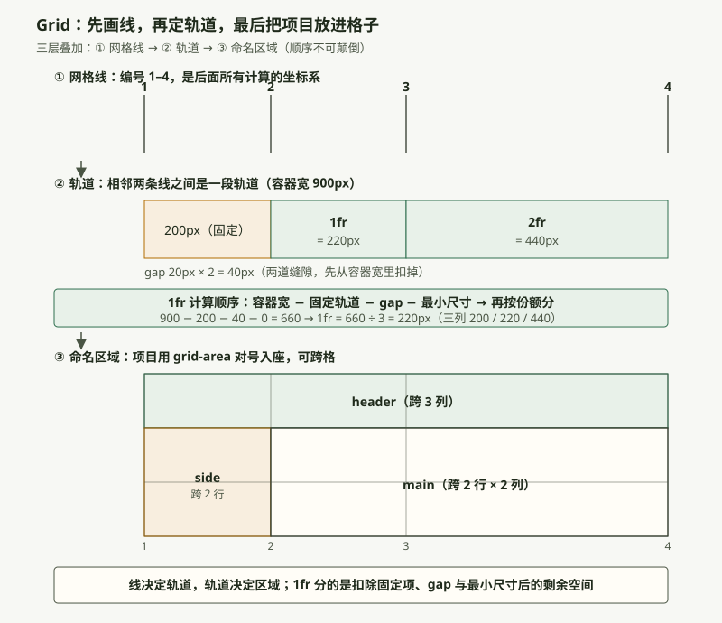

# 11 · Grid：二维空间怎么画

> **前置**：[04](04-box-model.md)——知道 `min-content`；[10](10-flex.md)——知道"内容最小尺寸顶破分配"的机制。
>
> 上一篇：[10](10-flex.md) ｜ 下一篇：[响应式](12-responsive.md) ｜ [教程总览](README.md)

```css
.grid { display: grid; grid-template-columns: 1fr 1fr 1fr; }
```

三列等宽——直到某格塞进长内容，那列突然变宽。`1fr` 的真相：**它分的是"剩余空间"，而每条轨道自带内容最小尺寸的下限**。这一章按"画线 → 定轨道 → 放项目"讲全 Grid，把轨道尺寸算法讲到底，再收高频问题。

## 第一步：画线——网格线才是坐标系

Grid 的根本参照是**网格线**：正数从左上起（1 号线在最左/最上），负数从末端起（`-1` 是最后一条）：

```css
.item  { grid-column: 1 / 3; }    /* 1 号线到 3 号线：占前两列 */
.item2 { grid-column: span 2; }   /* 跨两列，自动找位置 */
.item3 { grid-row: 2 / -1; }      /* 第 2 行到倒数第 1 线 */
```



*图 11-1 · Grid：先画线，再定轨道，最后把项目放进格子*

**这张图的一句话结论：轨道是两条线之间的空间，项目放进的是"线与线围出的格子"。**

## 第二步：定轨道——算法、fr 与隐式网格

轨道尺寸的计算顺序值得理解（简化版）：

1. 先确定每条轨道的**固有尺寸**：`min-content`（下限）与 `max-content`（上限）；
2. 固定单位（px/%）的轨道先就位；
3. 剩余空间再按 **`fr` 份额**分配——但 fr 轨道的隐式下限是 `auto`（内容最小尺寸），长内容先顶宽自己，fr 才分剩下的。

所以"`1fr` 不等分"是算法的正常行为，不是 bug：

```css
grid-template-columns: repeat(3, minmax(0, 1fr));  /* 下限改 0，真均分 */
```

其余轨道工具：

- **`minmax(min, max)`** 设边界，`auto` 可参与（`minmax(150px, auto)`）。
- **`repeat()` 批量声明**；**隐式轨道**（没声明的行列）用 `grid-auto-rows` / `grid-auto-columns` 定尺寸——不设的话隐式行高是 `auto`（随内容参差）。
- **`subgrid`**（2023 基线）：子网格沿用父网格的轨道定义，嵌套组件的行列终于能对齐父级——设计系统里"卡片内标题/正文跨卡片对齐"的正解：

  ```css
  .card { display: grid; grid-template-rows: subgrid; grid-row: span 3; }
  ```

- 实验性 `masonry`（瀑布流，`grid-template-rows: masonry`）尚未标准化，知道即可。

## 第三步：放项目——模板、区域与自动放置

**`grid-template-areas`** 用字符串"画"布局，可读性最好：

```css
.page {
  display: grid;
  grid-template-columns: 220px 1fr;
  grid-template-rows: auto 1fr auto;
  grid-template-areas:
    "sidebar header"
    "sidebar main"
    "sidebar footer";
}
.sidebar { grid-area: sidebar; }
```

规则：区域在字符串里必须是**矩形**，`.` 留空；响应式换布局 = 换一份字符串，项目零改动。不写放置的项目走**自动放置**按行找空格；`grid-auto-flow: dense` 回头填空隙（瀑布感，代价是视觉顺序与 DOM 不一致）。对齐三组与 Flex 同名：`justify/align-items` 管格内项目、`justify/align-content` 管轨道整体、`-self` 唱反调。

## 响应式配方与两种 fill

```css
.cards {
  display: grid;
  grid-template-columns: repeat(auto-fill, minmax(240px, 1fr));
  gap: 1rem;
}
```

能塞几个 240px 列就塞几个，剩余平分——卡片网格的万能答案。`auto-fill` 保留空轨道（项少列数不变）；`auto-fit` 折叠空轨道（项少时摊满整行变宽）。按"要不要固定列数"选。

## 常见问题

**问题 1：`1fr` 不等分 / 长内容撑破轨道**
- **原因**：fr 轨道隐式下限是内容最小尺寸（`min-content`），长 URL/长单词先顶宽自己。
- **修法**：`repeat(3, minmax(0, 1fr))`；内容配 `overflow-wrap: anywhere`；进阶让卡片内文本区 `min-width: 0`。

**问题 2：`grid-template-areas` 整条失效，布局散架**
- **原因**：字符串里区域不是矩形（L 形）、行列数与 template 尺寸不符、名字拼写不一致——任何一条违规，整条声明被容错解析丢弃（第 01 篇），回退到隐式网格。
- **修法**：DevTools 检查这条声明是否"整条消失"；画字符串时先画行、逐列对齐写。

**问题 3：隐式行高度参差 / 内容被压扁**
- **原因**：没写 `grid-auto-rows`，隐式行高 auto 随内容；或给容器定高后行被压。
- **修法**：`grid-auto-rows: minmax(120px, auto)`；定高容器用 `grid-template-rows: auto 1fr` 明确"哪行弹性"。

**问题 4：`dense` 之后 Tab 顺序和视觉对不上**
- **原因**：dense 回填打乱视觉位置，但 DOM/读屏顺序不变（第 10 篇 order 的同款问题）。
- **修法**：内容型网格别用 dense；装饰型（图片墙）可用。

**问题 5：格子间距忽宽忽窄**
- **原因**：gap 与 margin 叠加（子项里还写着 margin）。
- **修法**：间距唯一来源用 `gap`，删掉子项 margin。

**问题 6：百分比高度在格子里不生效**
- **原因**：格子（隐式行）高度是 auto 时，百分比无从解析（第 04/19 篇的包含块规则）。
- **修法**：给行定高（`grid-auto-rows: 100%` 或显式行），或用 `align-self: stretch` 代替百分比。

## 动手验证

[打开 demo：调轨道与放置，看格子怎么长](../../examples/minimal/16-grid.html)

<iframe class="demo-frame" src="/css-concept-course/examples/minimal/16-grid.html" title="Grid 轨道实验" loading="lazy"></iframe>

[打开实验台：常用 Grid 布局配方](../../examples/layout/grid-patterns.html)

复现问题 1（塞长 URL）再用 `minmax(0,1fr)` 修好；把 `auto-fill` 换 `auto-fit` 并删两张卡，观察两种 fill 的分野。

## 本章要点

- 三步模型：**画线 → 定轨道 → 放项目**；轨道算法"先固有、再固定、最后分 fr"。
- fr 分剩余空间且带内容下限——真均分 `minmax(0, 1fr)`；`subgrid` 解决嵌套对齐。
- areas 字符串必须矩形，违规整条失效；隐式行用 `grid-auto-rows` 兜底。
- 卡片网格 `repeat(auto-fill, minmax(240px, 1fr))`；auto-fill 保列数、auto-fit 摊满。
- 间距唯一来源 gap；视觉顺序工具（dense/order）慎用于内容型网格。

下一篇 [12 · 响应式](12-responsive.md)：三个"视口"概念、移动优先与高频断点事故。
