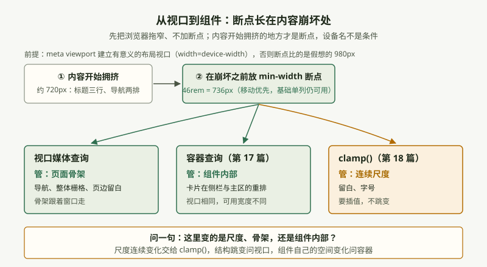

# 12 · 响应式：三个视口与移动优先

> **前置**：[05 · 单位](05-units.md)——会用 clamp 与 dvh；[11 · Grid](11-grid.md)——知道 auto-fill 配方。
>
> 上一篇：[11](11-grid.md) ｜ 下一篇：[transform 与过渡](13-transform-transition.md) ｜ [教程总览](README.md)

桌面三列的卡片墙，手机上变成一列 980px 宽、字小得看不清——不是 CSS 写错，是页面用的**视口根本不是屏幕**。响应式的地基比想象多一层：先分清**三个"视口"**，再谈移动优先与流式尺寸，最后把高频事故收成一节。

## 先分清：三个视口

移动浏览器的"视口"不是一个概念，是三个，混着说必然出 bug：

| 概念 | 是什么 | 谁在动它 |
| --- | --- | --- |
| **布局视口（layout viewport）** | CSS 布局使用的画布宽度 | `<meta viewport>` |
| **视觉视口（visual viewport）** | 用户此刻真实看到的那块（可缩放、可被键盘挤压） | 缩放手势、软键盘 |
| **理想视口（ideal viewport）** | 设备屏幕的 CSS 像素宽（如 390px） | 设备固有 |

没有这行 meta 时，老移动浏览器用约 980px 的布局视口再整体缩小来"兼容桌面站"——你的 `(max-width: 600px)` 永远不会命中：

```html
<meta name="viewport" content="width=device-width, initial-scale=1" />
```

它把布局视口设为理想视口。**响应式没反应，第一件事查它**。键盘弹起改变的是视觉视口（布局视口不动）——fixed 元素不避让键盘的根源在这（第 09 篇）；Chrome 支持 `interactive-widget=resizes-content` 让键盘挤压布局视口，是少数场景的解法。

## 移动优先的媒体查询

```css
.cards { grid-template-columns: 1fr; }              /* 基线：最窄屏可用 */

@media (min-width: 48em) {
  .cards { grid-template-columns: repeat(auto-fill, minmax(240px, 1fr)); }
}
```

**为什么 min-width 从小往大写？** 级联方向友好（后写覆盖前写，符合层叠直觉，第 03 篇）；且"先满足最窄屏"逼出核心内容，桌面自然优雅——反过来写通常缩到手机就崩。

两个工程细节：

- **断点单位用 `em` 更稳**：媒体查询里的 rem 在旧 Safari 按"初始根字号"解析（用户调大系统字号不生效）；`em` 各端行为一致。48em = 768px。
- **断点值没有标准**，640/768/1024 只是经验。正确做法：预览从 320px 拉宽，**内容开始难看处立断点**，不对齐设备型号。

逻辑组合：`@media (min-width: 40em) and (orientation: landscape)`；逗号 = 或；`not` 取反。

## 流式尺寸：断点之间的坡道

断点是台阶，流式是坡道，配合才不生硬：

```css
h1    { font-size: clamp(1.75rem, 1rem + 2.5vw, 3rem); }
.hero { padding-block: clamp(2rem, 6vw, 5rem); }
img   { max-width: 100%; height: auto; }             /* 显示层：永不撑破 */
```

图片有两层职责：CSS `max-width: 100%` 管"别撑破"；HTML `srcset`/`sizes` 管"按屏幕发合适大小的文件"（流量层）——``。

## 媒体特性：宽度之外的用户环境

| 特性 | 含义 | 用途 |
| --- | --- | --- |
| `prefers-reduced-motion` | 减少动效 | 全局降级动画（第 14/23 篇） |
| `prefers-color-scheme` | 深/浅色 | 配 `color-scheme` 换肤 |
| `prefers-contrast` / `prefers-reduced-transparency` | 高对比 / 低透明偏好 | 加深文字、去毛玻璃 |
| `hover: hover` / `pointer: coarse` | 有无悬停 / 指针粗细 | **触屏别写 hover 依赖**：`(hover: none)` 下给 tap 反馈 |
| `(orientation: landscape)` | 横竖屏 | 注意软键盘弹起会"改变"横竖判定 |

触屏适配值得单独记：桌面 hover 才出现的菜单，在 `hover: none` 设备上必须有替代路径（点击展开），否则触屏用户永远进不去。



*图 12-1 · 断点定在内容难看的宽度，而不是设备型号*

**这张图的一句话结论：先让内容在流式尺寸里自然伸缩，崩坏处才立断点。**

## 常见问题

**问题 1：手机上媒体查询完全不命中**
- **原因**：漏写/写错 viewport meta，布局视口是 980px。
- **修法**：`<head>` 第一行补 `width=device-width, initial-scale=1`；用 `window.innerWidth` 实测布局视口。

**问题 2：移动端 `100vh` 时大时小**
- **原因**：地址栏伸缩（第 05 篇详述的 svh/lvh/dvh 分野）。
- **修法**：全屏高改 `100dvh`（或明确选 `svh`），配 `@supports` 垫底。

**问题 3：断点写了一堆，间距字号还是不协调**
- **原因**：只用台阶（断点），没有坡道（流式），每个断点都要手动调一遍。
- **修法**：字号/内距换 `clamp()`，断点只留"结构变化"（单列变网格）。

**问题 4：hover 下拉菜单在手机上进不去**
- **原因**：触屏没有悬停，`:hover` 偶尔"粘住"但不可靠。
- **修法**：`@media (hover: none)` 下改点击展开；菜单本体用 `<details>`/JS 状态，hover 只是增强。

**问题 5：媒体查询在旧 Safari 上不随用户字号变化**
- **原因**：MQ 内 rem 基于初始根字号解析的历史行为。
- **修法**：断点单位统一用 `em`。

## 动手验证

[打开 demo：拖窗口看断点与流式的配合](../../examples/minimal/19-responsive.html)

<iframe class="demo-frame" src="/css-concept-course/examples/minimal/19-responsive.html" title="响应式实验" loading="lazy"></iframe>

[打开实验台：媒体偏好（深色/减少动效/高对比）实测](../../examples/responsive/media-preference.html)

从 320px 拉宽找出"内容难看点"；实验台切换系统设置，观察偏好查询的实时响应。

## 本章要点

- 三个视口：布局视口（meta 定）、视觉视口（缩放/键盘动）、理想视口（设备宽）——响应式没反应先查 meta。
- 移动优先 + `min-width` 递增；断点单位用 em；断点立在内容崩坏处。
- 台阶（断点）+ 坡道（clamp）配合；图片 CSS 防撑破 + `srcset` 防浪费。
- 媒体特性是用户环境接口：动效/配色/对比/指针形态（hover:none 给触屏留路径）。

下一篇 [13 · transform 与过渡](13-transform-transition.md)：为什么 transform 动画不卡，width 动画就卡。
