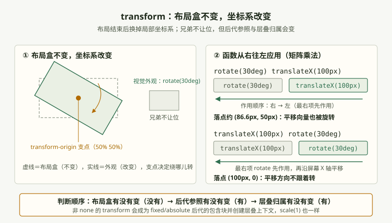

# 13 · transform 与过渡：布局之外的动

> **前置**：[01](01-how-css-works.md)——知道流水线与"transform 只走合成"；[09](09-position.md)——知道 fixed 的 transform 例外。
>
> 上一篇：[12](12-responsive.md) ｜ 下一篇：[动画 animation](14-animation.md) ｜ [教程总览](README.md)

```css
.card:hover { transform: translateY(-4px); }
```

悬停上浮，顺滑不卡。换成 `margin-top: -4px` 整段文字就跟着抖。差别在**流水线**：transform 在布局之后换坐标系。这一章讲 transform 的坐标系模型与函数顺序、origin，过渡的四件套与可插值边界，最后是高频事故。

## transform：布局盒不变，坐标系改变



*图 13-1 · transform 在布局完成后对"绘制坐标系"做变换*

**这张图的一句话结论：transform 改的是"画在哪"，不改"占多大"——所以它便宜，也所以它不影响文档流。**

三个必建认知：

1. **不改变布局**：占位不变，移动/缩放/旋转都是"画出来的"。这是它廉价的原因，也是"缩到 0 还占着布局空间"的原因。
2. **创建新参照系**：transform 元素成为后代 fixed/absolute 的**包含块**（第 09 篇事故根源），同时创建**层叠上下文**（第 18 篇）——一个属性两张副作用门票。
3. **函数是连续左乘的矩阵**：从左到右依次"带着前一步的坐标系"变换——`translate(100px) rotate(45deg)` 先平移再绕**新位置**旋转；`rotate(45deg) translate(100px)` 先转向再沿**已旋转的轴**走，落点完全不同。直觉口诀：**想按屏幕方向移动，translate 放最前**。

函数四件套：`translate(x, y)`、`scale(s)`（负值翻转）、`rotate(angle)`、`skew(x, y)`。**原点**由 `transform-origin` 决定（默认中心 50% 50%）——"门开合"就是 origin 移到边缘再 rotate。3D 记两个词：`perspective`（透视距离）、`translateZ`；真 3D 嵌套需要 `transform-style: preserve-3d`（且中间任何 overflow/filter/opacity<1 都会把它"打平"，第 18 篇）。

**百分比参照自身**：`translateX(50%)` 是自身宽度的 50%（不是父容器的）——和 width 的百分比参照完全是两回事，居中配方 `translate(-50%, -50%)` 正是利用这一点。

## transition：状态之间的补间

| 子属性 | 作用 | 默认 |
| --- | --- | --- |
| `transition-property` | 过渡哪些属性 | all |
| `transition-duration` | 时长 | 0s（**默认没有过渡**） |
| `transition-timing-function` | 节奏曲线 | ease |
| `transition-delay` | 延迟 | 0s |

```css
.card {
  transition: transform .2s ease, box-shadow .2s ease;  /* 只列要动的，别用 all */
}
.card:hover {
  transform: translateY(-4px);
  box-shadow: 0 8px 24px rgb(0 0 0 / .12);
}
```

三条规则：

- **过渡由状态变化触发**（hover/类切换/checked）。进出场想不同节奏就在两侧写不同 transition：平时 `.3s`（慢出），hover 里 `.1s`（快进）。
- **可插值才能过渡**：数值、颜色、transform、opacity 可以；`display`、`height: auto`、`font-family` 不行——auto 没有中间值。`display` 参与过渡的现代方案：`transition-behavior: allow-discrete` + `@starting-style`（第 26 篇配方）。
- **曲线选型**：`ease`（默认）、`linear`（匀速）、`cubic-bezier(.34, 1.56, .64, 1)`（第三参数 >1 = 过冲回弹）、`steps(n)`（打字机）、`linear()`（自定义分段，2023+）。交互常用 0.15–0.25s。

## 常见问题

**问题 1：hover 上移导致页面轻微"抖动"/文字发虚**
- **原因**：scale 到非整数尺寸或落在半像素位置时，文本按插值尺寸渲染发糊；动画结束回整数才清晰。
- **修法**：位移用整偶数 px；scale 文本容器时正文缩放幅度收敛（≤1.05）；或将 transform 放在外层容器、文本在内层固定尺寸。

**问题 2：旋转后再 translate，方向不对**
- **原因**：函数顺序——rotate 在前，后面的 translate 沿旋转后的轴走（矩阵连续左乘）。
- **修法**：`translate` 放最前；或拆成外层平移 + 内层旋转两层元素。

**问题 3：fixed 元素在动画期间"吸"到卡片上**
- **原因**：transform 动画期间（哪怕 opacity 过渡借道）祖先变成包含块，fixed 参照被劫持（第 09 篇问题 4 同源）。
- **修法**：动画属性只放叶子元素；fixed 层不放在任何 transform 祖先内。

**问题 4：`scale(0)` 隐藏后还挡着布局**
- **原因**：transform 不改布局——scale(0) 只是画不出来，占位与命中区域仍在（命中区域也缩为 0，但布局空间留着）。
- **修法**：要移除布局用 `display: none`（配 `allow-discrete`），scale 只做视觉退场。

**问题 5：transition 写了没反应**
- **原因**排序：duration 没写（默认 0s）；属性是 `auto`/`display` 不可插值；transition 写在了状态选择器里（hover 才有 transition，移开瞬间没过渡——transition 要写在常驻态）。
- **修法**：transition 挂在元素本体，状态选择器只改值。

## 动手验证

[打开 demo：同一位移，对比 transform 与改布局](../../examples/minimal/13-transform.html)

<iframe class="demo-frame" src="/css-concept-course/examples/minimal/13-transform.html" title="transform 实验" loading="lazy"></iframe>

[打开实验台：transform-origin 可视化](../../examples/motion/transform-origin.html)

分别用 `translate` 与 `left` 做同一位移感受流畅差；实验台里拖 origin 十字点，看同一个 rotate 的不同效果——再交换 translate/rotate 顺序复现问题 2。

## 本章要点

- transform 布局后换坐标系：**不占位、不惊动布局**；副作用是包含块 + 层叠上下文两张门票。
- 函数连续左乘：**translate 放最前**按屏幕方向走；`translate(50%)` 参照自身不是父级。
- origin 决定绕哪变；3D 嵌套要 `preserve-3d` 且中间层会被 overflow/filter 打平。
- transition 写在常驻态；`auto`/`display` 不可插值（现代用 `allow-discrete`）；曲线超 1 即回弹。
- 溢出居中用 `safe center` 思路同理适用；scale(0) 不移除布局。

下一篇 [14 · animation](14-animation.md)：关键帧、循环与"结束后为什么不跳回"。
