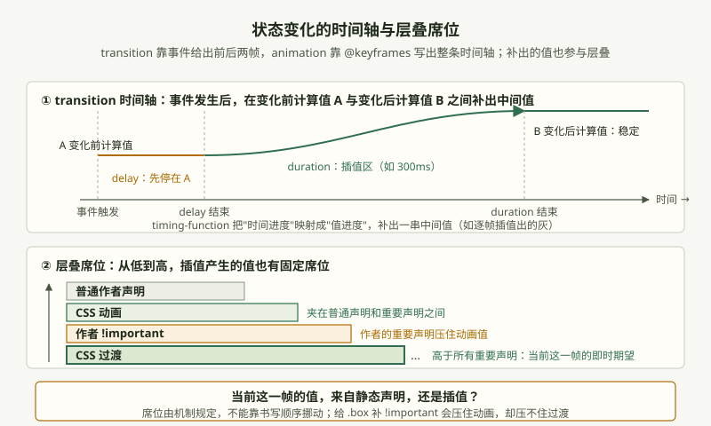

# 14 · animation：关键帧与时间轴

> **前置**：[13](13-transform-transition.md)——知道可插值与 transition 四件套；[03](03-cascade-inheritance.md)——知道动画的层叠席位。
>
> 上一篇：[13](13-transform-transition.md) ｜ 下一篇：[自定义属性与主题](15-custom-properties.md) ｜ [教程总览](README.md)

```css
.toast { animation: slide-in .3s ease both; }
@keyframes slide-in { from { transform: translateY(16px); opacity: 0; } }
```

提示框进场用的是 animation 而不是 transition——transition 管不了"页面加载即播放""多段轨迹""循环"，这些归 animation。这一章讲关键帧、八个子属性、fill-mode、**多动画叠加的 composition**，最后是高频事故。

## @keyframes 与八个子属性



*图 14-1 · 关键帧沿时间轴补间，播放中的动画在层叠里占更高的席位*

**这张图的一句话结论：动画是"时间轴上的补间"，且播放中的动画值会压过普通样式。**

关键帧是"时刻 → 样式"快照：`from/to` 是 `0%/100%` 别名；**缺首帧或尾帧时用元素当前样式补齐**——上面 toast 只写 from，起点就是元素自己。同一帧多属性同时补间，各帧可写自己的 easing。

| 子属性 | 作用 | 常用值 |
| --- | --- | --- |
| `animation-name` | 引用 @keyframes | — |
| `animation-duration` | 一轮时长 | `.3s` |
| `animation-timing-function` | 帧间节奏 | ease / steps |
| `animation-delay` | **只在第一轮前**等待 | `2s` |
| `animation-iteration-count` | 播几轮 | `1` / `infinite` |
| `animation-direction` | 方向 | `alternate`（往返） |
| `animation-fill-mode` | **首尾时刻的姿态** | `both` |
| `animation-play-state` | 播放开关 | paused / running |

shorthand 坑：双时间值时**第一个 duration、第二个 delay**。循环场景两个冷知识：**delay 只在第一轮前生效**（想让每轮之间有间隔，把留白写进关键帧百分比里，如 `0%, 80% {…} 100% {…}`）；关键帧声明里写 `!important` 会被忽略。

## fill-mode 与"播完跳回"

默认 `fill-mode: none`——播完立刻回到普通样式值。`forwards` 留住 100% 帧、`backwards` 让 delay 期间先呈现 0% 帧、`both` 两头都要。**"动画播完闪一下弹回原地"，九成是缺 `both`。**

## 多动画叠加与 composition

一个元素可以同时跑多个动画（逗号分隔）。它们改同一个属性时，**后声明的覆盖先声明的**——除非用 `animation-composition`（2023+）定义叠加方式：

```css
.orb {
  animation: drift 4s infinite, pulse 1.2s infinite;
  animation-composition: add;   /* replace(默认，覆盖) / add / accumulate */
}
@keyframes drift  { to { transform: translateX(40px); } }
@keyframes pulse  { to { transform: scale(1.2); } }
```

`add` 把后者的变换**乘到**前者之上（平移+缩放同时生效），`accumulate` 做"叠加累积"。这是"多个动效共存不打架"的正式机制。

## 何时选 animation，何时 transition

| 场景 | 选 | 理由 |
| --- | --- | --- |
| hover、checked、类切换两态 | transition | 状态驱动、双向自动 |
| 加载进场、提示浮层、循环骨架 | animation | 自播、循环、多段 |
| 按需暂停/恢复 | animation + `play-state` | hover 暂停配方 |

播放控制不需要 JS：`.player:hover { animation-play-state: paused; }`。注意**transition 与 animation 同时改一个属性时，动画赢**（层叠席位高于普通样式，第 03 篇）；元素状态变化想触发过渡，就别让它同时挂着改同一属性的无穷循环动画。

动效无障碍底线（第 23 篇全局配方）：`@media (prefers-reduced-motion: reduce)` 下把时长压到 0.01ms。

## 常见问题

**问题 1：动画播完"闪回"原样**
- **原因**：fill-mode 默认 none。
- **修法**：`animation-fill-mode: both`（或 forwards）；反向问题"delay 期间闪现最终态"也是它——补 backwards。

**问题 2：循环动画每轮之间没有间隔**
- **原因**：delay 只在第一轮前生效。
- **修法**：把间隔写进关键帧（末段保持静止的百分比），或拆成两个交替的动画。

**问题 3：样式"失灵"，改了值没反应**
- **原因**：播放中的动画在层叠里压过普通样式（第 03 篇席位表）——你改的属性正被某 animation 占用。
- **修法**：DevTools Styles 面板能看到动画来源；改 keyframes 或停掉动画。

**问题 4：无限动画把 CPU/电量吃满**
- **原因**：常驻 infinite 动画即使画面不动也在跑；或动画属性是布局属性（每帧重排）。
- **修法**：只用 transform/opacity；视口外暂停（`content-visibility` / IntersectionObserver 切 play-state）；动完的动画及时移除类。

**问题 5：shorthand 写完动画没播**
- **原因**：双时间值顺序（duration 在前 delay 在后）写反；或 name 与关键字冲突（如动画名叫 `none`）。
- **修法**：复杂动画用分属性写；name 避开 CSS 关键字。

## 动手验证

[打开 demo：调关键帧与 fill-mode，看起止姿态](../../examples/minimal/14-animation.html)

<iframe class="demo-frame" src="/css-concept-course/examples/minimal/14-animation.html" title="关键帧实验" loading="lazy"></iframe>

[打开实验台：滚动驱动的进度条与视差](../../examples/modern/scroll-driven-animation.html)

把 fill-mode 从 both 改 none 看"闪回"；delay 调大并换 backwards，理解"等的时候长什么样"。

## 本章要点

- 缺首尾帧用当前样式补齐；**fill-mode both 是进场动画的默认答案**。
- delay 只管第一轮；循环间隔写进关键帧；keyframes 内 `!important` 无效。
- 多动画默认后声明覆盖，`animation-composition: add` 让它们叠加。
- 播放中的动画压过普通样式——"样式失灵"排查新方向。
- 只用 transform/opacity 做循环动画；视口外暂停；尊重动效偏好。

下一篇 [15 · 自定义属性与主题](15-custom-properties.md)：变量的作用域、失效行为与主题切换。
