# 15 · 自定义属性与主题

> **前置**：[03](03-cascade-inheritance.md)——知道继承与 unset；[05](05-units.md)——会用 calc。
>
> 上一篇：[14](14-animation.md) ｜ 下一篇：[伪类与伪元素进阶](16-pseudo-elements.md) ｜ [教程总览](README.md)

设计师说主色换成 `#2d5420`。全文搜索替换，漏了三处写死的、误替了两处灰色——而如果颜色都来自 `var(--brand)`，这是一行改动。这一章讲透变量的**作用域、失效规则（含 fallback 的精确语义）**、与 calc/@property 的组合，最后收高频事故。

## 声明与使用

```css
:root {
  --brand: #3f6b2a;
  --shadow: 0 2px 8px rgb(0 0 0 / .15);   /* 值可以是完整多 token 串 */
}
.btn {
  background: var(--brand);
  box-shadow: var(--shadow);              /* 整串引用合法 */
  color: var(--brand-ink, #fff);          /* 回退值 */
}
```

三条基本规则：`--` 开头声明、`var()` 引用、可带回退。值在**引用处才解析**——所以变量能存整个值串（过渡、阴影、渐变函数），这是"令牌"思想的物理基础。

## 作用域：带继承的"就近覆盖"

变量沿 DOM 继承，取值规则与第 03 篇完全同源：**向上找最近的定义，找到就停**。



*图 15-1 · 变量不是全局替换，是带作用域的继承*

**这张图的一句话结论：变量不是"全局替换"，是带作用域的继承——谁离得近听谁的。**

主题系统的原理即此：`.theme-dark { --bg: …; --ink: … }` 改一个祖先，其下所有组件自动换装，组件零改动。组件内局部覆盖（`.card { --radius: 2px; }`）做"主题内变体"。两条与普通属性不同：变量名**区分大小写**；同名定义冲突走层叠裁决（@layer 照常适用，第 03 篇）。

## 失效规则：fallback 的精确语义

这是最容易理解错的一节。`var()` 的回退值**只在"变量未定义"时生效**；变量已定义但值不合法时，走的不是 fallback，而是"invalid at computed-value time"：

```css
.btn  { width: var(--w, 100px); }
.btn  { --w: 300; }        /* 300 不是合法长度 */
```

结果：width 变 **unset**（可继承→继承值，不可继承→初始值），**fallback 100px 不会生效**。再推两条连锁规则：

- **shorthand 里一个部分失效，整条变 unset**：`border: var(--bw) solid` 若 `--bw` 非法，整条 border 归零——不是"只有宽度失效"。
- 替换发生在**计算值阶段**：`--gap: 8px + 4px` 声明时不报错（是合法 token 串），`width: calc(var(--gap))` 才炸。复杂表达式永远用 `calc()` 包住变量。

## 与 calc / @property 组合

- **calc + var**：`width: calc(100% - var(--sidebar-w))`——改一处变量全布局跟动。
- **`@property` 注册类型**（2023+）：变量获得类型、初始值、继承开关；最大收益是**变量本身可过渡**：

  ```css
  @property --angle { syntax: "<angle>"; inherits: false; initial-value: 0deg; }
  .dial { background: conic-gradient(from var(--angle), #3f6b2a, #a7631d);
          transition: --angle .6s; }   /* 未注册的变量不能 transition */
  ```

  常用 syntax 类型：`<length>`、`<percentage>`、`<color>`、`<angle>`、`<number>`、`<length-percentage>`。
- **JS 接口**：`getComputedStyle(el).getPropertyValue('--x')` 读、`el.style.setProperty('--x', v)` 写——CSS 与 JS 的标准数据通道（拖拽进度、数据可视化）。

## 主题切换完整配方

```css
:root { color-scheme: light dark; --bg: #f4f1e9; --ink: #263021; }
@media (prefers-color-scheme: dark) { :root { --bg: #1a2016; --ink: #e8ecdf; } }
[data-theme="light"] { color-scheme: light; --bg: #f4f1e9; --ink: #263021; }
[data-theme="dark"]  { color-scheme: dark;  --bg: #1a2016; --ink: #e8ecdf; }
```

`<html data-theme>` 由 JS 切换，实现"跟随系统 + 手动覆盖"。防"换肤闪烁"：在 `<head>` 里用**同步内联脚本**先设好 `data-theme`，别等 DOMContentLoaded（组件渲染前定装）。

## 常见问题

**问题 1：`background: url(var(--img))` 不生效**
- **原因**：`url()` 内部不解析 `var()`——url 是特殊 token，变量替换进不去。
- **修法**：把完整地址存进变量：`--img: url("a.png")`，引用处 `background: var(--img)`。CSS 里凡是"特殊语法槽位"（url、@media 条件、选择器名）都不能用变量——**变量只能出现在"值"里**。

**问题 2：变量定义了，样式却整条消失**
- **原因**：值不合法触发 invalid-at-computed-value-time，属性变 unset，fallback 也不救（本节核心）。
- **修法**：DevTools Computed 里看属性是否消失；把表达式放进 `calc()`，核对变量值的类型。

**问题 3：主题切换时页面闪一下旧色**
- **原因**：`data-theme` 在首帧渲染后才由 JS 设置。
- **修法**：`<head>` 内联同步脚本先定主题；根元素默认带 `color-scheme` 避免原生控件先闪白。

**问题 4：变量在 @media 里不生效 / 想用变量写断点**
- **原因**：媒体查询条件在解析期确定，变量是运行时值——**条件不能用变量**。
- **修法**：断点做成自定义属性供值使用（`clamp()` 内），条件本身仍写死。

**问题 5：同一变量两处定义，取值"随机"**
- **原因**：变量声明参与层叠——优先级与顺序在起作用（第 03 篇），不是玄学。
- **修法**：主题层用统一的作用域约定（`:root` 全局、组件局部覆盖），必要时 @layer 分层。

## 动手验证

[打开实验台：改变量看全站联动](../../examples/foundations/custom-properties.html)

<iframe class="demo-frame" src="/css-concept-course/examples/foundations/custom-properties.html" title="自定义属性实验" loading="lazy"></iframe>

改 `:root` 主色看全页联动；组件上覆盖同名变量验证就近覆盖；最后把颜色变量赋成数字，观察 Computed 里属性"消失"（问题 2 现场）。

## 本章要点

- 变量 = 带作用域的继承；主题切换 = 祖先上重定义。
- **fallback 只救"未定义"，不救"非法值"**；非法触发 unset，shorthand 一损俱损。
- 变量只能出现在值里：`url(var(…))`、@media 条件、选择器都不行。
- `@property` 注册类型后变量可过渡动画；`setProperty` 是 CSS↔JS 标准通道。
- 换肤防闪：head 内联脚本先定主题。

下一篇 [16 · 伪类与伪元素进阶](16-pseudo-elements.md)：不进 HTML 的绘制，以及伪元素失效的元素清单。
