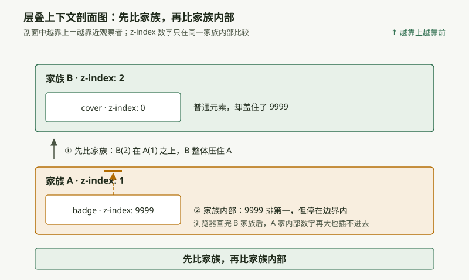

# 18 · 层叠上下文：谁盖住谁

> **前置**：[09](09-position.md)——定位与 z-index；[13](13-transform-transition.md)——transform 副作用；[16](16-pseudo-elements.md)——负 z-index 沉底。
>
> 上一篇：[17](17-overflow-scroll.md) ｜ 下一篇：[BFC 与包含块](19-bfc-containing-block.md) ｜ [教程总览](README.md)

```css
.modal { position: absolute; z-index: 9999; }
```

模态框 z-index 拉到 9999，还是被一张普通图片盖住。z-index 不是全局排位赛——**它只在同一层叠上下文内有效**。这一章讲清同上下文内的绘制顺序、上下文的创建清单、家族比较规则，最后给一套四步排查法。

## 模型：绘制按"家族"分组



*图 18-1 · 层叠上下文剖面图：先比家族，再比家族内部*

**这张图的一句话结论：z-index 只在同一个层叠上下文内比较；跨上下文先比"家族"的名次。**

每个层叠上下文是一支"战队"：内部排序由成员 z-index 决定，**战队之间的名次由它们在更上层的 z-index（或 DOM 顺序）决定**。9999 的成员在低名次战队里，输给高名次战队的任何成员——模态被图片盖住，几乎都是"模态被某个低名次的上下文圈走了"。

## 同一上下文内的绘制顺序（精确版）

1. 上下文自身的背景与边框
2. **负 z-index** 子上下文
3. 正常流块级盒子
4. 浮动盒
5. 行内内容
6. `z-index: auto/0` 的定位元素、flex/grid 子项（z-index 0 或 auto 按顺序）
7. 正 z-index 子上下文，从小到大

推论：负 z-index 画在"自身背景之上、内容之下"——伪元素垫底的正确姿势；同为 auto 时按 DOM 顺序；**flex/grid 子项不定位也能用 z-index 分层**。

## 创建清单（排查的核心工具）

| 创建条件 | 说明 |
| --- | --- |
| 根元素 | 页面总上下文 |
| 定位且 `z-index ≠ auto` | 经典 |
| flex/grid **子项**且 `z-index ≠ auto` | 不用定位也能分层 |
| `opacity < 1` | 半透明都算 |
| `transform` / `filter` / `backdrop-filter` / `perspective` ≠ none | 动画三兄弟 |
| `isolation: isolate` | 显式创建，专为隔离 |
| `will-change`（上述属性）/ `contain: paint` | 预优化也算 |
| `mix-blend-mode ≠ normal` | 混合模式 |

**过渡中的元素也算**：hover 时 opacity 从 1 变 0.99 的瞬间就创建了上下文——"hover 一下层级就乱"的元凶常见于此。3D 进阶：`transform-style: preserve-3d` 的子元素参与 3D 排序，但中间任何 overflow/filter/opacity 都会"打平"3D 空间，层级突然回退到 2D 规则。

## 四步排查法（对照 DevTools Layers）

1. **找出被盖元素的"战队"**：沿祖先链找创建条件（opacity/transform/filter/isolation/will-change…）——被盖元素实际属于哪个上下文。
2. **找出盖人元素的战队**：同样方法。
3. **找两支战队的最近公共祖先**：在那一层比较两个分支的名次（z-index 或 DOM 顺序）。
4. **决策**：要么提高自家分支在公共层的名次；要么用 `isolation: isolate` 把干扰源圈进独立低名次战队。DevTools 的 Layers / 3D View 面板能把层叠可视化，直接对照。

## 常见问题

**问题 1：hover 加 opacity 过渡后，浮层被兄弟盖住**
- **原因**：opacity < 1 的瞬间创建上下文，浮层被"圈"进了低名次家族。
- **修法**：浮层提为公共层直属（挪出被圈祖先）；或宿主 `isolation: isolate` 独立圈地抬名次。

**问题 2：负 z-index 的装饰沉到页面背景之下**
- **原因**：父元素没创建上下文，负 z-index 子元素沉到**根上下文**底（根背景之下）。
- **修法**：父元素 `isolation: isolate`（或任何创建条件），让"沉底"只沉到父层底（第 16 篇配方 ③）。

**问题 3：`backdrop-filter` 的毛玻璃元素层级意外**
- **原因**：backdrop-filter 创建上下文，元素参与名次竞争的方式变了。
- **修法**：显式 z-index + 在同一层比较；或提高其公共层名次。

**问题 4：iframe 盖不住也躲不开**
- **原因**：iframe 是独立文档，作为**原子单元**参与父文档层叠——内部元素不能跨文档比较 z-index。
- **修法**：层级问题在父文档层面解决（控制 iframe 的定位与 z-index）。

**问题 5：z-index 阶梯失控，层层加码**
- **原因**：多个组件各自加码（1000 → 2000 → 9999），本质是"都在同一层裸比数值"。
- **修法**：令牌化层级（`--layer-dropdown: 1; --layer-modal: 2;`）+ 组件根 `isolation: isolate`，数值只在圈内比。

## 动手验证

[打开 demo：动态创建上下文，看家族怎么翻盘](../../examples/minimal/08-stacking-context.html)

<iframe class="demo-frame" src="/css-concept-course/examples/minimal/08-stacking-context.html" title="层叠上下文实验" loading="lazy"></iframe>

[打开实验台：定位 + 层叠综合玩法](../../examples/layout/positioning-stacking.html)

给 z-index: 9999 的盒子加 `opacity: .99` 看它"掉队"（问题 1 现场）；再用 isolation 修回。打开 DevTools 的 Layers 面板对照四步排查法。

## 本章要点

- z-index 只在**同一上下文**内有效；跨上下文比家族名次。
- 七层绘制序 + 创建清单（opacity/transform/filter/backdrop-filter/isolation/will-change/blend）是排查武器。
- 过渡中的 opacity/transform 也在创建上下文——"hover 后层级乱"的高频元凶。
- 排查四步：找两个战队 → 找公共祖先 → 比分支名次 → isolate 圈地或提升名次。
- 层级令牌化 + 组件圈地，杜绝 9999 军备竞赛。

下一篇 [19 · BFC 与包含块](19-bfc-containing-block.md)：margin 为什么穿透父元素、行内对齐的底层机制。
