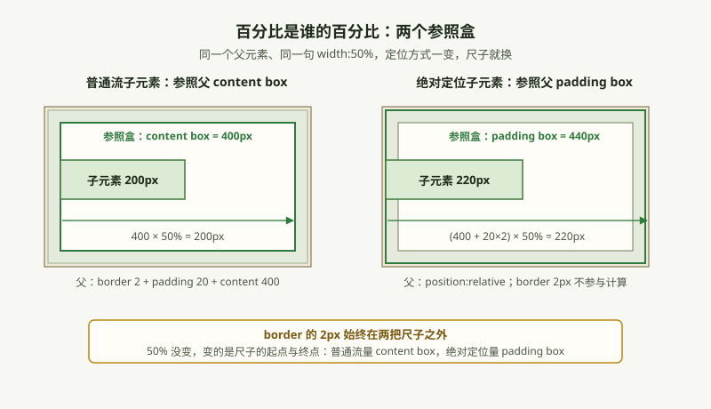
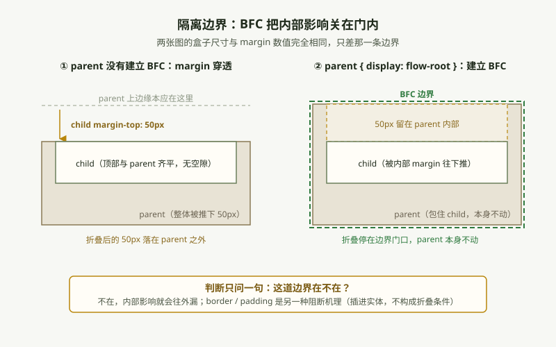

# 19 · BFC、包含块与行内布局

> **前置**：[04](04-box-model.md)——margin 折叠与 `height: 100%`；[09](09-position.md)——定位参照；[07](07-typography.md)——行高的比例模型。
>
> 上一篇：[18](18-stacking-context.md) ｜ 下一篇：[容器查询与现代选择器](20-container-query.md) ｜ [教程总览](README.md)

```css
.parent { background: #eef2e6; }
.child  { margin-top: 40px; }
```

按理说孩子被推下 40px，结果是**背景整个被顶下来**——margin 穿出了父元素。另一边，`height: 100%` 静默失效、图片底下多出一条缝，则是**包含块**与**行内布局**的机制在起作用。这一章把三个底层参照系统讲全：包含块、BFC，以及常被跳过的**行内格式化上下文（IFC）**——它解释了文字排版一半的"玄学"。

## 包含块：百分比和定位的参照盒

**包含块**是元素尺寸与定位的参照盒，多数情况是父元素的 content box，例外恰恰是坑的来源：



*图 19-1 · 不同定位方式下，包含块是谁*

**这张图的一句话结论：static/relative 参照父 content box；absolute 参照定位祖先的 padding box；fixed 参照视口——除非祖先是 transform。**

| 元素 | 包含块 |
| --- | --- |
| 普通流 / relative | 最近**块容器**祖先的 content box |
| absolute | 最近 **position ≠ static** 祖先的 **padding box** |
| fixed | **视口**（祖先有 transform/filter/perspective 时改为该祖先） |
| sticky | 最近的滚动容器 |

两条全局推论：**一切百分比相对包含块**（含"垂直 padding 按宽度算"，第 05 篇）；**`height: 100%` 失效 = 包含块高度由内容决定**，百分比无从解析——让父链上出现"确定高度"（显式高、flex/grid 分配、或 `aspect-ratio`）才能救活它。

## BFC：一道隔离边界

**BFC（块级格式化上下文）**是独立的布局判决书：内部布局不影响外部，外部也不影响内部。



*图 19-2 · BFC 把内部的影响关在门内*

**这张图的一句话结论：BFC 内的浮动、折叠、溢出都被关在门内——需要"隔离"时就造一个 BFC。**

### 三把钥匙与怎么开门

1. **包住内部浮动**：浮动子元素脱流，父元素高度塌为 0。造 BFC（`display: flow-root`）把浮动关门内，高度恢复。
2. **阻断 margin 折叠**：开头"margin 穿透父元素"就是父子 margin-top 折叠（第 04 篇）。父级造 BFC，或垫 border/padding/行内内容。
3. **不与浮动重叠**：两栏布局的第二栏造 BFC，排到浮动之外，形成自适应栏。

| 造 BFC 的方式 | 代价 |
| --- | --- |
| **`display: flow-root`** | 无副作用，现代标准答案 |
| `overflow: hidden/auto` | 裁剪副作用（第 17 篇） |
| `inline-block` / flex/grid 子项 | 改变盒类型 |
| 浮动 / 绝对定位 | 脱流，通常不可接受 |

顺带补全折叠（第 04 篇）：相邻兄弟 + 父子会折叠；flex/grid 子项之间、BFC 边界不折叠；一正一负取"最大正 + 最小负"。

## IFC：行内布局的底层机制

块级讲 BFC，行内讲 **IFC（行内格式化上下文）**——第 07 篇"行高玄学"的底层答案。三个概念：

- **行盒（line box）**：一行内容外面套着的无形盒子，高度由这行里所有行内盒与 **strut** 共同决定。
- **strut（支柱）**：每个行盒都有一根"隐形文字"——由**块容器的 font/line-height** 决定的最小行高。哪怕一行全是图片，行高也至少是 strut 的高度。
- **基线对齐**：行内内容默认按 `vertical-align: baseline` 排——不同字体尺寸、图片、inline-block 各自的基线决定它们在行盒里怎么摆。

这个模型直接解释两个传世之谜：

- **图片底部总有一条缝**：`img` 是行内级，按基线对齐——基线在图片**底部之上**，图片下方到行盒底部还留着一段"字母下伸部（descender）"的空间。修法任选：`img { display: block }`、`vertical-align: bottom`、或父级 `line-height: 0`。
- **inline-block 里装文字后整体下坠**：它的基线是"内部最后一行文字的基线"，装不装文字、字号多大都改变它自己的基线位置——用 `vertical-align: top` 免疫。

## 常见问题

**问题 1：父元素 margin 被"顶"出去 / 高度为 0**
- **原因**：父子 margin 折叠穿透；或子元素浮动脱流。
- **修法**：父级 `display: flow-root`（一次解决两件事）。

**问题 2：图片底部多出 3–5px 空隙**
- **原因**：IFC 基线对齐 + strut 留出的下伸空间（本节机制）。
- **修法**：`img { display: block }`（最常用）；或 `vertical-align: bottom`；或父行高置 0。

**问题 3：一排 inline-block 高低不齐**
- **原因**：每个 inline-block 的基线取决于其内部文字；有无内容、字号差异都改变基线。
- **修法**：`vertical-align: top`；或整体改 flex 容器。

**问题 4：`height: 100%` 链条上谁断了**
- **原因**：百分比高度需要链上每级"确定高度"，任何一级 auto 即失效。
- **修法**：逐级补显式高，或整条链改用 flex/grid 的 stretch 分配，替代百分比。

**问题 5：浮动图旁边的文字跑进图片下面**
- **原因**：浮动只"推走"行盒内容，块级盒本身仍与浮动重叠——只有造 BFC 的盒子才整体避开。
- **修法**：文本列 `display: flow-root`（钥匙 3），两栏才真正互不重叠。

## 动手验证

[打开 demo：造 BFC，看塌陷与穿透消失](../../examples/minimal/07-bfc.html)

<iframe class="demo-frame" src="/css-concept-course/examples/minimal/07-bfc.html" title="BFC 实验" loading="lazy"></iframe>

[打开 demo：切换参照盒看百分比跟着变](../../examples/minimal/06-containing-block.html)

<iframe class="demo-frame" src="/css-concept-course/examples/minimal/06-containing-block.html" title="包含块实验" loading="lazy"></iframe>

BFC demo 一场验证两把钥匙（塌陷 + 穿透）；再写一张塞在文字里的 img，依次试三种修法复现"图片底缝"的消除。

## 本章要点

- 包含块按定位四型分参照；一切百分比相对包含块，`height: 100%` 失效查链上的 auto。
- BFC 三把钥匙：**包浮动、断折叠、避浮动**；开门首选 `flow-root`。
- IFC 的行盒 + strut + 基线模型，解释图片底缝与 inline-block 齐平之谜。
- 浮动只推走行内内容，块级盒整体避开需要 BFC。
- 行内玄学先查基线对齐：`display: block` 或 `vertical-align: top` 是万能第一枪。

下一篇 [20 · 容器查询与现代选择器](20-container-query.md)：组件自己的断点与影响范围圈定。
