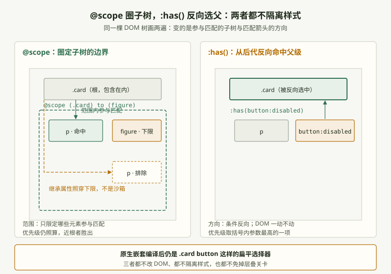

# 20 · 容器查询与现代选择器

> **前置**：[12 · 响应式](12-responsive.md)——媒体查询的分工局限；[02](02-selectors.md)——`:has()`；[21](21-rendering-performance.md) 可后读——contain 家族。
>
> 上一篇：[19](19-bfc-containing-block.md) ｜ 下一篇：[渲染与性能](21-rendering-performance.md) ｜ [教程总览](README.md)

同一张卡片，主区横排、侧栏竖排——媒体查询问不出"卡片自己多宽"，容器查询（2023 基线）补上这块拼图；配套的 `@scope` 回答另一个问题：**怎么把样式影响范围圈住**。这一章讲全 `@container`、cqw 单位、contain 家族的联动代价，与 `@scope`/`:has()` 组成的选择器矩阵。

## 容器查询：组件自己的断点

媒体查询管**骨架**，容器查询管**组件内部**——分工不是替代：

```css
.sidebar { container-type: inline-size; }          /* 1. 声明容器 */

@container card (min-width: 480px) {               /* 2. 按容器宽度切换 */
  .card { display: flex; }
  .card img { width: 40%; }
}
```

三个必懂点：

- **`container-type: inline-size`** 声明"按行内尺寸查询"。它**自带 `contain: layout style` 式的隔离**（下节展开）——机制的代价与收益同源。
- **`@container` 条件里的宽度是容器的，不是视口的**；`container-name`（容器上起名，条件里引用）解决多容器嵌套时"问谁"的问题——不匹配的名字会被跳过继续向外找。
- 容器查询还能查**样式**：`@container style(--theme: dark)`（style query，较新）——按**变量值**切换后代样式，"父级主题态驱动子组件"不用 JS。

## cqw 与它的回退陷阱

容器单位与 vw 同构，基准换成容器：`cqw`（容器宽 1%）、`cqh`、`cqi`（行内方向）。组件内字号内距终于"随容器缩放"：

```css
@container card (min-width: 480px) {
  .card h3 { font-size: clamp(1rem, 4cqi, 1.5rem); }
}
```

**一个静默陷阱**：`cqw` 系单位**在没有容器祖先时回退为小视口单位（svw）**——不报错，只是语义悄悄变了。组件脱离容器上下文复用时，"看起来正常但实际跟着屏幕缩放"。对策：组件文档写明"宿主必须声明 container-type"，或全局给布局主区统一声明。



*图 20-1 · @scope 圈定影响范围，:has() 反向选父——两者都不隔离样式*

**这张图的一句话结论：@scope 和 :has() 都是"选择器的精确化"，不是"样式隔离"。**

## contain 家族：容器查询的底层代价

`contain` 是"告诉浏览器影响范围到此为止"的优化开关，容器查询建立在其上。七个子值一张表：

| 值 | 隔离什么 | 副作用 |
| --- | --- | --- |
| `layout` | 内部布局不影响外部 | 内部成为独立布局上下文 |
| `paint` | 内部绘制不出界 | 创建层叠上下文 + 裁剪 |
| `style` | 计数器等"样式影响"不出界 | — |
| `size` / `inline-size` | 元素尺寸**不再由内容决定** | **必须显式给尺寸**，否则塌陷 |
| `strict` / `content` | 上述的组合包 | 组合副作用 |

要点：`container-type: inline-size` = 布局/样式 + inline-size 隔离——元素自身**高度仍随内容**（所以卡片不会被压塌）；而 `container-type: size` 是全尺寸隔离，**必须显式给高宽**——"设了 size 容器后内容消失"的事故就是它。`contain: paint` 顺带创建层叠上下文（第 18 篇清单又一员）。

## @scope：给选择器画个圈

```css
@scope (.card) {
  p { color: #4a5544; }          /* 只命中 .card 内的 p */
  :scope { border: 1px solid; }  /* :scope 指 .card 自身 */
  :scope > p { margin: 0; }
}
@scope (.card) to (.card-content) {  /* donut：到 .card-content 为止 */
  p { margin-block: .5em; }
}
```

`@scope` 限制**命中范围**（to 语法豁免插槽区），且带来层叠新维度——**proximity（就近优先）**：同优先级时，scope 距离目标更近者胜。澄清边界：**@scope 不隔离样式**（外部样式照样打进圈），它是"这条规则的圈"，硬隔离是 Shadow DOM（第 22 篇）。

## 常见问题

**问题 1：设了 `container-type: size` 后元素内容"消失"**
- **原因**：size 隔离让尺寸完全脱离内容，没显式给高宽时塌为 0。
- **修法**：大多数场景用 `inline-size`（高度仍随内容）；确需 size 时显式给尺寸。

**问题 2：cqw 单位"时灵时不灵"**
- **原因**：组件所在祖先链上没有声明容器时，单位回退为 svw——语义静默漂移。
- **修法**：宿主统一声明 `container-type`；组件文档标注宿主要求。

**问题 3：嵌套容器下查询命中了"错误的那层"**
- **原因**：未命名条件查"最近的祖先容器"，被中间层截胡。
- **修法**：给目标容器起名并写 `@container card (...)` 显式指名。

**问题 4：@scope 圈里的元素还是被外部样式改了**
- **原因**：@scope 只圈"自己这条规则的命中范围"，不挡外部样式（软边界）。
- **修法**：需要真隔离上 Shadow DOM；圈外冲突用优先级/@layer 解决。

**问题 5：媒体查询下的组件在弹层/侧栏里"失配"**
- **原因**：视口宽 ≠ 组件容器宽，媒体查询天生答不了。
- **修法**：组件内部改容器查询；骨架仍归媒体查询（分工模型）。

## 动手验证

[打开 demo：同一卡片在两个容器里的不同命运](../../examples/minimal/17-container-query.html)

<iframe class="demo-frame" src="/css-concept-course/examples/minimal/17-container-query.html" title="容器查询实验" loading="lazy"></iframe>

[打开实验台：:has 与 @scope 组合玩法](../../examples/modern/scope-nesting-has.html)

侧栏与主区卡片并排拖窗口——媒体查询下两张同时变，容器查询下各变各的；实验台里用 donut scope 圈出"插槽不可侵犯"范围。

## 本章要点

- 媒体查询管骨架、容器查询管组件；先 `container-type` 再 `@container`，style query 可按变量值切换。
- `cqw` 无容器祖先时**静默回退 svw**——组件宿主必须声明容器。
- `contain` 七值是容器查询的底层代价；`inline-size` 保内容高度、`size` 必须显式尺寸。
- `@scope` 圈命中范围（donut + proximity），不隔离样式；硬隔离只有 Shadow DOM。
- 选择器矩阵：嵌套管书写、`:has` 管反向、`@scope` 管范围、Shadow DOM 管硬隔离。

下一篇 [21 · 渲染与性能](21-rendering-performance.md)：layout thrashing 与帧预算。
