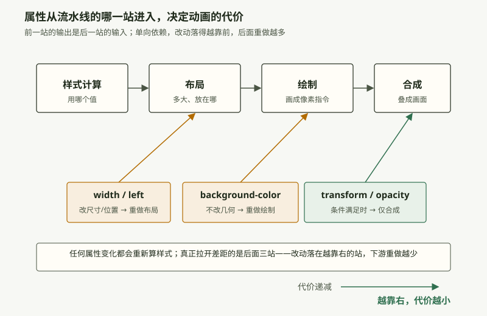

# 21 · 渲染与性能：帧预算与 layout thrashing

> **前置**：[01](01-how-css-works.md)——流水线四站；[13](13-transform-transition.md)——transform 走合成；[20](20-container-query.md)——contain 家族。
>
> 上一篇：[20](20-container-query.md) ｜ 下一篇：[架构与影响范围](22-architecture.md) ｜ [教程总览](README.md)

横向滚动的列表每项挂大阴影就掉帧，换成透明度渐隐立刻丝滑。差别在**渲染成本**。这一章把"为什么卡"变成可计算的规则：**帧预算 → 改动落点 → 合成层与内存 → JS 读写交错**，四个环节各有工具。

## 帧预算：16.7ms 里装下什么

60fps 意味着每帧只有 **16.7ms**，而这 16.7ms 要装下 JS + 样式计算 + 布局 + 绘制 + 合成的全部开销。由此推出两条硬规则：

- **布局属性动画每帧都重排**：`width/height/top/left/font-size` 动画让 Layout→Paint→Composite 全链路跑，列表稍长就爆预算。
- **transform/opacity 只走合成**：帧间只重拍照片（合成），主线程几乎不动——动画属性白名单就这两个。



*图 21-1 · 属性改动落在流水线的哪一站，决定动画的代价*

**这张图的一句话结论：动画只做 transform/opacity 就能留在合成站；动了布局属性，每帧都在重排重绘。**

## 合成层：内存账单

浏览器把"正在动"的元素提升为**独立合成层**（单独一张透明底照片），动它只重合成。提升条件：transform/opacity 动画中、`position: fixed`、`will-change` 预告、video/canvas、`contain: paint`。

**层是有内存账单的**：每层 ≈ 宽 × 高 × 4 字节（RGBA）。一个 1000×2000 的层就是 8MB——几百个"顺手提升"的元素足以把低端设备拖垮（**层爆炸**）。纪律：**只给正在动的元素提升，动完撤下**：

```css
.modal.is-opening { will-change: transform, opacity; }
/* 动画结束移除 is-opening，will-change 一并撤下 */
```

`will-change` 三纪律：只加给确实要动的、用完移除、不当护身符贴全站。

## Layout Thrashing：JS 读写交错的主线程杀手

这是 CSS 教程里最值得讲的一条 JS 性能问题——**强制同步布局（layout thrashing）**：

```js
// 反面教材：一帧内 N 次"读布局 → 写样式 → 再读布局"
items.forEach(el => {
  const top = el.getBoundingClientRect().top;   // 读：强制布局
  el.style.transform = `translateY(${top / 2}px)`; // 写：作废布局
  // 下一次读时，浏览器被迫重新布局 —— 每项都触发一次 reflow
});
```

**读布局的 API**（`offsetTop`、`getBoundingClientRect`、`getComputedStyle`…）会强制浏览器把待处理的布局立即算完；紧接着写样式又把布局"作废"。读写交错循环 N 次 = 一帧内 N 次重排。修法是**读写分批**：

```js
const tops = items.map(el => el.getBoundingClientRect().top);  // 先批量读
items.forEach((el, i) => { el.style.transform = ...; });       // 再批量写
```

或把读放到下一帧（`requestAnimationFrame`）。滚动回调里高频读布局是重灾区。

## 内容跳过与测量

- **`content-visibility: auto` + `contain-intrinsic-size`**：视口外的 section 整段跳过渲染（含样式计算），长页面/长列表的第一优化；`contain-intrinsic-size` 给预估高度防滚动条跳动。
- **测量先于优化**：DevTools Rendering 面板开 **Paint flashing**（重绘区域闪绿）、**Layout Shift Regions**（布局抖动闪蓝）；Performance 录制滚动，看每帧卡在 Layout/Paint/Composite——**卡在哪一站，优化哪一站的属性**。3D View/Layers 面板可直视合成层（第 18 篇排查共用）。

## 常见问题

**问题 1：滚动监听里改样式，越滚越卡**
- **原因**：滚动回调高频触发 + 读写交错 = 持续 thrashing。
- **修法**：回调里只记数据、渲染放 `requestAnimationFrame`；读写分批；高频计算交给 CSS（滚动驱动动画，第 26 篇）。

**问题 2：`will-change: transform` 贴满全站反而更卡**
- **原因**：层爆炸——每层占 4 字节/像素的内存，合成合并负担陡增。
- **修法**：只提升"正在动"的元素，动画结束撤类。

**问题 3：大 blur 阴影 / backdrop-filter 列表滚动掉帧**
- **原因**：绘制成本随模糊半径暴涨，滚动触发大面积重绘（第 06 篇伏笔）。
- **修法**：密集列表用小 blur 或背景分层；毛玻璃限定小面积；或 `content-visibility` 跳过屏外项。

**问题 4：动画在视口外还在耗电**
- **原因**：infinite 动画不因不可见而停（第 14 篇问题 4 的机制面）。
- **修法**：`content-visibility: auto` 跳过渲染 + IntersectionObserver 切 `animation-play-state`。

**问题 5：加了 `contain: paint` 层级突然乱了**
- **原因**：contain: paint 创建层叠上下文（第 18 篇清单）——优化开关改变层级行为。
- **修法**：给该元素显式 z-index 名次，或换个不含层叠副作用的隔离方式。

## 动手验证

[打开 demo：同一位移走不同流水线站](../../examples/minimal/25-rendering.html)

<iframe class="demo-frame" src="/css-concept-course/examples/minimal/25-rendering.html" title="渲染流水线实验" loading="lazy"></iframe>

[打开实验台：containment 对渲染的影响](../../examples/engineering/performance-containment.html)

开着 Paint flashing 对比 `translate` 与 `left` 动画的重绘区域；实验台里给长列表加 `content-visibility: auto` 看首屏渲染时间。

## 本章要点

- 60fps = 每帧 16.7ms；动画白名单 **transform/opacity**，其余每帧重排。
- 合成层有内存账单（宽×高×4 字节）——只提升正在动的元素，防层爆炸。
- **Layout thrashing：读写交错每帧 N 次重排**——批量读、批量写，或交给 CSS。
- `content-visibility: auto` 跳过屏外渲染，配 `contain-intrinsic-size`。
- `contain: paint` 有层叠副作用；先测量（Paint flashing / Performance）再优化。

下一篇 [22 · 架构与影响范围](22-architecture.md)：样式多了之后怎么不打架。
