# 22 · 架构与影响范围：让样式不打架

> **前置**：[03](03-cascade-inheritance.md)——层叠与 @layer；[15](15-custom-properties.md)——变量主题；[20](20-container-query.md)——@scope。
>
> 上一篇：[21](21-rendering-performance.md) ｜ 下一篇：[可访问性与渐进增强](23-accessibility.md) ｜ [教程总览](README.md)

样式少的阶段"能跑就行"；多了之后真正的问题浮现：**一条规则能影响谁？** `.title` 被全局污染、`!important` 军备竞赛、改一处崩三处。架构的全部目标：**约束影响范围**。这一章给从软到硬的四层工具箱（令牌 → 命名与层 → @scope → Shadow DOM），以及现代 reset 与常见事故。

## 第一层：设计令牌——把"值"收口

第 15 篇的变量升级为三层令牌体系：

```css
:root {
  /* 原始层：palette，不直接用 */
  --green-600: #3f6b2a;  --green-100: #e4ecd9;
  /* 语义层：组件只引用这一层 */
  --color-brand: var(--green-600);
  --color-surface: var(--green-100);
  --radius-md: 8px;
}
[data-theme="dark"] { --color-brand: #7cae5e; --color-surface: #1f2817; }
```

命名采用**区域-对象-属性**的语义法（`--color-text-primary`、`--space-card-inline`），而不是"颜色名直译"（`--light-green`）——换主题时语义层不变、原始层随便换，组件零改动。这是"影响范围收口"的第一步：值的变更被限定在令牌层。

## 第二层：命名与层——约束选择器

- **BEM**（`block__element--modifier`）用命名表达归属，配合**单类选择器**（优先级恒为 (0,0,1,0)）把层叠拉回"顺序与层"的平面。
- **@layer** 给排序提供官方机制，第三方与自有样式各就各位：

  ```css
  @layer reset, base, components, utilities, overrides;
  @import url(vendor.css) layer(components);
  ```

- **纪律三条**：不写 id 选择器；`!important` 只留给工具类层（`.hidden { display: none !important; }` 是正当用法）；重置用 `:where()` 零优先级（第 02 篇）保证永远可覆盖。

## 现代全局重置（modern reset）配方

```css
@layer reset {
  *, *::before, *::after { box-sizing: border-box; }        /* 尺子从边框外沿量 */
  * { margin: 0; }                                           /* 清默认间距，间距只来自 gap/margin 显式声明 */
  html { -webkit-text-size-adjust: 100%; }
  body { line-height: 1.6; -webkit-font-smoothing: antialiased; }
  img, video, canvas { display: block; max-width: 100%; }    /* 媒体防撑破 + 消图片底缝（第 19 篇） */
  input, button, textarea, select { font: inherit; color: inherit; } /* 控件继承文字环境 */
  button { background: none; border: none; cursor: pointer; } /* 按钮归白盒 */
  :where(h1, h2, h3, h4) { line-height: 1.25; }              /* :where(0)：永远可覆盖 */
}
```

这份 reset 的两条设计原则：**所有规则零优先级或单类**（不跟组件抢优先级）；**只重置"几乎必然要改"的默认**（不做过度 reset 把 UA 可用性洗掉，第 23 篇）。

## 第三层：@scope——软性圈地

`@scope (.card)` 圈定命中范围（donut 豁免插槽，第 20 篇），proximity 让"就近者胜"。适合约定式团队：圈是**声明出来的约定**，挡不住外部样式打进圈（软边界）。

## 第四层：Shadow DOM——硬隔离



*图 22-1 · Shadow DOM 边界：样式默认进不来，变量与 part 是受限通道*

**这张图的一句话结论：Shadow DOM 里外互不穿透；跨界只有变量继承与 ::part() 这些受控闸门。**

三条通道：**继承属性与自定义属性**（外→内自动传入）、**`::part(name)`**（外部精确修饰内部"报名"过的部件）、**`::slotted()`**（修饰被塞进插槽的外部元素）。组件库设计准则：内部样式自包含，暴露 `--xxx` 变量与 `part` 名作"官方旋钮"。

## 常见问题

**问题 1：第三方库样式怎么都覆盖不掉**
- **原因**：库样式与你的样式在同一层裸比优先级与顺序，库的加载顺序又不可控。
- **修法**：把库 `@import … layer(vendor)` 固定进低层，你的样式未分层或放高层——覆盖从此与书写顺序无关（第 03 篇）。

**问题 2：`!important` 越用越多，最后满屏 important**
- **原因**：用 important 解决优先级问题，对面也用 important，进入军备竞赛。
- **修法**：全局搜索清理：important 只保留在工具类层；其余改用 @layer 层次或调整选择器结构。

**问题 3：改了全局 `h2` 样式，组件里的标题全崩**
- **原因**：元素级全局规则的影响范围没有边界。
- **修法**：全局排版规则用 `:where(h2)` 降低优先级；组件内标题用类选择器覆盖；或正文排版圈进 `@scope (.prose)`。

**问题 4：深色模式切换时白屏闪一下**
- **原因**：`data-theme` 在首帧后才被 JS 设置（第 15 篇问题 3 的架构面）。
- **修法**：`<head>` 内联同步脚本先设主题 + `color-scheme` 兜底原生控件。

**问题 5：Web 组件库"完全不可定制"**
- **原因**：Shadow DOM 硬隔离挡住了一切外部选择器。
- **修法**：走官方通道——变量（若库暴露了 `--xxx`）与 `::part()`；选库时把"暴露多少 part/变量"当验收标准。

## 动手验证

[打开 demo：令牌换肤与层叠排序](../../examples/minimal/23-architecture.html)

<iframe class="demo-frame" src="/css-concept-course/examples/minimal/23-architecture.html" title="架构令牌实验" loading="lazy"></iframe>

[打开实验台：Shadow DOM 三条通道](../../examples/engineering/webcomponents.html)

换令牌看全站换装；实验台先试"外部直接选内部元素"（失败），再走变量与 `::part()`（成功）。

## 本章要点

- 架构唯一目标：**约束"一条规则能影响谁"**；四层按团队规模选配，不必堆满。
- 令牌三层 + 语义命名：值的变更收口在令牌层。
- 命名单类 + `@layer` 固定层次；reset 用 `:where(0)` 只重置"必然要改"的默认。
- `@scope` 软圈地（声明式约定），Shadow DOM 硬隔离（变量与 part 是官方旋钮）。
- 第三方进低层、important 只在工具层、主题切换 head 内先定装。

下一篇 [23 · 可访问性与渐进增强](23-accessibility.md)：样式底线与 forced-colors 模式。
