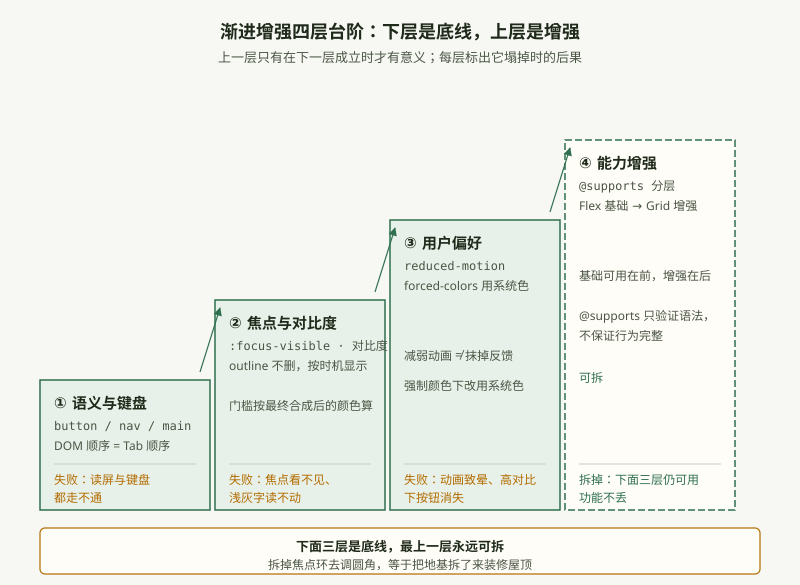

# 23 · 可访问性与渐进增强

> **前置**：[12](12-responsive.md)——媒体偏好；[08](08-display-flow.md)——隐藏三式；[22](22-architecture.md)——reset 的克制原则。
>
> 上一篇：[22](22-architecture.md) ｜ 下一篇：[表单控件与状态](24-forms.md) ｜ [教程总览](README.md)

```css
a:focus { outline: none; }
```

一行"让焦点框消失"的样式，切断了键盘用户唯一的定位手段。可访问性不是附加分，是**样式底线**；渐进增强则回答：**新特性怎么在不支持的浏览器上安全落地**。这一章给可核对的底线清单、两个容易被忽略的系统模式（forced-colors / reduced-transparency），以及 @supports 的落地姿势。

## 四条底线



*图 23-1 · 渐进增强四层台阶：下层是底线，上层是增强*

**这张图的一句话结论：先保证语义与键盘可用（台阶底层），视觉与新特性逐层增强。**

**底线一：焦点必须可见。** 自定义用 `:focus-visible`（键盘聚焦显示、鼠标点击不显示，第 02 篇），绝不裸删 outline；模态焦点进出由 JS 管理，CSS 用 `:focus-within` 做视觉搭档。

**底线二：对比度与"不只靠颜色"。** 正文与背景对比 ≥ 4.5:1（WCAG AA）；错误不只变红（配图标/文案）；链接保留下划线；`prefers-contrast: more` 时加深文字。

**底线三：动效尊重偏好。** 全局降级配方（第 14 篇）+ 一条容易被漏掉的硬指标：**闪烁频率不得超过每秒 3 次**（光敏安全，WCAG 2.2）——加载动画、警示灯都要过这道线。

**底线四：隐藏的正确姿势。** `display: none` 连语义一起移除；"视觉藏、读屏留"用 sr-only 配方：

```css
.sr-only {
  position: absolute; width: 1px; height: 1px;
  clip-path: inset(50%); overflow: hidden; white-space: nowrap;
}
```

## 两个容易被漏掉的系统模式

**forced-colors（Windows 高对比模式）**：用户开启高对比时，**浏览器几乎忽略你的全部颜色/背景/阴影**，替换为系统配色（黑底黄框白字）。页面不是"坏了"，是进入了另一个主题——需要专门适配：

```css
@media (forced-colors: active) {
  .btn { border: 1px solid ButtonBorder; }      /* 系统色关键字 */
  .card { forced-color-adjust: none; }           /* 例外：个别元素保留品牌色（如状态色徽章） */
}
```

要点：布局类样式（间距、尺寸）**不受影响**，受影响的是颜色背景；系统色关键字（`Canvas`、`CanvasText`、`ButtonBorder`、`AccentColor`…）让你跟随系统主题；`forced-color-adjust: none` 只给"颜色即语义"的元素（错误红、状态绿），别全局豁免。

**prefers-reduced-transparency**（较新）：用户要求降低透明度——毛玻璃（`backdrop-filter`）、半透明遮罩在该模式下应退回实色，与 `prefers-contrast` 一起纳入"偏好查询"清单。

## 渐进增强：@supports 的正确姿势

```css
.card { grid-template-columns: 1fr; }                 /* 基线：所有浏览器 */
@supports (grid-template-columns: subgrid) {          /* 增强：支持的加码 */
  .card { grid-template-columns: subgrid; }
}
@supports selector(:has(*)) {                          /* 选择器也能探测 */
  .card:has(img) { grid-column: span 2; }
}
```

两条原则：**基线写在 @supports 之外**（不是"默认新写法再 fallback"）；**简单增强甚至不需要 @supports**——容错解析（第 01 篇）会忽略不认识的属性，"旧属性垫底 + 新属性覆盖"写两遍即可；`@supports` 用在两种写法**结果冲突**的场景。

## 常见问题

**问题 1：`opacity: 0` 的按钮还能被点到**
- **原因**：opacity 不移除命中区域与可聚焦性（第 08 篇隐藏三式）。
- **修法**：真隐藏用 `display: none` / `visibility: hidden`；做"透明但存在"时要主动 `pointer-events: none` + `tabindex` 处理。

**问题 2：高对比模式下面板"全黑一片"**
- **原因**：forced-colors 下自定义背景被替换，元素边界（border）也被系统色覆盖。
- **修法**：给关键容器补 `border: 1px solid CanvasText` 类边界；品牌色元素用 `forced-color-adjust: none` 定点豁免。

**问题 3：用户把系统字号调大后页面布局崩坏**
- **原因**：字号用 px 锁死、或断点用 px 对用户缩放不感知。
- **修法**：字号间距用 rem/clamp（第 05 篇）；用浏览器 200% 缩放自查一遍关键页面。

**问题 4：加载动画"闪得难受"**
- **原因**：闪烁超过 3 次/秒的光敏阈值。
- **修法**：呼吸类动画周期 ≥ 0.7s 且柔和（opacity 幅度收窄）；警示状态用位移+色相缓变替代高频闪烁。

**问题 5：只有颜色能区分的表格状态**
- **原因**：红/绿状态依赖色觉。
- **修法**：状态加图形标记（icon/形状/加粗）；`prefers-contrast` 下进一步提高区分度。

## 动手验证

[打开 demo：无障碍样式检查清单实操](../../examples/minimal/24-accessibility.html)

<iframe class="demo-frame" src="/css-concept-course/examples/minimal/24-accessibility.html" title="无障碍实验" loading="lazy"></iframe>

[打开实验台：媒体偏好全览](../../examples/responsive/media-preference.html)

用 Tab 键走一遍"焦点环被删"的页面感受迷失感；系统开高对比模式实测 forced-colors 的样式替换范围。

## 本章要点

- 四条底线：焦点可见（`:focus-visible`）、对比 ≥4.5:1 且不只靠颜色、动效降级 + 闪烁 ≤3 次/秒、隐藏分三档。
- **forced-colors**：高对比模式替换你的颜色，用系统色关键字 + 定点 `forced-color-adjust: none` 适配。
- `prefers-reduced-transparency` 下毛玻璃退实色。
- 渐进增强：基线写在 @supports 外；简单增强靠容错解析写两遍。
- 用户系统字号 200% 自查是可访问性的"编译检查"。

下一篇 [24 · 表单控件与状态](24-forms.md)：appearance 放权、状态时序与 iOS 16px 缩放。
